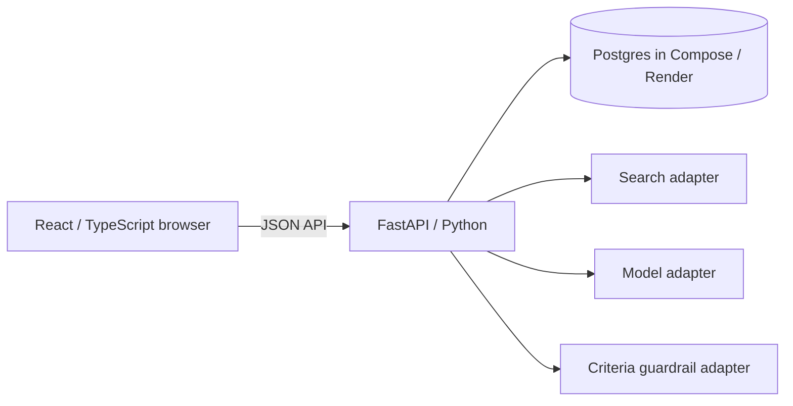
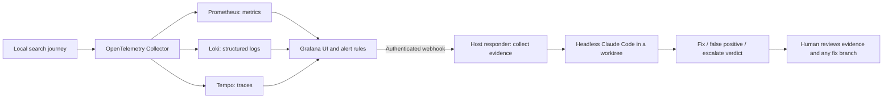

# Sail-event

Sail-event finds events from web-search results and scores them against your free-text criteria. It publishes accepted events to your personal ICS calendar feed and leaves borderline matches for you to review.


<sub>Local fixture run, captured 26 October 2026. The recorded events use October dates; this run also reports two failed event-page fetches. The funnel is visible at desktop widths.</sub>

## Try it live

Open **<https://sail-event.onrender.com>**. Account creation is open, with no invitation code. Use criteria such as *jazz concerts in Berlin next weekend*. **Search now** saves the criteria and starts a search; after a run, the button reads **Search again**. Subscribe to the **Calendar feed** URL for accepted events.

For a latency reference, [PR #144](https://github.com/alexisdacquay/sail-event/pull/144) records **86–493 seconds** per search with real adapters on a Mac, across several configurations. Those measurements are not a Render benchmark. [Run locally](#try-it) for the recorded demo.

Check the deployed commit rather than relying on a version in this document:

```bash
curl -s https://sail-event.onrender.com/api/health
```

## For reviewers

Final project for the [DataTalksClub AI Dev Tools Zoomcamp 2026](https://github.com/DataTalksClub/ai-dev-tools-zoomcamp/tree/main/project). The [reviewer guide](docs/reviewer-guide.md) quotes the rubric and maps its clauses to evidence.

**Observability, alerting and the on-call responder run locally. The deployed app exports no telemetry to that stack, so these alerts do not monitor the live sites. The recorded incidents are drills.**

| Criterion | Where to look | Quick evidence check |
|---|---|---|
| Problem description | [Guide §1](docs/reviewer-guide.md#1-problem-description) · [Problem](#problem) | Read the problem, functionality and [expected behaviour](#expected-behaviour); each behaviour links to code or a test. |
| Product specification | [Guide §2](docs/reviewer-guide.md#2-product-specification) · [PRD](_docs/plan.md) | [Issue #11](https://github.com/alexisdacquay/sail-event/issues/11) has acceptance criteria; [#7](https://github.com/alexisdacquay/sail-event/issues/7) records a FAIL, fix, PASS and closing note. |
| Agent team specification | [Guide §3](docs/reviewer-guide.md#3-agent-team-specification) · [Team](#how-it-was-built-an-agent-team) | Roles, boundaries and handoffs below; compare the prescribed cycle with #7's comments. |
| Context management | [Guide §4](docs/reviewer-guide.md#4-context-management) · [Context](#how-an-agent-gets-its-context) | [`CLAUDE.md`](CLAUDE.md) imports [`AGENTS.md`](AGENTS.md), which links the process, roles, specs and operations docs. |
| Application | [Guide §5](docs/reviewer-guide.md#5-application) · [Local run](#try-it) | [`test_data_survives_restart`][t-restart] restarts the app and checks stored data; it passed in [CI at 542e58c][ci-proof]. |
| Testing | [Guide §6](docs/reviewer-guide.md#6-testing) · [Testing](docs/testing.md) | `make test-all` runs unit, integration and browser tests; [CI at 542e58c][ci-proof] passed. Responder tests run in `make test`, outside CI. |
| Containerization | [Guide §7](docs/reviewer-guide.md#7-containerization) · [Compose](docker-compose.yml) | `docker compose up --build` starts the app and Postgres, including migrations and demo seeding. |
| Deployment | [Guide §8](docs/reviewer-guide.md#8-deployment) · [Live app](https://sail-event.onrender.com) | The health GET above returns status and deployed commit; `/api/config` reports whether registration needs a code. |
| CI/CD | [Guide §9](docs/reviewer-guide.md#9-cicd) · [Delivery](#ship-it-watch-it-fix-it) | [CI](.github/workflows/ci.yml) tests PRs to main; compare dev health with main, then inspect a manual [promote run](https://github.com/alexisdacquay/sail-event/actions/workflows/promote.yml). |
| Observability | [Guide §10](docs/reviewer-guide.md#10-observability) · [Local telemetry](observability/README.md) | Tempo and Loki show the same trace ID. Metrics lack trace IDs; HTTP spans can expose feed tokens. |
| Alerting on user impact | [Guide §11](docs/reviewer-guide.md#11-alerting-on-user-impact) · [Rules](observability/grafana/provisioning/alerting/rules.yaml) | Inspect the failed-search and silent-search rules; a drill's [`alert.json`](incident-response/incidents/20261021-074150-SearchRunFailures/alert.json) records a firing. |
| On-call agent | [Guide §12](docs/reviewer-guide.md#12-on-call-agent) · [Recorded drill](incident-response/incidents/20261021-074150-SearchRunFailures/) | Compare the firing time, evidence, verdict and [fix commit](https://github.com/alexisdacquay/sail-event/commit/8d2f839): alert to fix took 4 min 52 s. |

[Known gaps](#known-gaps) · [Quick review commands](docs/reviewer-guide.md#check-it-in-5-minutes)

## Problem

Small events are scattered across sites and feeds; no single source lists them all. Calendar aggregators collect events you already know about. A web search returns pages, not checked events in your calendar: you still have to verify dates, place and fit, copy the events you want, and repeat the search as new listings appear.

## What it does

The app parses criteria such as *jazz concerts in Berlin next weekend*, searches with that text plus the word `event`, and extracts events from the returned pages. When a listing links to an event page, it attempts to fetch and read that page too. Code screens out missing start dates or times, incomplete events, events already over at search time, and event pages already stored for the same day. A model scores the remaining events from 0–100 with a reason.

Your thresholds determine the initial status ([code][pipe-triage], [pipeline test][t-ge-le]):

| Default score | Status | Result |
|---|---|---|
| 90 or more | **In calendar** | Included in your ICS feed |
| 41–89 | **Review** | You accept or reject it |
| 40 or less | **Out** | Hidden behind the **show** toggle |

A final model check compares newly stored events with other stored events and moves duplicates to **Out**, even if their score is high ([deduplication code](backend/app/services/dedup.py)). The funnel calls Review “to review” and Out “rejected”. The scoring inputs say “above” and “below”, but the cutoffs are inclusive, as shown above.

Scheduled searches target production through an [hourly GitHub cron](.github/workflows/hourly-search.yml), not an in-app timer. On 26 October 2026, the latest 25 scheduled jobs were roughly **2–6 hours apart**; the 50-job sample included gaps up to 7.8 hours. Inspect the timestamps with:

```bash
gh run list -R alexisdacquay/sail-event --workflow hourly-search.yml --event schedule --limit 50 --json createdAt
```

Each job queues up to `MAX_SCHEDULED_USERS` users (default 50), oldest search first; others wait for a later job ([scheduler code](backend/app/routers/search.py)). A successful job confirms queuing, not completion of those background searches. Dev receives no scheduled searches.

### What it does not do

No email or push notifications, price rules, shared event library, manual score editing, or direct writes into Google Calendar. Calendar apps subscribe to the ICS feed; their refresh schedule determines when changes appear. See the [MVP scope](_docs/plan.md#out-of-scope-for-the-mvp).

## Expected behaviour

| Situation | Expected result | Evidence |
|---|---|---|
| Another user signs in | Their criteria and event list are separate | [Browser journey][j2] · [API isolation test][t-iso] |
| The same search runs twice | Only one copy of an event remains in In calendar or Review; repeat rows may exist in Out | [Integration test][t-dedup] |
| You reject an event | It stays Out after a later search; **show** still reveals it | [Rejection test][t-rej] · [Browser toggle][j-out] |
| You save thresholds | They survive a page reload | [Browser journey][j1-reload] |
| You remove an event from your calendar | Its status becomes Out and the feed omits it | [Browser action][j-remove] · [Feed test][t-feed] |
| Someone has your feed URL | They can read it without signing in; **Reset link** invalidates the old URL | [Feed router](backend/app/routers/calendar.py) · [Rotation test][t-rotate] |
| You exceed the default six manual searches per hour | The next request returns HTTP 429 with `Retry-After` | [Rate-limit test][t-429] |

The past-event filter runs during a search. Existing events remain listed after their date passes ([event listing](backend/app/routers/events.py)); the product does not continuously remove them.

## Try it

With Docker:

```bash
docker compose up --build
```

Open <http://localhost:8000>, sign in as **demo / demo**, and keep the pre-filled criteria. The search and model adapters replay recorded responses without API keys. Compose fixes the clock at 18 October 2026 so the recorded 19–21 October events remain usable. This is a canned demo; use the live app for your own criteria. For a port conflict, use `HOST_PORT=8010 docker compose up --build` and open port 8010.

| Task | Command | Requirements / result |
|---|---|---|
| Run without Docker | `make run` | Python 3.12, [uv](https://docs.astral.sh/uv/), Node 24 ([pin](.nvmrc)); SQLite backend and Vite frontend, with the same fixed demo clock |
| Run unit tests | `make test` | Python/uv and Node; backend, frontend and responder tests, no API keys or Docker |
| Run all test layers | `make test-all` | Same tools plus Docker; stops on the first failing phase |

The image serves the built frontend and API together; Compose adds Postgres with a persistent volume. See [testing](docs/testing.md), [API usage](docs/api.md) and [environment settings](docs/deployment.md).

Dev is at <https://sail-event-dev.onrender.com>. Its **demo / demo** account is shared: criteria, decisions, feed link and the per-user search limit affect everyone using it. Create your own account for isolated checks. Dev's configured clock is an environment setting; the repository alone cannot establish its live value.

## How it was built: an agent team

The team uses Claude Code: the orchestrator is the main session; PM, Engineer and QA run as subagents. The table describes their assigned responsibilities. Historical coverage and breaches are disclosed below.

| Role | Responsibility | Boundary |
|---|---|---|
| Owner (human) | Picks the next item; reviews the report; says **“merge”**, then separately **“push to prod”** for a named commit | Merge approves dev delivery; promotion requires a separate decision |
| Orchestrator | Writes agent briefs, starts roles, passes artifacts along, reports to the owner and closes on PASS; records owner-approved waivers | Must not groom, implement or perform QA itself |
| [PM](_docs/team/pm.md) | Rewrites an issue into Goal, Acceptance criteria, Out of scope and Constraints | Does not write code |
| [Engineer](_docs/team/software-engineer.md) | Implements the groomed criteria in a worktree; tests, commits and opens a PR | Does not change acceptance criteria or close the issue |
| [QA](_docs/team/qa-engineer.md) | Runs tests and checks each criterion; posts `## QA: PASS` or `## QA: FAIL` | Does not edit files or close the issue |

```mermaid
sequenceDiagram
    actor Owner
    participant O as Orchestrator
    participant PM
    participant E as Engineer
    participant QA
    participant GH as GitHub / CI
    participant R as Render
    Owner->>O: Pick issue
    O->>PM: Brief + issue + role file
    PM-->>O: Groomed issue body
    O->>E: Brief + groomed issue
    E->>GH: Commits + PR + implementation note
    GH-->>O: CI results
    O->>QA: Issue + PR + verification brief
    QA-->>O: FAIL with criterion and evidence
    O->>E: Return findings
    E->>GH: Fix commits; CI reruns
    O->>QA: Re-check
    QA-->>O: PASS with evidence
    O->>Owner: PR, green CI and QA PASS
    Owner->>O: "merge"
    O->>GH: Merge PR; close issue or use Closes #N
    GH->>R: Main update triggers dev deploy
    Owner->>O: Later: "push to prod" for named commit
    O->>GH: Dispatch promote workflow
    GH->>R: Deploy commit; verify prod health
```

The issue carries the PM's criteria. The PR and implementation comment carry the engineer's work. QA's verdict records one result per criterion and the test command/output. The orchestrator reports these to the owner in chat. Closing is either an orchestrator action or GitHub's `Closes #N` handling on merge. [Issue #7](https://github.com/alexisdacquay/sail-event/issues/7) shows the FAIL → password-leak fix → PASS → close loop.

For bug fixes, the root-cause gate requires a causal explanation before editing, a regression test committed while failing, then a fix that passes the unchanged test. This entered the [role files on 25 October 2026](https://github.com/alexisdacquay/sail-event/commit/c0f83e6); it is not a claim about all earlier work.

On **26 October 2026**, **58 of 96 issues** had all four grooming sections, **69** had a QA verdict heading, **23** had a FAIL heading, and **30 of 56 PRs** had a verdict heading. These counts measure headings, not complete adherence to the process. [Process evidence](_docs/process.md#evidence-it-ran-this-way) gives the reproducing `gh issue list` / `gh pr list` commands and exceptions.

Agents used the owner's GitHub login. Comment headings sometimes identify the role; early fix comments do not reliably identify which agent made the change. See [attribution](_docs/process.md#who-wrote-a-comment) and [known gaps](#known-gaps).

### How an agent gets its context

1. **Repository entry:** [`CLAUDE.md`](CLAUDE.md) imports [`AGENTS.md`](AGENTS.md), the project summary, rules and index into modular docs.
2. **Role and task:** the orchestrator writes a brief naming the issue, role file, relevant docs, scope and expected response. PM loads the [task template](_docs/task-template.md) and PRD; Engineer loads architecture and contract as needed; QA loads criteria and the work to verify. The role file is a referenced instruction, not the whole launch prompt.
3. **Independent verification:** new subagents have their own context. QA is instructed to verify against running code; re-checks sometimes returned to the same QA agent. The runnable [QA agent definition](.claude/agents/qa-engineer.md) reads its role and process files. Its Bash access means “no edits” relies on instructions and a clean-tree check, not a filesystem restriction.
4. **Resume and specialist work:** [`work/STATE.md`](work/STATE.md) carries cross-session state; [skills](.claude/skills/) supply procedures when needed. The issue and PR retain handoff evidence outside the agent's context.

In the main clone, [`make hooks`](Makefile) installs the shared pre-commit hook. It runs `make test` for changes under the code directories; `SKIP_HOOK_TESTS=1` bypasses that test gate. It does not establish that every commit was tested.

## How it is built: the stack



[Frontend](frontend/package.json): React, Vite and Tailwind. [Backend](backend/pyproject.toml): FastAPI, SQLAlchemy, Alembic and icalendar. [`openapi.yaml`](openapi.yaml) defines the API; CI lints it and a [contract test](backend/tests/test_schema_contract.py) compares paths, methods and operation IDs with the backend.

`SEARCH_PROVIDER`, `LLM_PROVIDER` and `GUARDRAIL` select adapters ([factory](backend/app/adapters/factory.py)). Search supports Exa, Tavily, Brave and fixtures; models support recorded responses and an OpenAI-compatible endpoint. Compose uses Postgres 18; `make run` defaults to SQLite. [Architecture](_docs/architecture.md) covers the components and [deployment settings](docs/deployment.md) cover hosted configuration.

## Ship it, watch it, fix it

### CI/CD and promotion

1. **PR:** [CI](.github/workflows/ci.yml) runs backend and frontend tests, builds the UI and lints OpenAPI. After those jobs pass, it starts Compose/Postgres and runs integration and Playwright tests. The same workflow runs on pushes to main.
2. **Merge → dev:** after the owner's “merge”, a main update triggers Render's dev deployment. That setting lives in Render, as recorded in [deployment.md](docs/deployment.md); it does not wait for the new main CI run. Compare dev's health commit with main:

   ```bash
   curl -s https://sail-event-dev.onrender.com/api/health
   git ls-remote https://github.com/alexisdacquay/sail-event refs/heads/main
   gh run list -R alexisdacquay/sail-event -b main -L 3
   ```

3. **Dev → prod:** the owner checks dev and says “push to prod” for a commit. The manual [promote workflow](.github/workflows/promote.yml) deploys the supplied full SHA (or its workflow commit if omitted) and waits for prod health to return that SHA. It checks health and identity, not the user journey. The intended path is manual promotion; a Render environment change also redeployed prod on 20 October ([deployment record](work/STATE.md)).
4. **Rollback:** selecting an older SHA in that workflow is an untested path across the three migrations introduced in PRs #128 and #150. PR #150's [date-only event deletion](backend/alembic/versions/f5a6b7c8d9e0_cleanup_events_without_start_time.py) is irreversible; a code rollback cannot restore deleted data. Back up the database before promotion and assess schema compatibility separately. See [release procedure](docs/release-process.md#rollback).

For recorded passing tests, inspect [CI at 542e58c][ci-proof]; reproduce locally with `make test-all`. CI does not run the responder unit tests. Green Playwright output includes expected failures for open issues and screenshot-generation tests ([test details](docs/testing.md)).

### Local observability, alerting and on-call

**This is a local stack, not monitoring for prod or dev.** The deployed app exports no telemetry to it. [`make up-all`](Makefile) starts the app, database and observability services; the responder is a separate host process.



Start the stack, run the local demo search, and allow about 60 seconds for the default metrics export interval:

```bash
export RESPONDER_WEBHOOK_SECRET=local-drill-secret
make up-all
```

Open Grafana at <http://localhost:3001>, dashboard **Sail-event — Search Run Journey** (anonymous Admin access). Logs and traces share a trace ID; inspect traces through **Explore → Tempo**, since the dashboard trace panel errors. The rubric asks for “metrics, traces, and structured logs that share a trace ID”; metrics have no trace ID/exemplars here. HTTP spans also expose calendar-feed tokens, so the “no customer data or credentials” requirement is not met. [Telemetry details and screenshots](observability/README.md) document the signals and remaining exposure.

The [rules](observability/grafana/provisioning/alerting/rules.yaml) check failed search runs (`increase` over 10 minutes > 1, held for 5 minutes) and silence (increase over 2 hours < 1, held for 10 minutes). Both are evaluated per metric series. Silence has `noDataState: OK`; it cannot detect every no-data failure. There is no local scheduler, and its two-hour window does not match the live job's observed cadence.

In another terminal, `make responder` uses the same exported secret. A firing critical alert routes to its webhook, which collects metrics, health and recent commits and attempts a Loki query. It launches `claude -p` in a git worktree with a $1 budget and a 300-second timeout. The agent is instructed to test and commit a fix on `incident/<id>`, or return a false-positive/escalation verdict. Its tool allowlist contains no push command; Read and Edit are not restricted to worktree paths ([responder](incident-response/responder.py)). Runtime limits come from this code; `autonomy-policy.yaml` is descriptive and is not loaded.

Two recorded **drills** injected faults on local branches: [17 October](incident-response/incidents/20261017-052050-SearchRunFailures/) and [21 October 2026](incident-response/incidents/20261021-074150-SearchRunFailures/). In the latter, Grafana fired at **07:41:20 UTC** and the agent's [fix](https://github.com/alexisdacquay/sail-event/commit/8d2f839) was committed at **07:46:12 UTC**. The evidence named the injected fault in a commit message; its Loki query returned no logs. This proves the alert-to-fix drill, not diagnosis of an unlabelled production fault.

To repeat the drill, follow the [on-call instructions](incident-response/README.md). The script needs Docker and a signed-in Claude CLI, creates a fault branch/commit in the clone, and can spend up to $1. Run it from a normal terminal outside Claude Code. `--dry-run` skips the model and checks alert → webhook → evidence → worktree only.

## All the docs

Start with the [reviewer guide](docs/reviewer-guide.md). [`AGENTS.md`](AGENTS.md) indexes product, process and operations docs. For implementation and verification, use the [PRD](_docs/plan.md), [process](_docs/process.md), [testing](docs/testing.md), [release procedure](docs/release-process.md), [observability](observability/README.md) and [on-call guide](incident-response/README.md). The [AI usage report](docs/ai-usage-report.md) and [operations/security report](docs/operations-and-security-report.md) discuss the development record.

## Status

Prod is the manually promoted release; dev follows main. The health endpoints above identify the code actually running. Screenshots here show the local recorded demo, not live search results.

### Known gaps

- **Process coverage:** 38 of the 96 issues lacked the four-section groom on 26 October. Items closed without a QA verdict include #139 and #142; PR #144 merged after QA FAILs with no written waiver. The orchestrator edited or re-checked work itself on #39, #52 and #55, then closed without a fresh QA PASS. Direct pushes to main continued alongside PRs; main has no branch protection. PRs [#31](https://github.com/alexisdacquay/sail-event/pull/31) and [#138](https://github.com/alexisdacquay/sail-event/pull/138) merged with a failing integration check. [Process evidence and counting commands](_docs/process.md#evidence-it-ran-this-way).
- **Rules evolved:** role/process docs began on [16 October 2026](https://github.com/alexisdacquay/sail-event/commit/98f3cf7). Owner control of next-item selection and prod promotion was recorded on 21 October ([handover](work/STATE.md)); the bug-fix regression gate entered role files on 25 October and the process summary on [26 October](https://github.com/alexisdacquay/sail-event/commit/ac54483). These are dated rules, not universal historical guarantees.
- **Search quality:** discovery is incomplete and model judgments can be wrong. A [local recall run](work/RECALL.md) at `ab21641` on 24 October found 3 of 38 ground-truth events; that is an older measurement, not a result for the current event-page pipeline. Criteria without a place may still auto-accept events ([#101](https://github.com/alexisdacquay/sail-event/issues/101)).
- **Delivery:** dev deploys without waiting for main CI; responder tests are outside CI. Rollback across the three new migrations is untested, and PR #150's deletion is irreversible.
- **Operations:** telemetry and alerts are local only. Metrics lack trace IDs; feed tokens and provider exception text can reach telemetry; the collector reads other container logs too. The trace dashboard panel errors, the recorded evidence's Loki query was empty, and the on-call runs were injected-fault drills. The agent's reported test total does not match the suite. The two-hour silence rule needs reassessment before monitoring the live schedule.

The [reviewer guide's gap list](docs/reviewer-guide.md#known-gaps) gives further detail, including open UI issues, incomplete issue labels, comment attribution and responder limits.

[pipe-triage]: https://github.com/alexisdacquay/sail-event/blob/542e58cb0fe73065a905febec7637bfa377a77c4/backend/app/services/pipeline.py#L736-L750
[t-ge-le]: https://github.com/alexisdacquay/sail-event/blob/542e58cb0fe73065a905febec7637bfa377a77c4/backend/tests/test_pipeline.py#L306-L323
[t-rej]: https://github.com/alexisdacquay/sail-event/blob/542e58cb0fe73065a905febec7637bfa377a77c4/backend/tests/test_events.py#L150-L165
[t-iso]: https://github.com/alexisdacquay/sail-event/blob/542e58cb0fe73065a905febec7637bfa377a77c4/backend/tests/integration/test_integration.py#L135-L162
[t-dedup]: https://github.com/alexisdacquay/sail-event/blob/542e58cb0fe73065a905febec7637bfa377a77c4/backend/tests/integration/test_integration.py#L103-L129
[t-feed]: https://github.com/alexisdacquay/sail-event/blob/542e58cb0fe73065a905febec7637bfa377a77c4/backend/tests/test_calendar.py#L112-L132
[t-rotate]: https://github.com/alexisdacquay/sail-event/blob/542e58cb0fe73065a905febec7637bfa377a77c4/backend/tests/test_calendar.py#L255-L269
[t-429]: https://github.com/alexisdacquay/sail-event/blob/542e58cb0fe73065a905febec7637bfa377a77c4/backend/tests/test_guardrails.py#L404-L417
[t-restart]: https://github.com/alexisdacquay/sail-event/blob/542e58cb0fe73065a905febec7637bfa377a77c4/backend/tests/integration/test_integration.py#L254-L301
[j1-reload]: https://github.com/alexisdacquay/sail-event/blob/542e58cb0fe73065a905febec7637bfa377a77c4/e2e/journeys.spec.ts#L60-L67
[j2]: https://github.com/alexisdacquay/sail-event/blob/542e58cb0fe73065a905febec7637bfa377a77c4/e2e/journeys.spec.ts#L158-L182
[j-out]: https://github.com/alexisdacquay/sail-event/blob/542e58cb0fe73065a905febec7637bfa377a77c4/e2e/journeys.spec.ts#L94-L101
[j-remove]: https://github.com/alexisdacquay/sail-event/blob/542e58cb0fe73065a905febec7637bfa377a77c4/e2e/journeys.spec.ts#L103-L107
[ci-proof]: https://github.com/alexisdacquay/sail-event/actions/runs/40251535674
