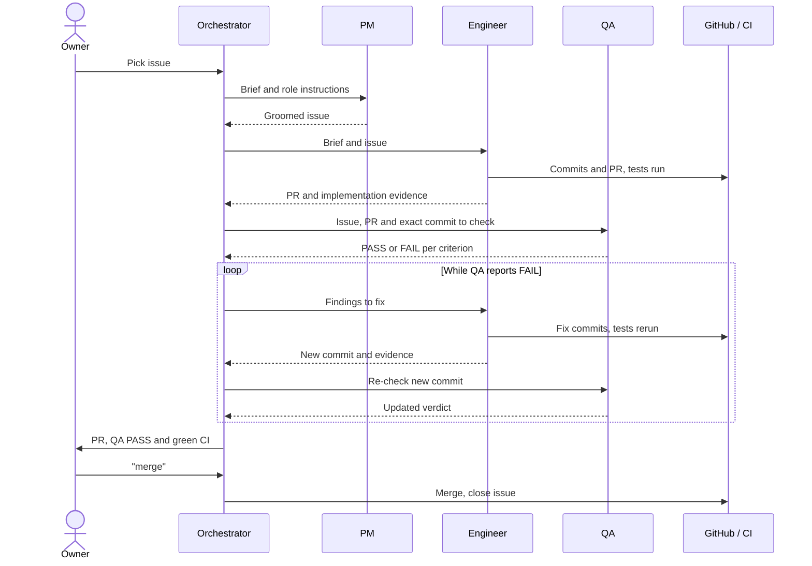
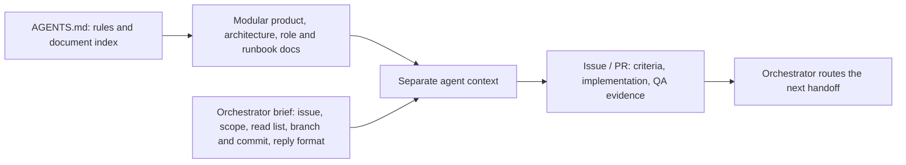
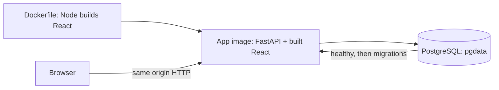
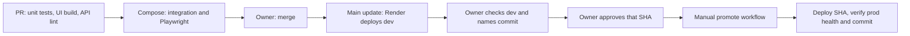
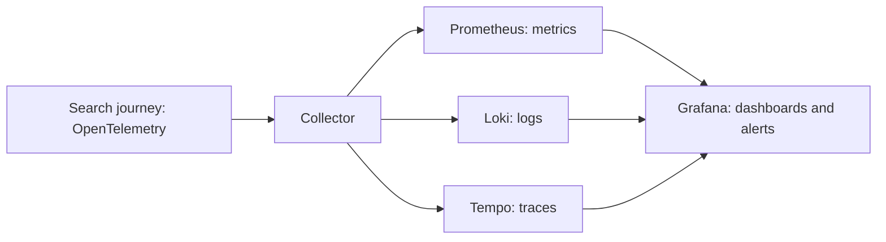
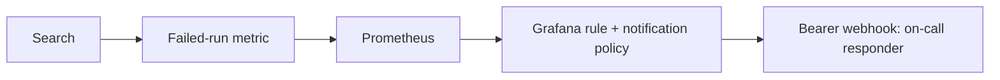
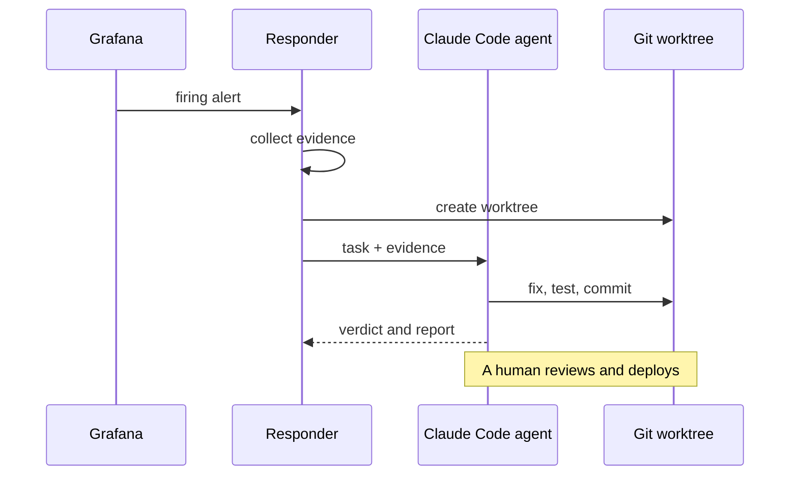

# Sail-event

**Write the events you want in one sentence. Sail-event searches the web, checks and scores each event, and puts the good ones in your calendar.**


<sub>The main page after a search (local demo).</sub>

## Try it live

- Open **<https://sail-event.onrender.com>** and register. Registration is open, with no invite code.
- Type what you want, e.g. *jazz concerts in Berlin next weekend*, and press **Search now**. A live search takes a few minutes.
- Good matches go to your calendar feed. Borderline ones wait for you under **Review**.

## How this page is organised

This is the final project for the [DataTalksClub AI Dev Tools Zoomcamp 2026](https://github.com/DataTalksClub/ai-dev-tools-zoomcamp/tree/main/project). There is one section for each review criterion. Each section says what it covers, what we built, and how to check it, with one click per proof.

1. [Problem description](#1-problem-description)
2. [Product specification](#2-product-specification)
3. [Agent team](#3-agent-team-specification)
4. [Context management](#4-context-management)
5. [Application](#5-application)
6. [Testing](#6-testing)
7. [Containerization](#7-containerization)
8. [Deployment](#8-deployment)
9. [CI/CD](#9-cicd)
10. [Observability](#10-observability)
11. [Alerting on user impact](#11-alerting-on-user-impact)
12. [On-call agent](#12-on-call-agent)

<details>
<summary><b>Check it in 5 minutes</b>: read-only commands; they need curl, git and the GitHub CLI</summary>

```bash
# §8: the live app answers and reports its deployed commit
curl -fsS --max-time 20 https://sail-event.onrender.com/api/health
# §9: dev runs the head of main
curl -fsS --max-time 20 https://sail-event-dev.onrender.com/api/health
git ls-remote https://github.com/alexisdacquay/sail-event refs/heads/main
# §6: the latest CI runs on main
gh run list -R alexisdacquay/sail-event --workflow=ci.yml -b main -L 3
# §3: one PR with every role's record: engineer report, QA verdict per criterion, merge
gh pr view 151 -R alexisdacquay/sail-event --comments
```

With a clone: `python3 -I incident-response/test_responder.py` runs the on-call responder's tests without starting an agent.
</details>

## 1. Problem description

*Covers: the problem · what the system does · the expected behaviour.*

### Problem

- **Scattered:** small events are spread across many sites.
- **Incomplete:** aggregators only know their own sources.
- **Manual:** a web search gives pages, not events. You still check dates, copy events into your calendar, and repeat the search every day.

### What it does

1. **Search:** sends your sentence to a web search, on demand (**Search now**) and on a schedule.
2. **Read:** extracts events from each page and opens each event's own page.
3. **Screen:** drops events with no date or start time, events already over, and events already stored.
4. **Score:** a model scores each event 0–100 against your sentence and gives a reason.
5. **Triage:** sorts by your own thresholds ([the triage code][triage]):
   - 90 or more: **In calendar**;
   - 41–89: **Review**, where you decide;
   - 40 or less: **Out**.
6. **Deduplicate:** a model check moves duplicates to Out ([the dedup stage][dedup]).
7. **Publish:** accepted events go to your private calendar feed (ICS), which any calendar app can subscribe to.

Thresholds are per user. New accounts start at 90 and 40 ([the registration defaults][auth]).

### Expected behaviour

Each row is proved by an automated test.

| When | Then | Proved by |
|---|---|---|
| Another user signs in | They see only their own sentence, events and feed | [Isolation test][t-iso] |
| The same search runs twice | No event appears twice in your calendar or Review list | [Duplicate test][t-dedup] |
| A score lands exactly on a threshold | 90 goes to the calendar, 40 goes Out | [Threshold test][t-triage] |
| You reject an event | It stays out after later searches and leaves your feed | [Rejection test][t-rej] · [feed test][t-feed] |
| You save thresholds | They survive a reload and apply to the next search | [Browser test][j1-reload] |
| You reset your feed link | The old link stops working | [Rotation test][t-rotate] |

Out of scope: notifications, and writing directly into Google Calendar ([MVP scope](_docs/plan.md#out-of-scope-for-the-mvp)).


## 2. Product specification

*Covers: a written specification · a public task tracker · tasks that define acceptance criteria · evidence that the agents used the tracker.*

- **Specification:** [the PRD](_docs/plan.md) (what and why), [the search quality spec](_docs/search-spec.md) and [the API contract](openapi.yaml). The PRD came first: it is dated 2026-10-15, a day before the first backend code.
- **Public tracker:** [GitHub Issues](https://github.com/alexisdacquay/sail-event/issues?q=is%3Aissue). Issues 1–28 come from [the original task list](_docs/outdated/tasks.md).
- **Acceptance criteria:** the PM writes each task in four parts: Goal, Acceptance criteria, Out of scope, Constraints ([the template](_docs/task-template.md)). For a full example, open [issue #11](https://github.com/alexisdacquay/sail-event/issues/11). Among issues #1–#152, 91 name acceptance criteria and 58 use all four parts.
- **Agents used it:** 69 issues carry a QA verdict, and QA sent work back on 23 of them. Issue #11 keeps the PM's rewrite (see **edited**), the engineer's report and QA's verdict per criterion.

The counts are a snapshot taken on 2026-10-26. To reproduce them, run the script in [process evidence](_docs/process.md#evidence-it-ran-this-way).

## 3. Agent team specification

*Covers: the roles · what each one is responsible for · the process · how they work together.*

<a id="how-it-was-built-an-agent-team"></a>

One human owner and four AI roles, all running on Claude Code. The owner decides; the agents do the work and check each other.

| Role | Does | Never does |
|---|---|---|
| Owner (human) | Picks the next item, says "merge", approves each prod release | Write the code |
| Orchestrator (main session) | Briefs each agent, passes the work along, reports to the owner, closes the issue | Specify, code or test |
| [PM](_docs/team/pm.md) | Turns an issue into Goal, Acceptance criteria, Out of scope and Constraints | Code |
| [Engineer](_docs/team/software-engineer.md) | Builds it on its own branch, tests it and opens a PR | Change the criteria, merge or close |
| [QA](_docs/team/qa-engineer.md) | Checks the exact commit against each criterion; passes it or sends it back | Edit any file, merge or close |

How they work together:

- **Every handoff leaves a record on GitHub:** the PM's criteria in the issue, the engineer's PR and report, QA's verdict per criterion.
- **QA is independent.** Its [agent definition](.claude/agents/qa-engineer.md) says "start fresh": read the criteria, run the code, don't trust the engineer's report. It sends work back when a criterion fails.
- **Bug fixes start with a failing test** that proves the cause. The fix must make that test pass.
- **The owner holds the gates.** Nothing merges, and nothing reaches prod, without the owner's word.

**See the team at work:**

- [Issue #7](https://github.com/alexisdacquay/sail-event/issues/7): the engineer delivered, QA rejected the first version, the engineer fixed it, QA re-checked and passed it, and the orchestrator closed the issue.
- [PR #151](https://github.com/alexisdacquay/sail-event/pull/151): the engineer's root-cause report, then three QA rounds with a verdict on every criterion, then the merge on the owner's word.



The cycle, step by step:

1. **Owner picks** the next issue. The orchestrator starts the PM with [its role file](_docs/team/pm.md), the issue and the template. The PM rewrites the issue into the four parts.
2. **Engineer builds** on its own branch, within scope, and opens a PR with a report. If a criterion looks wrong, it says so in a comment; it never rewrites the criteria.
3. **CI runs** on the PR.
4. **QA checks** the exact commit, criterion by criterion, and posts PASS or FAIL. It edits no files.
5. **On FAIL**, the findings go back to the engineer, and QA re-checks the new commit. A criterion that can't be met goes to the owner, who decides.
6. **The owner merges**, and dev deploys. Prod needs a second, separate approval for a named commit.

For how each agent is started, a real brief and every handoff, read [the process doc](_docs/process.md).

## 4. Context management

*Covers: AGENTS.md describes the project · it points to modular docs (process, team roles, product, operations).*

- **[AGENTS.md](AGENTS.md)** opens with what the project does, then lists the rules and indexes every doc. [`CLAUDE.md`](CLAUDE.md) loads it into every Claude Code session.
- **Modular docs**, each linked from [AGENTS.md's document list](AGENTS.md#documents):
  - `_docs/`: what to build and how the team works (PRD, architecture, process, role files);
  - `docs/`: how to run, test, ship and operate it.
- **The brief:** the orchestrator gives each agent its role file, the issue, a read list, the scope and the reply format ([see a real brief](_docs/process.md#how-the-orchestrator-starts-an-agent)). QA's agent definition reads its role file, then the process.
- **Memory across sessions:** [`work/STATE.md`](work/STATE.md) records the work in flight, the decisions and the next action. A new session reads its top block and carries on. Repeatable procedures live in [skills](.claude/skills/).
- **The on-call agent** gets its own context: a task file plus an evidence packet ([see §12](#12-on-call-agent)).



## 5. Application

*Covers: a frontend that talks to the backend · data that persists in a database · one command to run it locally.*

- **The stack:** React and TypeScript, then FastAPI, then Postgres (SQLite for `make run`). [`openapi.yaml`](openapi.yaml) is the API contract, and [a contract test][contract] keeps code and contract in step. See [the architecture](_docs/architecture.md).
- **End to end:** [the browser journey][journey] registers, saves a sentence, sets thresholds, searches, decides and reloads. [The HTTP journey][integration] does the same through the API.
- **Data persists:** [the restart test][t-restart] restarts the app and finds the stored events still there.
- **The frontend talks to the real backend:** the built image uses the HTTP client on the same origin, not the mock ([client selection][client]).

<a id="try-it"></a>

**Run it locally**, with one command:

```bash
docker compose up --build
```

- Open <http://localhost:8000>, log in as **demo / demo**, keep the pre-filled sentence and press **Search now**. Search and model answers are recorded, so no API keys are needed.
- Without Docker: `make run`.

## 6. Testing

*Covers: unit tests · integration tests · one command runs them · they pass.*

- **Unit:** [backend tests](backend/tests/) (pytest) and frontend tests (Vitest) beside their components.
- **Integration:** HTTP tests against the running container and Postgres, including the restart ([the integration suite][integration]). Browser tests use Playwright.
- **One command:** `make test-all` runs unit, integration and browser tests ([the Makefile][makefile]).
- **They pass:** `make test-all` exited 0 on 2026-10-26, with the code of `542e58c`:

```text
Backend:     507 passed, 4 skipped
Frontend:    117 passed
Responder:   20 tests OK
Integration: 7 passed, including test_data_survives_restart
Playwright:  12 passed
```

CI runs the same suites on every PR. [See a green CI run][ci-proof]. How the suites are set up: [testing](docs/testing.md).

## 7. Containerization

*Covers: the full system, including its database, starts with one Docker Compose command.*

- **One image** builds React and serves it from FastAPI ([the Dockerfile][dockerfile]).
- **Compose** adds Postgres 18 with a health check and a named volume ([the Compose file][compose]).
- **One command,** `docker compose up --build`, starts everything. The database becomes healthy, then migrations and the demo seed run by themselves.
- CI starts this same Compose stack before its integration and browser tests.
- `make up-all` adds the observability stack ([see §10](#10-observability)).



## 8. Deployment

*Covers: the app is deployed and reachable at a public URL.*

- **Live:** <https://sail-event.onrender.com>. Anyone can register.
- **Health:** `curl -fsS https://sail-event.onrender.com/api/health` returns the status and the deployed commit.
- **Two environments:** separate dev and prod services, each with its own database ([deployment](docs/deployment.md#services)).

## 9. CI/CD

*Covers: CI runs the tests · CD deploys to dev · a manual deploy to production.*



- **CI** runs on every PR and every push to main ([the CI workflow][ci]).
- **CD to dev:** every merge to main deploys dev on Render ([the deployment log](work/DEPLOY-render.md#devprod-split-issue-21-started-2026-10-17)). Dev's `/api/health` reports the head of main.
- **Manual deploy to prod:** [the promote workflow][promote] only runs when someone starts it. It deploys the named commit, then waits until prod's `/api/health` reports that exact commit. Open [its run history](https://github.com/alexisdacquay/sail-event/actions/workflows/promote.yml) to see each release. The steps are in [the release procedure](docs/release-process.md).

## 10. Observability

*Covers: a key user journey (the search) instrumented with metrics, traces and structured logs · logs and traces that share a trace ID · signals collected, stored and viewable in Grafana.*



- **The journey:** `POST /api/search` runs inside a `search_run` span, with one span per stage: search, extract, event-page hop, filter, judge, triage, dedup, persist ([the pipeline][pipeline]).
- **Metrics:** run count, duration, event counts, and provider and model activity ([metric definitions][metrics]).
- **Structured logs:** each record is JSON, with timestamp, level, logger, message, trace ID and span ID ([the log formatter][logging]).
- **One trace ID:** a search's completion log in Loki and its trace in Tempo show the same trace ID (see below).
- **Collected, stored, viewable:** the [collector](observability/collector.yaml) feeds Prometheus, Loki and Tempo, and Grafana shows them all. The [dashboard](observability/dashboard.json) has environment and version selectors, stage counts and run-duration percentiles.

**Run it locally:**

```bash
export RESPONDER_WEBHOOK_SECRET=local-drill-secret
make up-all
```

Run a search at <http://localhost:8000>, then open Grafana at <http://localhost:3001>, dashboard **Sail-event — Search Run Journey**. In **Explore**, the query `{service_name="sail-event-backend"} |= "search run completed"` finds the log line, and its trace ID opens the trace in Tempo. More: [what is collected](observability/README.md).

One search, followed from its log to its trace (trace ID `9da6b9bd797b3bdc96b17585867e9f6f`, local run, 2026-10-25):

| Tempo trace | Loki log |
|---|---|
|  |  |

## 11. Alerting on user impact

*Covers: alerts on what users feel, not on CPU.*

- **`SearchRunFailures`** fires when searches keep failing: more than one failed run in 10 minutes, for 5 minutes ([the alert rules][rules]).
- **`SearchRunsSilent`** fires when no search has run for 2 hours.
- **It fired:** in the 21 October drill, `SearchRunFailures` fired and its alert was saved ([the alert](incident-response/incidents/20261021-074150-SearchRunFailures/alert.json)).
- **Routed:** a critical alert goes through [the notification policy](observability/grafana/provisioning/alerting/policies.yaml) to [an authenticated webhook](observability/grafana/provisioning/alerting/contactpoints.yaml), which wakes the on-call agent. Each rule links its runbook.



## 12. On-call agent

*Covers: an agent wakes up on an alert and fixes the issue.*

How it works ([the responder][responder]):

1. Grafana sends the firing alert to the responder's webhook, which checks the Bearer secret.
2. The responder saves the alert and collects evidence: error metrics, logs, health and recent commits.
3. It starts headless Claude Code in its own worktree, with [the task](incident-response/responder-task.md) and the evidence packet.
4. The agent investigates, tests and commits a fix on an incident branch, then writes a verdict: fixed, false positive, or escalate.
5. The responder files the report and verdict with the incident. A human reviews the branch and deploys it.

Guard rails: a $1 budget, a 5-minute limit, no push rights, and its own worktree ([the tool list][responder-tools] · [the launch flags][responder-launch]).

**The drill on 21 October:** a test script broke the search provider (`3d9f6b8`), and then:

- the alert fired at **07:41:20 UTC**;
- the agent committed the fix (`8d2f839`) at **07:46:12 UTC**;
- that is **4 min 52 s** from alert to fix.

The incident record holds the [alert, evidence, verdict and fix](incident-response/incidents/20261021-074150-SearchRunFailures/). An earlier drill, on [17 October](incident-response/incidents/20261017-052050-SearchRunFailures/), fixed a broken scorer the same way.



To repeat the drill, follow [the on-call guide](incident-response/README.md).

## All the docs

[AGENTS.md](AGENTS.md) indexes every doc. The main ones:

- [PRD](_docs/plan.md)
- [Architecture](_docs/architecture.md)
- [Process](_docs/process.md)
- [Testing](docs/testing.md)
- [Deployment](docs/deployment.md)
- [Release procedure](docs/release-process.md)
- [Observability](observability/README.md)
- [On-call](incident-response/README.md)

[triage]: https://github.com/alexisdacquay/sail-event/blob/542e58cb0fe73065a905febec7637bfa377a77c4/backend/app/services/pipeline.py#L737-L750
[dedup]: https://github.com/alexisdacquay/sail-event/blob/542e58cb0fe73065a905febec7637bfa377a77c4/backend/app/services/pipeline.py#L547-L556
[auth]: https://github.com/alexisdacquay/sail-event/blob/542e58cb0fe73065a905febec7637bfa377a77c4/backend/app/routers/auth.py#L100-L101
[t-triage]: https://github.com/alexisdacquay/sail-event/blob/542e58cb0fe73065a905febec7637bfa377a77c4/backend/tests/test_pipeline.py#L306-L323
[t-rej]: https://github.com/alexisdacquay/sail-event/blob/542e58cb0fe73065a905febec7637bfa377a77c4/backend/tests/test_events.py#L150-L165
[t-iso]: https://github.com/alexisdacquay/sail-event/blob/542e58cb0fe73065a905febec7637bfa377a77c4/backend/tests/integration/test_integration.py#L135-L162
[t-dedup]: https://github.com/alexisdacquay/sail-event/blob/542e58cb0fe73065a905febec7637bfa377a77c4/backend/tests/integration/test_integration.py#L103-L129
[t-feed]: https://github.com/alexisdacquay/sail-event/blob/542e58cb0fe73065a905febec7637bfa377a77c4/backend/tests/test_calendar.py#L112-L132
[t-rotate]: https://github.com/alexisdacquay/sail-event/blob/542e58cb0fe73065a905febec7637bfa377a77c4/backend/tests/test_calendar.py#L255-L269
[t-restart]: https://github.com/alexisdacquay/sail-event/blob/542e58cb0fe73065a905febec7637bfa377a77c4/backend/tests/integration/test_integration.py#L254-L301
[j1-reload]: https://github.com/alexisdacquay/sail-event/blob/542e58cb0fe73065a905febec7637bfa377a77c4/e2e/journeys.spec.ts#L60-L67
[journey]: https://github.com/alexisdacquay/sail-event/blob/542e58cb0fe73065a905febec7637bfa377a77c4/e2e/journeys.spec.ts#L31-L115
[integration]: https://github.com/alexisdacquay/sail-event/blob/542e58cb0fe73065a905febec7637bfa377a77c4/backend/tests/integration/test_integration.py#L37-L97
[client]: https://github.com/alexisdacquay/sail-event/blob/542e58cb0fe73065a905febec7637bfa377a77c4/frontend/src/services/api.ts#L67-L71
[contract]: https://github.com/alexisdacquay/sail-event/blob/542e58cb0fe73065a905febec7637bfa377a77c4/backend/tests/test_schema_contract.py
[makefile]: https://github.com/alexisdacquay/sail-event/blob/542e58cb0fe73065a905febec7637bfa377a77c4/Makefile#L25-L32
[ci-proof]: https://github.com/alexisdacquay/sail-event/actions/runs/40251535674
[dockerfile]: https://github.com/alexisdacquay/sail-event/blob/542e58cb0fe73065a905febec7637bfa377a77c4/Dockerfile
[compose]: https://github.com/alexisdacquay/sail-event/blob/542e58cb0fe73065a905febec7637bfa377a77c4/docker-compose.yml
[ci]: https://github.com/alexisdacquay/sail-event/blob/542e58cb0fe73065a905febec7637bfa377a77c4/.github/workflows/ci.yml
[promote]: https://github.com/alexisdacquay/sail-event/blob/542e58cb0fe73065a905febec7637bfa377a77c4/.github/workflows/promote.yml
[pipeline]: https://github.com/alexisdacquay/sail-event/blob/542e58cb0fe73065a905febec7637bfa377a77c4/backend/app/services/pipeline.py
[metrics]: https://github.com/alexisdacquay/sail-event/blob/542e58cb0fe73065a905febec7637bfa377a77c4/backend/app/services/pipeline.py#L39-L77
[logging]: https://github.com/alexisdacquay/sail-event/blob/542e58cb0fe73065a905febec7637bfa377a77c4/backend/app/main.py#L26-L37
[rules]: https://github.com/alexisdacquay/sail-event/blob/542e58cb0fe73065a905febec7637bfa377a77c4/observability/grafana/provisioning/alerting/rules.yaml
[responder]: https://github.com/alexisdacquay/sail-event/blob/542e58cb0fe73065a905febec7637bfa377a77c4/incident-response/responder.py
[responder-tools]: https://github.com/alexisdacquay/sail-event/blob/542e58cb0fe73065a905febec7637bfa377a77c4/incident-response/responder.py#L27-L33
[responder-launch]: https://github.com/alexisdacquay/sail-event/blob/542e58cb0fe73065a905febec7637bfa377a77c4/incident-response/responder.py#L151-L166
