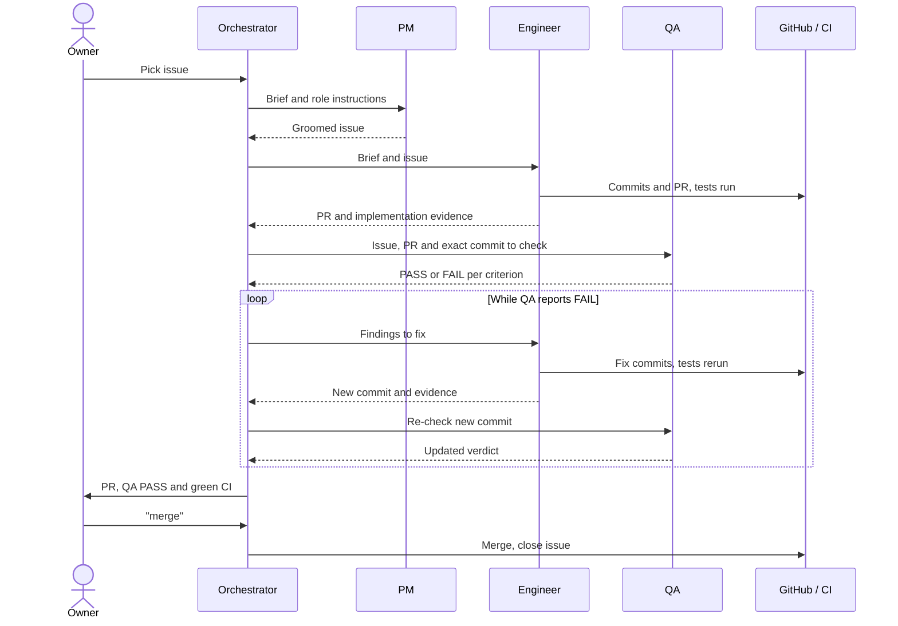
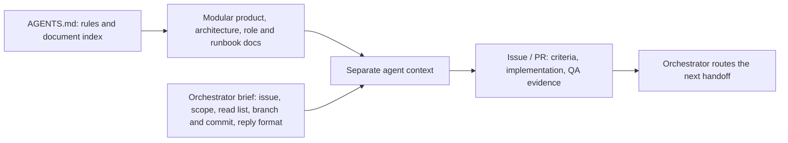
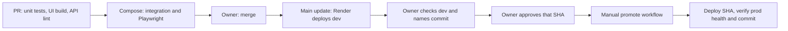
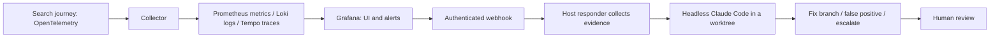

# Sail-event

Sail-event finds events from web-search results and scores them against your free-text criteria. It publishes accepted events to your personal ICS calendar feed and leaves borderline matches for you to review.


<sub>Local recorded demo, captured 26 October 2026; the run includes two failed event-page fetches.</sub>

## Try it live

Open **<https://sail-event.onrender.com>**. Registration is open. **Search now** saves your criteria and starts discovery; subscribe to **Calendar feed** for accepted events. Searches take minutes: [PR #144](https://github.com/alexisdacquay/sail-event/pull/144) records 86–493 seconds with real adapters on a Mac.

Check the deployed commit with `curl -s https://sail-event.onrender.com/api/health`. [Dev](https://sail-event-dev.onrender.com) follows main; production uses manual promotion.

## For reviewers

Final project for the [DataTalksClub AI Dev Tools Zoomcamp 2026](https://github.com/DataTalksClub/ai-dev-tools-zoomcamp/tree/main/project). The [reviewer guide](docs/reviewer-guide.md) maps every rubric clause to evidence you can check in a minute.

| Criterion | Where to look | Quick evidence check |
|---|---|---|
| Problem description | [Guide §1](docs/reviewer-guide.md#1-problem-description) | [Problem](#problem), workflow and [expected behaviour](#expected-behaviour) below. |
| Product specification | [Guide §2](docs/reviewer-guide.md#2-product-specification) | [Issue #11](https://github.com/alexisdacquay/sail-event/issues/11): acceptance criteria and edited history. |
| Agent team specification | [Guide §3](docs/reviewer-guide.md#3-agent-team-specification) | [Team](#how-it-was-built-an-agent-team); [PR #151](https://github.com/alexisdacquay/sail-event/pull/151) shows the handoffs: the engineer's PR and report, QA's verdict per criterion, the merge on the owner's word. |
| Context management | [Guide §4](docs/reviewer-guide.md#4-context-management) | [`CLAUDE.md`](CLAUDE.md) imports [`AGENTS.md`](AGENTS.md); [context handoff](#how-an-agent-gets-its-context) below. |
| Application | [Guide §5](docs/reviewer-guide.md#5-application) | [Restart persistence test][t-restart] passed in [recorded CI][ci-proof]. |
| Testing | [Guide §6](docs/reviewer-guide.md#6-testing) | `make test-all`; inspect the passing jobs in [recorded CI][ci-proof]. |
| Containerization | [Guide §7](docs/reviewer-guide.md#7-containerization) | [Compose](docker-compose.yml) starts app and Postgres in one command. |
| Deployment | [Guide §8](docs/reviewer-guide.md#8-deployment) | Live URL and health GET above. |
| CI/CD | [Guide §9](docs/reviewer-guide.md#9-cicd) | [CI jobs](.github/workflows/ci.yml), [dev deployment record](work/DEPLOY-render.md), [manual promotions](https://github.com/alexisdacquay/sail-event/actions/workflows/promote.yml). |
| Observability | [Guide §10](docs/reviewer-guide.md#10-observability) | Compare the trace ID in the Loki and Tempo captures. |
| Alerting on user impact | [Guide §11](docs/reviewer-guide.md#11-alerting-on-user-impact) | [Rules](observability/grafana/provisioning/alerting/rules.yaml) and a drill's [firing alert](incident-response/incidents/20261021-074150-SearchRunFailures/alert.json). |
| On-call agent | [Guide §12](docs/reviewer-guide.md#12-on-call-agent) | [Drill artifacts](incident-response/incidents/20261021-074150-SearchRunFailures/): alert, evidence, verdict and repair diff. |

## Problem

Small events are scattered across sites and feeds; no single source lists them all. Calendar aggregators only collect listings from sources they already know. A web search returns pages, not checked events in your calendar: you still have to verify dates, place and fit, copy the events you want, and repeat discovery as listings change.

## What it does

The app searches with your criteria text plus `event`, extracts listings and reads each event's own page. It drops events that are incomplete, lack a start date or time, have ended, or match an event page already stored for that day. Candidates are stored before a model scores them from 0–100 with a reason.

| Score range (default thresholds) | Status | Result |
|---|---|---|
| 90 or more | **In calendar** | Included in your ICS feed |
| 41–89 | **Review** | You accept or reject it |
| 40 or less | **Out** | Hidden unless requested |

Thresholds are configurable; comparisons include equality ([pipeline test][t-ge-le]). A final [model duplicate check](backend/app/services/dedup.py) moves duplicate events to Out.

A [scheduled GitHub workflow](.github/workflows/hourly-search.yml) queues searches for production users, oldest first, in addition to **Search now**.

## Expected behaviour

| Situation | Expected result | Evidence |
|---|---|---|
| Another user signs in | Separate criteria and events | [Isolation test][t-iso] |
| The fixture search repeats | No event shows twice in In calendar or Review | [Integration test][t-dedup] |
| An event is rejected | Stays Out after later searches; disappears from the feed | [Rejection][t-rej], [feed test][t-feed] |
| Thresholds are saved | Survive reloads and govern subsequent triage | [Browser journey][j1-reload], [pipeline](backend/app/services/pipeline.py) |
| Someone holds the feed URL | Can read it without signing in; resetting invalidates the old URL | [Rotation test][t-rotate] |

Calendar apps control feed refresh timing. There are no email/push notifications or direct Google Calendar writes; see [MVP scope](_docs/plan.md#out-of-scope-for-the-mvp).

<a id="try-it"></a>

## Run it locally

```bash
docker compose up --build
```

Open <http://localhost:8000>, sign in as **demo / demo**, and keep the pre-filled criteria. Recorded search/model responses need no API keys; the demo clock is fixed at 18 October 2026. For another port: `HOST_PORT=8010 docker compose up --build`.

Without Docker, `make run` uses Python 3.12, [uv](https://docs.astral.sh/uv/), Node 24 and SQLite. `make test` runs backend, frontend and responder unit tests; `make test-all` adds integration and browser tests with Docker. See [testing](docs/testing.md) and [API usage](docs/api.md).

## How it was built: an agent team

Claude Code's main session is the orchestrator. It briefs PM and Engineer as background general-purpose subagents and QA through the [qa-engineer definition](.claude/agents/qa-engineer.md).

This is the process as it stands now. It was built up in steps:

| Since | What started |
|---|---|
| 2026-10-16 | Role files |
| 2026-10-20 (#65) | Each engineer works on its own branch with a PR, and QA checks the PR |
| 2026-10-21 | The owner picks every item and approves every prod promote; 14 of the 15 promote runs before 26 October came before this |
| 2026-10-25 | The bug-fix root-cause gate |

Details: [process phases](_docs/process.md#phase-1-and-phase-2).

| Role | Responsibility | Boundary |
|---|---|---|
| Owner | Picks work; approves merge and a named production commit separately | — |
| Orchestrator | Briefs agents, routes evidence, reports to owner, closes issues | Must not groom, implement or perform QA itself |
| [PM](_docs/team/pm.md) | Writes Goal, Acceptance criteria, Out of scope, Constraints | Cannot code or settle unresolved product choices |
| [Engineer](_docs/team/software-engineer.md) | Implements in a separate checkout, tests, commits, opens PR | Cannot rewrite criteria, close issues or merge without approval |
| [QA](_docs/team/qa-engineer.md) | Independently checks the submitted commit; reports each criterion | Cannot edit files, merge or close issues |



If a criterion remains unmet, the orchestrator sends its evidence to the owner, who grants or rejects an explicit waiver before merge; QA's verdict remains FAIL. The [process](_docs/process.md) records every handoff. Bug fixes require a causal explanation, a regression test committed while failing, then a passing fix.

### How an agent gets its context



[`CLAUDE.md`](CLAUDE.md) imports AGENTS.md. PM also reads the [task template](_docs/task-template.md); Engineer reads architecture and API contract; QA reads criteria and the submitted work. [`work/STATE.md`](work/STATE.md) preserves active work and next actions across sessions; [skills](.claude/skills/) supply specialist procedures. [Launch details](_docs/process.md#how-the-orchestrator-starts-an-agent) include a recorded brief and re-check handling.

## Architecture

React/TypeScript → FastAPI/Python → Postgres (SQLite for `make run`). [`openapi.yaml`](openapi.yaml) defines the API. Environment variables select search, model and guardrail adapters; [architecture](_docs/architecture.md) explains the interfaces. The [Dockerfile](Dockerfile) builds the frontend and serves it with the API; Compose adds persistent Postgres.

## Ship it, watch it, fix it

### CI/CD and promotion



[CI](.github/workflows/ci.yml) also runs on every push to main. The [promote workflow](.github/workflows/promote.yml) deploys the named commit to prod and waits until prod's `/api/health` reports that commit. See the [release procedure](docs/release-process.md).

### Local observability, alerting and on-call

The whole stack runs locally with two commands:



```bash
export RESPONDER_WEBHOOK_SECRET=local-drill-secret
make up-all
# In a second terminal, set the same value explicitly:
RESPONDER_WEBHOOK_SECRET=local-drill-secret make responder
```

Run the local demo search and allow about 60 seconds for metrics. Open Grafana at <http://localhost:3001>, dashboard **Sail-event — Search Run Journey**. Traces are in **Explore → Tempo**. A search's log lines carry its trace ID, so one search can be followed from its logs in Loki to its trace in Tempo ([details](observability/README.md)).

The [alerts](observability/grafana/provisioning/alerting/rules.yaml) detect repeated failed searches over ten minutes and inactivity over two hours. The [responder](incident-response/responder.py) collects metrics, logs, health and recent commits, then starts `claude -p` from its checkout's HEAD in a separate worktree, with a $1 budget, 300-second timeout and no push tool.

The injected-fault drills on [17 October](incident-response/incidents/20261017-052050-SearchRunFailures/) and [21 October 2026](incident-response/incidents/20261021-074150-SearchRunFailures/) are recorded. The latter took **4 min 52 s from alert to repair commit**. Follow the [on-call guide](incident-response/README.md) to repeat it with Docker and a signed-in Claude CLI; `--dry-run` checks the chain without a model call.

## All the docs

The [reviewer guide](docs/reviewer-guide.md) holds the evidence for every criterion; [`AGENTS.md`](AGENTS.md) indexes all product, process and operations documents.

[t-ge-le]: https://github.com/alexisdacquay/sail-event/blob/542e58cb0fe73065a905febec7637bfa377a77c4/backend/tests/test_pipeline.py#L306-L323
[t-rej]: https://github.com/alexisdacquay/sail-event/blob/542e58cb0fe73065a905febec7637bfa377a77c4/backend/tests/test_events.py#L150-L165
[t-iso]: https://github.com/alexisdacquay/sail-event/blob/542e58cb0fe73065a905febec7637bfa377a77c4/backend/tests/integration/test_integration.py#L135-L162
[t-dedup]: https://github.com/alexisdacquay/sail-event/blob/542e58cb0fe73065a905febec7637bfa377a77c4/backend/tests/integration/test_integration.py#L103-L129
[t-feed]: https://github.com/alexisdacquay/sail-event/blob/542e58cb0fe73065a905febec7637bfa377a77c4/backend/tests/test_calendar.py#L112-L132
[t-rotate]: https://github.com/alexisdacquay/sail-event/blob/542e58cb0fe73065a905febec7637bfa377a77c4/backend/tests/test_calendar.py#L255-L269
[t-restart]: https://github.com/alexisdacquay/sail-event/blob/542e58cb0fe73065a905febec7637bfa377a77c4/backend/tests/integration/test_integration.py#L254-L301
[j1-reload]: https://github.com/alexisdacquay/sail-event/blob/542e58cb0fe73065a905febec7637bfa377a77c4/e2e/journeys.spec.ts#L60-L67
[ci-proof]: https://github.com/alexisdacquay/sail-event/actions/runs/40251535674
