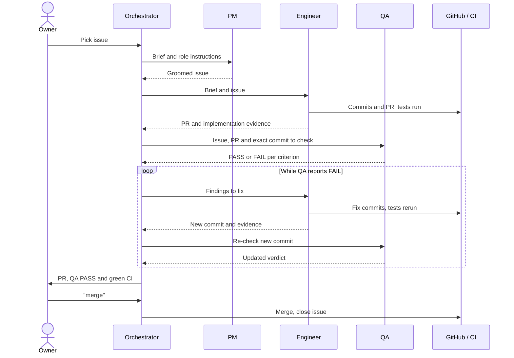
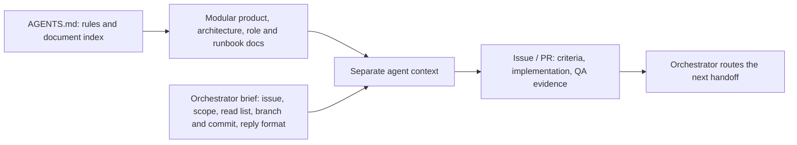
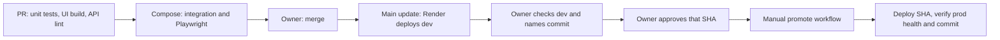
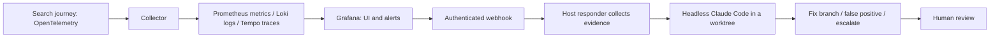

# Sail-event

**Write the events you want in one sentence. Sail-event searches the web, checks and scores each event, and puts the good ones in your calendar.**


<sub>The main page after a search (local demo).</sub>

## Try it live

- Open **<https://sail-event.onrender.com>** and register. Registration is open, with no invite code.
- Type what you want, e.g. *jazz concerts in Berlin next weekend*, and press **Search now**. A live search takes a few minutes.
- Good matches go to your calendar feed. Borderline ones wait for you under **Review**.

## For reviewers

Final project for the [DataTalksClub AI Dev Tools Zoomcamp 2026](https://github.com/DataTalksClub/ai-dev-tools-zoomcamp/tree/main/project). One row per rubric criterion. For the full proof of each one, read the [reviewer guide](docs/reviewer-guide.md).

| Criterion | What we built, and where to see it | Full proof |
|---|---|---|
| Problem description | The problem, what the app does, and how it behaves; each behaviour is linked to its test. Read [the problem](#problem), [what it does](#what-it-does) and [the expected behaviour](#expected-behaviour). | [Guide §1](docs/reviewer-guide.md#1-problem-description) |
| Product specification | A written spec and a public task tracker whose tasks carry acceptance criteria. Open [the PRD](_docs/plan.md), the [issue tracker](https://github.com/alexisdacquay/sail-event/issues?q=is%3Aissue), and one task as an example: [issue #11](https://github.com/alexisdacquay/sail-event/issues/11). | [Guide §2](docs/reviewer-guide.md#2-product-specification) |
| Agent team specification | One owner and four AI roles, each with a clear job and clear limits. See [who does what](#how-it-was-built-an-agent-team). Then watch the team at work on [issue #7](https://github.com/alexisdacquay/sail-event/issues/7): QA rejected the first version, the engineer fixed it, QA re-checked and passed it, and the issue was closed. | [Guide §3](docs/reviewer-guide.md#3-agent-team-specification) |
| Context management | [`AGENTS.md`](AGENTS.md) describes the project and points every agent to the process, role, product and operations docs. See [how an agent gets its context](#how-an-agent-gets-its-context). | [Guide §4](docs/reviewer-guide.md#4-context-management) |
| Application | React, then FastAPI, then Postgres, started with one command. Data survives an app restart: see [the restart test][t-restart]. | [Guide §5](docs/reviewer-guide.md#5-application) |
| Testing | Unit, integration and browser tests. `make test-all` runs them all, and they pass. See [a green CI run][ci-proof]. | [Guide §6](docs/reviewer-guide.md#6-testing) |
| Containerization | `docker compose up --build` starts the app and its Postgres. See [the Compose file](docker-compose.yml). | [Guide §7](docs/reviewer-guide.md#7-containerization) |
| Deployment | Live at <https://sail-event.onrender.com>. `/api/health` reports the deployed commit. | [Guide §8](docs/reviewer-guide.md#8-deployment) |
| CI/CD | CI tests every PR; a merge deploys dev; prod is promoted by hand. See [the pipeline](#cicd-and-promotion). | [Guide §9](docs/reviewer-guide.md#9-cicd) |
| Observability | The search journey emits metrics, traces and JSON logs, and the logs carry the trace ID. Everything shows in Grafana. See [the stack](#observability-alerting-and-on-call). | [Guide §10](docs/reviewer-guide.md#10-observability) |
| Alerting on user impact | Two alerts: searches failing, and no searches at all. Read [the alert rules](observability/grafana/provisioning/alerting/rules.yaml). | [Guide §11](docs/reviewer-guide.md#11-alerting-on-user-impact) |
| On-call agent | An alert wakes a headless Claude Code agent, which commits a fix. In the 21 October drill it took 4 min 52 s from alert to fix. Open [the recorded incident](incident-response/incidents/20261021-074150-SearchRunFailures/). | [Guide §12](docs/reviewer-guide.md#12-on-call-agent) |

## Problem

- **Scattered:** small events are spread across many sites.
- **Incomplete:** aggregators only know their own sources.
- **Manual:** a web search gives pages, not events. You still check dates, copy events into your calendar, and repeat the search every day.

## What it does

1. **Search:** sends your sentence to a web search, on demand (**Search now**) and on a schedule.
2. **Read:** extracts events from each page and opens each event's own page.
3. **Screen:** drops events with no date or start time, events already over, and events already stored.
4. **Score:** a model scores each event 0–100 against your sentence and gives a reason.
5. **Triage:** sorts by your thresholds ([test][t-ge-le]):
   - 90 or more: **In calendar**;
   - 41–89: **Review**, where you decide;
   - 40 or less: **Out**.
6. **Deduplicate:** a model check moves duplicates to Out.
7. **Publish:** accepted events go to your private calendar feed (ICS), which any calendar app can subscribe to.

## Expected behaviour

| When | Then | Proved by |
|---|---|---|
| Another user signs in | They see only their own sentence, events and feed | [Isolation test][t-iso] |
| The same search runs twice | No event appears twice in your calendar or Review list | [Integration test][t-dedup] |
| You reject an event | It stays out after later searches and leaves your feed | [Rejection test][t-rej] · [feed test][t-feed] |
| You save thresholds | They survive a reload and apply to the next search | [Browser test][j1-reload] |
| You reset your feed link | The old link stops working | [Rotation test][t-rotate] |

Out of scope: notifications, and writing directly into Google Calendar ([MVP scope](_docs/plan.md#out-of-scope-for-the-mvp)).

<a id="try-it"></a>

## Run it locally

```bash
docker compose up --build
```

- Open <http://localhost:8000>, log in as **demo / demo**, keep the pre-filled sentence and press **Search now**. Search and model answers are recorded, so no API keys are needed.
- Without Docker: `make run`.
- Tests: `make test` runs the unit tests. `make test-all` runs everything and needs Docker. See [how testing works](docs/testing.md).

## How it was built: an agent team

One human owner and four AI roles, all running on Claude Code. The owner decides; the agents do the work and check each other.

| Role | Does | Never does |
|---|---|---|
| Owner (human) | Picks the next item, says "merge", approves each prod release | Write the code |
| Orchestrator (main session) | Briefs each agent, passes the work along, reports to the owner, closes the issue | Specify, code or test |
| [PM](_docs/team/pm.md) | Turns an issue into Goal, Acceptance criteria, Out of scope and Constraints | Code |
| [Engineer](_docs/team/software-engineer.md) | Builds it on its own branch, tests it and opens a PR | Change the criteria, merge or close |
| [QA](_docs/team/qa-engineer.md) | Checks the exact commit against each criterion; passes it or sends it back | Edit any file, merge or close |

How they work together:

- **Every handoff leaves a record on GitHub:** the PM's criteria in the issue, the engineer's PR and report, and QA's verdict per criterion.
- **QA is independent:** it checks the code itself, not the engineer's report, and sends work back when a criterion fails. QA sent work back on 23 issues ([see the counts and how to reproduce them](_docs/process.md#evidence-it-ran-this-way)).
- **Bug fixes start with a failing test** that proves the cause. The fix must then make that test pass.
- **The owner holds the gates:** nothing merges, and nothing reaches prod, without the owner's word.



For the full process (how an agent is started, every handoff, how the process grew), read [the process doc](_docs/process.md).

### How an agent gets its context



- [`CLAUDE.md`](CLAUDE.md) loads [`AGENTS.md`](AGENTS.md): the project summary, the rules and an index of every doc.
- The orchestrator's brief names the issue, the role file, what to read and the reply format. [See a real brief](_docs/process.md#how-the-orchestrator-starts-an-agent).
- [`work/STATE.md`](work/STATE.md) carries the state of the work across sessions. [Skills](.claude/skills/) hold repeatable procedures.

## Architecture

React and TypeScript, then FastAPI, then Postgres (SQLite for `make run`). [`openapi.yaml`](openapi.yaml) is the API contract. Search, model and guardrail are adapters chosen by environment variables, so tests need no keys. See [the architecture](_docs/architecture.md).

## Ship it, watch it, fix it

### CI/CD and promotion



The [promote workflow](.github/workflows/promote.yml) deploys the named commit to prod and waits until prod's `/api/health` reports that commit. See [the release procedure](docs/release-process.md).

### Observability, alerting and on-call



Run it locally:

```bash
export RESPONDER_WEBHOOK_SECRET=local-drill-secret
make up-all
# in a second terminal:
RESPONDER_WEBHOOK_SECRET=local-drill-secret make responder
```

- **See it:** run a search, then open Grafana at <http://localhost:3001>, dashboard **Sail-event — Search Run Journey**. Traces are in **Explore → Tempo**. A search's logs carry its trace ID, so you can go from a log line to its trace. See [what is collected](observability/README.md).
- **Alerts:** one fires on repeated failed searches (10 minutes), one on no searches at all (2 hours).
- **On-call agent:** on an alert, the responder collects metrics, logs, health and recent commits. It then starts headless Claude Code in its own worktree, with a $1 budget, a 5-minute limit and no push rights.
- **Drill, 21 October:** 4 min 52 s from alert to fix commit. To repeat it, follow [the on-call guide](incident-response/README.md).

## All the docs

The [reviewer guide](docs/reviewer-guide.md) has the full proof for every criterion. [`AGENTS.md`](AGENTS.md) indexes every product, process and operations doc.

[t-ge-le]: https://github.com/alexisdacquay/sail-event/blob/542e58cb0fe73065a905febec7637bfa377a77c4/backend/tests/test_pipeline.py#L306-L323
[t-rej]: https://github.com/alexisdacquay/sail-event/blob/542e58cb0fe73065a905febec7637bfa377a77c4/backend/tests/test_events.py#L150-L165
[t-iso]: https://github.com/alexisdacquay/sail-event/blob/542e58cb0fe73065a905febec7637bfa377a77c4/backend/tests/integration/test_integration.py#L135-L162
[t-dedup]: https://github.com/alexisdacquay/sail-event/blob/542e58cb0fe73065a905febec7637bfa377a77c4/backend/tests/integration/test_integration.py#L103-L129
[t-feed]: https://github.com/alexisdacquay/sail-event/blob/542e58cb0fe73065a905febec7637bfa377a77c4/backend/tests/test_calendar.py#L112-L132
[t-rotate]: https://github.com/alexisdacquay/sail-event/blob/542e58cb0fe73065a905febec7637bfa377a77c4/backend/tests/test_calendar.py#L255-L269
[t-restart]: https://github.com/alexisdacquay/sail-event/blob/542e58cb0fe73065a905febec7637bfa377a77c4/backend/tests/integration/test_integration.py#L254-L301
[j1-reload]: https://github.com/alexisdacquay/sail-event/blob/542e58cb0fe73065a905febec7637bfa377a77c4/e2e/journeys.spec.ts#L60-L67
[ci-proof]: https://github.com/alexisdacquay/sail-event/actions/runs/40251535674
