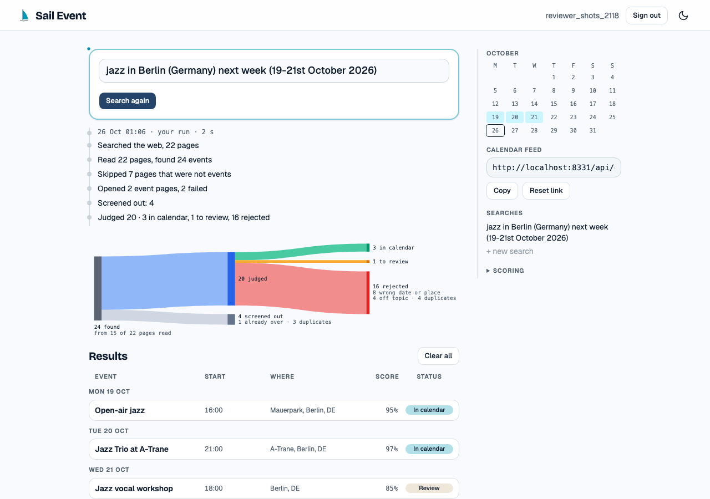
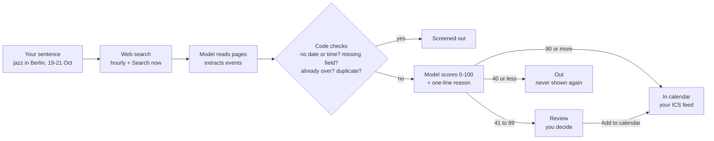
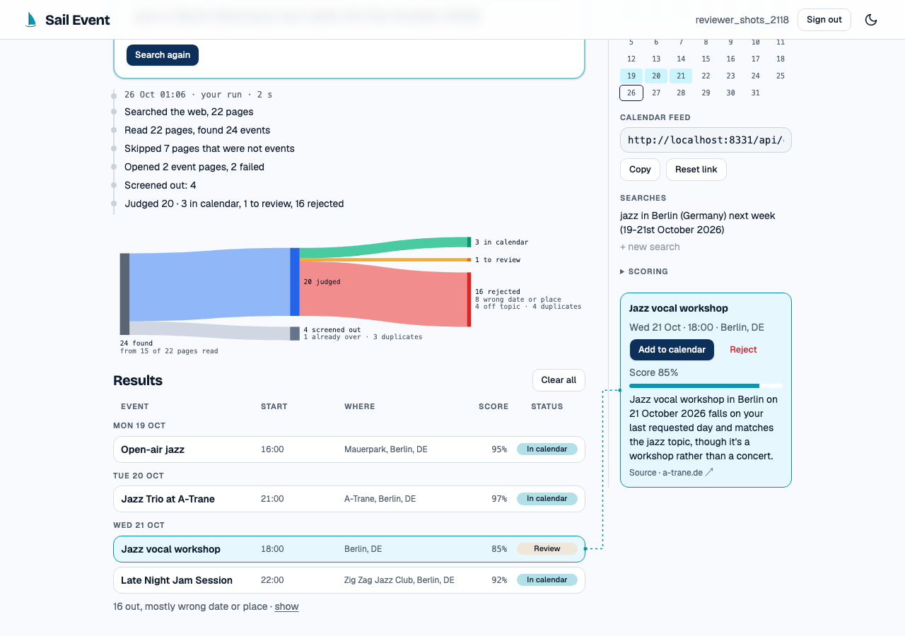
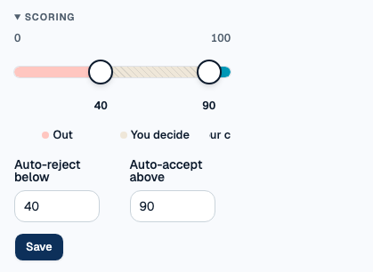
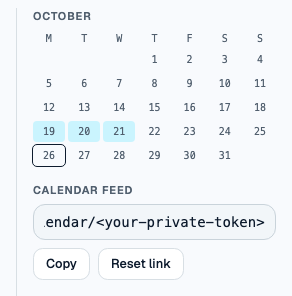
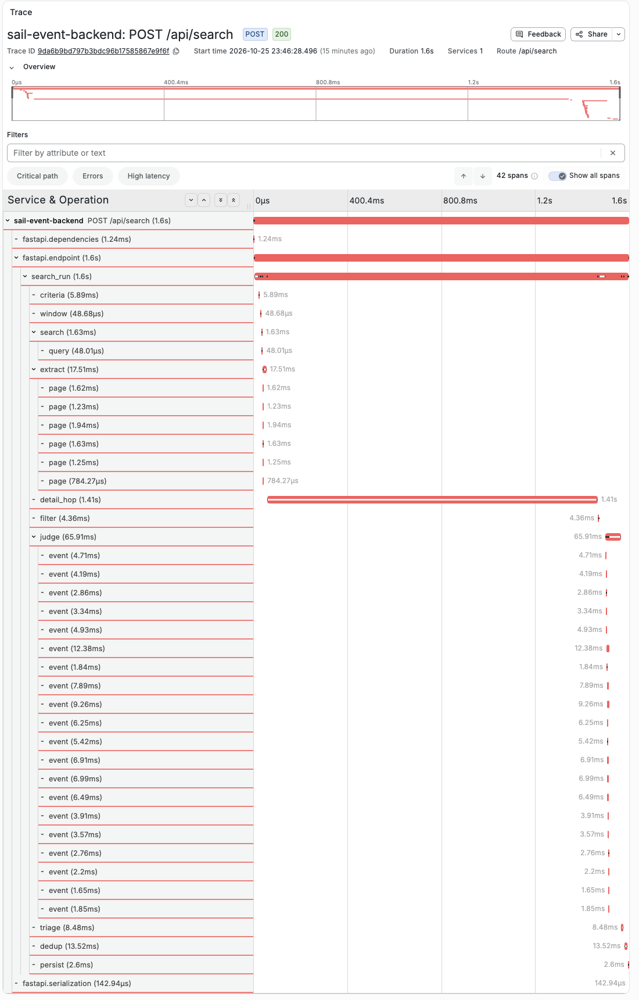
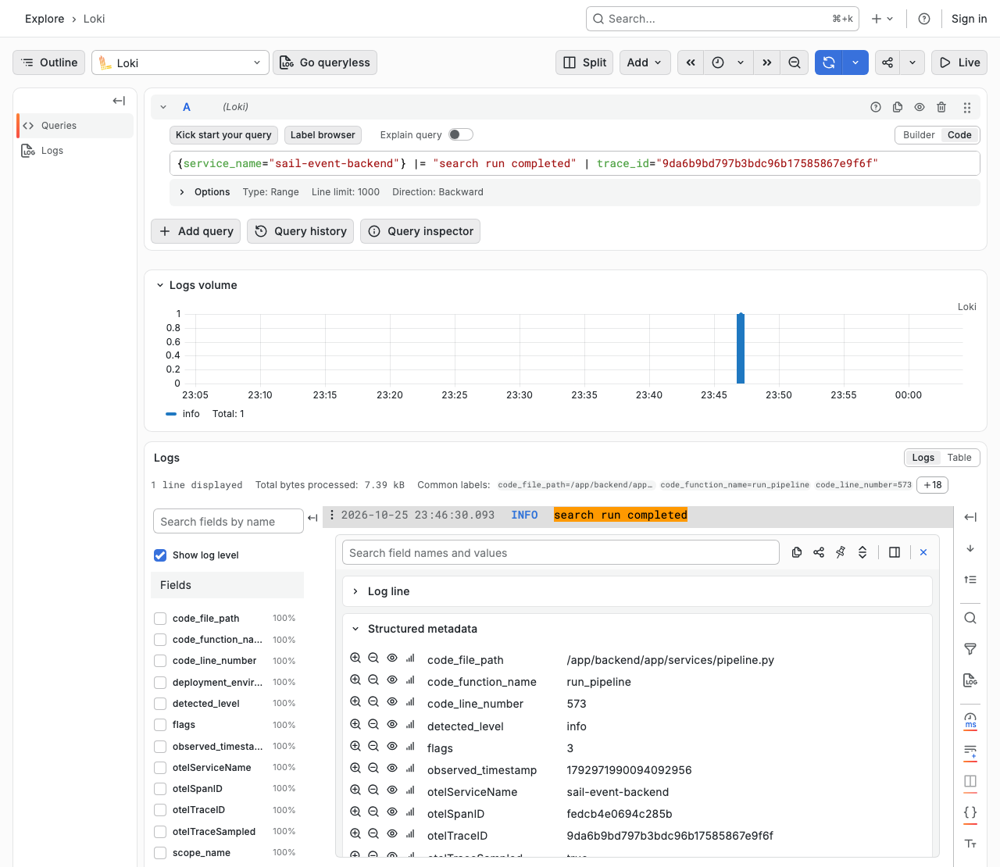
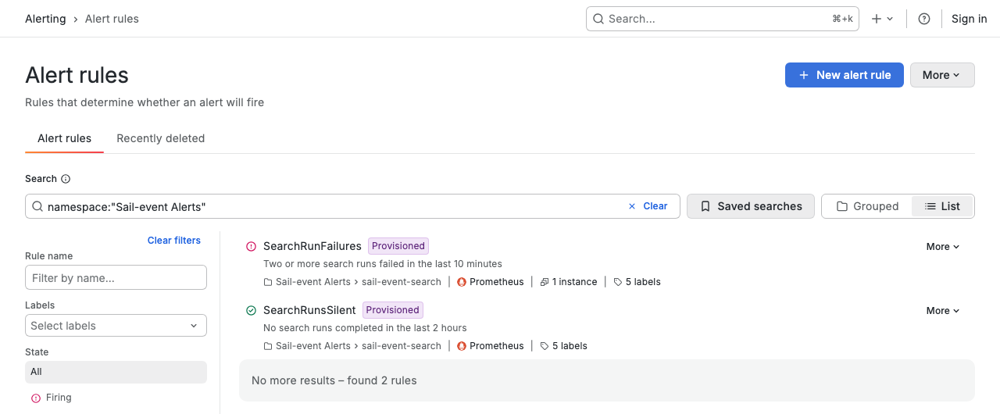

# Sail-event

**Write what events you like, in one sentence.**
**It searches the web every hour, scores each event 0-100 with a reason, and puts the sure ones on your calendar.**
**It asks you only about the borderline ones.**

[](https://github.com/alexisdacquay/sail-event/actions/workflows/ci.yml)
[](https://sail-event.onrender.com)
[](https://github.com/alexisdacquay/sail-event/actions/workflows/hourly-search.yml)



<sub>The Stream after one search: your sentence, what the run did, the funnel (found, screened out, judged, in calendar, to review, rejected), the results. Local stack, recorded data, 2026-10-26.</sub>

**Live:** prod <https://sail-event.onrender.com> (register, no invite code) · dev <https://sail-event-dev.onrender.com> (log in **demo / demo**).
Final project for the [DataTalksClub AI Dev Tools Zoomcamp 2026](https://github.com/DataTalksClub/ai-dev-tools-zoomcamp/tree/main/project).

## For reviewers

One row per rubric criterion.
The first link opens that criterion in the [reviewer guide](docs/reviewer-guide.md): the rubric's words, a checklist, the risks we closed, extra evidence, a picture.

| # | Criterion | Max | Where to look | One-line proof |
|---|---|---|---|---|
| 1 | Problem description | 2 | [guide §1](docs/reviewer-guide.md#1-problem-description) · [Problem](#problem) | Problem, 8 steps, one diagram, and 8 expected-behaviour rules, each linked to its test |
| 2 | Product specification | 2 | [guide §2](docs/reviewer-guide.md#2-product-specification) · [PRD](_docs/plan.md) · [Issues](https://github.com/alexisdacquay/sail-event/issues?q=is%3Aissue) | Public issues: 58 groomed with acceptance criteria, 69 carry a QA verdict. Example: [issue #11](https://github.com/alexisdacquay/sail-event/issues/11). Agents post as the owner; the comment's first line names the role ([how to tell](_docs/process.md#who-wrote-a-comment)) |
| 3 | Agent team specification | 2 | [guide §3](docs/reviewer-guide.md#3-agent-team-specification) · [process.md](_docs/process.md#team) | Owner + 4 AI roles, a Does / Never does table, a sequence diagram; [issue #7](https://github.com/alexisdacquay/sail-event/issues/7) shows one full loop. QA is a runnable agent file; PM and Engineer are role files given to a subagent |
| 4 | Context management | 2 | [guide §4](docs/reviewer-guide.md#4-context-management) · [AGENTS.md](AGENTS.md) | AGENTS.md (loaded through `CLAUDE.md`) links process, team, spec, architecture, ops docs, skills |
| 5 | Application | 2 | [guide §5](docs/reviewer-guide.md#5-application) · [Try it](#try-it) | React → FastAPI → Postgres, one command; a CI test restarts the app and the data is still there |
| 6 | Testing | 2 | [guide §6](docs/reviewer-guide.md#6-testing) · [testing.md](docs/testing.md) | `make test-all` runs unit, integration, e2e. Green in [CI](https://github.com/alexisdacquay/sail-event/actions/runs/40242394581): 481 + 117 unit, 7 integration, 12 e2e (e2e runs inside the job named `integration`). The 20 responder unit tests run in `make test`, not in CI |
| 7 | Containerization | 2 | [guide §7](docs/reviewer-guide.md#7-containerization) · [docker-compose.yml](docker-compose.yml) | `docker compose up --build` starts app + Postgres; no `.env`, no migrate, no seed step |
| 8 | Deployment | 2 | [guide §8](docs/reviewer-guide.md#8-deployment) · [live site](https://sail-event.onrender.com) | `/api/health` answers ok with commit `969a161`; registration is open |
| 9 | CI/CD | 3 | [guide §9](docs/reviewer-guide.md#9-cicd) · [release-process.md](docs/release-process.md) | CI on every PR; merge auto-deploys dev; prod only by the manual [promote.yml](.github/workflows/promote.yml) |
| 10 | Observability | 2 | [guide §10](docs/reviewer-guide.md#10-observability) · [observability/README.md](observability/README.md) | The search journey: 9 metrics, a 42-span trace, JSON logs; the same trace id in Loki and Tempo. **Gap:** the calendar feed token lands in HTTP spans, and metrics carry no trace id ([known gaps](docs/reviewer-guide.md#known-gaps)) |
| 11 | Alerting on user impact | 1 | [guide §11](docs/reviewer-guide.md#11-alerting-on-user-impact) · [rules.yaml](observability/grafana/provisioning/alerting/rules.yaml#L9) | 2 alerts on failed or missing searches; one fired for real ([alert.json](incident-response/incidents/20261021-074150-SearchRunFailures/alert.json)) |
| 12 | On-call agent | 2 | [guide §12](docs/reviewer-guide.md#12-on-call-agent) · [incident-response/README.md](incident-response/README.md) | Alert → webhook → headless Claude Code → fix commit [8d2f839](https://github.com/alexisdacquay/sail-event/commit/8d2f839), 4 min 52 s after the alert. A drill: we injected the fault, on a local branch ([what it does not prove](docs/reviewer-guide.md#what-this-run-does-not-prove)) |
| | **Total** | **24** | [Known gaps](docs/reviewer-guide.md#known-gaps) | Pass is 10 |

Short on time? [Check it in 5 minutes](docs/reviewer-guide.md#check-it-in-5-minutes): four commands, no Docker.

## Problem

People who like events spend time every day scanning sites.
Small events surface late, or never.
Site filters are fixed boxes. You cannot type what you mean.

| Who | When | Done when |
|---|---|---|
| Set up what I like | once, then tweak | my sentence is saved and a search has run |
| See what was found and decide | every day or two | no borderline event is left to decide |
| Get it on my calendar | after accepting | accepted events show up in my calendar app |

| Before | With Sail-event |
|---|---|
| Open 5-10 sites a day | Write one sentence, once |
| Miss events on small sites | A web search runs every hour, and on **Search now** |
| Fixed filter boxes (city, category) | A model reads your own words and scores each event 0-100, with a reason |
| Copy events into your calendar by hand | Sure ones land in your calendar feed by themselves |

More: [PRD, Problem](_docs/plan.md#problem) · [user jobs](_docs/ux-spec.md#1-who-the-user-is).

## What it does

1. **Sign up.** Everything is yours alone: sentence, events, thresholds, calendar feed.
2. **Write one sentence**: what, where, when. Example: *jazz in Berlin (Germany) next week (19-21st October 2026)*.
3. **Search**, every hour and when you press **Search now**. Your sentence goes to a web search as written.
4. **Read.** A model reads each page and pulls out the events. From a listing, it also opens each event's own page.
5. **Screen out.** Code drops events with no date or time, a missing field, already over, or a duplicate. The funnel calls them **screened out**.
6. **Score.** A model scores each event 0-100 against your sentence, with a one-line reason.
7. **Triage** with two thresholds you can move (defaults 90 and 40):
   90 or more → **In calendar** · 41 to 89 → **Review**, you decide · 40 or less → **Out**, never shown again.
8. **Calendar.** In-calendar events appear in your private ICS feed. Any calendar app can subscribe.

"Every hour" is a GitHub cron at minute `:07`. GitHub delays scheduled runs, so in practice they land every 2-6 hours ([runs](https://github.com/alexisdacquay/sail-event/actions/workflows/hourly-search.yml)).
**Search now** is immediate: seconds locally, 1-2 minutes on the live site.



The boundaries are exact: 90 is In calendar, 40 is Out ([code][pipe-triage], [test][t-bound]).

| Decide a Review row | Move the thresholds | Subscribe to your feed |
|---|---|---|
|  |  |  |

### What it does not do

- notify you (no email, no push)
- write into Google Calendar (you subscribe to a feed instead)
- apply price or budget rules (the judge scores topic, place and dates)
- share events between users
- let you edit a score by hand

Full list: [PRD, Out of scope](_docs/plan.md#out-of-scope-for-the-mvp).
You never see in **In calendar** or **Review**: past events, events without a start time, pages that are not events, duplicates, a score without a reason ([targets](_docs/search-spec.md#2-quality-definition)).

## Expected behaviour

| When you... | The app... | Proved by |
|---|---|---|
| sign up as a second user | shows you none of the first user's events, sentence or feed | [Journey 2][j2] · [test_user_isolation][t-iso] |
| run the same search twice | adds no duplicate rows | [test_dedup][t-dedup] |
| get a score of 90+, 41-89 or 40- (defaults) | marks it In calendar, Review or Out | [test_triage_uses_ge_le_cutoffs][t-ge-le] · [test_triage_exact_boundaries][t-bound] |
| reject an event | keeps it rejected; a later search never brings it back | [test_rejected_event_survives_later_search][t-rej] |
| move a threshold and save | keeps it after a reload; the next search uses it | [Journey 1, reload][j1-reload] |
| reject an event that is in your calendar | removes it from the feed | [test_rejected_event_removed_from_feed][t-feed] |
| share your feed URL | lets anyone with it read the feed; after **Reset link** the old URL returns 404 | [test_old_token_404_after_rotate][t-rotate] |
| press **Search now** a 7th time within an hour | answers 429, try later | [test_seventh_call_returns_429][t-429] |

## Try it

| I want to... | Run | Then |
|---|---|---|
| use the live app | open <https://sail-event.onrender.com> | **Register** (no invite code), type a sentence, press **Search now**, wait 1-2 minutes |
| run it locally | `docker compose up --build` | open <http://localhost:8000>, log in **demo / demo**, keep the pre-filled sentence, press **Search now** |
| run every test | `make test-all` | unit + integration + e2e, one exit code; needs Docker; about 10 minutes |
| run unit tests only | `make test` | no Docker, no API keys; about 5 minutes |
| see metrics, traces, logs | `make up-all` | Grafana at <http://localhost:3001>, dashboard "Sail-event — Search Run Journey" |
| run without Docker | `make run` | needs [uv](https://docs.astral.sh/uv/) and Node 22+; open the URL Vite prints |

- `docker compose up --build` starts 2 containers: `postgres` and `app`. The app image holds both the React frontend and the FastAPI API, so there is no separate frontend container.
- The first build takes a few minutes. Port 8000 taken? `HOST_PORT=8010 docker compose up --build`.
- Locally, the search and the model replay recorded answers: no API keys. Those answers match the demo's pre-filled sentence only, so keep it. For your own sentence, use the live site.

<details>
<summary>Same journey with curl (no browser)</summary>

```bash
B=http://localhost:8000
curl -s -X POST $B/api/auth/register -H 'Content-Type: application/json' -d '{"username":"me","password":"secret1"}'
T=$(curl -s -X POST $B/api/auth/login -H 'Content-Type: application/json' -d '{"username":"me","password":"secret1"}' | python3 -c 'import sys,json;print(json.load(sys.stdin)["token"])')
# locally the model is a recorder: use this exact text, it is the one with recorded answers
curl -s -X PUT $B/api/criteria -H "Authorization: Bearer $T" -H 'Content-Type: application/json' -d '{"text":"jazz in Berlin (Germany) next week (19-21st October 2026)"}'
curl -s -X POST $B/api/search -H "Authorization: Bearer $T"                   # seconds locally; 1-2 minutes on the live site
curl -s "$B/api/events?status=queued" -H "Authorization: Bearer $T"          # the Review rows
ID=$(curl -s "$B/api/events?status=queued" -H "Authorization: Bearer $T" | python3 -c 'import sys,json;print(json.load(sys.stdin)[0]["id"])')
curl -s -X POST $B/api/events/$ID/decision -H "Authorization: Bearer $T" -H 'Content-Type: application/json' -d '{"decision":"accepted"}'
curl -s $B/api/calendar-url -H "Authorization: Bearer $T"                    # your ICS feed URL
```

Full contract: [`openapi.yaml`](openapi.yaml), summarised in [docs/api.md](docs/api.md).
</details>

## How it was built: an agent team

Every task was a GitHub issue. One human owner and four AI roles worked each one.

| Role | Human or AI | Does | Never does |
|---|---|---|---|
| Owner | human | picks the next item; says "merge"; says "push to prod" for one sha | - |
| Orchestrator | the main Claude Code session | launches the agents, passes work along, closes on QA PASS | grooms, codes, tests |
| PM | Claude Code subagent, given [pm.md](_docs/team/pm.md) as its prompt | rewrites the issue: Goal, Acceptance criteria, Out of scope, Constraints | writes code |
| Engineer | Claude Code subagent, given [software-engineer.md](_docs/team/software-engineer.md) as its prompt | red test first, implements, opens a PR, comments what it did | edits the criteria, closes the issue |
| QA | Claude Code subagent, fresh context, runnable file [qa-engineer.md](.claude/agents/qa-engineer.md) | runs the tests, checks every criterion, posts `## QA: PASS` or `## QA: FAIL` | edits any file (a written rule plus a clean-tree check; not a tool block, since it has Bash), closes the issue |

```
  owner picks ──▶ PM grooms ──▶ Engineer builds ──▶ QA checks ──┬── FAIL ──▶ back to Engineer
                                                                └── PASS ──▶ owner says merge ──▶ closed
```

- Used for real: 58 groomed issues, 69 with a QA verdict, 23 sent back on FAIL, 30 PRs with a QA verdict ([counts, commands, who closed what](_docs/process.md#evidence-it-ran-this-way)).
- One full loop on one page: [issue #7](https://github.com/alexisdacquay/sail-event/issues/7) (QA caught a password echoed back in a 400 response).
- Agents post with the owner's `gh` login. The first line of each comment names the role ([who wrote what](_docs/process.md#who-wrote-a-comment)).
- Details: [process.md](_docs/process.md) · role files [PM](_docs/team/pm.md), [Engineer](_docs/team/software-engineer.md), [QA](_docs/team/qa-engineer.md) · runnable [QA subagent](.claude/agents/qa-engineer.md) · [AGENTS.md](AGENTS.md), which every agent reads first.

QA caught real defects before they shipped: an invalid decision crashing with 500, a validation error echoing the password, the single-page fallback swallowing `/api/*`, a health check calling a binary absent from the image. Full list: [docs/ai-usage-report.md](docs/ai-usage-report.md).

## How it is built: the stack

```
   browser ──▶ React 19 + TypeScript (Vite, Tailwind, shadcn/ui)
                     │  JSON, contract in openapi.yaml
                     ▼
               FastAPI (Python 3.12) ──▶ PostgreSQL 18
                 │         │                (SQLite for make run)
                 │         └── adapters, chosen by env var:
                 │              SEARCH_PROVIDER = fixture | tavily | exa | brave
                 │              LLM_PROVIDER    = fake    | openai_compatible (DeepSeek)
                 │              GUARDRAIL       = none    | lakera
                 ▼
          OpenTelemetry ──▶ collector ──▶ Prometheus + Loki + Tempo ──▶ Grafana

   GitHub Actions cron (hourly, :07) ──▶ POST /api/search/all ──▶ one run per user
   push to main ──▶ Render builds the Dockerfile ──▶ dev
   promote workflow (manual, by sha) ──▶ prod ──▶ /api/health reports that sha
```

| Layer | Choice | Where |
|---|---|---|
| Frontend | React 19, TypeScript, Vite, Tailwind, shadcn/ui, Vitest | [frontend/](frontend/) |
| Backend | FastAPI, SQLAlchemy 2, Alembic, PyJWT, bcrypt, icalendar | [backend/](backend/) |
| Contract | written first; CI lints it | [openapi.yaml](openapi.yaml) |
| Database | PostgreSQL 18 in Docker and on Render; SQLite for `make run` | [docker-compose.yml](docker-compose.yml) |
| Container | one image: a Node stage builds the UI, Python serves the API and the UI | [Dockerfile](Dockerfile) |
| Telemetry | OpenTelemetry SDK, collector, Prometheus, Loki, Tempo, Grafana | [observability/](observability/) |
| On-call | alert webhook, evidence collector, headless Claude Code responder | [incident-response/](incident-response/) |

More: [architecture](_docs/architecture.md).

## Ship it, watch it, fix it

| Stage | What happens | Where |
|---|---|---|
| Pull request | CI: backend and frontend tests, then compose + Postgres + 7 integration + 12 browser tests | [ci.yml](.github/workflows/ci.yml) |
| Merge to main | Render deploys **dev** | [deployment.md](docs/deployment.md#which-version-runs-where) |
| Promote | the owner runs a workflow with a sha; it waits until prod's `/api/health` reports that sha | [promote.yml](.github/workflows/promote.yml) |
| Rollback | the same workflow with the previous sha | [release-process.md](docs/release-process.md#rollback) |
| Watch | metrics, traces and logs of the search journey, in Grafana (local, `make up-all`) | [observability/README.md](observability/README.md) |
| Alert | **SearchRunFailures** (searches fail), **SearchRunsSilent** (nothing ran in 2 hours) | [rules.yaml](observability/grafana/provisioning/alerting/rules.yaml#L9) |
| Fix | the alert wakes a headless Claude Code agent; it fixes the fault on an `incident/...` branch and never pushes | [incident-response/README.md](incident-response/README.md) |

| One search, one trace | The same trace id in a log line | The alert, firing |
|---|---|---|
|  |  |  |

```
  Grafana alert ──▶ responder (port 8001) ──▶ collect evidence (error-run metric, logs, health, git log)
                                                        │
                                                        ▼
                                         headless Claude Code, budget $1, in a git worktree
                                                        │
                            ┌───────────────────────────┼───────────────────────────┐
                            ▼                           ▼                           ▼
                      verdict: fix             verdict: false_positive        verdict: escalate
                 commit on a branch              nothing to change              a human reads
                 incident/<id>, never main                                      evidence.md
```

It ran for real, twice. On 2026-10-21 a deliberate fault made every search fail. Grafana's alert fired at 07:41:20, the agent read the evidence, found the injected `raise`, and committed the fix [8d2f839](https://github.com/alexisdacquay/sail-event/commit/8d2f839) at 07:46:12.
Every file of that run: [incident-response/incidents/20261021-074150-SearchRunFailures/](incident-response/incidents/20261021-074150-SearchRunFailures/).
Reproduce it with `RESPONDER_WEBHOOK_SECRET=any-string incident-response/test-incident.sh` (needs the `claude` CLI; add `--dry-run` to skip the model).

## All the docs

Two folders, on purpose: `_docs/` = what to build and how the team works. `docs/` = how to run, test, ship and review it.

| Doc | Answers |
|---|---|
| [docs/reviewer-guide.md](docs/reviewer-guide.md) | where each rubric point is proved |
| [_docs/plan.md](_docs/plan.md) | what the product does and why (the PRD) |
| [_docs/search-spec.md](_docs/search-spec.md) | what a good search result is |
| [_docs/ux-spec.md](_docs/ux-spec.md) | screens and user jobs |
| [_docs/architecture.md](_docs/architecture.md) | how it is built |
| [openapi.yaml](openapi.yaml) · [docs/api.md](docs/api.md) | the API contract |
| [_docs/process.md](_docs/process.md) | the agent team and how it works |
| [_docs/team/](_docs/team/) | one file per role |
| [AGENTS.md](AGENTS.md) | what every agent reads first |
| [docs/testing.md](docs/testing.md) | test layers, counts, commands |
| [docs/deployment.md](docs/deployment.md) | where it runs, how to use it live, settings |
| [docs/release-process.md](docs/release-process.md) | CI, CD, promote, rollback |
| [observability/README.md](observability/README.md) | metrics, logs, traces, alerts |
| [incident-response/README.md](incident-response/README.md) | the on-call agent |
| [docs/ai-usage-report.md](docs/ai-usage-report.md) | how AI tools were used, defects QA caught |
| [docs/operations-and-security-report.md](docs/operations-and-security-report.md) | one incident reconstructed, data policy for AI tools |

## Status

- Prod runs release `969a161` (promoted 2026-10-23). Dev runs the latest `main`. Prod lags dev on purpose: it moves only when the owner promotes a sha.
- The live sites use a real web search provider and a real model, chosen by env var ([settings](docs/deployment.md)).
- The app screenshots come from the local stack with recorded data. The GitHub and Grafana screenshots are real pages. All captured 2026-10-26.
- What is not done yet: [known gaps](docs/reviewer-guide.md#known-gaps).
- Post-MVP hardening, done: [#33](https://github.com/alexisdacquay/sail-event/issues/33) JWT secret, [#34](https://github.com/alexisdacquay/sail-event/issues/34) responder isolation, [#35](https://github.com/alexisdacquay/sail-event/issues/35) rate and length limits, [#36](https://github.com/alexisdacquay/sail-event/issues/36) feed-token rotation. Each closed after a QA PASS. The label `post-mvp` means "after the MVP", not "not done".

[pipe-triage]: https://github.com/alexisdacquay/sail-event/blob/8305160/backend/app/services/pipeline.py#L739-L745
[t-bound]: https://github.com/alexisdacquay/sail-event/blob/8305160/backend/tests/test_events.py#L111
[t-ge-le]: https://github.com/alexisdacquay/sail-event/blob/8305160/backend/tests/test_pipeline.py#L306
[t-rej]: https://github.com/alexisdacquay/sail-event/blob/8305160/backend/tests/test_events.py#L150
[t-iso]: https://github.com/alexisdacquay/sail-event/blob/8305160/backend/tests/integration/test_integration.py#L131
[t-dedup]: https://github.com/alexisdacquay/sail-event/blob/8305160/backend/tests/integration/test_integration.py#L103
[t-feed]: https://github.com/alexisdacquay/sail-event/blob/8305160/backend/tests/test_calendar.py#L112
[t-rotate]: https://github.com/alexisdacquay/sail-event/blob/8305160/backend/tests/test_calendar.py#L255
[t-429]: https://github.com/alexisdacquay/sail-event/blob/8305160/backend/tests/test_guardrails.py#L404
[j1-reload]: https://github.com/alexisdacquay/sail-event/blob/8305160/e2e/journeys.spec.ts#L60-L67
[j2]: https://github.com/alexisdacquay/sail-event/blob/8305160/e2e/journeys.spec.ts#L158
