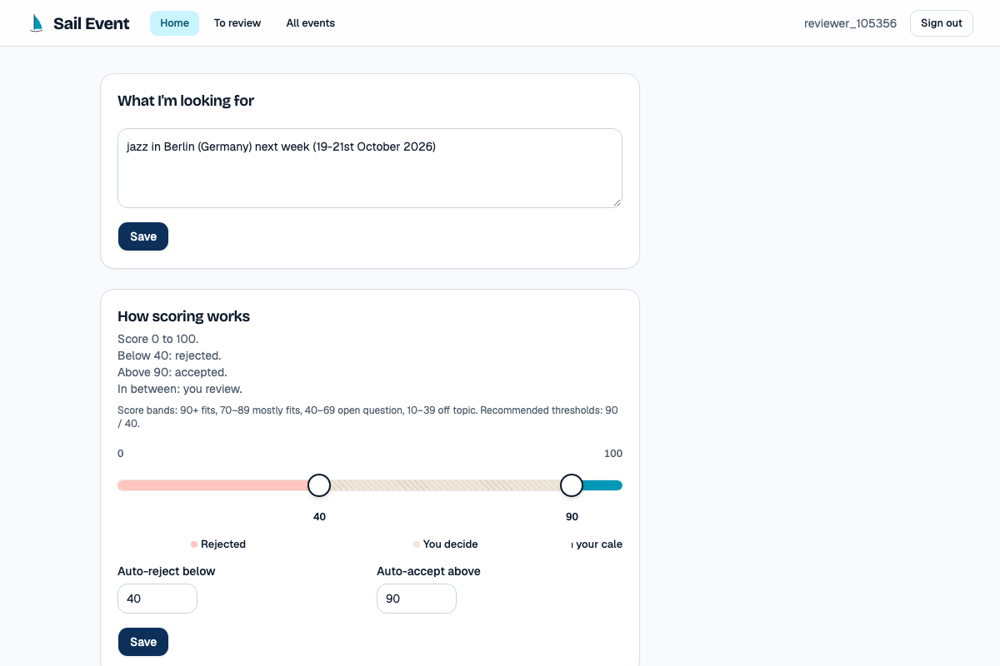
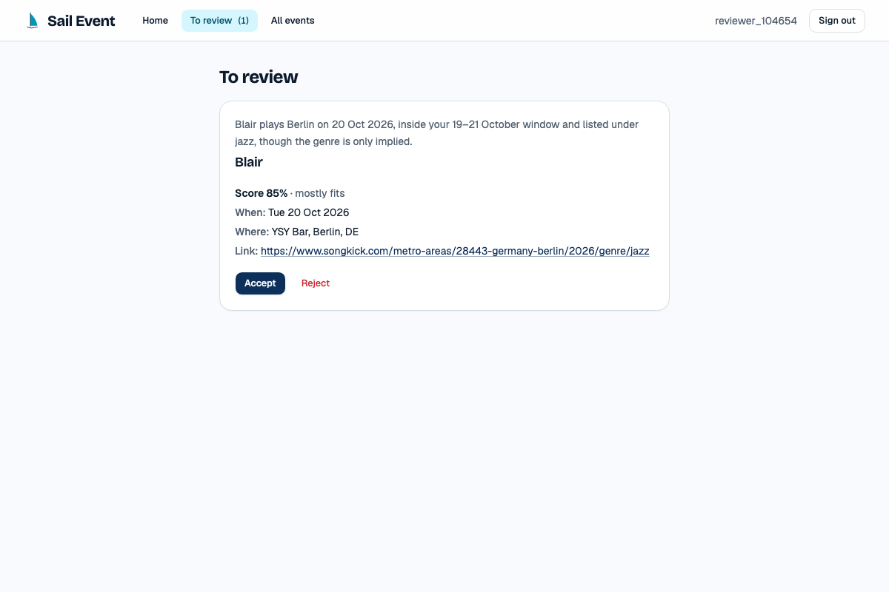
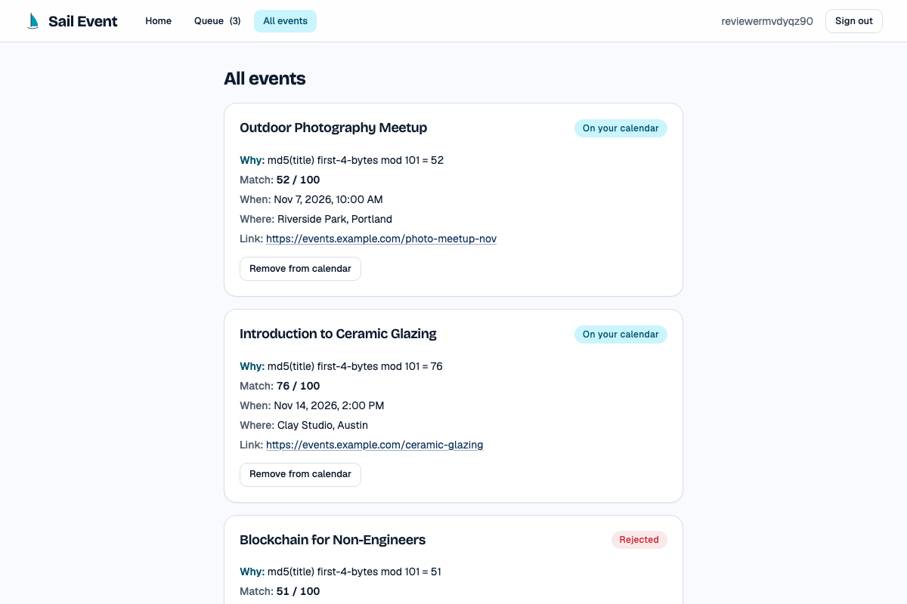
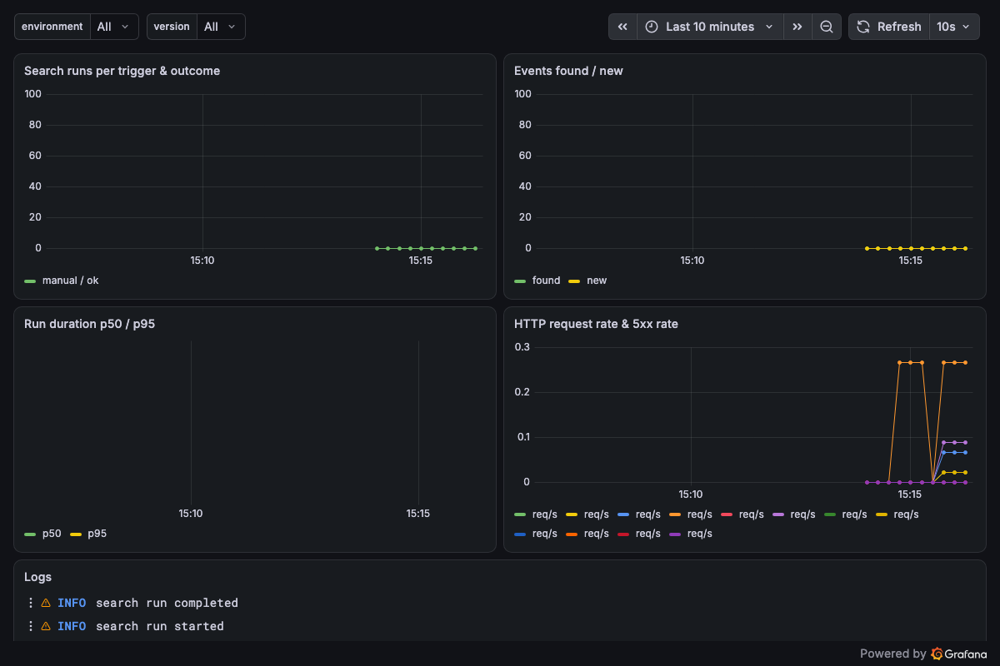

# Sail-event

**Tell it what events you like, in plain words. It searches the web every hour, scores what it finds, puts the sure ones on your calendar, and asks you only about the borderline ones.**

[](https://github.com/alexisdacquay/sail-event/actions/workflows/ci.yml)
[](https://sail-event.onrender.com)
[](https://github.com/alexisdacquay/sail-event/actions/workflows/hourly-search.yml)

Final project for the [DataTalksClub AI Dev Tools Zoomcamp 2026](https://github.com/DataTalksClub/ai-dev-tools-zoomcamp). **Reviewers: jump to the [reviewer map](#reviewer-map) for where each criterion lives.**

| Write your criteria, hit Search | Decide the borderline ones | See the result |
|---|---|---|
|  |  |  |

## The idea in one picture

```
  you                       every hour, or "Search now"
  ───                       ────────────────────────────
  "jazz or folk,            ┌─────────┐   ┌─────────┐   ┌──────────────┐
   near Paris,     ──────▶  │ web     │──▶│ model   │──▶│ score 0..100 │
   weekends,                │ search  │   │ scores  │   │ + one-line   │
   under 40 EUR"            └─────────┘   └─────────┘   │   reason     │
                                                        └──────┬───────┘
                                                               │
                              ┌────────────────────────────────┼─────────────────────┐
                              ▼                                ▼                     ▼
                         score > 70                      30 ≤ score ≤ 70        score < 30
                     ┌────────────────┐               ┌────────────────┐    ┌────────────────┐
                     │ auto-accepted  │               │ queue: you     │    │ auto-rejected  │
                     │ → ICS calendar │ ◀── Accept ── │ Accept/Reject  │    │ never shown    │
                     └────────────────┘               └────────────────┘    │ again          │
                                                                            └────────────────┘
```

The two thresholds (30 and 70 above) are yours to move. Everything is per user: criteria, events, thresholds, and the calendar feed URL.

## Problem

People who want to go to events spend time every day scanning sites and feeds. Events surface too late or not at all because no single source lists them. Calendar aggregators only collect events you already know about, and structured filters cannot express "small jazz festivals on weekends, not too expensive".

## What the app does

1. You register and sign in.
2. You write your criteria as free text.
3. Every hour, and whenever you press **Search now**, the app queries a web search provider and collects candidate events.
4. A model scores each new event against your criteria and records a score with a one-line reason.
5. Two thresholds split events into auto-accepted, auto-rejected, and a queue of uncertain ones.
6. You open the queue and accept or reject each uncertain event.
7. Accepted events appear in your personal ICS calendar feed, which any calendar app can subscribe to.

Expected behaviour: nothing is shared between users; duplicates are removed per user; a rejected event never comes back; moving a threshold changes future triage; rejecting an accepted event removes it from the feed; the feed URL is a secret, anyone holding it can read that feed.

## Try it in 60 seconds

Needs Docker. One command starts the app and its Postgres:

```bash
docker compose up --build
```

Open <http://localhost:8000>, log in as **demo / demo**, press **Search now**, then open **Queue**. Locally the search provider and the scorer are fixtures, so results are canned and scores are deterministic: no API keys needed.

Without Docker (needs Python 3.12 with [uv](https://docs.astral.sh/uv/) and Node 24):

```bash
make run
```

The live deployment is <https://sail-event.onrender.com>. Register your own account there.

## How it is built

```
   browser ──▶ React 19 + TypeScript (Vite, Tailwind, shadcn/ui)
                     │  JSON, contract in openapi.yaml
                     ▼
               FastAPI (Python 3.12) ──▶ PostgreSQL 18
                 │         │                (SQLite in local dev)
                 │         └── adapters, chosen by env var:
                 │              SEARCH_PROVIDER = fixture | tavily
                 │              SCORER          = fake    | claude
                 ▼
          OpenTelemetry ──▶ collector ──▶ Prometheus + Loki + Tempo ──▶ Grafana

   GitHub Actions cron (:07 every hour) ──▶ POST /api/search/all ──▶ one run per user
   push to main ──▶ Render builds the Dockerfile ──▶ dev
   promote workflow (manual, by commit) ──▶ prod ──▶ health reports that commit
```

| Layer | Choice | Where |
|---|---|---|
| Frontend | React 19, TypeScript, Vite, Tailwind, shadcn/ui, Vitest | `frontend/` |
| Backend | FastAPI, SQLAlchemy 2, Alembic, PyJWT, bcrypt, icalendar | `backend/` |
| Contract | `openapi.yaml`, written first; CI checks the backend matches it | `openapi.yaml`, `docs/api.md` |
| Database | SQLite for `make run`, PostgreSQL 18 in Docker and on Render | `backend/alembic/` |
| Container | One image: Node build stage, then Python serving API and built frontend | `Dockerfile`, `docker-compose.yml` |
| Telemetry | OpenTelemetry SDK, collector, Prometheus, Loki, Tempo, Grafana | `observability/` |
| On-call | Alert webhook, evidence collector, headless Claude Code responder | `incident-response/` |
| QA subagent | Claude Code subagent that checks finished work against the issue | [`.claude/agents/qa-engineer.md`](.claude/agents/qa-engineer.md) |

More detail: [architecture](_docs/architecture.md), [deployment](docs/deployment.md), [release process](docs/release-process.md).

## How it was built: a three-role agent loop

Every task was a GitHub issue. Three AI agents with written job descriptions worked each one, driven by an orchestrator that never codes itself.

```
            ┌──────────┐    groomed issue    ┌───────────┐   commit + comment   ┌──────────┐
  issue ──▶ │    PM     │ ──────────────────▶ │ Engineer  │ ───────────────────▶ │    QA    │
            └──────────┘                     └───────────┘                      └────┬─────┘
                 ▲                                 ▲                                 │
                 │                                 │ FAIL: QA comment lists           │
                 │                                 └──────── what to fix ◀────────────┤
                 │                                                                   │ PASS
          next issue ◀──────────────── orchestrator closes the issue ◀───────────────┘
```

- PM rewrites the issue into Goal, Acceptance criteria, Out of scope, Constraints: [`_docs/team/pm.md`](_docs/team/pm.md)
- Engineer implements one groomed issue, commits, comments, never closes: [`_docs/team/software-engineer.md`](_docs/team/software-engineer.md)
- QA starts fresh, checks every criterion, posts PASS or FAIL: [`_docs/team/qa-engineer.md`](_docs/team/qa-engineer.md)
- The rules of the loop: [`_docs/process.md`](_docs/process.md). The spec: [`_docs/plan.md`](_docs/plan.md). The tracker: [GitHub issues](https://github.com/alexisdacquay/sail-event/issues?q=is%3Aissue), every one carries the PM groom, the engineer's commit and the QA verdict.
- Agents read [`AGENTS.md`](AGENTS.md) first (`CLAUDE.md` just includes it); it points to the modular docs above.

QA caught real defects before they shipped: an invalid decision crashing with 500, a validation error echoing the password back, the single-page fallback swallowing `/api/*`, a health check calling a binary absent from the image. The full list is in [docs/ai-usage-report.md](docs/ai-usage-report.md).

## Tests

```bash
make test              # backend unit + frontend unit, one exit code
make test-integration  # starts compose, runs the API against real Postgres, tears down
make test-e2e          # starts compose, runs Playwright journeys in Chromium, tears down
```

| Suite | Count | Tool |
|---|---|---|
| Backend unit | 165 | pytest |
| Frontend unit | 22 | Vitest |
| Integration (real Postgres) | 7 | pytest, marker `integration` |
| End to end (browser) | 2 journeys | Playwright |

How they are organised: [docs/testing.md](docs/testing.md).

## Ship it

| Step | What happens | Where |
|---|---|---|
| Pull request | CI runs backend, frontend, then integration and e2e | [`.github/workflows/ci.yml`](.github/workflows/ci.yml) |
| Merge to main | Render builds the image and deploys it to **dev** (sail-event-dev.onrender.com) | [docs/deployment.md](docs/deployment.md) |
| Promote to prod | Manual workflow: pick a commit, Render deploys it to **prod**, the job waits until `/api/health` reports that commit | [`.github/workflows/promote.yml`](.github/workflows/promote.yml) |
| Rollback | Run the promote workflow with the previous commit | [docs/release-process.md](docs/release-process.md) |
| Hourly search | GitHub Actions cron calls `POST /api/search/all` with a shared key | [`.github/workflows/hourly-search.yml`](.github/workflows/hourly-search.yml) |

## When it breaks

The key journey, a search run, is instrumented end to end: a metric per run with its outcome, a trace per request, and structured logs that carry the trace id. No user content or credentials go to telemetry.

```bash
make up-all        # app + Postgres + the whole observability stack
```

Grafana is at <http://localhost:3001> (no login), dashboard "Sail-event, Search Run Journey":



Two alerts fire on user impact, not CPU: **SearchRunFailures** (two or more runs failed in ten minutes) and **SearchRunsSilent** (no run at all in two hours). They hit a webhook that wakes an on-call agent:

```
  Grafana alert ──▶ responder (port 8001) ──▶ collect evidence (error-run metric, error logs, health, git log)
                                                        │
                                                        ▼
                                         headless Claude Code, budget $1, in a git worktree
                                                        │
                            ┌───────────────────────────┼───────────────────────────┐
                            ▼                           ▼                           ▼
                      verdict: fix             verdict: false_positive        verdict: escalate
                 commit on a branch              nothing to change              human reads
                 incident/<id>, never main                                      evidence.md
```

It ran for real once. A deliberate fault made every search run fail; the alert fired, the agent read the evidence, found the injected `raise`, fixed it on branch `incident/20261017-052050-SearchRunFailures` and left a verdict. Everything it saw and did is in [`incident-response/incidents/20261017-052050-SearchRunFailures/`](incident-response/incidents/20261017-052050-SearchRunFailures/). Reproduce it with:

```bash
make responder                        # terminal 1
incident-response/test-incident.sh    # terminal 2: injects the fault, fires the alert
```

Policy, prompt and limits: [`incident-response/`](incident-response/). Security audit and the data policy for AI tools: [docs/operations-and-security-report.md](docs/operations-and-security-report.md).

## Reviewer map

| Criterion | Look at |
|---|---|
| Problem description | This README: Problem, What the app does |
| Product specification | [`_docs/plan.md`](_docs/plan.md), [issues](https://github.com/alexisdacquay/sail-event/issues?q=is%3Aissue) with PM groom, engineer and QA comments |
| Agent team specification | [`_docs/team/`](_docs/team/), [`_docs/process.md`](_docs/process.md) |
| Context management | [`AGENTS.md`](AGENTS.md) pointing to plan, architecture, process, team |
| Application | `docker compose up --build`, then <http://localhost:8000>, demo / demo |
| Testing | `make test`, `make test-integration`, `make test-e2e`; [docs/testing.md](docs/testing.md) |
| Containerization | [`Dockerfile`](Dockerfile), [`docker-compose.yml`](docker-compose.yml) |
| Deployment | <https://sail-event.onrender.com>, [docs/deployment.md](docs/deployment.md) |
| CI/CD | [`ci.yml`](.github/workflows/ci.yml) on PRs, Render deploys merges to dev, [`promote.yml`](.github/workflows/promote.yml) deploys to prod by hand |
| Observability | `make up-all`, Grafana on 3001, [`observability/`](observability/) |
| Alerting on user impact | [`observability/grafana/provisioning/alerting/`](observability/grafana/provisioning/alerting/) |
| On-call agent | [`incident-response/`](incident-response/) and the recorded incident above |

## Status

- Live and searching hourly with fixture adapters; real web search and model scoring switch on with two API keys on Render ([docs/deployment.md](docs/deployment.md)).
- Two environments on Render: dev follows main, prod moves only by the promote workflow.
- Security findings deferred to post-MVP are issues [#33 to #36](https://github.com/alexisdacquay/sail-event/issues?q=is%3Aissue+label%3Apost-mvp).
