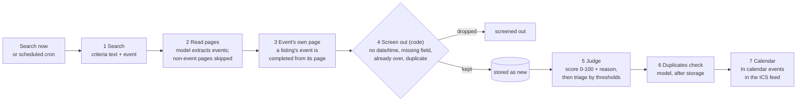

# Architecture — Sail-event

The application runs on Render; the observability, alerting and on-call stack
runs locally with `make up-all`. The deployed app sends no telemetry. Locally,
logs and traces correlate by trace ID; the metrics do not carry that ID, a gap
against the rubric's “share a trace ID” requirement. See
[observability](../observability/README.md) for collection and privacy limits.

## Stack

| Concern | Choice | Version |
|---|---|---|
| Frontend framework | React + TypeScript | 19.3 |
| Frontend build | Vite | 8.3 |
| Frontend styling | Tailwind CSS + shadcn/ui | — |
| Backend framework | FastAPI (Python) | 0.143 |
| Python runtime | — | 3.12 |
| ORM | SQLAlchemy | 2.1 |
| Migrations | Alembic | — |
| DB (local `make run`) | SQLite | — |
| DB (compose and Render) | PostgreSQL | 18 |
| ICS feed | icalendar | 7.3 |
| Auth | bcrypt + PyJWT | 5.0 / 2.15 |
| Tests (backend) | pytest | 9.1 |
| Tests (e2e) | Playwright | 1.64 |
| CI/CD | GitHub Actions | — |
| Deploy | Render Web Service (Docker) + Render Postgres. Dev auto-deploy is a Render service setting; prod promotion uses manual `promote.yml` | — |
| Scheduler | GitHub Actions cron → POST /api/search/all | — |
| Contract | openapi.yaml (backend implements it; [test_schema_contract.py](../backend/tests/test_schema_contract.py) checks they match) | — |
| Container | Docker; docker-compose for app + Postgres | — |
| Telemetry (local) | OTel → Prometheus + Loki + Tempo + Grafana | — |

## Repo layout

| Path | Purpose |
|---|---|
| `frontend/` | React app (Vite, Tailwind, shadcn/ui) |
| `backend/` | FastAPI app (routers, models, services, adapters) |
| `openapi.yaml` | API contract; the backend implements it, a test checks the match |
| `docker-compose.yml` | App + Postgres services |
| `.github/workflows/` | `ci.yml` (tests on PR and main), `hourly-search.yml` (scheduled enqueue), `promote.yml` (manual prod deploy) |
| `_docs/` | Product/design specifications, process and role files |
| `docs/` | Run, test, deploy and review guides |
| `.claude/` | Agent and skill definitions |
| `scripts/` | Pre-commit hook |
| `work/` | State and historical evidence |
| `observability/` | OTel collector config, Grafana dashboards, docker-compose |
| `incident-response/` | On-call agent prompt, runbooks |
| `e2e/` | Playwright end-to-end tests |
| `Makefile` | Local run, test, container, observability and responder commands |

## Data model
Source: [orm.py](../backend/app/orm.py). Column groups below include the persisted
fields; `stage_counts`, `pages` and cached facets are JSON stored as text.

| Table | Columns | Constraints |
|---|---|---|
| User | id, username, password_hash, upper_threshold, lower_threshold, time_zone, ics_token, created_at | username and ics_token UNIQUE; lower_threshold < upper_threshold CHECK |
| Criteria | id, user_id FK, text, facets_json, facets_version, facets_text_sha, parsed_at, updated_at | user_id UNIQUE (one profile per user) |
| Event | id, user_id FK, title, date_time, place, link, description; start_tz, end_time, source_url, page_kind, city, country, source_query, extraction_confidence; score, score_reason, judge_model, judge_version, status, decided_by, run_id FK, created_at | status CHECK: new / accepted / rejected / queued. No link/start UNIQUE constraint |
| Run | id, user_id FK, started_at, finished_at, events_found, events_new, trigger, error, stage_counts, search_calls, llm_calls, llm_tokens_in, llm_tokens_out, cost_usd, current_stage, stopped_at_stage, error_detail, pages | One row per user search execution |

Run data drives the chronology, funnel, earlier-run list and local metrics.
The API also returns per-page details; the current UI does not display them. See [search router](../backend/app/routers/search.py)
and [EarlierRuns](../frontend/src/components/EarlierRuns.tsx).

PR [#150](https://github.com/alexisdacquay/sail-event/pull/150) removed the event
uniqueness constraint and deleted stored events without start times. That delete
is irreversible. Rollback across the three migrations added by PRs #128/#150 is
untested; deploying old code cannot restore deleted events. Back up the database
before promotion and follow the release guide.

## Adapter interfaces

| Adapter | Env var | Values (first = default) |
|---|---|---|
| Search provider | `SEARCH_PROVIDER` | `fixture` (canned results) · `tavily` · `brave` · `exa` |
| LanguageModel `complete_json(...)` | `LLM_PROVIDER` | `fake` (replays recorded answers) · `openai_compatible` (any OpenAI-style API; DeepSeek per [deployment.md](../docs/deployment.md)) |
| Guardrail `check(text)` | `GUARDRAIL` | `none` · `lakera` (+ `GUARD_FALLBACK=self_check`) |

- Source: [factory.py](../backend/app/adapters/factory.py). Fixture search and the fake model are used in ordinary tests, CI and compose; tests may inject other implementations.
- With `APP_ENV=prod`, fixture search and the fake model refuse at first use; health can still succeed.
- The guard runs on `PUT /api/criteria`, not during the search ([criteria.py](https://github.com/alexisdacquay/sail-event/blob/542e58cb0fe73065a905febec7637bfa377a77c4/backend/app/routers/criteria.py#L56-L58)).

## Request flow — one run

| Step | Code | Span name |
|---|---|---|
| Trigger | `POST /api/search` (one user) or `POST /api/search/all` (scheduled, shared-secret header, enqueues one Run per selected user) | `search_run` |
| 1 Search | criteria text plus `" event"` sent to the `SEARCH_PROVIDER` ([pipeline.py](https://github.com/alexisdacquay/sail-event/blob/542e58cb0fe73065a905febec7637bfa377a77c4/backend/app/services/pipeline.py#L286-L298)) | `search` |
| 2 Read pages | every result with page content is read by the model, in parallel up to `EXTRACT_CONCURRENCY`; `page_kind` comes from the model | `extract` |
| 3 Event's own page | [detail_hop.py](../backend/app/services/detail_hop.py) | `detail_hop` |
| 4 Screen out | [filters.py](https://github.com/alexisdacquay/sail-event/blob/542e58cb0fe73065a905febec7637bfa377a77c4/backend/app/services/filters.py#L171): no date, no time, incomplete, past, duplicate. Place and dates are left to the judge | `filter` |
| 5 Judge + triage | [pipeline.py](https://github.com/alexisdacquay/sail-event/blob/542e58cb0fe73065a905febec7637bfa377a77c4/backend/app/services/pipeline.py#L615): `score >= upper` accepted, `score <= lower` rejected, else queued | `judge`, `triage` |
| 6 Duplicates check | [dedup.py](../backend/app/services/dedup.py): same event under two links; new accepted/queued events with same-day candidates are checked by the model, with repair if needed; duplicates are rejected | `dedup` |
| 7 Calendar | accepted events served at `GET /api/calendar/{ics_token}` | HTTP span |
| Run row | `stage_counts`, calls, tokens, timestamps written | `persist` |

- Events are committed as `new` before judging. The next run retries leftover `new` rows; this recovers that stage, not every possible crash in the pipeline.

## Application at a glance

| Part | What | Proof |
|---|---|---|
| Frontend | React + TypeScript, built by Vite | [frontend/](../frontend/) |
| Backend | FastAPI; also serves the built frontend files | [main.py](https://github.com/alexisdacquay/sail-event/blob/542e58cb0fe73065a905febec7637bfa377a77c4/backend/app/main.py#L117-L119) |
| Database | Postgres (compose, Render); SQLite for `make run` and unit tests | [docker-compose.yml](../docker-compose.yml) |
| FE talks to BE | [Dockerfile line 7](https://github.com/alexisdacquay/sail-event/blob/542e58cb0fe73065a905febec7637bfa377a77c4/Dockerfile#L7) sets `VITE_API_URL`, so [api.ts line 67](https://github.com/alexisdacquay/sail-event/blob/542e58cb0fe73065a905febec7637bfa377a77c4/frontend/src/services/api.ts#L67) picks [http.ts](../frontend/src/services/http.ts) (real `fetch`). `mock.ts` is used only by unit tests and by a backend-less `npm run dev` | same files |
| Data persists | `test_data_survives_restart` restarts the app container and checks the event count is unchanged; Journey 1 saves a threshold, reloads, sees 96 | [test_integration.py#L254](https://github.com/alexisdacquay/sail-event/blob/542e58cb0fe73065a905febec7637bfa377a77c4/backend/tests/integration/test_integration.py#L254) · [journeys.spec.ts#L60-L67](https://github.com/alexisdacquay/sail-event/blob/542e58cb0fe73065a905febec7637bfa377a77c4/e2e/journeys.spec.ts#L60-L67) |
| One command | `docker compose up --build`: app + Postgres without a `.env` file or manual migration/seed step; the container runs Alembic and the app seeds demo data by default | [docker-compose.yml](../docker-compose.yml) · [Dockerfile line 25](https://github.com/alexisdacquay/sail-event/blob/542e58cb0fe73065a905febec7637bfa377a77c4/Dockerfile#L25) |

## Environments

| Aspect | Local (`make run` / compose) | Render dev | Render prod |
|---|---|---|---|
| DB | SQLite / Postgres | Render Postgres | Render Postgres |
| URL | localhost:5173 + :8000 / :8000 | https://sail-event-dev.onrender.com | https://sail-event.onrender.com |
| Configuration | Environment; compose provides local defaults | Render environment variables | Render environment variables |
| Adapters | Fixture search, fake model by default | Real adapters, per deployment configuration | Real adapters, per deployment configuration |
| Scheduler | No local scheduler; manual trigger | No GitHub cron target | GitHub hourly cron; actual starts are less frequent |
| Deployment | Local commands | Auto-deploy setting in Render, not a GitHub deploy job | Manual `promote.yml` after owner approval |
| Telemetry | `make up-all` enables OTel collection | None exported | None exported |

See [deployment.md](../docs/deployment.md) for service settings. To inspect the
currently deployed commit, run `curl -s https://sail-event.onrender.com/api/health`;
do not infer it from main or the last merge.

## Known limitations

- Duplicate detection depends on the model after the stored-page/date check. Errors can leave both rows (`dedup_errors`). Removing the uniqueness constraint permits different events with the same link and start.
- Search coverage is limited by provider results and failed page/model calls. A stored `new` row is retried; a page lost during extraction is not recovered by that mechanism.
- The two recorded on-call repair runs are injected-fault drills. HTTP telemetry has privacy gaps described in the observability guide.
