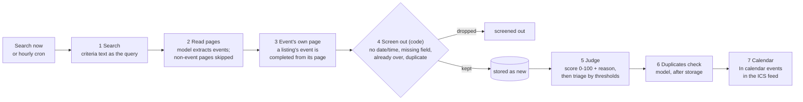

# Architecture — Sail-event
## Stack
| Concern | Choice | Version |
|---|---|---|
| Frontend framework | React + TypeScript | 19.3 |
| Frontend build | Vite | 8.3 |
| Frontend styling | Tailwind CSS + shadcn/ui | — |
| Backend framework | FastAPI (Python) | 0.143 |
| Python runtime | — | 3.12 |
| ORM | SQLAlchemy | 2.1 |
| Migrations | Alembic | — |
| DB (dev) | SQLite | — |
| DB (prod) | PostgreSQL | 18 |
| ICS feed | icalendar | 7.3 |
| Auth | bcrypt + PyJWT | 5.0 / 2.15 |
| Tests (backend) | pytest | 9.1 |
| Tests (e2e) | Playwright | 1.64 |
| CI/CD | GitHub Actions | — |
| Deploy | Render Web Service (Docker) + Render Postgres. Dev auto-deploys on push to main; prod moves only via `promote.yml` | — |
| Scheduler | GitHub Actions cron → POST /api/search/all | — |
| Contract | openapi.yaml (backend implements it; [test_schema_contract.py](../backend/tests/test_schema_contract.py) checks they match) | — |
| Container | Docker; docker-compose for app + Postgres | — |
| Telemetry | OTel → Prometheus + Loki + Tempo + Grafana | — |

## Repo layout
| Path | Purpose |
|---|---|
| `frontend/` | React app (Vite, Tailwind, shadcn/ui) |
| `backend/` | FastAPI app (routers, models, services, adapters) |
| `openapi.yaml` | API contract; the backend implements it, a test checks the match |
| `docker-compose.yml` | App + Postgres services |
| `.github/workflows/` | CI (test on PR) and CD (deploy on main) |
| `_docs/` | Product spec, architecture, tasks |
| `observability/` | OTel collector config, Grafana dashboards, docker-compose |
| `incident-response/` | On-call agent prompt, runbooks |
| `e2e/` | Playwright end-to-end tests |
| `Makefile` | Run, test, build, deploy commands |

## Data model
| Table | Columns | Constraints |
|---|---|---|
| User | id, username, password_hash, upper_threshold, lower_threshold, ics_token, created_at | username UNIQUE; lower_threshold < upper_threshold (validated on write) |
| Criteria | id, user_id FK, text, updated_at | user_id UNIQUE (one profile per user) |
| Event | id, user_id FK, title, date_time, place, link, description, score, score_reason, judge_model, status, run_id FK, created_at | status ENUM(new, accepted, rejected, queued); UNIQUE(user_id, link, date_time) for dedup |
| Run | id, user_id FK, started_at, finished_at, events_found, events_new, trigger | one row per search execution |
- Events enter as `new`; each run first scores any leftover `new` events (recovery after a crash between insert and scoring)

## Adapter interfaces
| Adapter | Env var | Values (first = default) |
|---|---|---|
| SearchProvider `search(query, max_results, search_depth)` | `SEARCH_PROVIDER` | `fixture` (canned results) · `tavily` · `brave` · `exa` |
| LanguageModel `complete_json(prompt_name, ...)` | `LLM_PROVIDER` | `fake` (replays recorded answers) · `openai_compatible` (any OpenAI-style API; DeepSeek per [deployment.md](../docs/deployment.md)) |
| Guardrail `check(text)` | `GUARDRAIL` | `none` · `lakera` (+ `GUARD_FALLBACK=self_check`) |
- Source: [factory.py](../backend/app/adapters/factory.py). Defaults are used in tests, CI and compose
- With `APP_ENV=prod`, `fixture` and `fake` refuse to run, so prod cannot serve canned data

## Request flow — one run

| Step | Code | Span name |
|---|---|---|
| Trigger | `POST /api/search` (one user) or `POST /api/search/all` (hourly, shared-secret header, one Run per user) | `search_run` |
| 1 Search | criteria text sent as written to the `SEARCH_PROVIDER` | `search` |
| 2 Read pages | every result with page content is read by the model, in parallel up to `EXTRACT_CONCURRENCY`; `page_kind` comes from the model | `extract` |
| 3 Event's own page | [detail_hop.py](../backend/app/services/detail_hop.py) | `detail_hop` |
| 4 Screen out | [filters.py](../backend/app/services/filters.py#L171): no date, no time, incomplete, past, duplicate. Place and dates are left to the judge | `filter` |
| 5 Judge + triage | [pipeline.py](../backend/app/services/pipeline.py#L611): `score >= upper` accepted, `score <= lower` rejected, else queued | `judge`, `triage` |
| 6 Duplicates check | [dedup.py](../backend/app/services/dedup.py): same event under two links, one model call per new accepted or queued event; the newer one is rejected | `dedup` |
| 7 Calendar | accepted events served at `GET /api/calendar/{ics_token}` | HTTP span |
| Run row | `stage_counts`, calls, tokens, timestamps written | `persist` |

- Events enter as `new` before the judge, so a crash mid-run loses nothing; the next run scores leftover `new` events first

## Application at a glance

| Part | What | Proof |
|---|---|---|
| Frontend | React + TypeScript, built by Vite | [frontend/](../frontend/) |
| Backend | FastAPI; also serves the built frontend files | [main.py](../backend/app/main.py#L117-L119) |
| Database | Postgres (compose, Render); SQLite for `make run` and unit tests | [docker-compose.yml](../docker-compose.yml) |
| FE talks to BE | [Dockerfile line 7](../Dockerfile#L7) sets `VITE_API_URL`, so [api.ts line 67](../frontend/src/services/api.ts#L67) picks [http.ts](../frontend/src/services/http.ts) (real `fetch`). `mock.ts` is used only by unit tests and by a backend-less `npm run dev` | same files |
| Data persists | `test_data_survives_restart` restarts the app container and gets the same events back; Journey 1 saves a threshold, reloads, sees 96 | [test_integration.py#L250](../backend/tests/integration/test_integration.py#L250) · [journeys.spec.ts#L60-L67](../e2e/journeys.spec.ts#L60-L67) |
| One command | `docker compose up --build`: app + Postgres, no `.env`, no migrate, no seed | [docker-compose.yml](../docker-compose.yml) · [Dockerfile line 25](../Dockerfile#L25) |

## Environments
| Aspect | Dev | Prod |
|---|---|---|
| DB | SQLite (local) / Postgres (compose) / Render Postgres (dev service) | Render Postgres |
| URL | localhost / https://sail-event-dev.onrender.com | https://sail-event.onrender.com (promoted by hand) |
| Secrets | .env file | Render env vars |
| Adapters | fixture + fake scorer | real (env var toggles) |
| Scheduler | manual / compose | GitHub Actions hourly |
| Reverse proxy | none | Render (TLS) |

## Known limitations
- Duplicates: code drops a stored event page for the same day; the same event on two sites needs the model check after storage, so a model error there leaves both rows (`dedup_errors`)
- Run is an engineering table for the failed/empty-run alert, not a product concept
