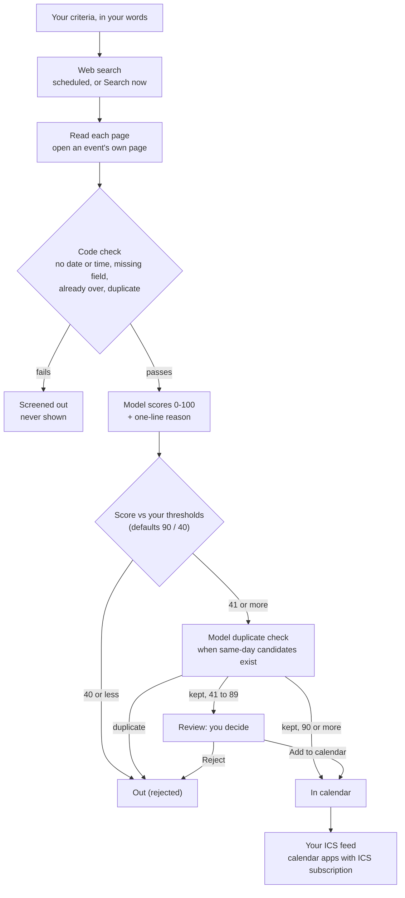

# Sail-event — product spec (PRD)

What the app does and why. Jump to:
[Problem](#problem) ·
[Workflow](#core-workflow) ·
[One picture](#the-workflow-in-one-picture) ·
[Expected behaviour](#expected-behaviour) ·
[Features and their issues](#features-the-mvp-settles-on) ·
[Out of scope](#out-of-scope-for-the-mvp) ·
[Changed after the MVP](#changed-after-the-mvp-dated)

## Product goal

Find the events a person would want to attend, decide for them when the answer is
clear, ask them when it is not, and put the accepted events on their calendar.

## Problem

No single source lists every event a person might attend. A web search accepts
free text, but returns pages: the person still has to check dates and places,
decide what fits, copy events into a calendar and repeat the search.

Sail-event repeats discovery, scores the extracted events against the saved
criteria and publishes accepted events to a calendar feed. The
[quality targets and measurements](search-spec.md#2-quality-definition) define
how search results are assessed.

### Who it is for: three jobs

For people who want relevant events in their calendar without repeating the
search and checking every page. The jobs and outcomes are defined once in
[ux-spec.md §1](ux-spec.md#1-who-the-user-is).

### Before and with Sail-event

| Work the person repeats | What Sail-event supplies |
|---|---|
| Repeat a search for new events | Scheduled searches against saved criteria, plus **Search now** |
| Read pages and judge which events fit | Extracted events with a score, reason and source link |
| Decide and copy events into a calendar | Threshold triage, a review list and an ICS feed |

## Users

Several people use one deployment. Each user has their own account, their own
criteria, their own event list and their own calendar feed. Authenticated event and criteria access is scoped to the user. A feed URL is
a bearer link: anyone holding it can read that feed.

## Core workflow

### 1. Describe what you want

A user writes their criteria in their own words: topics, places, dates, formats,
anything that matters to them. One free-text profile per user, editable at any time.

### 2. Search

The query is the criteria text plus the word `event`, sent to one selected web
search provider ([pipeline.py](https://github.com/alexisdacquay/sail-event/blob/542e58cb0fe73065a905febec7637bfa377a77c4/backend/app/services/pipeline.py#L286-L298)).
The app collects candidate pages and reads each one for events
(title, start date and time, place, link, description).
When a listing page links to an event's own page, the app opens that page too ([#139](https://github.com/alexisdacquay/sail-event/issues/139)).

**When it runs.** A GitHub workflow enqueues background searches for production
users, with cron expression `7 * * * *`
([hourly-search.yml](../.github/workflows/hourly-search.yml)).

**Search now** starts on demand. Measurements with live adapters in
[PR #144](https://github.com/alexisdacquay/sail-event/pull/144) range from **86 to
493 seconds** across local runs, branches and concurrency settings.

### 3. Screen out (code, no model)

Code drops what it can check without a model.
The funnel calls these **screened out**.

| Dropped | Counter | Where |
|---|---|---|
| No start date | `filtered_no_date` | [filters.py](https://github.com/alexisdacquay/sail-event/blob/542e58cb0fe73065a905febec7637bfa377a77c4/backend/app/services/filters.py#L195-L197) |
| A date but no start time | `filtered_no_time` | [filters.py](https://github.com/alexisdacquay/sail-event/blob/542e58cb0fe73065a905febec7637bfa377a77c4/backend/app/services/filters.py#L200-L202) |
| A required field missing (title, description, time zone, city, country) | `filtered_incomplete` | [filters.py](https://github.com/alexisdacquay/sail-event/blob/542e58cb0fe73065a905febec7637bfa377a77c4/backend/app/services/filters.py#L205-L207) |
| Already over | `filtered_past` | [filters.py](https://github.com/alexisdacquay/sail-event/blob/542e58cb0fe73065a905febec7637bfa377a77c4/backend/app/services/filters.py#L210-L213) |
| Duplicate: same event page already stored for that day | `filtered_duplicate` | [filters.py](https://github.com/alexisdacquay/sail-event/blob/542e58cb0fe73065a905febec7637bfa377a77c4/backend/app/services/filters.py#L217-L221) |

Pages that are not events (articles, venue pages, top-10 lists) are skipped
earlier, when the page is read. The funnel shows them as "Skipped N pages that were not events".

Wrong place and wrong dates are **not** screened by code.
The judge prompt assigns scores 0–9 to them, below the default lower threshold ([judge prompt](../backend/app/adapters/prompts/judge_v3.md)).

### 4. Score

A model reads each remaining event against the user's criteria and returns a score
from 0 to 100 with a one-line reason. The score, the reason and the model used are
stored on the event.

After storage, a model check compares each new accepted or queued event with
other stored events on its date, when there are candidates. A duplicate is moved to **Out** ([#136](https://github.com/alexisdacquay/sail-event/issues/136)).

### 5. Triage

Two thresholds split the scored events. Defaults: 90 and 40.
The words are the ones the UI shows on each row.

| Score (defaults) | Rule in code | UI status |
|---|---|---|
| 90 or more | `score >= upper` | **In calendar** (accepted automatically) |
| 41 to 89 | in between | **Review** (you decide) |
| 40 or less | `score <= lower` | **Out** (rejected automatically) |

Rule: [pipeline.py#L743-L750](https://github.com/alexisdacquay/sail-event/blob/542e58cb0fe73065a905febec7637bfa377a77c4/backend/app/services/pipeline.py#L743-L750).
Proof: [test_triage_uses_ge_le_cutoffs](https://github.com/alexisdacquay/sail-event/blob/542e58cb0fe73065a905febec7637bfa377a77c4/backend/tests/test_pipeline.py#L306) runs a search and checks every event against this rule.

**Out** rows are hidden until the user selects **show**. A later search does not
bring a rejected event back. The user can change the thresholds.

### 6. Approve

The user opens the app and sees the **Review** rows. For each one they choose
**Add to calendar** or **Reject**. There is no notification; the list is where they look.

### 7. Calendar

The app publishes one calendar feed (ICS) per user. **In calendar** events appear in it;
the user subscribes to the feed from their calendar application. Rejecting an
accepted event removes it from the feed.

## The workflow in one picture

The [triage implementation](https://github.com/alexisdacquay/sail-event/blob/542e58cb0fe73065a905febec7637bfa377a77c4/backend/app/services/pipeline.py#L743-L750)
sets the inclusive boundaries: 90 is In calendar and 40 is Out at the defaults.
The pipeline test linked above checks the statuses produced by a fixture search.

## Expected behaviour

| When you... | The app... | Proved by |
|---|---|---|
| sign up as a second user | starts with empty criteria and no events from the first user | [Journey 2](https://github.com/alexisdacquay/sail-event/blob/542e58cb0fe73065a905febec7637bfa377a77c4/e2e/journeys.spec.ts#L158) · [test_user_isolation](https://github.com/alexisdacquay/sail-event/blob/542e58cb0fe73065a905febec7637bfa377a77c4/backend/tests/integration/test_integration.py#L135) |
| repeat the fixture search | leaves no duplicate accepted/queued events in the fixture integration scenario | [test_dedup](https://github.com/alexisdacquay/sail-event/blob/542e58cb0fe73065a905febec7637bfa377a77c4/backend/tests/integration/test_integration.py#L103) |
| get a score of 90+, 41-89, or 40- (defaults) | marks it In calendar, Review, or Out | [test_triage_uses_ge_le_cutoffs](https://github.com/alexisdacquay/sail-event/blob/542e58cb0fe73065a905febec7637bfa377a77c4/backend/tests/test_pipeline.py#L306) |
| reject an event | keeps it rejected; a later search never brings it back | [test_rejected_event_survives_later_search](https://github.com/alexisdacquay/sail-event/blob/542e58cb0fe73065a905febec7637bfa377a77c4/backend/tests/test_events.py#L150) |
| move a threshold and save | keeps it after a reload; the next search triages with it | [Journey 1](https://github.com/alexisdacquay/sail-event/blob/542e58cb0fe73065a905febec7637bfa377a77c4/e2e/journeys.spec.ts#L37-L67) · the rule reads the saved value: [pipeline.py#L743](https://github.com/alexisdacquay/sail-event/blob/542e58cb0fe73065a905febec7637bfa377a77c4/backend/app/services/pipeline.py#L743) |
| reject an event that is in your calendar | removes it from the feed | [test_rejected_event_removed_from_feed](https://github.com/alexisdacquay/sail-event/blob/542e58cb0fe73065a905febec7637bfa377a77c4/backend/tests/test_calendar.py#L112) |
| share your feed URL | lets anyone with the URL read that feed; after a reset the old URL returns 404 | [test_old_token_404_after_rotate](https://github.com/alexisdacquay/sail-event/blob/542e58cb0fe73065a905febec7637bfa377a77c4/backend/tests/test_calendar.py#L255) |
| press **Search now** a 7th time within an hour | answers 429, try later | [test_seventh_call_returns_429](https://github.com/alexisdacquay/sail-event/blob/542e58cb0fe73065a905febec7637bfa377a77c4/backend/tests/test_guardrails.py#L404) |

The intended result is no past events, missing start times, non-events,
duplicates or unexplained scores in **In calendar** or **Review**.
Targets: [search-spec.md §2](search-spec.md#2-quality-definition).

## Features the MVP settles on

MVP features, including later changes to the core loop.

Each feature links to the GitHub issues that built it.

| # | Feature | Issues |
|---|---|---|
| 1 | Per-user criteria profile in free text | [#2](https://github.com/alexisdacquay/sail-event/issues/2), [#42](https://github.com/alexisdacquay/sail-event/issues/42) |
| 2 | Scheduled and on-demand search, model scoring, three-way triage | [#11](https://github.com/alexisdacquay/sail-event/issues/11), [#19](https://github.com/alexisdacquay/sail-event/issues/19), [#20](https://github.com/alexisdacquay/sail-event/issues/20), [#22](https://github.com/alexisdacquay/sail-event/issues/22), [#54](https://github.com/alexisdacquay/sail-event/issues/54)-[#63](https://github.com/alexisdacquay/sail-event/issues/63) |
| 3 | Approval queue | [#3](https://github.com/alexisdacquay/sail-event/issues/3), [#41](https://github.com/alexisdacquay/sail-event/issues/41), [#63](https://github.com/alexisdacquay/sail-event/issues/63) |
| 4 | Per-user ICS calendar feed | [#12](https://github.com/alexisdacquay/sail-event/issues/12), [#36](https://github.com/alexisdacquay/sail-event/issues/36), [#71](https://github.com/alexisdacquay/sail-event/issues/71) |
| 5 | Multi-user accounts | [#7](https://github.com/alexisdacquay/sail-event/issues/7) |

## Decisions made for the MVP

### Multi-user from the start

**Decision:** accounts with username and password; every record belongs to a user.

**Why:** the app is deployed publicly and others must be able to try it as
themselves.

**Alternatives considered:** single profile (simpler, but nobody else can use the
deployment); shared group feed (not the product).

### Web search is the only source

**Decision:** events come from a web search provider, nothing else.

**Why:** the point is to find events the user does not already know about.

**Alternatives considered:** pasted calendar feeds (events the user already found);
manual add (same).

### A model applies the criteria

**Decision:** criteria are free text; a model scores each event against them.

**Why:** topic, place and date preferences need interpretation against the
information on an event page. The saved sentence is the judge's input.

**Alternatives considered:** code-only filters (cheap, testable, too blunt);
facet-by-facet scoring (more rules to maintain). Code still screens missing
data, past events and known pages before the judge.

**Cost accepted:** every run makes model calls; tests and reviewers need a model
key or recorded answers. Local defaults use recorded answers.

### Three-way triage with user-set thresholds

**Decision:** auto-accept, auto-reject, ask in between.

**Why:** the user should only be asked about the events the model is unsure of.

**Alternative considered:** the user decides every event, increasing the review
work the thresholds are intended to reduce.

### Calendar by published feed

**Decision:** the app serves an ICS feed per user; no calendar-provider login.

**Why:** no third-party credentials, works with calendar applications that support ICS subscriptions, one
endpoint in the API contract.

**Alternatives considered:** writing into Google Calendar (needs a Google cloud
project and per-user sign-in); app-only list (requires opening the app to see accepted events).

**Cost accepted:** a feed is pulled on the calendar application's schedule; an accepted event
appears when the calendar client refreshes. Anyone holding the feed URL can read it.

### Scheduled search plus a button

**Decision:** a GitHub cron configured as `7 * * * *` and a manual **Search now**.

**Why:** repeat discovery without requiring the user to repeat the search.

**Cost accepted:** daily limits default to 600 search credits and 5000 model calls
([budget.py](../backend/app/services/budget.py)); **Search now** defaults to six
requests per user per hour. There is no per-search event cap; daily budgets
still stop work.

## Out of scope for the MVP

What it does not do:

- travel schedule (where the user will be on a date)
- crawling: the app opens an event's own page from a listing (one hop, [#139](https://github.com/alexisdacquay/sail-event/issues/139)), and follows no other links
- more than one search provider in the same run (one at a time, picked by `SEARCH_PROVIDER`)
- sharing or seeing other users' events
- writing into Google Calendar; push refresh of the calendar
- email or other notifications
- editing a score by hand
- price or budget rules: the judge scores topic, place and dates only ([search-spec.md revision 2026-10-18](search-spec.md))

## Changed after the MVP (dated)

| Date | Change | Where |
|---|---|---|
| 2026-10-18 | Criteria text plus `event` is the query; no query templates | [search-spec.md](search-spec.md) (revision line) |
| 2026-10-20 | The judge decides place and dates; code no longer filters them | commit [b656aa5](https://github.com/alexisdacquay/sail-event/commit/b656aa5) |
| 2026-10-24 | Six mandatory fields; an event without a start time is dropped | [#134](https://github.com/alexisdacquay/sail-event/issues/134) |
| 2026-10-25 | Event-page hop: a listing's event is completed from its own page before the judge | [#139](https://github.com/alexisdacquay/sail-event/issues/139), PR [#141](https://github.com/alexisdacquay/sail-event/pull/141) |
| 2026-10-25 | Duplicates: one code check, then a model check after storage | [#136](https://github.com/alexisdacquay/sail-event/issues/136), PR [#149](https://github.com/alexisdacquay/sail-event/pull/149) |
| 2026-10-25 | One search provider at a time, chosen by `SEARCH_PROVIDER`: `tavily`, `brave` or `exa` | [factory.py](../backend/app/adapters/factory.py), PR [#147](https://github.com/alexisdacquay/sail-event/pull/147) |
| 2026-10-25 | Extraction and judging default to concurrency 10; per-search event cap removed | PR [#144](https://github.com/alexisdacquay/sail-event/pull/144) |
| 2026-10-26 | Delete stored events without start times; drop the event link/start unique constraint | PR [#150](https://github.com/alexisdacquay/sail-event/pull/150) |
| 2026-10-26 | Event-page hop follows listing links to public hosts, including other sites | PR [#151](https://github.com/alexisdacquay/sail-event/pull/151) |

## Later, after the MVP

This was the planning category; the on-call work (#25/#26) and agent extension
work (#28) were delivered. See [incident-response](../incident-response/README.md)
and the [QA agent](../.claude/agents/qa-engineer.md). Observability, alerting and
the responder operate on the local `make up-all` stack. The recorded alert
firings and repairs are injected-fault drills.
