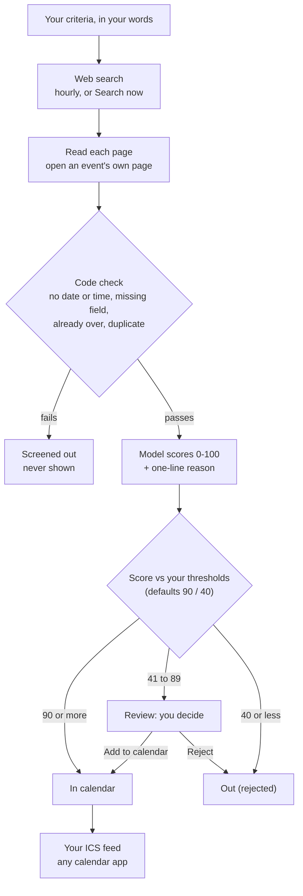

# Sail-event — product spec (PRD)

What the app does and why. Jump to:
[Problem](#problem) ·
[Workflow](#core-workflow) ·
[One picture](#the-workflow-in-one-picture) ·
[Expected behaviour](#expected-behaviour) ·
[Features and their issues](#features-the-mvp-settles-on) ·
[Out of scope](#out-of-scope-for-the-mvp) ·
[Changed after the MVP](#changed-after-the-mvp-dated)

## Product goal

Find the events a person would want to attend, decide for them when the answer is
clear, ask them when it is not, and put the accepted events on their calendar.

## Problem

People who like events spend time every day scanning sites.
Small events surface late, or never.
Site filters offer fixed boxes, not your own words.

### Who it is for: three jobs

A person who wants to go to events but does not want to scan sites every day.
Table copied from [ux-spec.md §1](ux-spec.md#1-who-the-user-is).

| Job | When | Done when |
|---|---|---|
| Set up what I like | Once, then tweak occasionally | My criteria are saved and a search has run |
| See what was found and decide | Every day or two | The queue is empty: every borderline event accepted or rejected |
| Get it on my calendar | After accepting | I subscribed to the feed; accepted events appear in my calendar app |

### Before and with Sail-event

| Before | With Sail-event |
|---|---|
| Open 5-10 sites a day | Write one sentence, once |
| Miss events on small sites | A web search runs every hour, and on **Search now** |
| Site filters are fixed boxes (city, category) | A model reads your own words and scores each event 0-100, with a one-line reason |
| Copy events into your calendar by hand | Sure ones land in your ICS feed by themselves |

## Users

Several people use one deployment. Each user has their own account, their own
criteria, their own event list and their own calendar feed. Nothing is shared
between users.

## Core workflow

### 1. Describe what you want

A user writes their criteria in their own words: topics, places, dates, formats,
anything that matters to them. One free-text profile per user, editable at any time.

### 2. Search

The criteria text is the search query, sent to one web search provider as written
([search-spec.md, revision 2026-10-18](search-spec.md)).
The app collects candidate pages and reads each one for events
(title, start date and time, place, link, description).
When a listing page links to an event's own page, the app opens that page too ([#139](https://github.com/alexisdacquay/sail-event/issues/139)).

**When it runs.** Scheduled hourly (GitHub cron at minute `:07`,
[hourly-search.yml](../.github/workflows/hourly-search.yml)).
GitHub delays or skips scheduled runs under load,
so in practice runs land every 2 to 6 hours.
Check: `gh run list -R alexisdacquay/sail-event --workflow=hourly-search.yml --limit 20`.
**Search now** is immediate. On the live site it takes 1-2 minutes.

### 3. Screen out (code, no model)

Code drops what it can check without a model.
The funnel calls these **screened out**.

| Dropped | Counter | Where |
|---|---|---|
| No start date | `filtered_no_date` | [filters.py](../backend/app/services/filters.py#L197-L200) |
| A date but no start time | `filtered_no_time` | [filters.py](../backend/app/services/filters.py#L202-L205) |
| A required field missing (title, description, time zone, city, country) | `filtered_incomplete` | [filters.py](../backend/app/services/filters.py#L207-L210) |
| Already over | `filtered_past` | [filters.py](../backend/app/services/filters.py#L212-L216) |
| Duplicate: same event page already stored for that day | `filtered_duplicate` | [filters.py](../backend/app/services/filters.py#L220-L226) |

Pages that are not events (articles, venue pages, top-10 lists) are skipped
earlier, when the page is read. The funnel shows them as "Skipped N pages that were not events".

Wrong place and wrong dates are **not** screened by code.
The model scores them 0-9, so they land in **Out** ([judge prompt](../backend/app/adapters/prompts/judge_v3.md)).

### 4. Score

A model reads each remaining event against the user's criteria and returns a score
from 0 to 100 with a one-line reason. The score, the reason and the model used are
stored on the event.

After storage, one more model call per event checks for the same event found under
two links. A duplicate is moved to Out ([#136](https://github.com/alexisdacquay/sail-event/issues/136)).

### 5. Triage

Two thresholds split the scored events. Defaults: 90 and 40.
The words are the ones the UI shows on each row.

| Score (defaults) | Rule in code | UI status |
|---|---|---|
| 90 or more | `score >= upper` | **In calendar** (accepted automatically) |
| 41 to 89 | in between | **Review** (you decide) |
| 40 or less | `score <= lower` | **Out** (rejected automatically) |

Rule: [pipeline.py#L739-L745](../backend/app/services/pipeline.py#L739-L745).
Proof: [test_triage_uses_ge_le_cutoffs](../backend/tests/test_pipeline.py#L306) runs a search and checks every event against this rule.

Rejected events never return. The user can change the thresholds.

### 6. Approve

The user opens the app and sees the **Review** rows. For each one they choose
**Add to calendar** or **Reject**. There is no notification; the list is where they look.

### 7. Calendar

The app publishes one calendar feed (ICS) per user. **In calendar** events appear in it;
the user subscribes to the feed from their calendar application. Rejecting an
accepted event removes it from the feed.

## The workflow in one picture

Boundary values (90 is In calendar, 40 is Out):
[test_triage_uses_ge_le_cutoffs](../backend/tests/test_pipeline.py#L306) ·
[test_triage_exact_boundaries](../backend/tests/test_events.py#L111).

Note for the owner: the slider labels **Auto-accept above** / **Auto-reject below**
([ScoreScale.tsx#L80-L86](../frontend/src/components/ScoreScale.tsx#L80-L86))
say "above" and "below", but the code includes the boundary (`>=`, `<=`).
That file belongs to an open PR, so it is not changed here.

## Expected behaviour

| When you... | The app... | Proved by |
|---|---|---|
| sign up as a second user | shows you none of the first user's events, criteria or feed | [Journey 2](../e2e/journeys.spec.ts#L158) · [test_user_isolation](../backend/tests/integration/test_integration.py#L131) |
| run the same search twice | adds no duplicate rows | [test_dedup](../backend/tests/integration/test_integration.py#L103) |
| get a score of 90+, 41-89, or 40- (defaults) | marks it In calendar, Review, or Out | [test_triage_uses_ge_le_cutoffs](../backend/tests/test_pipeline.py#L306) |
| reject an event | keeps it rejected; a later search never brings it back | [test_rejected_event_survives_later_search](../backend/tests/test_events.py#L150) |
| move a threshold and save | keeps it after a reload; the next search triages with it | [Journey 1](../e2e/journeys.spec.ts#L37-L67) · the rule reads the saved value: [pipeline.py#L739](../backend/app/services/pipeline.py#L739) |
| reject an event that is in your calendar | removes it from the feed | [test_rejected_event_removed_from_feed](../backend/tests/test_calendar.py#L112) |
| share your feed URL | lets anyone with the URL read that feed; after a reset the old URL returns 404 | [test_old_token_404_after_rotate](../backend/tests/test_calendar.py#L255) |
| press **Search now** a 7th time within an hour | answers 429, try later | [test_seventh_call_returns_429](../backend/tests/test_guardrails.py#L404) |

You never see in **In calendar** or **Review**: past events, events without a start time,
pages that are not events, duplicates, a score without a reason.
Targets: [search-spec.md §2](search-spec.md#2-quality-definition).

## Features the MVP settles on

Each feature links to the GitHub issues that built it.

| # | Feature | Issues |
|---|---|---|
| 1 | Per-user criteria profile in free text | [#2](https://github.com/alexisdacquay/sail-event/issues/2), [#42](https://github.com/alexisdacquay/sail-event/issues/42) |
| 2 | Hourly and on-demand search, model scoring, three-way triage | [#11](https://github.com/alexisdacquay/sail-event/issues/11), [#19](https://github.com/alexisdacquay/sail-event/issues/19), [#20](https://github.com/alexisdacquay/sail-event/issues/20), [#22](https://github.com/alexisdacquay/sail-event/issues/22), [#54](https://github.com/alexisdacquay/sail-event/issues/54)-[#63](https://github.com/alexisdacquay/sail-event/issues/63) |
| 3 | Approval queue | [#3](https://github.com/alexisdacquay/sail-event/issues/3), [#41](https://github.com/alexisdacquay/sail-event/issues/41), [#63](https://github.com/alexisdacquay/sail-event/issues/63) |
| 4 | Per-user ICS calendar feed | [#12](https://github.com/alexisdacquay/sail-event/issues/12), [#36](https://github.com/alexisdacquay/sail-event/issues/36), [#71](https://github.com/alexisdacquay/sail-event/issues/71) |
| - | Multi-user accounts | [#7](https://github.com/alexisdacquay/sail-event/issues/7) |

## Decisions made for the MVP

### Multi-user from the start

**Decision:** accounts with username and password; every record belongs to a user.

**Why:** the app is deployed publicly and others must be able to try it as
themselves.

**Alternatives considered:** single profile (simpler, but nobody else can use the
deployment); shared group feed (not the product).

### Web search is the only source

**Decision:** events come from a web search provider, nothing else.

**Why:** the point is to find events the user does not already know about.

**Alternatives considered:** pasted calendar feeds (events the user already found);
manual add (same).

### A model applies the criteria

**Decision:** criteria are free text; a model scores each event against them.

**Why:** structured filters were tried in the previous version and dropped; the
judgement is the product.

**Alternatives considered:** code-only filters (cheap, testable, too blunt);
filters first then model (two mechanisms to maintain).

**Cost accepted:** every run makes model calls; tests and reviewers need a model
key or a recorded stub.

### Three-way triage with user-set thresholds

**Decision:** auto-accept, auto-reject, ask in between.

**Why:** the user should only be asked about the events the model is unsure of.

**Alternative considered:** the user decides every event (too much work; the
previous version showed that).

### Calendar by published feed

**Decision:** the app serves an ICS feed per user; no calendar-provider login.

**Why:** no third-party credentials, works with any calendar application, one
endpoint in the API contract.

**Alternatives considered:** writing into Google Calendar (needs a Google cloud
project and per-user sign-in); app-only list (no scheduler).

**Cost accepted:** a feed is pulled on the calendar application's schedule; a hold
can appear hours late. The feed URL is a secret: anyone holding it sees the holds.

### Hourly schedule plus a button

**Decision:** a scheduled run every hour and a manual "Search now".

**Why:** events appear and sell out within a day.

**Cost accepted:** search quota and model calls scale with runs; each run is capped.

## Out of scope for the MVP

What it does not do:

- travel schedule (where the user will be on a date)
- crawling: the app opens an event's own page from a listing (one hop, [#139](https://github.com/alexisdacquay/sail-event/issues/139)), and follows no other links
- more than one search provider in the same run (one at a time, picked by `SEARCH_PROVIDER`)
- sharing or seeing other users' events
- writing into Google Calendar; push refresh of the calendar
- email or other notifications
- editing a score by hand
- price or budget rules: the judge scores topic, place and dates only ([search-spec.md revision 2026-10-18](search-spec.md))

## Changed after the MVP (dated)

| Date | Change | Where |
|---|---|---|
| 2026-10-18 | The criteria text is the search query, sent as written; no query templates | [search-spec.md](search-spec.md) (revision line) |
| 2026-10-20 | The judge decides place and dates; code no longer filters them | commit [b656aa5](https://github.com/alexisdacquay/sail-event/commit/b656aa5) |
| 2026-10-24 | Six mandatory fields; an event without a start time is dropped | [#134](https://github.com/alexisdacquay/sail-event/issues/134) |
| 2026-10-25 | Event-page hop: a listing's event is completed from its own page before the judge | [#139](https://github.com/alexisdacquay/sail-event/issues/139), PR [#141](https://github.com/alexisdacquay/sail-event/pull/141) |
| 2026-10-25 | Duplicates: one code check, then a model check after storage | [#136](https://github.com/alexisdacquay/sail-event/issues/136), PR [#149](https://github.com/alexisdacquay/sail-event/pull/149) |
| 2026-10-25 | One search provider at a time, chosen by `SEARCH_PROVIDER`: `tavily`, `brave` or `exa` | [factory.py](../backend/app/adapters/factory.py), PR [#147](https://github.com/alexisdacquay/sail-event/pull/147) |
| not shipped | No place in the criteria: queue, never auto-accept | [#101](https://github.com/alexisdacquay/sail-event/issues/101) open, PR [#103](https://github.com/alexisdacquay/sail-event/pull/103) open |

## Later, after the MVP

- self-maintenance: an on-call responder that investigates a failed or empty run
  and proposes a fix for approval (course lesson 4), and the agent extension pack
  around the project (course lesson 5)
- status 2026-10-17: both delivered. Responder: issues #25, #26, directory
  `incident-response/`. Extension pack: issue #28, reduced to the QA subagent and
  the pre-commit hook.
