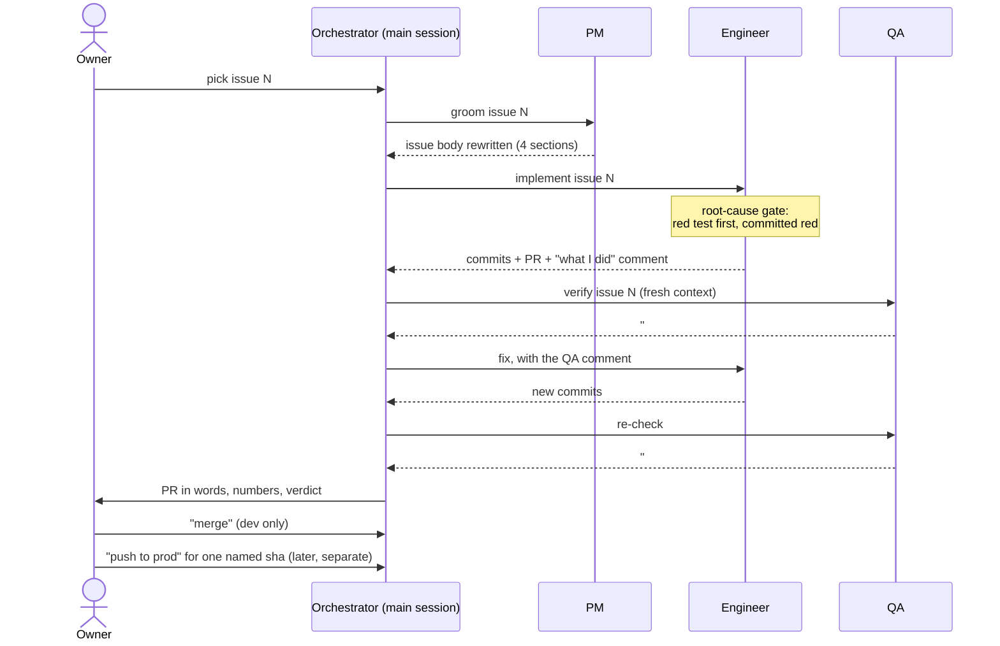

# Process: the agent team and how it works

Jump to:
[Team](#team) ·
[Roles](#roles) ·
[One cycle](#one-cycle-in-one-picture) ·
[Handoffs](#handoffs) ·
[Root-cause gate](#root-cause-gate) ·
[Phase 2](#phase-2-from-issue-65-worktrees-and-prs) ·
[Evidence](#evidence-it-ran-this-way)

- Tasks are GitHub issues
- One issue at a time
- Read the acceptance criteria before starting and before closing
- Commit regularly

## Team

| Member | Human or AI | How it starts | Decides |
|---|---|---|---|
| Owner | human | - | picks the next item; approves every merge; approves every prod promote, per sha |
| Orchestrator | AI: the main Claude Code session | the owner opens a session in this repo | which agent runs next; closes on QA PASS; may waive a criterion with a written reason |
| PM | AI: Claude Code subagent, fresh context | orchestrator launches it with its role file `_docs/team/pm.md` as instructions | how the issue is written |
| Engineer | AI: Claude Code subagent, fresh context | same, with `_docs/team/software-engineer.md` | how the code is written |
| QA | AI: Claude Code subagent, fresh context | same, with `_docs/team/qa-engineer.md`, or the runnable agent [`.claude/agents/qa-engineer.md`](../.claude/agents/qa-engineer.md) | PASS or FAIL |

Engineers and QA may launch their own subagents for independent parts
(one test suite, one file, one scenario each) whenever that saves
wall-clock time; one writer per file.

## Roles

| Role | Does | Never does | Defined in |
|---|---|---|---|
| PM | rewrites the issue into Goal, Acceptance criteria, Out of scope, Constraints; files follow-ups | writes code | [team/pm.md](team/pm.md), template [task-template.md](task-template.md) |
| Engineer | red test first, implements, commits, opens a PR, comments what it did | changes acceptance criteria; closes the issue | [team/software-engineer.md](team/software-engineer.md) |
| QA | fresh context; runs `make test`; checks every criterion; posts `## QA: PASS` or `## QA: FAIL` | edits a single file; closes the issue | [team/qa-engineer.md](team/qa-engineer.md) + [.claude/agents/qa-engineer.md](../.claude/agents/qa-engineer.md) |
| Orchestrator | picks the agent, passes work along, closes on PASS, waives with a written reason | grooms, codes, tests | this file |
| Owner (human) | picks the next item, says "merge", says "push to prod" for a sha | - | this file, [release-process.md](../docs/release-process.md) |

What would make a role unclear, and why it is not:

- Two roles could close an issue: no, only the orchestrator closes.
- QA could quietly fix what it finds: no, QA changes no file; `git status --short` must print nothing.
  QA's agent file grants `Bash, Read, Grep, Glob` (no Edit or Write tool). Bash could still write a file, so this rule rests on the instruction and that clean-tree check, not on a tool block.
- The engineer could move the goalposts: no, it may only comment on a wrong criterion, never edit it.
- A merge or a prod deploy could happen without a human: no, both wait for the owner's word.

## Lifecycle

1. Owner picks the next issue
2. PM grooms it
3. Engineer implements it
4. QA verifies it
5. On FAIL: back to engineer with the QA comment
6. On PASS: the orchestrator closes the issue
7. Repeat until the backlog is empty

## One cycle in one picture

## Handoffs

| From → To | Artifact | Where it lives |
|---|---|---|
| PM → Engineer | groomed issue body (Goal, Acceptance criteria, Out of scope, Constraints) | issue body; click **edited** above the body to see the original |
| Engineer → QA | commits + PR + "what I did" comment | issue or PR comment |
| QA → Orchestrator | `## QA: PASS` or `## QA: FAIL`, one verdict per criterion, the test command and its result | issue or PR comment |
| Orchestrator → Owner | the PR described in words, numbers, verdict | chat |
| Owner → Orchestrator | "merge" / "push to prod `<sha>`" | merge commit; [promote.yml](../.github/workflows/promote.yml) run |

## Rules

- Do not skip grooming, even when the task looks obvious
- The engineer does not close the issue, QA does not fix the code
- Do not commit until the tests pass
- Only the orchestrator closes issues. In Phase 2 a PR body may say `Closes #N`: GitHub then closes the issue when the owner's "merge" lands
- QA ticks each criterion in its own comment; the boxes in the issue body may stay unticked, the QA comment is the record

## Root-cause gate

Written in [software-engineer.md](team/software-engineer.md) and enforced by [qa-engineer.md](team/qa-engineer.md).

1. On any anomaly, the engineer stops and writes the causal chain on the issue before touching code.
2. A bug fix starts with a test that reproduces the bug from its root cause, committed while red.
3. The fix turns it green. The assertion is never changed to pass.
4. QA fails any bug fix without a regression test that fails on the parent commit.
5. A red CI job is never "unrelated" until its cause is found.

Regression tests live in [`backend/tests/regression/`](../backend/tests/regression/).

## Phase 2 (from issue #65): worktrees and PRs

From issue [#65](https://github.com/alexisdacquay/sail-event/issues/65) on (its PR [#66](https://github.com/alexisdacquay/sail-event/pull/66) carries the first QA verdict on a PR), work moved from direct commits to pull requests:

1. The engineer works in its own git worktree and opens a PR.
2. CI must be green ([ci.yml](../.github/workflows/ci.yml)).
3. QA posts its verdict on the PR. Examples: PR [#85](https://github.com/alexisdacquay/sail-event/pull/85) (two FAILs, a fix, then a written waiver), PR [#149](https://github.com/alexisdacquay/sail-event/pull/149) (PASS).
4. The orchestrator reports to the owner, who says "merge". Merge = dev only.
5. Prod moves only when the owner names a sha ([release-process.md](../docs/release-process.md)).

## Labels

- `mvp` - needed for the MVP defined in `_docs/plan.md`
- `post-mvp` - real work, deliberately not now
- Every issue carries exactly one of the two

Known gap (2026-10-25): 21 later issues (#94-#131) carry neither label.

## Who wrote a comment

Agents post with the owner's `gh` CLI login, so GitHub shows `alexisdacquay` as the author of every comment.
The first line of each comment names the role:

| Comment starts with | Role | Role file |
|---|---|---|
| issue body edit (see **edited**) | PM | [team/pm.md](team/pm.md) |
| `## Implementation ...`, `## What was done`, `## Done`, `## SWE: ...` | Engineer | [team/software-engineer.md](team/software-engineer.md) |
| `## QA: PASS`, `## QA: FAIL`, `## QA re-check: ...` | QA | [team/qa-engineer.md](team/qa-engineer.md) |
| `## QA fix: <sha>`, `QA fixes landed`, `## QA defect fixes`, `Fix in <sha>`, `**Fix:**` | the fix that answers a QA FAIL, sent back to the engineer by the lifecycle. "QA fix" means "fix for QA's findings", not "QA fixed it". It is not a verdict: the fresh `## QA: PASS` after it is | [team/software-engineer.md](team/software-engineer.md) |
| `Closed by the orchestrator ...`, `... closed by the orchestrator.`, `Orchestrator: ...`, `Merged to main; on dev ...` | Orchestrator | this file |

Known gap: session transcripts from 2026-10-16 to 2026-10-17 are not kept. For a fix comment such as `## QA fix: db3499a` on [#7](https://github.com/alexisdacquay/sail-event/issues/7), the record shows the fix and the fresh QA re-check, not which agent typed the fix.

## Evidence it ran this way

Counts on 2026-10-26 (they grow as work continues), each with the command that produced it. They count comments that start with a `## QA: PASS` / `## QA: FAIL` heading; older verdicts written as `**QA verdict: ...**` are not counted.

| Count | What | Command |
|---|---|---|
| 58 | issues groomed into all four sections | `gh issue list -R alexisdacquay/sail-event --state all --limit 400 --json body --jq '[.[] \| select(.body \| test("(?m)^#+ *Goal") and test("(?m)^#+ *Acceptance criteria") and test("(?m)^#+ *Out of scope") and test("(?m)^#+ *Constraints"))] \| length'` |
| 69 | issues with a QA verdict | `gh issue list -R alexisdacquay/sail-event --state all --limit 400 --json comments --jq '[.[] \| select(any(.comments[]; .body \| test("(?m)^#+ *QA:? *(PASS\|FAIL)")))] \| length'` |
| 23 | issues sent back on a QA FAIL | same, with `FAIL` only |
| 30 | PRs with a QA verdict | same as 69, with `gh pr list` |
| 45 | issues whose closing note says "closed by the orchestrator" | `gh issue list -R alexisdacquay/sail-event --state all --limit 400 --json comments --jq '[.[] \| select(any(.comments[]; .body \| test("closed by the orchestrator"; "i")))] \| length'` |

Who closed the 85 closed issues (2026-10-26):

| Closed issues | How |
|---|---|
| 45 | a note that says "closed by the orchestrator" (count above) |
| 28 | the orchestrator's merge note: "Merged to main; on dev ...", "Merged into main in #64", "Merged via PR 144" |
| 7 | GitHub, when a PR that says `Closes #N` merged on the owner's word: #46, #52, #68, #83, #120, #122, #142 |
| 5 | other notes: #17, #21, #29 ("Delivered on Render instead of AWS", no role named); #39, #55 (the orchestrator says it fixed or re-checked, then closed; see Known gaps below) |

One full cycle on one page: issue [#7](https://github.com/alexisdacquay/sail-event/issues/7).
QA failed it because a 400 response echoed the plaintext password; fix `db3499a` landed; a fresh QA pass checked it and passed.

The PM groom on one page: open issue [#11](https://github.com/alexisdacquay/sail-event/issues/11), click **edited** above the body.
The oldest version is the raw task (627 characters); the next is the PM groom (Goal, Acceptance criteria, Out of scope, Constraints).

Known gaps (2026-10-26):

- Issues #139 and #142 (PRs #141, #143) were closed with no QA verdict.
- PR #144 (#145) merged after three QA FAILs with no written waiver.
- Issues [#39](https://github.com/alexisdacquay/sail-event/issues/39), [#52](https://github.com/alexisdacquay/sail-event/issues/52) and [#55](https://github.com/alexisdacquay/sail-event/issues/55): after a QA FAIL on one item, the orchestrator added the missing line (#39, #52) or re-checked the fix itself (#55) and closed, with no fresh QA pass. Each closing note says so.

## Test runner — four phases

One runner (`backend/tests/field/runner.py --base-url URL --phase N`) runs phases 1..N:
1. Invariants battery (13 checks, quick) — are the core promises kept?
2. Regression tests (`backend/tests/regression/`) — do past bugs stay fixed?
3. Breadth batch (20 dissimilar searches, quick) — does the system handle variety?
4. Recall ground truth (38 events) — does it find what exists?
Each run logs numbers and deltas to `work/RUN-LOG.md`.
