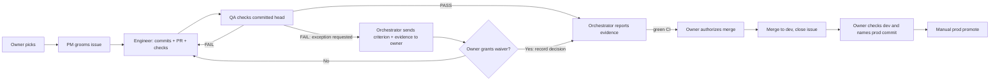

# Process: the agent team and how it works

[Team](#team) · [Roles](#roles) · [Starting an agent](#how-the-orchestrator-starts-an-agent) · [Lifecycle](#lifecycle) · [Handoffs](#handoffs) · [Rules](#rules) · [Process records](#process-records)

The owner directs the orchestrator, which briefs separate PM, engineer and QA
agents. Several can work in parallel: one issue per agent, one writer per file.
[Process records](#process-records) show the handoffs in practice.

## Team

The human owner starts the main Claude Code session. That session is the AI
orchestrator; it loads [AGENTS.md](../AGENTS.md) and launches separate PM,
engineer and QA agents. The role files are their instructions:
[PM](team/pm.md), [engineer](team/software-engineer.md), [QA](team/qa-engineer.md).

## Roles

| Role | Does | Must not do |
|---|---|---|
| PM | Writes Goal, Acceptance criteria, Out of scope and Constraints; links follow-ups | Write code or settle an unresolved product choice without the owner |
| Engineer | Implements, tests, commits and opens a PR; for bug fixes, follows the root-cause gate below | Change acceptance criteria, close the issue or merge without authorization |
| QA | Runs checks and records a verdict per criterion | Edit any project file, fix the defect, merge or close the issue |
| Orchestrator | Assigns work, passes evidence between roles, records owner decisions, closes after review | Groom issues, implement changes or perform QA; start the next item without the owner's pick |
| Owner | Sets scope and priority; approves merge and prod separately | — |

## How the orchestrator starts an agent

The orchestrator starts PM and engineer tasks as `general-purpose` background
subagents. QA uses the registered [`qa-engineer`](../.claude/agents/qa-engineer.md)
agent.

Each launch gets a brief naming the role file, AGENTS.md, issue, constraints,
assigned checkout and expected reply. A worktree is a separate copy of the repo;
the engineer works on its own branch, and QA checks the exact submitted commit
(the PR's head). PM also reads this process, the task template and product plan.
PM and engineer read the architecture, API contract and relevant code; QA reads
the issue, PR and code at the submitted commit. [A recorded brief and context
handoffs follow](#brief-and-context-details).

## Lifecycle

1. The owner picks an issue. The orchestrator asks PM to groom it and returns unresolved product choices to the owner.
2. The engineer implements in its worktree, runs checks, commits and opens a linked PR.
3. QA independently checks the submitted commit and posts PASS/FAIL per criterion. On FAIL, the orchestrator sends the findings to the engineer for a fix, then asks QA to check the new commit.
4. To request an exception, the orchestrator sends the unmet criterion and evidence to the owner. The owner grants or rejects a waiver; the decision is recorded on the issue or PR. A waiver leaves the QA verdict as FAIL.
5. With green CI and either QA PASS or a recorded owner waiver, the orchestrator reports the evidence and asks the owner to authorize merge. Merge updates dev; GitHub closes the issue through `Closes #N`, or the orchestrator closes it.
6. The owner checks dev and approves a named commit for [manual prod promotion](../docs/release-process.md).

Since **2026-10-21**, the process requires the owner's pick for each next item
and a dev check before each prod promotion, retaining priority and release decisions.

## Handoffs

Agent-to-agent handoffs below pass through the orchestrator, which receives
each report and briefs the next role.

| Producer → Consumer | Artifact | Checkable record |
|---|---|---|
| Orchestrator → PM/Engineer/QA | Brief: role, read list, issue, constraints, assigned checkout and commit, reply format | Agent prompt in local session transcript |
| PM → Engineer | Four-section issue body and linked follow-ups | Issue body and **edited** history |
| Engineer → QA | Committed head, PR, implementation summary, commands/results | PR and issue/PR comments |
| QA → Engineer/Orchestrator | PASS/FAIL per criterion, checked head, commands and observed failures | PR verdict; issue verdict in the earlier workflow |
| Owner → Orchestrator | Scope, waiver decision, merge authorization or approval of a prod commit | Chat; waiver decisions recorded on issue/PR; scope decisions on #136 and #145 |
| Orchestrator → Owner | Change, test evidence, QA verdict, remaining risks; unmet criterion and evidence when requesting a waiver | Chat for approval; issue/PR for waivers; merge and promote runs for execution |

## One cycle in one picture



## Brief and context details

For example, the issue #1 engineer brief began (abridged from the local transcript):

> You're a Software Engineer on the Sail-event project … Your role is defined in
> `_docs/team/software-engineer.md`; read it first and follow it exactly. Read
> `AGENTS.md` and `_docs/architecture.md` too. Implement issue #1: read it with
> `gh issue view 1 -R alexisdacquay/sail-event` … Reply with only: the commit
> hashes, the `make test` summary line(s), and anything you could not satisfy.

That early brief assigned the shared checkout. Later briefs assign an engineer
worktree and QA a detached worktree at the PR head. Fix rounds can be sent back
with `SendMessage`; issue #7 reused the same QA agent for its re-check.

Supervision recorded in [STATE](../work/STATE.md): check progress roughly every
9 minutes using status, file times and agent output; investigate 20 minutes of
silence before stopping and relaunching with a handoff. Before context
compression, record active issues, heads, worktrees, verdicts, pending owner
decisions and the next action in STATE. A resumed session reads that top block
and the referenced evidence; it must not restart from an old backlog position.

## Rules

- Groom before implementation. If a criterion is wrong, the engineer comments and waits; it does not rewrite the issue's acceptance criteria.
- Run `make test`, then commit completed work. Agents may use `SKIP_HOOK_TESTS=1` after running it themselves, to avoid a second run. Exception: a deliberately red regression-test commit (root-cause gate step 2) is committed with `SKIP_HOOK_TESTS=1`, because `make test` fails on purpose at that point. The hook's secret-pattern scan still runs.
- Require green PR CI and a QA verdict before asking to merge. The owner must explicitly accept any unmet criterion.
- QA never changes project files and checks that its reviewed worktree is clean.
- The orchestrator closes issues, or GitHub does on merge of `Closes #N`. QA records each criterion in its comment.
- Do not use `rm` or `sed -i`. Keep credentials out of output and tracked files. Do not nest engineer agents unless the brief assigns independent parts; keep one writer per file.

## Root-cause gate

For bug fixes, this gate was added to the [engineer](team/software-engineer.md)
and [QA](team/qa-engineer.md) roles on **2026-10-25**, commit `c0f83e6`; added here
on 2026-10-26 in `ac54483`. Verify the additions directly:

```sh
git show c0f83e6 -- _docs/team/software-engineer.md _docs/team/qa-engineer.md
git show ac54483 -- _docs/process.md
```

1. On a failing test, unexpected result or red CI job, write the observed failure and causal chain on the issue before changing code.
2. Add a test reproducing the cause and commit it while red, using `SKIP_HOOK_TESTS=1` for this deliberate exception.
3. Fix the cause and run `make test`. Do not weaken the regression assertion to make it pass.
4. QA verifies the new test against the pre-fix code (red) and the submitted head (green). See the [QA steps](team/qa-engineer.md#how-you-check).
5. Explain a red CI job before calling it unrelated. Report an unresolved cause and stop for the orchestrator.

Regression tests live in [backend/tests/regression/](../backend/tests/regression/).

<a id="phase-2-from-issue-65-worktrees-and-prs"></a>

## Phase 1 and Phase 2

**Phase 1, 2026-10-16 to 2026-10-20:** shared checkout with QA verdicts on issues.
PRs #30–#32 were created on 2026-10-17.

**Phase 2, from issue #65 on 2026-10-20:** assigned worktrees and PR review;
PR [#66](https://github.com/alexisdacquay/sail-event/pull/66) carries the first QA
heading on a PR. The owner gates followed on 2026-10-21. Several engineer and QA
agents could proceed in parallel; dependent changes needed rebasing and review
at their final commit.

## Labels

The grooming rule uses `mvp` or `post-mvp` to mark scope. Topic labels include
`enhancement`, `search-v2`, `ux`, `bug`, `theme` and `robustness`.

## Who wrote a comment

GitHub comments use the owner's `alexisdacquay` login, with role headings to
identify the handoff. Common forms include:

| Text | Meaning |
|---|---|
| `## Implementation`, `## SWE:`, `## S5 implementation complete` | Engineer's implementation report |
| `## QA: PASS`, `## QA: FAIL`, `## QA FAIL`, `## QA final check: PASS` | QA verdict or re-check; read the criterion results |
| `## QA fix: <sha>` | Fix submitted in response to QA findings |
| `Closed by the orchestrator`, `Merged to main` | Closing or merge handoff |
| `Owner decisions … (recorded by the orchestrator)` | Owner's decision transcribed to the tracker |

PM work is an issue-body edit, visible through **edited**. Session transcripts
are retained locally; public comments use role headings for attribution.

<a id="evidence-it-ran-this-way"></a>
<a id="process-records-and-exceptions"></a>

## Process records

The **2026-10-26** tracker snapshot for **#1–#152** shows the team at work:

- **58 groomed issues** with Goal, Acceptance criteria, Out of scope and Constraints give engineers a checkable specification.
- **69 issues with QA verdicts** record independent review.
- **QA sent work back on 23 issues**, showing that review challenges the implementation before re-checking it.

Reproduce the counts from the public tracker:

```sh
gh issue list -R alexisdacquay/sail-event --state all -L 400 --json number,body,comments | python3 -c '
import json,re,sys
rows=[x for x in json.load(sys.stdin) if x["number"]<=152]
groom=lambda x: all(re.search(r"(?m)^#+ *"+h,x["body"]) for h in ("Goal","Acceptance criteria","Out of scope","Constraints"))
qa=lambda x,pattern: any(re.search(pattern,c["body"]) for c in x["comments"])
print("Groomed issues:",sum(map(groom,rows)))
print("Issues with QA verdicts:",sum(qa(x,r"(?m)^#+ *QA:? *(PASS|FAIL)") for x in rows))
print("Issues sent back by QA:",sum(qa(x,r"(?m)^#+ *QA:? *FAIL") for x in rows))'
```

Read issue [#7](https://github.com/alexisdacquay/sail-event/issues/7) for a full
review cycle: QA sent the first version back, the engineer's fix landed in
`db3499a`, and QA re-checked and passed. The local transcript records reuse of
the same QA agent. Issue [#11](https://github.com/alexisdacquay/sail-event/issues/11)'s
**edited** history shows the PM handoff: the raw task became a four-section
specification.

## Field-test references

The field runner is described in [docs/testing.md](../docs/testing.md) and the
[field-test skill](../.claude/skills/field-test/SKILL.md). The owner authorizes live
runs, which spend search and model quota; findings return to the orchestrator
for the owner to prioritize before the PM → engineer → QA cycle.
[RUN-LOG](../work/RUN-LOG.md) is the new log template; earlier runs are in
[FIELD-TESTS](../work/FIELD-TESTS.md).
