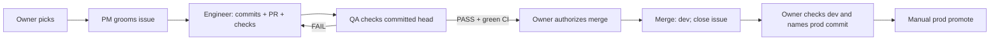

# Process: the agent team and how it works

[Team](#team) · [Roles](#roles) · [Starting an agent](#how-the-orchestrator-starts-an-agent) · [Lifecycle](#lifecycle) · [Handoffs](#handoffs) · [Rules](#rules) · [Evidence and gaps](#evidence-it-ran-this-way)

The owner directs the orchestrator, which briefs separate PM, engineer and QA
agents. Several can work in parallel: one issue per agent, one writer per file.
[Evidence and known gaps](#evidence-it-ran-this-way) follow the operating model.

## Team

The human owner starts the main Claude Code session. That session is the AI
orchestrator; it loads [AGENTS.md](../AGENTS.md) and launches separate PM,
engineer and QA agents. The role files are their instructions:
[PM](team/pm.md), [engineer](team/software-engineer.md), [QA](team/qa-engineer.md).

## Roles

| Role | Does | Must not do |
|---|---|---|
| PM | Writes Goal, Acceptance criteria, Out of scope and Constraints; links follow-ups | Write code or settle an unresolved product choice without the owner |
| Engineer | Implements, tests, commits and opens a PR; for bug fixes, follows the dated root-cause gate below | Change acceptance criteria, close the issue or merge without authorization |
| QA | Runs checks and records a verdict per criterion | Edit any project file, fix the defect, merge or close the issue |
| Orchestrator | Assigns work, passes evidence between roles, records owner decisions, closes after review | Substitute its own implementation or test result for independent QA; start the next item without the owner's pick |
| Owner | Sets scope and priority; approves merge and prod separately | No automated role restriction |

## How the orchestrator starts an agent

PM and engineer start as `general-purpose` background subagents; QA uses the
registered [`qa-engineer`](../.claude/agents/qa-engineer.md). Earlier QA launches
and later exceptions used `general-purpose`. Recorded launches use `model: opus`;
STATE also records Fable for judgment-heavy work.

The Agent-call brief supplies role file, AGENTS.md, issue, constraints,
worktree/head and reply format. PM also reads this process, the task template,
plan, architecture, contract and code; engineer reads architecture, contract and
code; QA reads the issue, PR and submitted head. Outputs are a groomed issue,
commits/PR/checks, or a verdict link respectively. [A real brief and context
handoffs follow](#brief-and-context-details).

## Lifecycle

1. Owner picks; PM grooms. Open product choices return through the orchestrator.
2. Engineer implements in its worktree, runs checks, commits and opens a linked PR.
3. QA checks that head independently and posts PASS/FAIL per criterion. FAIL returns to the engineer, then QA re-checks the new head.
4. With QA PASS and green CI, the orchestrator reports evidence; the owner authorizes merge. Merge updates dev and closes the issue through `Closes #N`, or the orchestrator closes it. Any waiver records the unmet criterion and owner's decision.
5. Owner checks dev and approves a named commit for [manual prod promotion](../docs/release-process.md).

Owner priority/prod gates began **2026-10-21**; the original 2026-10-16 process
ran an unattended backlog loop. Rollback across the three migrations added by
PRs #128/#150 is untested; PR #150's deletion is irreversible. A code redeploy
does not restore deleted data.

## Handoffs

| From → To | Artifact | Checkable record |
|---|---|---|
| Orchestrator → PM/Engineer/QA | Brief: role, read list, issue, constraints, head/worktree, reply format | Agent prompt in local session transcript; not public |
| PM → Engineer | Four-section issue body and linked follow-ups | Issue body and **edited** history |
| Engineer → QA | Committed head, PR, implementation summary, commands/results | PR and issue/PR comments |
| QA → Engineer/Orchestrator | PASS/FAIL per criterion, checked head, commands and observed failures | PR verdict; issue verdict in the earlier workflow |
| Owner → Orchestrator | Scope, “merge”, or approval of a prod commit | Chat; some decisions copied to issues, e.g. #136 and #145 |
| Orchestrator → Owner | Change, test evidence, QA verdict, remaining risks | Chat for approval; merge and promote runs for execution |

## One cycle in one picture



For bug fixes since 2026-10-25, the engineer also follows the root-cause gate.

## Brief and context details

For example, the issue #1 engineer brief began (abridged from the local transcript):

> You're a Software Engineer on the Sail-event project … Your role is defined in
> `_docs/team/software-engineer.md`; read it first and follow it exactly. Read
> `AGENTS.md` and `_docs/architecture.md` too. Implement issue #1: read it with
> `gh issue view 1 -R alexisdacquay/sail-event` … Reply with only: the commit
> hashes, the `make test` summary line(s), and anything you could not satisfy.

That early brief assigned the shared checkout. Later briefs assign an engineer
worktree and QA a detached worktree at the PR head. Fix rounds can be sent back
with `SendMessage`; issue #7 reused the same QA agent for its re-check.

Supervision recorded in [STATE](../work/STATE.md): check progress roughly every
9 minutes using status, file times and agent output; investigate 20 minutes of
silence before stopping and relaunching with a handoff. Before context
compression, record active issues, heads, worktrees, verdicts, pending owner
decisions and the next action in STATE. A resumed session reads that top block
and the referenced evidence; it must not restart from an old backlog position.

## Rules

- Groom before implementation. If a criterion is wrong, the engineer comments and waits; it does not edit the contract.
- Run `make test`, then commit completed work. Agents may use `SKIP_HOOK_TESTS=1` after running it themselves, to avoid a second run. The exception is a deliberately red regression-test commit under the gate below. The hook's secret-pattern scan still runs; it is not a guarantee that every secret is detected.
- Require green PR CI and a QA verdict before asking to merge. The owner must explicitly accept any unmet criterion; a closing note claiming PASS is not a QA verdict.
- QA never changes project files. In the shared checkout a clean-tree check also checked the engineer had committed. In a detached QA worktree it checks only that the reviewed checkout remains clean; it cannot prove the engineer left nothing uncommitted elsewhere.
- The orchestrator closes issues, or GitHub does on merge of `Closes #N`. QA records each criterion in its comment; issue-body boxes need not be the review record.
- Do not use `rm` or `sed -i`. Keep credentials out of output and tracked files. Do not nest engineer agents unless the brief assigns independent parts; keep one writer per file.
- Current freeze (owner, 2026-10-26): documentation only; no new product work.

## Root-cause gate

Added to the [engineer](team/software-engineer.md) and [QA](team/qa-engineer.md)
roles on **2026-10-25**, commit `c0f83e6`; added here on 2026-10-26. It applies to
bug fixes, not every feature since the project began.

1. On a failing test, unexpected result or red CI job, write the observed failure and causal chain on the issue before changing code.
2. Add a test reproducing the cause and commit it while red, using `SKIP_HOOK_TESTS=1` for this deliberate exception.
3. Fix the cause and run `make test`. Do not weaken the regression assertion to make it pass.
4. QA verifies the new test against the pre-fix code (red) and the submitted head (green). See the [QA steps](team/qa-engineer.md#how-you-check).
5. Explain a red CI job before calling it unrelated. Report an unresolved cause and stop for the orchestrator.

QA checks the regression evidence and criteria; the written causal analysis and
commit sequence remain review obligations, not a mechanical enforcement gate.
Regression tests live in [backend/tests/regression/](../backend/tests/regression/).

## Phase 2 (from issue #65): worktrees and PRs

**Phase 1, 2026-10-16 to 2026-10-20:** shared checkout, mostly direct commits,
QA comments on issues. PRs already existed: #30–#32 were created on 2026-10-17.

**Phase 2, from issue #65 on 2026-10-20:** assigned worktrees and PR review;
PR [#66](https://github.com/alexisdacquay/sail-event/pull/66) carries the first QA
heading on a PR. The owner gates followed on 2026-10-21. Several engineers and QA could proceed
in parallel; dependent changes needed rebase and review at their final head.

## Labels

The 2026-10-16 rule called for `mvp` or `post-mvp` on each issue. It was not
applied consistently: 21 issues in #94–#131 have neither as of 2026-10-26.
Other labels describe topic: `enhancement`, `search-v2`, `ux`, `bug`, `theme`,
`robustness`. Labels do not prove grooming or completion.

## Who wrote a comment

The checked GitHub comments use the owner's `alexisdacquay` login. A heading is
a convention, not authenticated agent identity. Common forms include:

| Text | Meaning |
|---|---|
| `## Implementation`, `## SWE:`, `## S5 implementation complete` | Engineer's report; not a verdict |
| `## QA: PASS`, `## QA: FAIL`, `## QA FAIL`, `## QA final check: PASS` | QA verdict or re-check; read the criterion results |
| `## QA fix: <sha>` | Fix for QA findings; does not mean QA wrote the fix |
| `Closed by the orchestrator`, `Merged to main` | Closing/merge note; not independent QA |
| `Owner decisions … (recorded by the orchestrator)` | Owner's decision transcribed to the tracker |

Some comments have none of these headings. PM work is an issue-body edit,
visible through **edited**, rather than a comment. Session transcripts are
retained locally, not published; public comments use role headings for attribution.

## Evidence it ran this way

Snapshot **2026-10-26**: 58/96 issues have all four sections; 69 have a QA heading,
23 have a FAIL; 30/56 PRs have a QA heading; 45 issues have a “closed by the
orchestrator” note. Reproduce from the public tracker:

```sh
gh issue list -R alexisdacquay/sail-event --state all -L 400 --json number,state,body,comments,labels | python3 -c '
import json,re,sys
rows=json.load(sys.stdin)
groom=lambda x: all(re.search(r"(?m)^#+ *"+h,x["body"]) for h in ("Goal","Acceptance criteria","Out of scope","Constraints"))
qa=lambda x,pattern: any(re.search(pattern,c["body"]) for c in x["comments"])
print("issues",len(rows),"groomed",sum(map(groom,rows)))
print("QA",sum(qa(x,r"(?m)^#+ *QA:? *(PASS|FAIL)") for x in rows),"FAIL",sum(qa(x,r"(?m)^#+ *QA:? *FAIL") for x in rows))
print("closing notes",sum(qa(x,r"(?i)closed by the orchestrator") for x in rows))
print("closed without four sections",sorted(x["number"] for x in rows if x["state"]=="CLOSED" and not groom(x)))
print("without mvp/post-mvp",sorted(x["number"] for x in rows if not {"mvp","post-mvp"}&{v["name"] for v in x["labels"]}))'
gh pr list -R alexisdacquay/sail-event --state all -L 400 --json number,mergedAt,comments | python3 -c '
import json,re,sys
rows=json.load(sys.stdin)
qa=lambda x: any(re.search(r"(?m)^#+ *QA:? *(PASS|FAIL)",c["body"]) for c in x["comments"])
merged=[x for x in rows if x["mergedAt"] and x["number"]>=66]
print("PRs",len(rows),"with QA",sum(map(qa,rows)))
print("merged since #66",len(merged),"no PR QA heading",sorted(x["number"] for x in merged if not qa(x)))'
```

GitHub closed eight issues through a PR merge: #46, #52, #68, #76, #83, #120,
#122, #142. The closure event, rather than the wording of a comment, proves that:

```sh
gh api graphql -f query='{repository(owner:"alexisdacquay",name:"sail-event"){issues(first:100,states:CLOSED){nodes{number timelineItems(itemTypes:[CLOSED_EVENT],last:1){nodes{... on ClosedEvent{closer{__typename ... on PullRequest{number}}}}}}}}}' --jq '.data.repository.issues.nodes[] | .number as $n | .timelineItems.nodes[] | select(.closer.__typename == "PullRequest") | [$n,.closer.number]'
```

Read issue [#7](https://github.com/alexisdacquay/sail-event/issues/7) for a full
FAIL → fix → PASS cycle: the engineer fixed the plaintext-password error in
`db3499a`; the same QA agent re-checked and passed (local transcript). For a
groom, issue [#11](https://github.com/alexisdacquay/sail-event/issues/11)'s
**edited** history shows the raw task followed by the four-section specification.
Its old implementation details are historical, not today's pipeline contract.

### Known gaps (2026-10-26)

- **Orchestrator overreach:** it filed issues from owner feedback and field tests, changed code and resolved conflicts, and sometimes replaced independent QA with its own re-check. #39, #52 and #55 explicitly record that shortcut. The local transcript also records main-session code edits; it is not public proof.
- **Grooming skipped:** 38/96 issues lack at least one template section; 27 of them are closed (numbers printed by the command above). A body with acceptance criteria does not establish PM involvement.
- **Closed without a recorded QA verdict on the issue or its PR:** #17, #21, #29, #59, #60, #74, #139, #142. Check each with `gh issue view N -R alexisdacquay/sail-event --comments`, then any linked PR with `gh pr view P -R alexisdacquay/sail-event --comments`.
- **Merged without a PR verdict:** 14 of the 42 merged PRs from #66 onward lack the QA heading matched above. PR #144 merged after QA FAILs without a written waiver. Issue #134's closing note says PASS, but its QA comments say FAIL.
- **CI bypassed:** PRs #31 and #138 merged with a failed integration check. `gh pr view N -R alexisdacquay/sail-event --json mergedAt,statusCheckRollup` shows it. Main also received direct pushes; `git log --first-parent origin/main` and `gh api repos/alexisdacquay/sail-event/commits/SHA/pulls` let a reader check a commit's PR association. No branch protection enforces the written gates.
- **Rules arrived late:** the initial process dates from 2026-10-16; QA agent file from 2026-10-17 (used from 2026-10-20, with later general-purpose exceptions); owner priority/prod gates from 2026-10-21; regression gate from 2026-10-25. QA's `Bash, Read, Grep, Glob` tool list omits Edit/Write but Bash can still write, so the restriction rests on instructions and review. Fourteen of the 15 recorded promotes predate the owner gate; these are not evidence of owner approval.

Check rule history with `git log --date=short --format='%h %ad %s' -- _docs/process.md _docs/team .claude/agents/qa-engineer.md`, and promotions with `gh run list -R alexisdacquay/sail-event --workflow promote.yml -L 100`.

## Test runner — four phases

The field runner is described in [docs/testing.md](../docs/testing.md) and the
[field-test skill](../.claude/skills/field-test/SKILL.md). Live phases spend search
and model quota and require authorization. The ground-truth set is unvetted, so
recall is indicative. [RUN-LOG](../work/RUN-LOG.md) is a log template, not evidence
that a run occurred.
