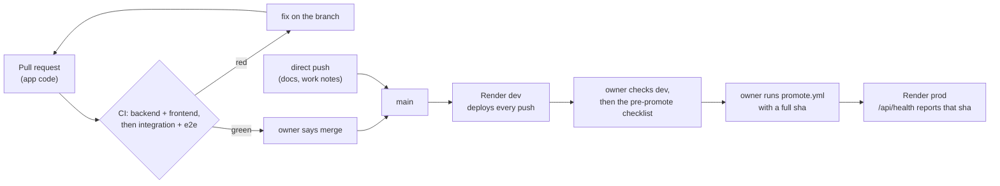

# Release process

Three stages: CI tests every pull request and every push to `main`; Render deploys every push to `main` to **dev**; **prod** moves only when the owner runs a workflow with a commit sha.



| Stage | What does it | Check it yourself |
|---|---|---|
| CI | [ci.yml](../.github/workflows/ci.yml): 3 jobs on every PR to `main` and every push to `main` | `gh run list --workflow=ci.yml --limit 5` |
| CD to dev | Render service `sail-event-dev`, auto-deploy on every push to `main` | dev's `/api/health` prints `main`'s head sha ([commands](deployment.md#prove-cd-in-30-seconds)) |
| Manual deploy to prod | [promote.yml](../.github/workflows/promote.yml), started by hand with a sha | `gh run list --workflow=promote.yml` (every run is `workflow_dispatch`) |
| Rollback | promote.yml with an older sha, plus a database restore when a migration lies between the two | [Rollback](#rollback) |

## How changes reach main

- **App code goes through a pull request.** Since 18 Oct, every change to `backend/app`, `frontend/src`, the migrations, the Dockerfile, the compose file and the workflows landed through a PR. On 16-17 Oct most issues were still committed straight to `main`.
- **Docs, work notes (`work/`) and field-test tooling are pushed straight to `main`.** Since the first PR (#30), 130 of the 180 commits on `main` were direct pushes; 59 of them are `work:` notes.
- **Nothing enforces the CI gate.** `main` has no branch protection (`gh api repos/alexisdacquay/sail-event/branches/main/protection` returns 404). "Every CI job is green before it merges" is a rule in [the engineer's role file](../_docs/team/software-engineer.md), checked by people, not by GitHub. Two PRs merged with the integration job red: [#31](https://github.com/alexisdacquay/sail-event/pull/31) (17 Oct) and [#138](https://github.com/alexisdacquay/sail-event/pull/138) (24 Oct).
- **Dev does not wait for CI.** A push deploys dev while CI on `main` is still running, so dev can run a commit that CI has not passed yet.

Count it yourself:

```bash
git log --first-parent --format=%s a719004^..origin/main | wc -l                                      # commits since PR #30
git log --first-parent --format=%s a719004^..origin/main | grep -cE '\(#[0-9]+\)$|Merge pull request' # through a PR
```

## CI checks

| Job | What it runs |
|---|---|
| backend | `uv sync --frozen`, `uv run pytest` (unit tests; integration tests are excluded by `addopts` in `pyproject.toml`) |
| frontend | `npm ci`, `npm test`, `npm run build`, `npx @redocly/cli lint openapi.yaml` |
| integration | `docker compose up --build -d --wait` (app + Postgres), `make test-integration`, `make test-e2e` (Playwright, Chromium), then `docker compose down -v` |

`backend` and `frontend` run in parallel; `integration` starts when both pass. A new push to a PR cancels that PR's older run. The 20 on-call responder tests are not in CI; they run in `make test` ([testing.md](testing.md#at-a-glance)).

## CD to dev on merge

Render service `sail-event-dev` builds the root `Dockerfile` and deploys on every push to `main` (Auto-Deploy: On Commit). The setting lives in the Render dashboard, not in the repo; dev's `/api/health` reporting `main`'s head sha is the proof ([deployment.md](deployment.md#prove-cd-in-30-seconds)).

## Manual promotion to prod

Prod (`sail-event`) has auto-deploy off. The owner promotes a sha that already runs on dev.

**Pre-promote checklist (owner):**

1. Dev runs the candidate and CI passed on it:
   `curl -s https://sail-event-dev.onrender.com/api/health` and `gh run list --workflow=ci.yml --commit <sha>`.
2. Try the change on dev. This step has no written test list; the [field-test runner](testing.md#field-test-runner-four-phases-against-a-deployed-service) can be pointed at dev.
3. List the migrations between prod and the candidate:
   `git diff --name-only <prod sha> <sha> -- backend/alembic/versions`.
   If one deletes or rewrites data, take a database backup first (Render → `sail-event-db` → Recovery). Example: `f5a6b7c8d9e0` deletes every event without a start time, and its `downgrade()` is empty.
4. Set the environment variables the release needs (Render → `sail-event` → Environment), then check `/api/health`. Saving variables can trigger a Render deploy of its own: on 2026-10-20 one put `main` 487cb1a on prod with no promote run ([work/STATE.md](../work/STATE.md)).
5. Promote: `gh workflow run promote.yml -f sha=<full 40-character sha>` (or Actions → Promote to prod → Run workflow). Without `sha`, the workflow promotes the commit it runs from, `main`'s head.
6. The run passes only when prod's `/api/health` reports that sha with `"status":"ok"`.

**What promote.yml does:** it calls the prod deploy hook with `ref=<sha>`, then polls `GET $SAIL_BASE_URL/api/health` every 10 s. It succeeds when the `commit` field (Render's `RENDER_GIT_COMMIT`) equals the sha, and fails after 10 minutes.

**One-time setup:** secret `RENDER_PROD_DEPLOY_HOOK` = the Deploy Hook URL from Render → `sail-event` → Settings; variable `SAIL_BASE_URL` = the prod URL. The hourly search job reads the same `SAIL_BASE_URL`, so changing it moves both.

## Rollback

Not exercised yet: each of the 15 promote runs moved prod to a newer commit.

1. Find the sha prod ran before:

   ```bash
   for id in $(gh run list --workflow=promote.yml --limit 2 --json databaseId --jq '.[].databaseId'); do
     gh run view $id --log | grep -m1 -oE 'Promoting [0-9a-f]{40}'
   done   # newest first; the second line is the previous release
   ```

2. Check for migrations between the two: `git diff --name-only <previous sha> <current sha> -- backend/alembic/versions`.
3. **No migration:** `gh workflow run promote.yml -f sha=<previous sha>`.
4. **A migration:** a code rollback alone does not work. The container runs `alembic upgrade head` on start ([Dockerfile](../Dockerfile) line 25), and the older code does not know the newer revision, so it cannot start; promote.yml would fail after 10 minutes (expected from the code, not tried). Restore the database to a point before the promote (Render → `sail-event-db` → Recovery; point-in-time recovery is on), then promote the older sha.

## Releases

A release is a sha promoted to prod. There are no git tags and no GitHub releases; the promote run history is the record (`gh run list --workflow=promote.yml`).

## Scheduled search

[hourly-search.yml](../.github/workflows/hourly-search.yml) asks prod to search for every user. What it checks and how often it really runs: [deployment.md](deployment.md#scheduled-search).
