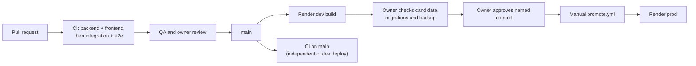

# Release process

GitHub Actions runs CI on pull requests to `main` and pushes to `main`. Render builds dev after each push to `main`. Production uses a separate, owner-approved manual promotion of a named commit.



| Stage | Mechanism | Evidence |
|---|---|---|
| CI | [ci.yml](../.github/workflows/ci.yml) | `gh run list -R alexisdacquay/sail-event --workflow=ci.yml --branch main --limit 3` |
| CD to dev | Render auto-deploy on commit, recorded in the [deployment log](../work/DEPLOY-render.md) | Compare dev’s health response with remote main after the build; [commands](deployment.md#prove-cd-in-30-seconds) |
| Manual promotion | [promote.yml](../.github/workflows/promote.yml) calls the prod deploy hook and checks the resulting commit | `gh run list -R alexisdacquay/sail-event --workflow=promote.yml` |

## How changes reach main

The engineer submits a PR and test evidence. QA checks the submitted commit and records a verdict per criterion. The orchestrator presents that evidence and green CI to the owner for merge authorization. The [process records](../_docs/process.md#process-records) show the handoffs and re-checks.

Since 2026-10-21, the owner picks each next item and checks dev before approving a production commit. The bug-fix root-cause gate was added to the role files on 2026-10-25 and the process summary on 2026-10-26: [gate and verification commands](../_docs/process.md#root-cause-gate).

## CI checks

| Job | Checks |
|---|---|
| backend | `uv sync --frozen`, then `uv run pytest`; default pytest options exclude integration tests |
| frontend | `npm ci`, `npm test`, `npm run build`, Redocly lint of `openapi.yaml` |
| integration | Build and start app + Postgres; `make test-integration`; `make test-e2e`; always tear down the compose stack and its volumes |

Backend and frontend run in parallel. Integration depends on both. A new push cancels an older run for the same PR. CI installs Playwright packages and Chromium, starts compose itself, and sets `SAIL_BASE_URL` and `SAIL_COMPOSE_MANAGED=1` for the Make targets. Local `make test` also runs the responder suite. Commands and coverage: [testing.md](testing.md).

## CD to dev on merge

Render builds the root Dockerfile after a push to `main`, including a merge. Dev deployment and CI run independently. `/api/health` reports status and the commit from `RENDER_GIT_COMMIT`.

## Manual promotion to prod

Owner checklist:

1. Identify the candidate already running on dev and inspect its CI run:
   `curl -s https://sail-event-dev.onrender.com/api/health` and `gh run list --workflow=ci.yml --commit <sha>`.
2. Review the change and its validation on dev. Use dedicated test accounts for the [field runner](testing.md#field-test-runner-four-phases-against-a-deployed-service).
3. Read prod’s deployed commit with `curl -s https://sail-event.onrender.com/api/health`. Inspect migrations using `git diff <prod-sha> <candidate-sha> -- backend/alembic/versions`. Back up the database before promoting a release that contains a migration, and confirm an available recovery point.
4. Check required configuration in [deployment.md](deployment.md#environment-variables), including `EXA_API_KEY`, `SEARCH_PROVIDER=exa` and `MAX_RESULTS_PER_QUERY=10`. Coordinate environment saves with the approved release: saving settings can trigger a Render deployment.
5. Approve the full candidate SHA, then run `gh workflow run promote.yml -f sha=<full-40-character-sha>`.
6. Inspect the workflow result and prod health response. Confirm the deployed commit and review application validation.

The workflow POSTs to the Render deploy hook with `ref=<sha>`, then polls health up to 60 times, sleeping 10 seconds between attempts. It succeeds when `status` is `ok` and `commit` matches. If dispatched without `sha`, it selects the commit the workflow runs from.

One-time configuration: GitHub secret `RENDER_PROD_DEPLOY_HOOK` contains the Render prod deploy-hook URL. Repository variable `SAIL_BASE_URL` identifies prod for both promotion verification and the scheduled-search workflow. Set it to the intended target for both workflows.

## Rollback

Prepare code and database recovery together:

1. Find the previous production commit in promotion history and Render’s deployment history:

   ```bash
   gh run list -R alexisdacquay/sail-event --workflow=promote.yml --limit 10
   # Read the selected run’s "Promoting <sha>" line:
   gh run view <run-id> --log
   ```

2. Compare migration heads and read the intervening [migration files](../backend/alembic/versions/). The container runs `alembic upgrade head` before serving.
3. For a code-only change with the same migration head, obtain owner approval for the previous commit and select it through `promote.yml`.
4. For recovery across migrations, select a database recovery point compatible with the target code. Back up the current database, pause writes, and coordinate the database restore and code deployment.
5. Check the deployed commit and validate the application before resuming writes.

## Releases

A release here means a commit deployed to prod. GitHub promotion history records workflow-driven deploys; Render’s deployment history records service deploys, including dashboard actions.

## Scheduled search

[hourly-search.yml](../.github/workflows/hourly-search.yml) checks prod health and requests searches. Follow each queued search through the [run API](api.md#run-responses). Schedule and setup: [deployment.md](deployment.md#scheduled-search).
