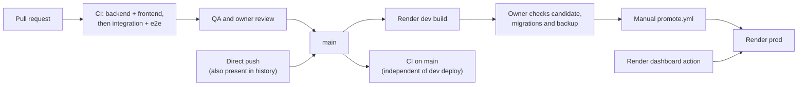

# Release process

GitHub Actions runs CI on pull requests to `main` and pushes to `main`. Render dev follows pushes independently of CI. Prod has auto-deploy off in the recorded configuration; the normal release path is an owner-approved manual promotion. Dashboard deploys and environment changes can also redeploy prod.



| Stage | Mechanism | Evidence |
|---|---|---|
| CI | [ci.yml](../.github/workflows/ci.yml) | `gh run list -R alexisdacquay/sail-event --workflow=ci.yml --branch main --limit 3` |
| CD to dev | Render auto-deploy on commit, recorded in the [deployment log](../work/DEPLOY-render.md) | Compare dev’s health response with remote main after the build; [commands](deployment.md#prove-cd-in-30-seconds) |
| Manual promotion | [promote.yml](../.github/workflows/promote.yml) calls the prod deploy hook and checks the resulting commit | `gh run list -R alexisdacquay/sail-event --workflow=promote.yml` |
| Rollback | Candidate code and database recovery must be assessed together | See [Rollback](#rollback) for migration and recovery requirements |

## How changes reach main

The intended path is engineer PR → CI and QA → owner-approved merge. It is a process rule, not an enforced GitHub gate: `main` has no branch protection or rulesets (checked 2026-10-26).

Direct pushes also occur, including documentation and work notes. For example, `gh api repos/alexisdacquay/sail-event/commits/542e58c/pulls` returns an empty list. A direct push triggers dev deployment before CI has passed. PR [#31](https://github.com/alexisdacquay/sail-event/pull/31) merged after integration failed; [#138](https://github.com/alexisdacquay/sail-event/pull/138) merged before CI completed, and integration subsequently failed. Check the merge and check-completion times with `gh pr view 138 --json mergedAt,statusCheckRollup`.

```bash
gh api repos/alexisdacquay/sail-event/branches/main/protection  # 404: not protected
gh api repos/alexisdacquay/sail-event/rulesets                 # [] at the check date
```

The [process record](../_docs/process.md#evidence-it-ran-this-way) distinguishes the intended lifecycle from ungroomed issues, closures and merges without QA PASS, and orchestrator overreach. The role files date from 2026-10-16, and owner priority/prod gates from 2026-10-21; the root-cause/regression gate entered them on 2026-10-25 (`git show c0f83e6 -- _docs/team`). It was added to the process summary on 2026-10-26 (`git show ac54483 -- _docs/process.md`).

## CI checks

| Job | Checks |
|---|---|
| backend | `uv sync --frozen`, then `uv run pytest`; default pytest options exclude integration tests |
| frontend | `npm ci`, `npm test`, `npm run build`, Redocly lint of `openapi.yaml` |
| integration | Build and start app + Postgres; `make test-integration`; `make test-e2e`; always tear down the compose stack and its volumes |

Backend and frontend run in parallel. Integration depends on both. A new push cancels an older run for the same PR. CI installs Playwright packages and Chromium, starts compose itself, and sets `SAIL_BASE_URL` and `SAIL_COMPOSE_MANAGED=1` for the Make targets. Responder tests run in local `make test`, but are absent from CI. Test scope and expected failures: [testing.md](testing.md).

## CD to dev on merge

Render builds the root Dockerfile after a push to `main`, including a merge. There is no CI dependency in the repository that delays that build. `/api/health` reports the commit from `RENDER_GIT_COMMIT`; it does not verify database access, providers or a user journey.

## Manual promotion to prod

Owner checklist:

1. Identify the candidate already running on dev and inspect its CI run:
   `curl -s https://sail-event-dev.onrender.com/api/health` and `gh run list --workflow=ci.yml --commit <sha>`.
2. Review the change and its validation on dev. Live searches cost provider credits; the [field runner](testing.md#field-test-runner-four-phases-against-a-deployed-service) also changes test accounts and events.
3. Read prod’s deployed commit with `curl -s https://sail-event.onrender.com/api/health`. Inspect migration changes using `git diff <prod-sha> <candidate-sha> -- backend/alembic/versions`. Before destructive changes, take a database backup and confirm an available recovery point. The [rollback section](#rollback) lists the migrations, including PR #150’s destructive event deletion.
4. Check required configuration in [deployment.md](deployment.md#environment-variables). The owner’s promotion checklist calls for `EXA_API_KEY`, `SEARCH_PROVIDER=exa`, `MAX_RESULTS_PER_QUERY=10`. Coordinate saving settings with the deployment: an environment save can redeploy independently. The [work log](../work/STATE.md) records such a prod deploy on 2026-10-20.
5. Run `gh workflow run promote.yml -f sha=<full-40-character-sha>`. Use an explicit candidate; without `sha`, the workflow uses the commit it runs from.
6. Inspect the workflow result and prod health response. Confirm the commit, then review application validation separately; health alone is not a search test.

The workflow POSTs to the Render deploy hook with `ref=<sha>`, then polls health up to 60 times, sleeping 10 seconds between attempts. It succeeds only when `status` is `ok` and `commit` matches. It performs no QA, migration review, backup or search validation.

One-time configuration: GitHub secret `RENDER_PROD_DEPLOY_HOOK` contains the Render prod deploy-hook URL. Repository variable `SAIL_BASE_URL` identifies prod for both promotion verification and the scheduled-search workflow. Changing it changes both targets.

## Rollback

Rollback is untested, including across the migrations introduced by PRs [#128](https://github.com/alexisdacquay/sail-event/pull/128) and [#150](https://github.com/alexisdacquay/sail-event/pull/150):

| Migration | Effect on recovery |
|---|---|
| [`e4f5a6b7c8d9`](../backend/alembic/versions/e4f5a6b7c8d9_add_pages_to_runs.py) | Adds run-page storage; downgrade drops that column |
| [`f5a6b7c8d9e0`](../backend/alembic/versions/f5a6b7c8d9e0_cleanup_events_without_start_time.py) | Deletes events without a start time; downgrade cannot restore them |
| [`a6b7c8d9e0f1`](../backend/alembic/versions/a6b7c8d9e0f1_drop_event_user_link_date_unique.py) | Removes the event unique constraint; downgrade fails if duplicate keys exist |

Use promotion history to find candidate older commits, then compare it with Render’s deployment history: dashboard actions are absent from GitHub’s promotion history.

```bash
gh run list -R alexisdacquay/sail-event --workflow=promote.yml --limit 10
# Inspect the selected run’s log for the "Promoting <sha>" line:
gh run view <run-id> --log
```

For a code-only change with the same migration head, the proposed rollback is to redeploy a previous SHA through `promote.yml`. Across a migration, do not assume that command is sufficient: the container runs `alembic upgrade head` before serving, and older code may not recognize the database revision. A safe recovery plan needs a compatible database restore and code deployment, coordinated to avoid writes during recovery. Restoring a backup loses later writes. Confirm Render’s available recovery points before relying on the point-in-time recovery recorded in the deployment log.

## Releases

A release here means a commit deployed to prod. There are no Git tags or GitHub releases at the 2026-10-26 check (`git ls-remote --tags origin`; `gh release list`). GitHub promotion history records workflow-driven deploys; Render also records dashboard-driven ones.

## Scheduled search

[hourly-search.yml](../.github/workflows/hourly-search.yml) requests searches on prod. It checks health and enqueueing, not completed searches. Schedule, measured delays and setup: [deployment.md](deployment.md#scheduled-search). Search-failure coverage: [Monitoring](deployment.md#monitoring).
