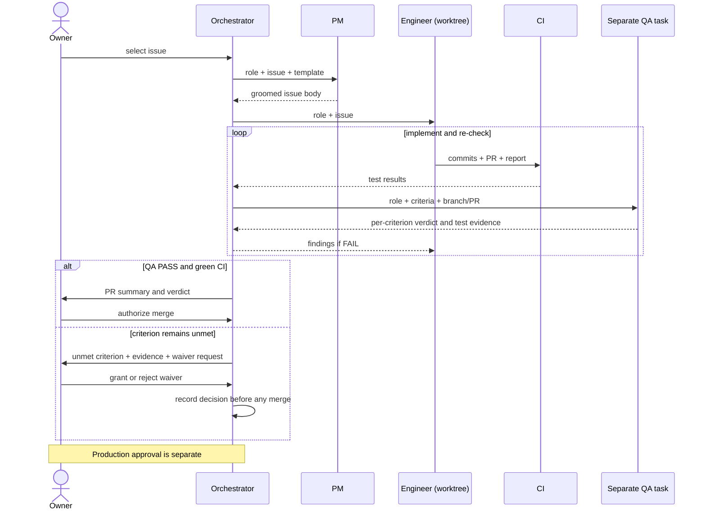
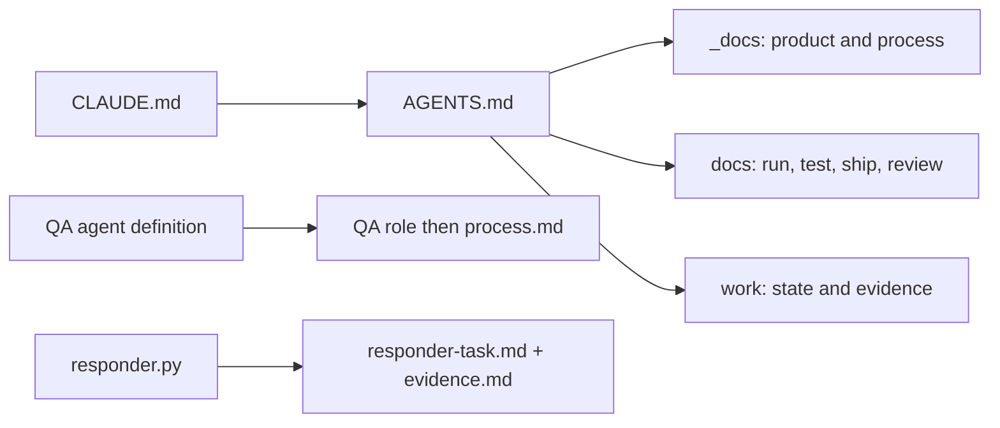
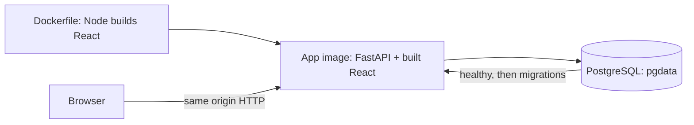
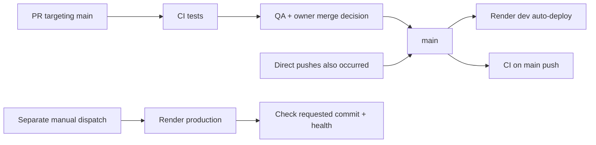
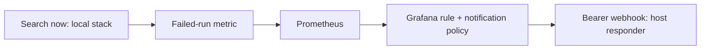
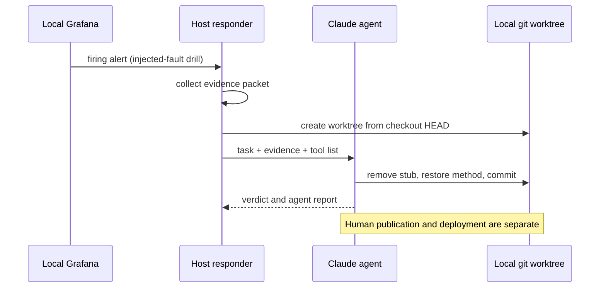

# Reviewer guide

Sail-event turns a free-text event search into scored events and a personal ICS feed. [Production](https://sail-event.onrender.com) · [Dev](https://sail-event-dev.onrender.com) · [Local setup](../README.md#try-it).

Each criterion below has the rubric's levels, a phrase-by-phrase checklist, the evidence against the lower level, extras, a picture where useful, and known gaps. Each proof is a file, record or screenshot you can open in under a minute.

Rubric: [saved copy](../work/rubric-2026-10-16.md), compared with the [course source](https://github.com/DataTalksClub/ai-dev-tools-zoomcamp/tree/main/project) on 2026-10-26. Source links were checked at `542e58cb0fe73065a905febec7637bfa377a77c4` on 2026-10-26. Check the deployed commit with `curl -fsS https://sail-event.onrender.com/api/health`.

## Criteria map

| Criterion | Evidence |
|---|---|
| [1. Problem description](#1-problem-description) | README problem, workflow and expected behavior |
| [2. Product specification](#2-product-specification) | PRD, public issues, edit history and QA comments |
| [3. Agent team specification](#3-agent-team-specification) | Roles, launches and handoffs |
| [4. Context management](#4-context-management) | AGENTS.md and modular docs |
| [5. Application](#5-application) | Browser journey and restart test |
| [6. Testing](#6-testing) | CI logs and Makefile |
| [7. Containerization](#7-containerization) | Dockerfile and Compose |
| [8. Deployment](#8-deployment) | Public health endpoint |
| [9. CI/CD](#9-cicd) | CI, Render deployment instructions, manual promote |
| [10. Observability](#10-observability) | Metrics, Tempo, Loki and Grafana |
| [11. Alerting on user impact](#11-alerting-on-user-impact) | Provisioned rules and drill records |
| [12. On-call agent](#12-on-call-agent) | Drill evidence and fix commits |

The [Known gaps index](#known-gaps) links to limitations and their evidence.

## Check it in 5 minutes

Open the [app](https://sail-event.onrender.com). These read-only checks need curl, Git and an authenticated GitHub CLI:

```bash
# §8: availability and the deployed commit.
curl -fsS --max-time 20 https://sail-event.onrender.com/api/health
# §9: compare dev's reported commit with main's head; allow for a deploy in progress.
curl -fsS --max-time 20 https://sail-event-dev.onrender.com/api/health
git ls-remote https://github.com/alexisdacquay/sail-event refs/heads/main
# §6: find the latest CI run, then inspect its jobs with gh run view <id> -R ...
gh run list -R alexisdacquay/sail-event --workflow=ci.yml -b main -L 3
# §2–3: QA FAIL → fix → QA PASS → close.
gh issue view 7 -R alexisdacquay/sail-event --comments
```

Browser alternatives: [CI history](https://github.com/alexisdacquay/sail-event/actions/workflows/ci.yml) · [issue #7](https://github.com/alexisdacquay/sail-event/issues/7).

With a clone, `python3 -I incident-response/test_responder.py` checks the responder without launching an agent. For a longer local review, use `docker compose up --build` (Docker), then `make test-all` (Docker, uv, Node/npm and Python). These builds and test suites are outside the five-minute check.

## 1. Problem description

**Rubric levels**

> The problem is not described. (0 points)
>
> The problem is described briefly, but it is unclear what the system does or what functionality is expected. (1 point)
>
> The README clearly describes the problem, the system functionality, and expected behavior. (2 points)

**Checklist**

| Rubric phrase | Where to look | Proof checkable in under a minute |
|---|---|---|
| README | [README](../README.md) | The entry document contains the problem, workflow and expected behavior. |
| clearly | [Problem](../README.md#problem) | The gap is repeated discovery and checking: a web search returns pages, not checked events in a calendar. |
| describes the problem | [Problem](../README.md#problem) · [user](../_docs/ux-spec.md#1-who-the-user-is) | The user wants events without repeatedly scanning sites and copying details. |
| the system functionality | [What it does](../README.md#what-it-does) · [pipeline][pipeline] | Search → extract → event-page fetch → screen → store as new → score/triage → model duplicate check → feed. |
| expected behavior | [Expected behaviour](../README.md#expected-behaviour) · [triage implementation][triage] · [pipeline test][triage-test] · [rejection test][rejection] | Saved thresholds control triage; a rejected event stays rejected after a later search. |

**Why not the lower score**

The lower level is “The problem is described briefly, but it is unclear what the system does or what functionality is expected.” The README distinguishes discovery from calendar delivery, names the result states, and links expected behaviors to tests.

Thresholds are per user. Defaults accept at **90 or more**, reject at **40 or less**, and leave the middle for review ([registration defaults][auth], [triage][triage]). A later model duplicate check can reject a high-scoring event ([dedup stage][dedup]).

**Beyond the rubric**

The [expected-behavior table](../README.md#expected-behaviour) links the product description to executable checks for triage, user isolation, feed removal and token rotation.

**Picture**


Local demo data. The server clock is fixed at 18 October 2026 so the 19–21 October fixtures remain usable; the run time and mini-calendar show the real capture date, 26 October. The chronology also shows two failed event-page fetches.

**Known gaps**

- “Hourly” describes the GitHub cron, not a delivery guarantee. The 50 scheduled runs inspected on 2026-10-26 had gaps of **2.1–7.8 hours**; [reproduce the measurement](#schedule-measurement).
- Each scheduled run queues at most 50 users by default (`MAX_SCHEDULED_USERS`); the [2026-10-26 12:51 UTC run](https://github.com/alexisdacquay/sail-event/actions/runs/40325804781) queued 50 and skipped 23. [Read the recorded output](#schedule-measurement).
- Criteria without a place can still auto-accept events; [#101](https://github.com/alexisdacquay/sail-event/issues/101), which requires queuing them instead, is unshipped ([search spec](../_docs/search-spec.md#3-criteria-understanding)).
- Price rules are unsupported; other product exclusions are in [the PRD](../_docs/plan.md#out-of-scope-for-the-mvp).

## 2. Product specification

**Rubric levels**

> No written specs. (0 points)
>
> A spec exists, but no public task tracker. (1 point)
>
> A specification exists and there's a publicly accessible task tracker. The tasks define acceptance criteria and there's evidence that the agents used the tracker. (2 points)

**Checklist**

| Rubric phrase | Where to look | Proof checkable in under a minute |
|---|---|---|
| A specification exists | [PRD](../_docs/plan.md) · [search spec](../_docs/search-spec.md) · [API contract](../openapi.yaml) | Product behavior, quality targets and API operations are written down. |
| publicly accessible task tracker | [GitHub Issues](https://github.com/alexisdacquay/sail-event/issues?q=is%3Aissue) | Issues and comments are readable in the public repository. |
| The tasks define acceptance criteria | [task template](../_docs/task-template.md) · [issue #11](https://github.com/alexisdacquay/sail-event/issues/11) | Among issues #1–#152, 91 of 96 contain acceptance criteria; 58 use all four template sections (2026-10-26; command in [Tracker evidence](#tracker-evidence)). |
| evidence that the agents used the tracker | [#11 edit history and comments](https://github.com/alexisdacquay/sail-event/issues/11) · [PR #149 QA](https://github.com/alexisdacquay/sail-event/pull/149) | Among issues #1–#152, 69 carry a QA verdict; 23 include a FAIL requesting a fix (2026-10-26; [command](#tracker-evidence)). Issue #11 preserves its body rewrite, implementation report and per-criterion QA PASS. |

**Why not the lower score**

“A spec exists, but no public task tracker.” The issue body, implementation report and QA verdict are public, not just an internal task list. They show use of acceptance criteria.

[Issue #11](https://github.com/alexisdacquay/sail-event/issues/11), including **edited** and the QA comment, preserves the specification history. The 2026-10-16 rewrite added the criteria. A third edit on 2026-10-20 ticked the boxes after the 2026-10-16 close. The QA comment is the contemporaneous verification record. Query splitting and the per-run cap in that historical issue were later withdrawn ([PRD changes](../_docs/plan.md#changed-after-the-mvp-dated), [PR #144](https://github.com/alexisdacquay/sail-event/pull/144)).

**Beyond the rubric**

- The spec preceded code. `git log --reverse --diff-filter=A --format='%h %ci %s' -- _docs/plan.md AGENTS.md backend/app/main.py` shows the PRD on 2026-10-15 (`fa345ba`), context and roles on 2026-10-16 (`98f3cf7`), then the first backend scaffold (`6ccfdec`).
- [Original tasks](../_docs/outdated/tasks.md) 1–28 became issues 1–28. Task 18 was narrowed to CI; CD was split into [#29](https://github.com/alexisdacquay/sail-event/issues/29).

**Known gaps**

- Among issues #1–#152 on 2026-10-26, **38 of 96 issue bodies** lacked at least one template heading; **27** were closed. [Tracker evidence](#tracker-evidence) gives the filters and exceptions.
- **14 of 42 merged PRs** in #66–#152 lacked a PR QA heading; some closed or merged work had no verdict or no fresh PASS after FAIL. [Exception records](#tracker-evidence) distinguish these cases.
- Shared GitHub authorship, incomplete role headings and **21 issues** in #1–#152 without MVP/post-MVP labels limit attribution and classification; [the evidence](#tracker-evidence) lists them.

## 3. Agent team specification

**Rubric levels**

> No agent team described. (0 points)
>
> Roles or agents are mentioned, but responsibilities are unclear. (1 point)
>
> The project defines the agent team and process of how they work together. (2 points)

**Checklist**

The first two rows check the preceding level: role names and clear responsibilities.

| Rubric phrase | Where to look | Proof checkable in under a minute |
|---|---|---|
| Roles or agents are mentioned | [Team](../_docs/process.md#team) | Human owner; AI orchestrator, PM, engineer and QA. |
| responsibilities | [role files](../_docs/team/) · [Roles](../_docs/process.md#roles) | PM specifies; engineer implements; QA verifies; orchestrator coordinates. The walkthrough below states the boundaries and the recorded exceptions. |
| defines the agent team | [Team](../_docs/process.md#team) · [QA agent](../.claude/agents/qa-engineer.md) | The main Claude Code session coordinates separate subagent tasks. QA also has a runnable agent definition. |
| process | [Lifecycle](../_docs/process.md#lifecycle) · [Phase 2](../_docs/process.md#phase-2-from-issue-65-worktrees-and-prs) | Groom → implement → verify → fix/recheck → owner-authorized merge. |
| how they work together | [Handoffs](../_docs/process.md#handoffs) · [PR #149](https://github.com/alexisdacquay/sail-event/pull/149) | Issue body → implementation/PR → QA verdict → owner decision. PR #149 contains a QA PASS against the duplicate-check criteria. |

**Why not the lower score**

“Roles or agents are mentioned, but responsibilities are unclear.” The roles have distinct inputs and outputs, not just names. In the documented Phase 2 cycle:

1. The owner selects work; the orchestrator starts a PM task with [pm.md](../_docs/team/pm.md), the issue and [task template](../_docs/task-template.md). PM rewrites the body; it does not implement code. [Recorded launches](../_docs/process.md#how-the-orchestrator-starts-an-agent) use background `general-purpose` tasks for PM and engineer, with the role file and read list supplied in the brief.
2. The orchestrator starts an engineer task with [software-engineer.md](../_docs/team/software-engineer.md) and the groomed issue. In Phase 2 the engineer uses its own copy of the repository on a separate branch, implements within scope and opens a PR with its report. It may question criteria in a comment, not rewrite them or close the issue.
3. CI runs on the PR. Green CI is the written merge rule; historical violations are listed in §9.
4. The orchestrator starts a separate QA task, using [qa-engineer.md](../.claude/agents/qa-engineer.md) or the QA role brief. The QA definition says “Start fresh”: read the criteria, inspect/run the code and do not trust the implementation report. QA posts a verdict, edits no files and leaves the issue open.
5. FAIL returns the QA comment to the engineer for a fix and re-check. If a criterion remains unmet, the orchestrator sends that criterion and its evidence to the owner, who grants or rejects a waiver; the decision is recorded before merge. QA records its verdict on the PR. A PASS goes to the owner with the PR summary.
6. The owner authorizes merge in chat; the orchestrator performs it. GitHub may close an issue through `Closes #N`. A merge deploys dev. Production needs separate owner approval for a named SHA; the owner can dispatch the promote workflow or instruct the orchestrator to dispatch that approved SHA. Public run metadata records the dispatch, not the private approval conversation.

[Issue #7](https://github.com/alexisdacquay/sail-event/issues/7) records a Phase 1 loop: password echoed in an error → QA FAIL → fix → QA PASS → close. It predates the worktree/PR phase.

**Beyond the rubric**

The root-cause/regression rule entered the role files on **2026-10-25** (`c0f83e6`, part of the test-runner PR), then process.md on **2026-10-26** (`ac54483`). Verify with `git show --format='%h %cs %s' c0f83e6 -- _docs/team/software-engineer.md` and `git show --format='%h %cs %s' ac54483 -- _docs/process.md`.

**Picture**



**Known gaps**

- The orchestrator groomed, edited code and substituted its own verification for QA in recorded cases ([tracker evidence](#tracker-evidence), [AI usage report](ai-usage-report.md)).
- Owner control of work selection and production approval began on **2026-10-21** ([state record](../work/STATE.md)).
- QA has Bash. “No edits” rests on instructions and the clean-tree check, not a write-proof sandbox. The runnable QA definition was added on **2026-10-17** (`git log -1 --format='%h %cs %s' a41b405`).
- A re-check by the same QA agent keeps its earlier context ([#7](https://github.com/alexisdacquay/sail-event/issues/7), [launch record](../_docs/process.md#how-the-orchestrator-starts-an-agent)). [PR #143](https://github.com/alexisdacquay/sail-event/pull/143) (#142) depended on #141 and merged with no recorded QA verdict at its final commit.

## 4. Context management

**Rubric levels**

> No project docs. (0 points)
>
> An AGENTS.md (or equivalent) exists and describes the project. (1 point)
>
> AGENTS.md exists and it also points to modular docs (process, teams, etc.). (2 points)

**Checklist**

“describes the project” checks the preceding level as well.

| Rubric phrase | Where to look | Proof checkable in under a minute |
|---|---|---|
| AGENTS.md exists | [AGENTS.md](../AGENTS.md) | Root entry document. |
| describes the project | [AGENTS.md](../AGENTS.md) opening | Event finding, score thresholds and per-user ICS feeds are named. |
| points to modular docs | [AGENTS.md: Documents](../AGENTS.md#documents) | Links group product, process, operations and history rather than embedding them all. |
| process | [process.md](../_docs/process.md) | Lifecycle and handoffs. |
| teams | [role files](../_docs/team/) | PM, engineer and QA responsibilities. |
| etc. | [testing](testing.md) · [deployment](deployment.md) · [observability](../observability/README.md) | Operational context is linked separately. |

**Why not the lower score**

“An AGENTS.md (or equivalent) exists and describes the project.” The entry file also routes readers to modular instructions. `_docs/` is product, design and team process; `docs/` is running, testing, shipping and review. `work/` is evidence and handover, and `_docs/outdated/` is history.

**Beyond the rubric**

[CLAUDE.md](../CLAUDE.md) contains `@AGENTS.md`. The [launch/context record](../_docs/process.md#how-the-orchestrator-starts-an-agent) describes the rest of the context handoff:

1. The orchestrator briefs the task with its role, issue, read list, scope, branch/worktree and required reply. The PM gets the template/product context; the engineer gets architecture/API/code context. The runnable QA definition explicitly reads its role file, then process.md.
2. Replies return artifact links, checked heads, commands/results and unmet criteria. A report is a lead for QA to verify, not inherited proof.
3. Before context compression, the orchestrator records active issues, heads, worktrees, verdicts, pending decisions and the next action in [STATE](../work/STATE.md). A resumed session reads the top block and its evidence rather than restarting the backlog.
4. The on-call path is separate: [responder.py][responder] builds a prompt from the task template and fenced evidence packet, then starts the agent in its worktree.

**Picture**

Context entry points:



**Known gaps**

[work/STATE.md](../work/STATE.md) contains dated snapshots that can drift; verify the top block against live versions. Exact launch transcripts remain private, and PM/engineer reads depend on the task brief.

## 5. Application

**Rubric levels**

> No working application, or frontend, backend, or persistent storage is missing. (0 points)
>
> Frontend, backend, and database exist but are not fully connected. (1 point)
>
> Full-stack application works end to end: frontend talks to backend, data persists in a database. Application runs locally with a single command. (2 points)

**Checklist**

| Rubric phrase | Where to look | Proof checkable in under a minute |
|---|---|---|
| works end to end | [browser journey][journey] · [HTTP journey][integration] | Registration, criteria, thresholds, search, decisions and re-fetch are exercised against the app. CI evidence is in §6. |
| frontend talks to backend | [image build][dockerfile] · [client selection][client] | `VITE_API_URL=""` selects the HTTP client at the same origin, not the mock client. |
| data persists in a database | [restart test][restart] · [Compose][compose] | App restarts; the nonzero event count remains. The browser journey separately reloads a saved threshold. |
| runs locally | [Compose][compose] | App and PostgreSQL run on the local host through containers. |
| with a single command | [README setup](../README.md#try-it) · [Dockerfile][dockerfile] | `docker compose up --build` starts the database and app; startup migrates and seeds the demo. |

**Why not the lower score**

“Frontend, backend, and database exist but are not fully connected.” The browser and HTTP tests cross those boundaries; the restart test checks storage beyond the app process. Their assertions and the §6 CI log provide the proof.

**Beyond the rubric**

[The schema-contract test][contract] compares API paths, methods and operation IDs with [openapi.yaml](../openapi.yaml). [Journey 2][journeys] checks that another user cannot see the first user's events.

**Known gaps**

- Local defaults replay fixture search pages and recorded model answers. Use the pre-filled demo criteria; other text can lack a model recording and remain unscored ([fixture provider][fixture], [fake model][fake]). The backend, HTTP client and database still run normally.
- The restart assertion compares event **counts**, not event IDs or full contents; the exact-score boundary test seeds its expected statuses instead of exercising triage ([test source][seeded-boundaries]).
- The full recall run at 2026-10-24 20:04 UTC ([local, `ab21641`](../work/RECALL.md#2026-10-24-2004-utc----recall-measurement----httplocalhost8032----ab21641), before the event-page hop) found **3 of 38** ground-truth events and accepted **none**; the ground truth is unvetted. Recall after the event-page changes is unmeasured ([testing](testing.md#field-test-runner-four-phases-against-a-deployed-service)).
- Out events offer “Add to calendar”, but the backend returns HTTP 400; the [UI specification](../_docs/ux-spec.md#3e-all-events) records this mismatch.
- Model duplicate-check failure or budget exhaustion can retain both events ([duplicate checker][duplicate-checker]).
- Past events remain listed ([#94](https://github.com/alexisdacquay/sail-event/issues/94)). Open defects: [open issues](https://github.com/alexisdacquay/sail-event/issues?q=is%3Aissue+is%3Aopen).

## 6. Testing

**Rubric levels**

> No tests, or the tests do not run. (0 points)
>
> Only unit tests or only integration tests exist. (1 point)
>
> Both unit and integration tests exist, run with a single command, and pass. (2 points)

**Checklist**

| Rubric phrase | Where to look | Proof checkable in under a minute |
|---|---|---|
| Both unit and integration tests exist | [backend tests](../backend/tests/) · [frontend tests](../frontend/src/) · [HTTP integration tests][integration] | Unit: pytest and Vitest suites. Integration: HTTP against the container and PostgreSQL, including restart. Results are below. |
| run with a single command | [Makefile][makefile] | `make test-all` invokes `test`, `test-integration` and `test-e2e`. |
| pass | [Local combined run](#combined-test-run) · [CI run 40251535674](https://github.com/alexisdacquay/sail-event/actions/runs/40251535674) | `make test-all` exited 0 locally at `ca4cf2b` on 2026-10-26; the command and summary are below. |

**Why not the lower score**

“Only unit tests or only integration tests exist.” Both layers run: [CI configuration][ci] uses `uv run pytest` in `backend`, `npm test` in `frontend`, then `make test-integration` and `make test-e2e` inside the job named `integration`. CI does not invoke `make test-all` itself.

At **542e58c**, [CI run 40251535674](https://github.com/alexisdacquay/sail-event/actions/runs/40251535674) reports **507 backend passed, 4 skipped, 7 deselected; 117 frontend; 7 integration; 12 Playwright**. Reproduce:

```bash
gh run view 40251535674 -R alexisdacquay/sail-event --log | grep -E 'passed|test_data_survives_restart'
```

<a id="combined-test-run"></a>

**Local combined run**

At `ca4cf2b` on 2026-10-26, this command exited **0**:

```bash
PYTHONDONTWRITEBYTECODE=1 TEST_COMPOSE_PROJECT=sail-docs-guide-round2 TEST_HOST_PORT=8046 make test-all
```

```text
Backend:     507 passed, 4 skipped, 7 deselected
Frontend:    117 passed
Responder:   Ran 20 tests; OK
Integration: 7 passed, including test_data_survives_restart
Playwright:  12 passed
```

Test setup and suite details: [docs/testing.md](testing.md).

**Beyond the rubric**

The responder's **20** stdlib tests passed locally on 2026-10-26: `python3 -I incident-response/test_responder.py`. They do not launch an agent. The [schema-contract test][contract] checks API drift, and the [browser journeys][journeys] exercise user isolation.

**Known gaps**

- The responder suite runs in `make test`, but **not CI**.
- The 12-test Playwright result includes **two expected-failure markers** for [#94](https://github.com/alexisdacquay/sail-event/issues/94) (clipped scoring legend) and [#95](https://github.com/alexisdacquay/sail-event/issues/95) (feed subscription), plus **three screenshot-oriented tests**. Inspect [field.spec.ts][field] and the [journey/screenshot specs](../e2e/); a green result does not mean those bugs are fixed.
- The backend excludes marked integration tests from its default run; those run in the integration job. Other skips are conditional on a live model, PostgreSQL test URL or built frontend ([testing.md](testing.md)).

## 7. Containerization

**Rubric levels**

> No containerization. (0 points)
>
> Dockerfiles exist, but running the full system requires manual steps. (1 point)
>
> The full system, including the database, runs via Docker or Docker Compose and starts with a single command. (2 points)

**Checklist**

| Rubric phrase | Where to look | Proof checkable in under a minute |
|---|---|---|
| The full system | [Dockerfile][dockerfile] · [SPA mount][spa] | One image builds React and serves it with FastAPI; Compose adds storage. |
| including the database | [Compose][compose] | `postgres:18-alpine`, healthcheck and named `pgdata` volume; the app connects to that service. |
| runs via Docker or Docker Compose | [Compose][compose] | `docker compose config --services` prints `postgres` and `app`. |
| starts with a single command | [Dockerfile][dockerfile] · [Compose][compose] | `docker compose up --build`; health dependency, migrations and demo seed run automatically. |

**Why not the lower score**

“Dockerfiles exist, but running the full system requires manual steps.” The default application path needs no separate database creation, migration, seed or provider-key setup. CI starts the same Compose stack before integration and browser tests ([CI][ci]).

**Beyond the rubric**

`make up-all` adds the [observability containers](../observability/docker-compose.yml) and enables OTLP in the app through [the override](../docker-compose.observability.yml). The responder itself is a host process, not one of those containers.

**Picture**



**Known gaps**

The one-command application path uses fixture search, the fake/recorded model and a fixed clock. Real providers need environment configuration and keys. The GitHub scheduled trigger is external to Compose; observability uses `make up-all`, and the responder starts separately.

## 8. Deployment

**Rubric levels**

> Application is not deployed. (0 points)
>
> Deployment steps are described, but no working deployment is shown. (1 point)
>
> The application is deployed and reachable at a public URL, or there's a clear demo with the deployment. (2 points)

**Checklist**

| Rubric phrase | Where to look | Proof checkable in under a minute |
|---|---|---|
| deployed | [Render deployment instructions](deployment.md) · [public app](https://sail-event.onrender.com) | HTTP GET reaches the hosted application; `/api/health` returns status and the deployed commit. |
| reachable at a public URL | <https://sail-event.onrender.com/api/health> | `curl -fsS --max-time 20 https://sail-event.onrender.com/api/health` prints the deployment's own response. The hosted UI and API are publicly reachable. |

**Why not the lower score**

“Deployment steps are described, but no working deployment is shown.” The health endpoint and served UI can be inspected now, independently of the written instructions.

**Beyond the rubric**

- [Services](deployment.md#services) documents separate dev and production services/databases. [Promotion][promote] checks health and the requested commit after deployment.
- Registration requirements are discoverable with `curl -fsS --max-time 20 https://sail-event.onrender.com/api/config`; the 2026-10-26 GET returned `registrationCodeRequired: false`.

**Known gaps**

Live searches depend on provider availability and balance. Measured searches in [PR #144](https://github.com/alexisdacquay/sail-event/pull/144) ranged **86–493 seconds** in local measurements across different code/configuration settings. [The alerting section](#11-alerting-on-user-impact) records the provider-balance outage and monitoring coverage.

## 9. CI/CD

**Rubric levels**

> No CI/CD pipeline. (0 points)
>
> CI runs the tests automatically on every pull request. (1 point)
>
> CI runs tests and CD automatically deploys. (2 points)
>
> CI runs tests, CD deploys to dev, and there's a manual deploy to production. (3 points)

**Checklist**

| Rubric phrase | Where to look | Proof checkable in under a minute |
|---|---|---|
| CI runs tests | [CI][ci] · [run evidence](#6-testing) | PRs targeting main and pushes to main trigger unit, integration and browser checks. |
| CD deploys to dev | [deployment instructions](deployment.md) · [live dev health](https://sail-event-dev.onrender.com/api/health) | The [2026-10-17 deployment log](../work/DEPLOY-render.md#devprod-split-issue-21-started-2026-10-17) shows dev auto-deploying `10d4701`. For current version alignment, compare dev health with `git ls-remote https://github.com/alexisdacquay/sail-event refs/heads/main`. |
| manual deploy to production | [promote.yml][promote] · [run history](https://github.com/alexisdacquay/sail-event/actions/workflows/promote.yml) | Only `workflow_dispatch` triggers this workflow. An optional full SHA overrides the dispatched ref's commit. |

**Why not the lower score**

“CI runs tests and CD automatically deploys.” The extra distinction is the separate manual production workflow. Dev and production use different deployment paths. The dated deployment record shows the dev/prod split in use; the manual workflow and run history show production dispatches.

The [promotion workflow][promote] selects the input SHA or dispatched commit, validates its format, calls the Render deploy hook, then polls production for that healthy commit. The owner first checks dev and approves a named commit ([release process](release-process.md)).

**Beyond the rubric**

The workflow verifies the running commit after deployment, beyond checking health alone. Inspect deployment state without dispatching anything:

```bash
curl -fsS --max-time 20 https://sail-event-dev.onrender.com/api/health
git ls-remote https://github.com/alexisdacquay/sail-event refs/heads/main
curl -fsS --max-time 20 https://sail-event.onrender.com/api/health
gh run list -R alexisdacquay/sail-event --workflow=promote.yml -L 3
```

**Picture**



Dev deployment and CI on main start from the same push; dev does not wait for CI.

**Known gaps**

- Main has no branch protection/ruleset gate; direct pushes and merges with failed CI occurred ([delivery evidence](#delivery-evidence)).
- Current Render trigger settings are external to git and have no sanitized dashboard capture here; the manual workflow checks SHA format and health, but neither prior green CI nor production approval.
- Rollback is untested; PR #150’s migration deletes data irreversibly ([migration evidence](#delivery-evidence), [release process](release-process.md#rollback)).

## 10. Observability

Telemetry, alerts and the responder cover the local stack started with `make up-all`; hosted deployments export no telemetry to it. [Telemetry initialization][telemetry] requires an OTLP endpoint, supplied by the local [override](../docker-compose.observability.yml).

**Rubric levels**

> No telemetry. (0 points)
>
> The app emits logs, but there are no metrics or traces, or the signals cannot be correlated to a single request. (1 point)
>
> A key user journey is instrumented with metrics, traces, and structured logs that share a trace ID; no customer data or credentials are sent to telemetry; and the signals are collected, stored, and viewable in a UI. (2 points)

**Checklist**

| Rubric phrase | Where to look | Proof checkable in under a minute |
|---|---|---|
| A key user journey | [search pipeline][pipeline] | `POST /api/search` encloses a `search_run` span with a run ID and stage spans. |
| metrics | [metric definitions][metrics] | Run count, duration, event counts and provider/model activity are instrumented. |
| traces | [pipeline][pipeline] · picture below | Search, extraction, event-page hop, filter, judge, triage, dedup and persist appear as spans. |
| structured logs | [JSON formatter][logging] | Timestamp, level, logger, message, trace ID and span ID form each application JSON record. |
| share a trace ID | picture below · [telemetry][telemetry] | **Partial:** Loki and Tempo display the same ID; metric correlation is a [known gap](#telemetry-evidence). |
| no customer data or credentials are sent to telemetry | [pipeline][pipeline] · [telemetry][telemetry] · [collector](../observability/collector.yaml) · [calendar route][calendar] | **Not met:** check customer identifiers/client metadata in spans and bearer feed tokens in HTTP paths; [the privacy evidence](#telemetry-evidence) covers both. |
| collected | [collector](../observability/collector.yaml) | OTLP receivers feed signal pipelines; filelog also reads container logs. |
| stored | [observability Compose](../observability/docker-compose.yml) | Prometheus, Loki and Tempo store metrics, logs and traces. |
| viewable in a UI | [dashboard](../observability/dashboard.json) · [Grafana provisioning](../observability/grafana/provisioning/) | The dashboard shows metrics/logs; use **Explore → Tempo** for traces, as demonstrated below. |

**Lower-level wording and remaining gaps**

“The app emits logs, but there are no metrics or traces, or the signals cannot be correlated to a single request.” Metrics and traces exist; the screenshots correlate a log with its trace. The checklist leaves the metric-correlation and privacy clauses open.

**Inspect the signal path**

To inspect the local path, run `RESPONDER_WEBHOOK_SECRET=local-drill-secret make up-all`, exercise the recorded demo through `http://localhost:8000`, then open Grafana at `http://localhost:3001`. The app exports OTLP to the collector; Prometheus scrapes collector metrics; Loki and Tempo receive logs/traces. In Explore, use `{service_name="sail-event-backend"} |= "search run completed"` for logs, and find the same trace ID in Tempo. Allow for export delay. Starting the responder is a separate step (§12).

**Beyond the rubric**

The [dashboard](../observability/dashboard.json) adds environment/version selectors and panels for stage counts and run-duration percentiles.

**Picture**

Local fixture run, 2026-10-25. The matching trace ID is `9da6b9bd797b3bdc96b17585867e9f6f`:

| Tempo trace | Loki log |
|---|---|
|  |  |

**Known gaps**

- Metrics lack trace-ID/exemplar correlation; user UUIDs, HTTP client metadata, feed-token paths and provider exceptions can reach unsanitized telemetry ([telemetry evidence](#telemetry-evidence)).
- The traces dashboard panel errors in [the captured dashboard](images/review-40-grafana-dashboard.png); use **Explore → Tempo**, shown above.
- The collector reads all host-container logs, may find no files on some Docker hosts, and Grafana grants anonymous Admin access; `service.version` defaults to `dev` ([configuration and probe evidence](#telemetry-evidence)).

## 11. Alerting on user impact

**Rubric levels**

> No alerts. (0 points)
>
> At least one alert exists. (1 point)

**Checklist**

| Rubric phrase | Where to look | Proof checkable in under a minute |
|---|---|---|
| At least one alert exists | [rules.yaml][rules] · [2026-10-21 drill alert](../incident-response/incidents/20261021-074150-SearchRunFailures/alert.json) | `SearchRunFailures`: failed-run increase over ten minutes > 1, held five minutes, evaluated every 60 seconds. A firing alert element is recorded. |

**Why not the lower score**

“No alerts.” The rule is provisioned in code and a drill records its firing. It measures failed searches, a user journey outcome, rather than CPU utilization.

**Beyond the rubric**

The route is also configured: `severity=critical` → [notification policy](../observability/grafana/provisioning/alerting/policies.yaml) → [Bearer-authenticated webhook](../observability/grafana/provisioning/alerting/contactpoints.yaml) → responder. Current rules link the runbook; the recorded alert predates that change and still says `TODO`.

A second rule, `SearchRunsSilent`, evaluates `increase(sail_runs_total[2h]) < 1`, held ten minutes, with `noDataState: OK`. It evaluates each series separately; it is not an aggregate count of all search activity.

**Picture**



**Known gaps**

- On **2026-10-25**, DeepSeek balance exhaustion caused HTTP 402 search failures on dev and production. The local-only rules did not cover that outage; a human resolved the balance problem ([handover](../work/HANDOVER-2026-10-25.md)).
- `SearchRunsSilent` watches local series, not the production scheduler. It can fire for one quiet series, for example `trigger=scheduled`, while other searches succeed; no-data is treated as OK. Its window is shorter than the observed scheduled-search gaps (§1), so it is not a validated scheduler alarm. Useful-result quality and recall are not alerted on.
- [The scheduled workflow][schedule] checks health and the enqueue response only. [`POST /api/search/all`][enqueue] returns **202** before background searches finish. Search failures cannot turn that workflow red.

## 12. On-call agent

**Rubric levels**

> No on-call agent. (0 points)
>
> An agent wakes up on an alert and fixes the issue. (2 points)

**Checklist**

| Rubric phrase | Where to look | Proof checkable in under a minute |
|---|---|---|
| An agent | [responder launch][responder-launch] · [task](../incident-response/responder-task.md) | The HTTP responder starts headless Claude Code with model `sonnet`; the model process is the agent. |
| wakes up on an alert | [drill script][drill] · [stored alert](../incident-response/incidents/20261021-074150-SearchRunFailures/alert.json) | The script injects failures and waits for Grafana's firing rule. Its only direct `/alerts` POST is a resolved liveness ping, ignored by the responder. The rule, route and stored alert are linked together in §11. |
| fixes the issue | [verdict](../incident-response/incidents/20261021-074150-SearchRunFailures/verdict.json) · [diff](../incident-response/incidents/20261021-074150-SearchRunFailures/fix.diff) · [commit 8d2f839](https://github.com/alexisdacquay/sail-event/commit/8d2f839) | The commit removes the injected exception stub and restores the method name (+1/−4). Recovery evidence is a [known gap](#responder-evidence). |

**Why not the lower score**

“No on-call agent.” The drill preserves the alert, collected evidence, agent report, verdict and fix commit. It demonstrates alert-triggered code repair of an injected fault.

The implemented sequence is explicit in [responder.py][responder]:

1. Run the webhook server on the host with `RESPONDER_WEBHOOK_SECRET=local-drill-secret make responder`; use the same secret for `make up-all`. Grafana's default URL is `host.docker.internal:8001/alerts`.
2. For a valid firing alert, create an incident folder and save the **alert element**, not the entire Grafana webhook envelope.
3. Run `collect-evidence.sh` before the agent starts: Prometheus errors, Loki query, health and recent commits form `evidence.md`.
4. Create a separate repository worktree from the responder checkout's **HEAD**, rather than automatically selecting the deployed commit. Pass [responder-task.md](../incident-response/responder-task.md) and fenced evidence to Claude Code. The task asks it to make an incident branch, investigate, test, commit and write `verdict.json`.
5. Copy the report/verdict into the incident record and remove the worktree. The tool list omits `git push`; branch publication and deployment are separate human actions.

**Recorded drills**

- The **2026-10-17** drill injected a scorer fault (`7318f2f`) and recorded fix `dae24e9` ([folder](../incident-response/incidents/20261017-052050-SearchRunFailures/)). The 2026-10-21 drill injected search-provider fault `3d9f6b8` and recorded fix `8d2f839`.
- The latter alert starts at **07:41:20 UTC**, and its fix commit is **07:46:12 UTC**: **4 min 52 s** from alert to fix commit. Check `git show -s --format='%h %cI %s' 3d9f6b8 8d2f839` against the stored alert.

**Beyond the rubric**

Implemented limits are in [the tool list][responder-tools], [launch flags][responder-launch] and [authentication][responder-auth]: separate worktree, $1 budget, 300-second timeout, Bearer check. The [response schema](../incident-response/response.schema.json) also permits `false_positive` and `escalate`.

**Picture**



**Known gaps**

- The repair worktree can differ from the running build, and the drills reveal the injected fault in the commit subject while preserving the original method ([responder evidence](#responder-evidence)).
- Evidence collection returned empty Loki results and missing version/health data; test success and service recovery are unverified ([recorded evidence](#drill-limits)).
- Broad Edit access, the operator's login/configuration and shared git identity limit isolation and attribution; written autonomy policy is not runtime enforcement ([controls](#drill-limits)).

## Known gaps

Each row links to the criterion’s limitations and evidence.

| Criterion | Gaps | Evidence |
|---|---|---|
| [1](#1-problem-description) | Schedule delays; scheduled-user cap; place-less criteria auto-accept; price rules unsupported | [Schedule measurement](#schedule-measurement) · [#101](https://github.com/alexisdacquay/sail-event/issues/101) · [product exclusions](../_docs/plan.md#out-of-scope-for-the-mvp) |
| [2](#2-product-specification) | Missing specification sections; incomplete labels; shared author identity; missing QA verdicts; merges after QA FAIL | [Tracker evidence](#tracker-evidence) · [process records](../_docs/process.md#process-records-and-exceptions) |
| [3](#3-agent-team-specification) | Orchestrator crossed role boundaries; rules introduced after implementation; QA can write through Bash; QA reuses prior context; final commits lack QA | [Team gaps](#3-agent-team-specification) · [tracker evidence](#tracker-evidence) |
| [4](#4-context-management) | Handovers can become stale; private launch records; reads depend on briefs | [Context gaps](#4-context-management) |
| [5](#5-application) | Fixture providers; count-only restart assertion; seeded boundary test; low measured recall; unvetted ground truth; later recall unmeasured; Out restore fails; duplicate-check failures retain duplicates; past events remain listed; open product defects | [Application gaps](#5-application) · [open issues](https://github.com/alexisdacquay/sail-event/issues?q=is%3Aissue+is%3Aopen) |
| [6](#6-testing) | Responder absent from CI; expected browser failures; screenshots need visual review; conditional skips | [Testing gaps](#6-testing) |
| [7](#7-containerization) | Fixture providers and fixed clock; real providers need keys; scheduler outside Compose; operations need separate startup | [Container gaps](#7-containerization) |
| [8](#8-deployment) | Provider availability and balance; variable search latency | [Deployment gaps](#8-deployment) |
| [9](#9-cicd) | Direct pushes; merges with failed CI; approval gates unenforced; Render settings capture missing; rollback untested; irreversible data deletion | [Delivery evidence](#delivery-evidence) |
| [10](#10-observability) | Metrics lack trace IDs; sensitive telemetry; broad container-log collection; container-log mount portability; traces panel errors; default version label; anonymous Grafana Admin | [Telemetry evidence](#telemetry-evidence) · [working trace UI](#10-observability) |
| [11](#11-alerting-on-user-impact) | Hosted monitoring absent; silence checks individual series; missing data treated as OK; scheduler alarm unvalidated; no result-quality alerts; workflow checks enqueue only | [Alerting gaps](#11-alerting-on-user-impact) |
| [12](#12-on-call-agent) | Checkout may differ from deployment; fault disclosed to agent; incomplete collected evidence; tests lack full output; recovery unverified; broad editing access; autonomy policy unenforced; host process needs startup; operator login and identity | [Responder evidence](#responder-evidence) · [Drill limits](#drill-limits) |

## Evidence commands

<a id="tracker-audit"></a>

### Tracker evidence

Snapshot checked on 2026-10-26, limited to issues and PRs #1–#152. The filters below reproduce **58/96** issues with four headings, **69** with QA headings (**23** FAIL), **30/56** PRs with QA headings, and **45** orchestrator closing notes. All comments use the owner's GitHub login; role headings supply project attribution.

- **Specification coverage:** 38 issue bodies lacked at least one heading, including 27 closed issues. Five bodies lacked “acceptance criteria”: #17, #21, #46, #102 and #145. Issue #11's edited history shows its boxes were ticked after closure; its QA comment is the contemporaneous check.
- **No PR QA heading among 42 merged PRs in #66–#152:** #67, #88, #89, #91, #92, #93, #137, #138, #140, #141, #143, #144, #146, #152.
- **Closed with no QA verdict on the issue or associated PR:** #17, #21, #29, #59, #60, #74, #139, #142. #59 deferred verification to #60, whose PR #64 has no verdict.
- **Closed or merged after FAIL without a fresh QA PASS:** issues #14, #15, #39, #52, #55, #63, #76, #134; PRs #86, #115, #127, #128, #129, #144. #76 corresponds to #86; #144's FAILs are on #145. #134's closing PASS is an orchestrator assertion. PR #85 instead records an orchestrator waiver of criterion 6b; the comment cites sessionmaker construction and stale-run release.
- **Role separation:** the orchestrator corrected the #24 groom, edited missing lines for #39/#52 and verified #14/#15/#55 itself ([AI usage report](ai-usage-report.md)).
- **Classification:** 21 issues had neither `mvp` nor `post-mvp`; the command prints them.

Run from a clone with `gh` authenticated:

```bash
python3 - <<'PY'
import json, re, subprocess
repo = 'alexisdacquay/sail-event'
def get(kind):
    fields = 'number,state,body,comments,labels' if kind == 'issue' else 'number,body,comments,mergedAt'
    return json.loads(subprocess.check_output([
        'gh', kind, 'list', '-R', repo, '--state', 'all', '--limit', '400', '--json', fields]))
# Fixed sample: exclude docs PR #153 and all later issues/PRs.
issues = [x for x in get('issue') if x['number'] <= 152]
prs = [x for x in get('pr') if x['number'] <= 152]
def groom(x):
    return all(re.search(r'^#+ *'+h, x['body'], re.M)
               for h in ['Goal', 'Acceptance criteria', 'Out of scope', 'Constraints'])
def qa(x, pattern=r'PASS|FAIL'):
    return any(re.search(r'^#+ *QA:? *('+pattern+r')', c['body'], re.M) for c in x['comments'])
print('issues / closed:', len(issues), sum(x['state']=='CLOSED' for x in issues))
print('four headings / AC phrase:', sum(map(groom, issues)),
      sum('acceptance criteria' in x['body'].lower() for x in issues))
print('ungroomed / closed ungroomed:', sum(not groom(x) for x in issues),
      sum(not groom(x) and x['state']=='CLOSED' for x in issues))
print('without AC phrase:', sorted(x['number'] for x in issues
      if 'acceptance criteria' not in x['body'].lower()))
print('issue QA / FAIL:', sum(map(qa, issues)), sum(qa(x, 'FAIL') for x in issues))
print('PR QA / total:', sum(map(qa, prs)), len(prs))
print('closed-by-orchestrator notes:', sum(any('closed by the orchestrator' in c['body'].lower()
      for c in x['comments']) for x in issues))
merged = [x for x in prs if x['mergedAt'] and x['number'] >= 66]
print('merged #66–#152 / no QA heading:', len(merged), sorted(x['number'] for x in merged if not qa(x)))
print('no MVP label:', sorted(x['number'] for x in issues
      if not {'mvp','post-mvp'} & {a['name'] for a in x['labels']}))
PY
```

For the exception claims, inspect the complete comments, including the closing note:

```bash
# No verdict cases: repeat with 21, 29, 59, 60, 74, 139, 142 and PRs 64, 141, 143.
gh issue view 17 -R alexisdacquay/sail-event --comments
# FAIL without fresh PASS cases: repeat with 14, 15, 39, 52, 55, 63, 76, 134.
gh issue view 134 -R alexisdacquay/sail-event --comments
# PR cases: repeat with 86, 115, 127, 128, 129; #144's FAILs are on issue #145.
gh pr view 144 -R alexisdacquay/sail-event --comments
gh issue view 145 -R alexisdacquay/sail-event --comments
```

### Schedule measurement

The workflow name “Hourly search” and cron are in [hourly-search.yml][schedule]. This command measures start gaps in the last 50 scheduled runs through 2026-10-26 12:51:46 UTC:

```bash
gh run list -R alexisdacquay/sail-event --workflow=hourly-search.yml --event=schedule --created '<=2026-10-26T12:51:46Z' -L 50 --json createdAt | python3 -c 'import sys,json,datetime; t=sorted(datetime.datetime.fromisoformat(x["createdAt"].replace("Z","+00:00")) for x in json.load(sys.stdin)); g=[(b-a).total_seconds()/3600 for a,b in zip(t,t[1:])]; print(len(t), "runs; gap hours", round(min(g),1), "to", round(max(g),1))'
```

The default queue cap is in [`search_all`][enqueue]. Inspect the recorded enqueue result:

```bash
gh run view 40325804781 -R alexisdacquay/sail-event --log | grep -E 'usersQueued: 50$|usersSkipped: 23$'
```

<a id="delivery-audit"></a>

### Delivery evidence

On 2026-10-26, main's protection API returned “Branch not protected”, rulesets and deployments were empty, and PRs **#31 and #138** showed merged timestamps with failed integration checks. A fixed sample of the last 60 first-parent subjects at `542e58c` contains **34** without a PR marker; inspect their changed paths to distinguish docs/work notes from code.

Rollback has no recorded execution: all 15 [promotion runs](https://github.com/alexisdacquay/sail-event/actions/workflows/promote.yml) through 2026-10-26 12:51:46 UTC moved forward. The three migrations added in [PR #128](https://github.com/alexisdacquay/sail-event/pull/128) and [PR #150](https://github.com/alexisdacquay/sail-event/pull/150) are `e4f5a6b7c8d9`, `f5a6b7c8d9e0` and `a6b7c8d9e0f1`. PR #150's [deletion migration][delete-migration] has no restorative downgrade. Old code may not recognize a newer database revision at `alembic upgrade head`, and an older application SHA cannot restore deleted events; follow the [release rollback requirements](release-process.md#rollback).

The [2026-10-17 deployment record](../work/DEPLOY-render.md#devprod-split-issue-21-started-2026-10-17) documents dev auto-deploy and prod auto-deploy being disabled.

```bash
# A 404 saying Branch not protected was returned on 2026-10-26.
gh api repos/alexisdacquay/sail-event/branches/main/protection
gh api repos/alexisdacquay/sail-event/rulesets
gh api repos/alexisdacquay/sail-event/deployments
gh run list -R alexisdacquay/sail-event --workflow=promote.yml --created '<=2026-10-26T12:51:46Z' -L 100 --json databaseId,event,conclusion,createdAt,headSha
gh pr view 31 -R alexisdacquay/sail-event --json mergedAt,statusCheckRollup
gh pr view 138 -R alexisdacquay/sail-event --json mergedAt,statusCheckRollup
# Fixed historical sample: 34 subjects without a PR marker; inspect paths to classify them.
git log --first-parent 542e58c -60 --format='%s' | python3 -c 'import re,sys; print(sum(not re.search(r"\(#\d+\)$|^Merge pull request", s) for s in sys.stdin.read().splitlines()))'
# Examples of direct pushes: field-test code/tests, then incident records.
git show --stat 8ceef57 6b2fcc4 571b751
```

<a id="responder-audit"></a>

### Responder evidence

[responder.py][responder] starts the repair worktree at the operator checkout's `HEAD`; health collection does not select its revision. Compare the two before a drill.

<a id="what-this-run-does-not-prove"></a>

### Drill limits

| Limit | Recorded evidence and consequence |
|---|---|
| Production response | The host process uses the operator's Claude login/configuration and must be started separately with `make responder`. |
| Diagnosis of an unknown fault | The newest commit says `test: inject search-provider fault`; the original method remains under `_search_original`. The repair is unusually easy. |
| Complete investigation | Both Loki queries returned no lines; the 2026-10-21 health commit was empty and deployed version `unknown`. The 2026-10-17 health check failed. Read [agent.log](../incident-response/incidents/20261021-074150-SearchRunFailures/agent.log) for the agent's own reasoning. |
| Reliable test evidence | The agent claims “84 frontend + backend tests” passed, without preserving the full test output, and admits not checking a background pytest completion. It also says “~28 errors/min” where the packet says about 28 in **ten** minutes. `SKIP_HOOK_TESTS=1` skips the hook's tests. |
| Recovery | No successful post-fix search or resolved alert is recorded. A local code commit did not replace the faulty running image; cleanup/rebuild was separate. |
| Enforced file boundaries | `autonomy-policy.yaml` is documentation, read by no runtime code. `Read` and `Edit` are not path-restricted. Broad Edit plus `make test` allows indirect actions beyond the written policy. |
| Independent identity | Commits use the machine's git identity; GitHub author names do not prove which process wrote them. The incident branches were published by a human for the record, not by the agent. |

Read the [recorded folders](../incident-response/incidents/) without running another drill. The script's `--dry-run` still needs Docker, creates/cleans a temporary fault branch, builds the stack and waits for Grafana; it skips only the model agent. It is not a quick read-only check.

<a id="telemetry-audit"></a>

### Telemetry evidence

- [Metrics][metrics] have no trace-ID attribute or demonstrated exemplars; [the screenshots](#10-observability) correlate logs and traces.
- The [search span][pipeline] includes the user's UUID. HTTP auto-instrumentation adds client address, user-agent and URL metadata; the [calendar route][calendar] carries the feed credential in its path. Provider warnings and `record_exception` can also export provider text. The [collector](../observability/collector.yaml) has no redaction processor.
- Collector filelog covers `/var/lib/docker/containers/*/*.log`, including other applications' logs; this mount can be empty on some Docker hosts ([telemetry comments][telemetry]). [Grafana Compose](../observability/docker-compose.yml) enables anonymous Admin access, and [telemetry][telemetry] defaults `service.version` to `dev` unless `APP_VERSION` is set.
- A local probe on 2026-10-26, using the commands below, returned HTTP 404 and appeared in the Uvicorn access log with client IP; its Loki query returned no lines.

### Local privacy check

Use the local app port and the same Compose project and override flags used to start it. The example below matches `make up-all` with `HOST_PORT=8010`; for the base stack, omit both `-f` flags. The probe is deliberately invalid; never substitute a real feed credential.

```bash
curl -s -o /dev/null -w '%{http_code}\n' http://localhost:8010/api/calendar/invalid-probe-token
docker compose -f docker-compose.yml -f docker-compose.observability.yml logs --since 5m app | grep 'invalid-probe-token'
curl -sG http://localhost:3100/loki/api/v1/query_range --data-urlencode 'query={service_name="sail-event-backend"} |= "invalid-probe-token"' --data-urlencode 'limit=10'
```

[auth]: https://github.com/alexisdacquay/sail-event/blob/542e58cb0fe73065a905febec7637bfa377a77c4/backend/app/routers/auth.py#L100-L101
[seeded-boundaries]: https://github.com/alexisdacquay/sail-event/blob/542e58cb0fe73065a905febec7637bfa377a77c4/backend/tests/test_events.py#L111
[rejection]: https://github.com/alexisdacquay/sail-event/blob/542e58cb0fe73065a905febec7637bfa377a77c4/backend/tests/test_events.py#L150
[pipeline]: https://github.com/alexisdacquay/sail-event/blob/542e58cb0fe73065a905febec7637bfa377a77c4/backend/app/services/pipeline.py
[triage]: https://github.com/alexisdacquay/sail-event/blob/542e58cb0fe73065a905febec7637bfa377a77c4/backend/app/services/pipeline.py#L737-L750
[dedup]: https://github.com/alexisdacquay/sail-event/blob/542e58cb0fe73065a905febec7637bfa377a77c4/backend/app/services/pipeline.py#L547-L556
[journey]: https://github.com/alexisdacquay/sail-event/blob/542e58cb0fe73065a905febec7637bfa377a77c4/e2e/journeys.spec.ts#L31-L115
[journeys]: https://github.com/alexisdacquay/sail-event/blob/542e58cb0fe73065a905febec7637bfa377a77c4/e2e/journeys.spec.ts
[integration]: https://github.com/alexisdacquay/sail-event/blob/542e58cb0fe73065a905febec7637bfa377a77c4/backend/tests/integration/test_integration.py#L37-L97
[restart]: https://github.com/alexisdacquay/sail-event/blob/542e58cb0fe73065a905febec7637bfa377a77c4/backend/tests/integration/test_integration.py#L254-L301
[dockerfile]: https://github.com/alexisdacquay/sail-event/blob/542e58cb0fe73065a905febec7637bfa377a77c4/Dockerfile
[compose]: https://github.com/alexisdacquay/sail-event/blob/542e58cb0fe73065a905febec7637bfa377a77c4/docker-compose.yml
[client]: https://github.com/alexisdacquay/sail-event/blob/542e58cb0fe73065a905febec7637bfa377a77c4/frontend/src/services/api.ts#L67-L71
[contract]: https://github.com/alexisdacquay/sail-event/blob/542e58cb0fe73065a905febec7637bfa377a77c4/backend/tests/test_schema_contract.py
[fixture]: https://github.com/alexisdacquay/sail-event/blob/542e58cb0fe73065a905febec7637bfa377a77c4/backend/app/adapters/fixture.py
[fake]: https://github.com/alexisdacquay/sail-event/blob/542e58cb0fe73065a905febec7637bfa377a77c4/backend/app/adapters/llm_fake.py
[makefile]: https://github.com/alexisdacquay/sail-event/blob/542e58cb0fe73065a905febec7637bfa377a77c4/Makefile#L25-L32
[ci]: https://github.com/alexisdacquay/sail-event/blob/542e58cb0fe73065a905febec7637bfa377a77c4/.github/workflows/ci.yml
[field]: https://github.com/alexisdacquay/sail-event/blob/542e58cb0fe73065a905febec7637bfa377a77c4/e2e/field.spec.ts
[spa]: https://github.com/alexisdacquay/sail-event/blob/542e58cb0fe73065a905febec7637bfa377a77c4/backend/app/main.py#L117-L126
[promote]: https://github.com/alexisdacquay/sail-event/blob/542e58cb0fe73065a905febec7637bfa377a77c4/.github/workflows/promote.yml
[delete-migration]: https://github.com/alexisdacquay/sail-event/blob/542e58cb0fe73065a905febec7637bfa377a77c4/backend/alembic/versions/f5a6b7c8d9e0_cleanup_events_without_start_time.py
[telemetry]: https://github.com/alexisdacquay/sail-event/blob/542e58cb0fe73065a905febec7637bfa377a77c4/backend/app/telemetry.py
[metrics]: https://github.com/alexisdacquay/sail-event/blob/542e58cb0fe73065a905febec7637bfa377a77c4/backend/app/services/pipeline.py#L39-L77
[logging]: https://github.com/alexisdacquay/sail-event/blob/542e58cb0fe73065a905febec7637bfa377a77c4/backend/app/main.py#L26-L37
[calendar]: https://github.com/alexisdacquay/sail-event/blob/542e58cb0fe73065a905febec7637bfa377a77c4/backend/app/routers/calendar.py
[schedule]: https://github.com/alexisdacquay/sail-event/blob/542e58cb0fe73065a905febec7637bfa377a77c4/.github/workflows/hourly-search.yml
[enqueue]: https://github.com/alexisdacquay/sail-event/blob/542e58cb0fe73065a905febec7637bfa377a77c4/backend/app/routers/search.py#L289-L314
[rules]: https://github.com/alexisdacquay/sail-event/blob/542e58cb0fe73065a905febec7637bfa377a77c4/observability/grafana/provisioning/alerting/rules.yaml
[responder]: https://github.com/alexisdacquay/sail-event/blob/542e58cb0fe73065a905febec7637bfa377a77c4/incident-response/responder.py
[responder-tools]: https://github.com/alexisdacquay/sail-event/blob/542e58cb0fe73065a905febec7637bfa377a77c4/incident-response/responder.py#L27-L33
[responder-launch]: https://github.com/alexisdacquay/sail-event/blob/542e58cb0fe73065a905febec7637bfa377a77c4/incident-response/responder.py#L151-L166
[responder-auth]: https://github.com/alexisdacquay/sail-event/blob/542e58cb0fe73065a905febec7637bfa377a77c4/incident-response/responder.py#L188-L195
[drill]: https://github.com/alexisdacquay/sail-event/blob/542e58cb0fe73065a905febec7637bfa377a77c4/incident-response/test-incident.sh

[triage-test]: https://github.com/alexisdacquay/sail-event/blob/542e58cb0fe73065a905febec7637bfa377a77c4/backend/tests/test_pipeline.py#L306-L323
[duplicate-checker]: https://github.com/alexisdacquay/sail-event/blob/542e58cb0fe73065a905febec7637bfa377a77c4/backend/app/services/dedup.py#L67-L104
