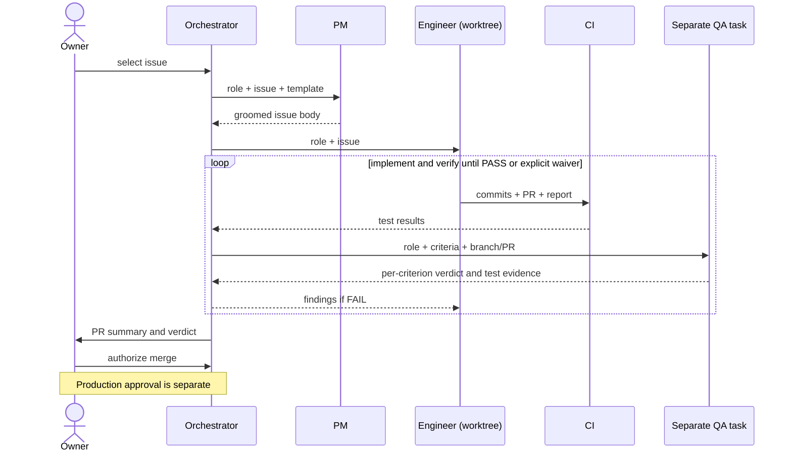
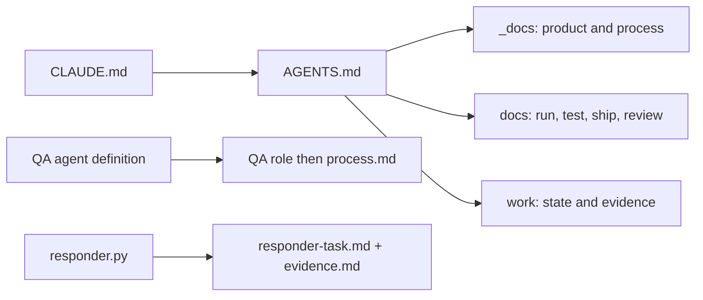
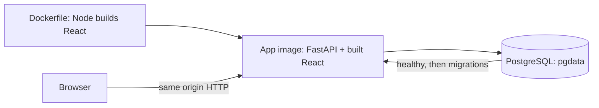
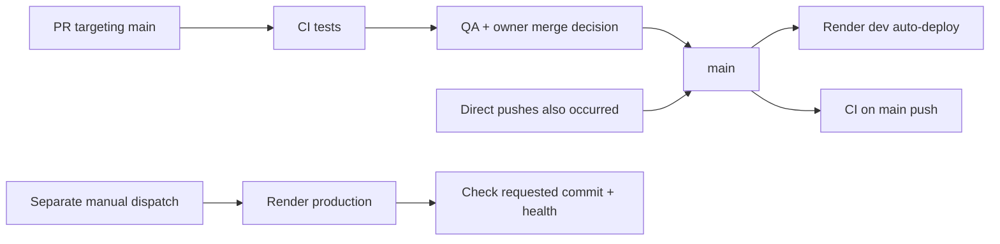
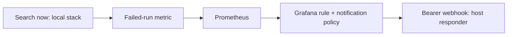

# Reviewer guide

Sail-event turns a free-text event search into scored events and a personal ICS feed. [Production](https://sail-event.onrender.com) · [Dev](https://sail-event-dev.onrender.com) · [Local setup](../README.md#try-it).

**Observability, alerts and the on-call responder cover the local stack (`make up-all`). The deployed app sends no telemetry to that stack. Both recorded on-call runs are drills with injected faults.**

Each criterion below has the rubric's levels, a phrase-by-phrase checklist, the evidence against the lower level, extras, a picture where useful, and known gaps. Proof checks mean inspecting a linked file, record or screenshot; building and running the system takes longer.

Rubric: [saved copy](../work/rubric-2026-10-16.md), compared with the [course source](https://github.com/DataTalksClub/ai-dev-tools-zoomcamp/tree/main/project) on 2026-10-26. Code-line links use **542e58cb0fe73065a905febec7637bfa377a77c4**, an evidence pin, not a claim about the deployed version. Read that version with `curl -s https://sail-event.onrender.com/api/health`.

## Criteria map

| Criterion | Evidence | Main limitations (full list in [Known gaps](#known-gaps)) |
|---|---|---|
| [1. Problem description](#1-problem-description) | README problem, workflow and expected behavior | Scheduled searches are not reliably hourly; demo data is recorded |
| [2. Product specification](#2-product-specification) | PRD, public issues, edit history and QA comments | Incomplete grooming, missing QA passes and inconsistent role attribution |
| [3. Agent team specification](#3-agent-team-specification) | Roles, launches and handoffs | Orchestrator overreach; late rules; instructions do not enforce separation |
| [4. Context management](#4-context-management) | AGENTS.md and modular docs | Handover and instructions can drift |
| [5. Application](#5-application) | Browser journey and restart test | External services replay fixtures locally; restart test compares counts |
| [6. Testing](#6-testing) | CI logs and Makefile | Responder tests are local only; expected browser failures; no captured combined run |
| [7. Containerization](#7-containerization) | Dockerfile and Compose | Scheduler and responder are separate; local providers use fixtures |
| [8. Deployment](#8-deployment) | Public health endpoint | Health does not prove search quality or provider availability |
| [9. CI/CD](#9-cicd) | CI, Render deployment instructions, manual promote | Direct pushes, red merges, no enforced CI gate; migration rollback untested and PR #150's delete irreversible |
| [10. Observability](#10-observability) | Metrics, Tempo, Loki and Grafana | Local only; feed-token exposure; metrics lack a trace ID; other privacy/UI gaps |
| [11. Alerting on user impact](#11-alerting-on-user-impact) | Provisioned rules and drill records | No hosted coverage; silence rule limitations; enqueue success is not search success |
| [12. On-call agent](#12-on-call-agent) | Drill evidence and fix commits | Host process; easy injected fault; weak test evidence; no recorded recovery; broad Edit access |

## Check it in 5 minutes

Open the [app](https://sail-event.onrender.com). The following are read-only checks; `gh` needs an authenticated GitHub CLI. They do not register an account or run a paid search.

```bash
# §8: availability and the deployed commit; no expected SHA is hard-coded.
curl -s https://sail-event.onrender.com/api/health
# §9: compare dev's reported commit with main's head; allow for a deploy in progress.
curl -s https://sail-event-dev.onrender.com/api/health
git ls-remote https://github.com/alexisdacquay/sail-event refs/heads/main
# §6: find the latest CI run, then inspect its jobs with gh run view <id> -R ...
gh run list -R alexisdacquay/sail-event --workflow=ci.yml -b main -L 3
# §2–3: QA FAIL → fix → QA PASS → close.
gh issue view 7 -R alexisdacquay/sail-event --comments | grep -E '^## QA|^Closed by the orchestrator'
```

In that issue, `QA fix: db3499a` labels a fix for QA's findings, not a QA verdict. The public record does not identify which agent typed it. Browser alternatives: [CI history](https://github.com/alexisdacquay/sail-event/actions/workflows/ci.yml) · [issue #7](https://github.com/alexisdacquay/sail-event/issues/7).

With a clone, `python3 -I incident-response/test_responder.py` checks the responder without launching an agent. For a longer local review, use `docker compose up --build` (Docker), then `make test-all` (Docker, uv, Node/npm and Python). These builds and test suites are outside the five-minute check.

## 1. Problem description

**Rubric levels**

> The problem is not described. (0 points)
>
> The problem is described briefly, but it is unclear what the system does or what functionality is expected. (1 point)
>
> The README clearly describes the problem, the system functionality, and expected behavior. (2 points)

**Checklist**

| Rubric phrase | Where to look | Proof checkable in under a minute |
|---|---|---|
| README | [README](../README.md) | The entry document contains the problem, workflow and expected behavior. |
| clearly | [Problem](../README.md#problem) | The gap is repeated discovery and checking: a web search returns pages, not checked events in a calendar. |
| describes the problem | [Problem](../README.md#problem) · [user](../_docs/ux-spec.md#1-who-the-user-is) | The user wants events without repeatedly scanning sites and copying details. |
| the system functionality | [What it does](../README.md#what-it-does) · [pipeline][pipeline] | Search → extract → event-page fetch → screen → score/triage → store → model duplicate check → feed. |
| expected behavior | [Expected behaviour](../README.md#expected-behaviour) · [boundary test][boundaries] · [rejection test][rejection] | Saved thresholds control triage; a rejected event stays rejected after a later search. |

**Why not the lower score**

The lower level is “The problem is described briefly, but it is unclear what the system does or what functionality is expected.” The README distinguishes discovery from calendar delivery, names the result states, and links expected behaviors to tests. The checklist checks those distinctions rather than the length of the prose.

**Beyond the rubric**

- Thresholds are per user. Defaults accept at **90 or more**, reject at **40 or less**, and leave the middle for review ([registration defaults][auth], [triage][triage]). A later model duplicate check can move a high-scoring event to Out ([dedup stage][dedup]).
- Out rows are hidden behind **show**, not erased from the UI ([browser test][journey]).

**Picture**


Local demo data, with the application clock fixed at 18 October 2026 so the 19–21 October fixtures remain usable. This is not live search-quality evidence. The chronology also shows two failed event-page fetches.

**Known gaps**

- “Hourly” describes the GitHub cron, not a delivery guarantee. The 50 scheduled runs inspected on 2026-10-26 had gaps of **2.1–7.8 hours**; [reproduce the measurement](#schedule-measurement).
- The UI says “Auto-accept above” / “Auto-reject below”, but equality also accepts/rejects ([triage][triage]). Product limits are in [the PRD](../_docs/plan.md#out-of-scope-for-the-mvp); price rules are not supported.

## 2. Product specification

**Rubric levels**

> No written specs. (0 points)
>
> A spec exists, but no public task tracker. (1 point)
>
> A specification exists and there's a publicly accessible task tracker. The tasks define acceptance criteria and there's evidence that the agents used the tracker. (2 points)

**Checklist**

| Rubric phrase | Where to look | Proof checkable in under a minute |
|---|---|---|
| A specification exists | [PRD](../_docs/plan.md) · [search spec](../_docs/search-spec.md) · [API contract](../openapi.yaml) | Product behavior, quality targets and API operations are written down. |
| publicly accessible task tracker | [GitHub Issues](https://github.com/alexisdacquay/sail-event/issues?q=is%3Aissue) | Issues and comments are readable in the public repository. |
| The tasks define acceptance criteria | [task template](../_docs/task-template.md) · [issue #11](https://github.com/alexisdacquay/sail-event/issues/11) | The example has Goal, Acceptance criteria, Out of scope and Constraints. Coverage counts and exceptions are below. |
| evidence that the agents used the tracker | [#11 edit history and comments](https://github.com/alexisdacquay/sail-event/issues/11) · [PR #149 QA](https://github.com/alexisdacquay/sail-event/pull/149) | Body rewrite, implementation report, and a per-criterion QA PASS are preserved as separate artifacts. Role labels are project attribution, not separate GitHub identities. |

**Why not the lower score**

“A spec exists, but no public task tracker.” The issue body, implementation report and QA verdict are public, not just an internal task list. They show use of acceptance criteria. This is evidence for the workflow, not a claim that every item followed it.

**Beyond the rubric**

- The spec preceded code. `git log --reverse --diff-filter=A --format='%h %ci %s' -- _docs/plan.md AGENTS.md backend/app/main.py` shows the PRD on 2026-10-15 (`fa345ba`), context and roles on 2026-10-16 (`98f3cf7`), then the first backend scaffold (`6ccfdec`).
- [Original tasks](../_docs/outdated/tasks.md) 1–28 became issues 1–28. Task 18 was narrowed to CI; CD was split into [#29](https://github.com/alexisdacquay/sail-event/issues/29).

**Picture**

The useful record is [issue #11](https://github.com/alexisdacquay/sail-event/issues/11), including **edited** and the QA comment; a screenshot would hide its revision history. The 2026-10-16 rewrite added the criteria. A third edit on 2026-10-20 ticked the boxes after the 2026-10-16 close. The QA comment is the contemporaneous verification record. Query splitting and the per-run cap in that historical issue were later withdrawn ([PRD changes](../_docs/plan.md#changed-after-the-mvp-dated), [PR #144](https://github.com/alexisdacquay/sail-event/pull/144)).

**Known gaps**

- On 2026-10-26, **58 of 96 issues** had all four template headings; **91** contained “acceptance criteria”. The other **38** were never groomed into the full template, including **27** already closed. Those without the phrase were #17, #21, #46, #102 and #145. These are textual counts, not a quality verdict.
- **69 issues** had a QA PASS/FAIL heading; **23** had a FAIL. **30 of 56 PRs** had a verdict heading. Of **42** merged PRs from #66 onward, **14** had none: #67, #88, #89, #91, #92, #93, #137, #138, #140, #141, #143, #144, #146, #152. A missing PR verdict alone does not prove there was none on its issue. [Reproduce these counts](#tracker-audit).
- Closed issues with no QA verdict on either the issue or its associated PR: **#17, #21, #29, #59, #60, #74, #139, #142**. #59 deferred verification to #60; #60 and PR #64 have no QA verdict. [Inspect the exception records](#tracker-audit).
- Closed or merged after FAIL with no fresh QA PASS: issues **#14, #15, #39, #52, #55, #63, #76, #134**; PRs **#86, #115, #127, #128, #129, #144**. #76 corresponds to PR #86. On #134 the PASS claim is the orchestrator's closing note; the recorded QA comments are FAIL. PR #85 instead has an explicit waiver: criterion 6b could not occur at sessionmaker construction, and stale-run release bounded its effect.
- Role labels are incomplete and all comments use the owner's GitHub identity. The tracker does not independently authenticate who performed an action. **21 issues** lacked both `mvp` and `post-mvp`; the audit prints them.

## 3. Agent team specification

**Rubric levels**

> No agent team described. (0 points)
>
> Roles or agents are mentioned, but responsibilities are unclear. (1 point)
>
> The project defines the agent team and process of how they work together. (2 points)

**Checklist**

The first two rows also check the lower-level ambiguity requested by the owner; their words come from that level.

| Rubric phrase | Where to look | Proof checkable in under a minute |
|---|---|---|
| Roles or agents are mentioned | [Team](../_docs/process.md#team) | Human owner; AI orchestrator, PM, engineer and QA. |
| responsibilities | [role files](../_docs/team/) · [Roles](../_docs/process.md#roles) | PM specifies; engineer implements; QA verifies; orchestrator coordinates. The walkthrough below states the boundaries and the recorded exceptions. |
| defines the agent team | [Team](../_docs/process.md#team) · [QA agent](../.claude/agents/qa-engineer.md) | The main Claude Code session coordinates separate subagent tasks. QA also has a runnable agent definition. |
| process | [Lifecycle](../_docs/process.md#lifecycle) · [Phase 2](../_docs/process.md#phase-2-from-issue-65-worktrees-and-prs) | Groom → implement → verify → fix/recheck → owner-authorized merge. |
| how they work together | [Handoffs](../_docs/process.md#handoffs) · [PR #149](https://github.com/alexisdacquay/sail-event/pull/149) | Issue body → implementation/PR → QA verdict → owner decision. PR #149 contains a QA PASS against the duplicate-check criteria. |

**Why not the lower score**

“Roles or agents are mentioned, but responsibilities are unclear.” The roles have distinct inputs and outputs, not just names. The following is the documented Phase 2 cycle, not a claim that every historical task followed it:

1. The owner selects work; the orchestrator starts a PM task with [pm.md](../_docs/team/pm.md), the issue and [task template](../_docs/task-template.md). PM rewrites the body; it does not implement code.
2. The orchestrator starts an engineer task with [software-engineer.md](../_docs/team/software-engineer.md) and the groomed issue. In Phase 2 the engineer uses a separate branch/worktree, implements within scope and opens a PR with its report. It may question criteria in a comment, not rewrite them or close the issue.
3. CI runs on the PR. Green CI is the written merge rule; historical violations are listed in §9.
4. The orchestrator starts a separate QA task, using [qa-engineer.md](../.claude/agents/qa-engineer.md) or the QA role brief. “Fresh” means a separate verification task: read the criteria, inspect/run the code and do not trust the implementation report. QA posts a verdict, edits no files and leaves the issue open.
5. FAIL returns the QA comment to the engineer; the changed work goes back for re-check. PASS, or an explicit waiver, goes to the owner with the PR summary. In Phase 2 the verdict belongs on the PR.
6. The owner authorizes merge in chat; the orchestrator performs it. GitHub may close an issue through `Closes #N`. A merge deploys dev. Production needs separate owner approval for a named SHA; the owner can dispatch the promote workflow or instruct the orchestrator to dispatch that approved SHA. Public run metadata records the dispatch, not the private approval conversation.

**Beyond the rubric**

- [Issue #7](https://github.com/alexisdacquay/sail-event/issues/7) records a Phase 1 loop: password echoed in an error → QA FAIL → fix → QA PASS → close. It predates the worktree/PR phase.
- The root-cause/regression rule entered the role files on **2026-10-25** (`c0f83e6`, part of the test-runner PR), then process.md on **2026-10-26** (`ac54483`). Verify with `git log -S 'committed while red' --format='%h %cs %s' -- _docs/team/software-engineer.md` and `git log -S 'Root-cause gate' --format='%h %cs %s' -- _docs/process.md`.

**Picture**



**Known gaps**

- The orchestrator exceeded coordination: corrected the #24 groom, edited missing lines for #39/#52, and verified #14/#15/#55 itself. This breaks the stated role separation; it is not evidence of independent QA. See [the tracker audit](#tracker-audit) and [AI usage report](ai-usage-report.md).
- Owner control of work selection and production approval dates from **2026-10-21** ([state record](../work/STATE.md), pause at 11:40 and owner rules). Earlier work did not run under those rules. The root-cause rule dates above likewise do not describe the whole project.
- QA has Bash. “No edits” rests on instructions and the clean-tree check, not a write-proof sandbox. The runnable QA definition was added on **2026-10-17** (`git log -1 --format='%h %cs %s' a41b405`).
- A separate initial QA context does not mean each re-check started a new agent: #7 reused its QA task ([launch and re-check record](../_docs/process.md#how-the-orchestrator-starts-an-agent)). Parallel work also needs dependency control; [#142](https://github.com/alexisdacquay/sail-event/issues/142) explicitly depended on #141. The tracker exceptions in §2 and CI exceptions in §9 limit claims of process compliance.

## 4. Context management

**Rubric levels**

> No project docs. (0 points)
>
> An AGENTS.md (or equivalent) exists and describes the project. (1 point)
>
> AGENTS.md exists and it also points to modular docs (process, teams, etc.). (2 points)

**Checklist**

“describes the project” checks the preceding level as well.

| Rubric phrase | Where to look | Proof checkable in under a minute |
|---|---|---|
| AGENTS.md exists | [AGENTS.md](../AGENTS.md) | Root entry document. |
| describes the project | [AGENTS.md](../AGENTS.md) opening | Event finding, score thresholds and per-user ICS feeds are named. |
| points to modular docs | [AGENTS.md: Documents](../AGENTS.md#documents) | Links group product, process, operations and history rather than embedding them all. |
| process | [process.md](../_docs/process.md) | Lifecycle and handoffs. |
| teams | [role files](../_docs/team/) | PM, engineer and QA responsibilities. |
| etc. | [testing](testing.md) · [deployment](deployment.md) · [observability](../observability/README.md) | Operational context is linked separately. |

**Why not the lower score**

“An AGENTS.md (or equivalent) exists and describes the project.” The entry file also routes readers to modular instructions. `_docs/` is product, design and team process; `docs/` is running, testing, shipping and review. `work/` is evidence and handover, and `_docs/outdated/` is history.

**Beyond the rubric**

[CLAUDE.md](../CLAUDE.md) contains `@AGENTS.md`. The [launch/context record](../_docs/process.md#how-the-orchestrator-starts-an-agent) describes the rest of the context handoff:

1. The orchestrator briefs the task with its role, issue, read list, scope, branch/worktree and required reply. The PM gets the template/product context; the engineer gets architecture/API/code context. The runnable QA definition explicitly reads its role file, then process.md.
2. Replies return artifact links, checked heads, commands/results and unmet criteria. A report is a lead for QA to verify, not inherited proof.
3. Before context compression, the orchestrator records active issues, heads, worktrees, verdicts, pending decisions and the next action in [STATE](../work/STATE.md). A resumed session reads the top block and its evidence rather than restarting the backlog.
4. The on-call path is separate: [responder.py][responder] builds a prompt from the task template and fenced evidence packet, then starts the agent in its worktree.

**Picture**

Context entry points, not a claim that every linked file is loaded on every task:



**Known gaps**

Pointers do not guarantee freshness. [work/STATE.md](../work/STATE.md) contains dated snapshots; read its top block and verify live versions. Launch transcripts are retained locally, not published, so the public tracker cannot prove the exact context loaded on every task. No rule requires PM and engineer to load every linked document.

## 5. Application

**Rubric levels**

> No working application, or frontend, backend, or persistent storage is missing. (0 points)
>
> Frontend, backend, and database exist but are not fully connected. (1 point)
>
> Full-stack application works end to end: frontend talks to backend, data persists in a database. Application runs locally with a single command. (2 points)

**Checklist**

| Rubric phrase | Where to look | Proof checkable in under a minute |
|---|---|---|
| works end to end | [browser journey][journey] · [HTTP journey][integration] | Registration, criteria, thresholds, search, decisions and re-fetch are exercised against the app. CI evidence is in §6. |
| frontend talks to backend | [image build][dockerfile] · [client selection][client] | `VITE_API_URL=""` selects the HTTP client at the same origin, not the mock client. |
| data persists in a database | [restart test][restart] · [Compose][compose] | App restarts; the nonzero event count remains. The browser journey separately reloads a saved threshold. |
| runs locally | [Compose][compose] | App and PostgreSQL run on the local host through containers. |
| with a single command | [README setup](../README.md#try-it) · [Dockerfile][dockerfile] | `docker compose up --build` starts the database and app; startup migrates and seeds the demo. |

**Why not the lower score**

“Frontend, backend, and database exist but are not fully connected.” The browser and HTTP tests cross those boundaries; the restart test checks storage beyond the app process. Inspect their assertions and the linked CI log in §6 rather than inferring connectivity from folder names.

**Beyond the rubric**

[The schema-contract test][contract] compares API paths, methods and operation IDs with [openapi.yaml](../openapi.yaml). [Journey 2][journeys] checks that another user cannot see the first user's events.

**Picture**

The container diagram in §7 shows the serving path; another app screenshot adds no persistence evidence.

**Known gaps**

- Local defaults replay fixture search pages and recorded model answers. Use the pre-filled demo criteria; other text can lack a model recording and remain unscored ([fixture provider][fixture], [fake model][fake]). The backend, HTTP client and database still run normally.
- `mock.ts` is also selected by a bare frontend dev run when `VITE_API_URL` is absent; it is not limited to tests ([client selection][client]). Use the documented startup commands.
- The restart assertion compares event **counts**, not event IDs or full contents. End-to-end connectivity does not establish live search recall; no recall result after the event-page changes is recorded in [the measurement log](../work/RECALL.md). [PR #141](https://github.com/alexisdacquay/sail-event/pull/141) supplies a targeted regression, not that measurement.

## 6. Testing

**Rubric levels**

> No tests, or the tests do not run. (0 points)
>
> Only unit tests or only integration tests exist. (1 point)
>
> Both unit and integration tests exist, run with a single command, and pass. (2 points)

**Checklist**

| Rubric phrase | Where to look | Proof checkable in under a minute |
|---|---|---|
| unit tests exist | [backend tests](../backend/tests/) · [frontend tests](../frontend/src/) | The rubric's shared “tests exist” predicate applies to both layers. pytest and Vitest results are below; some backend tests cross routes/ORM in-process using TestClient and SQLite. |
| integration tests exist | [HTTP integration tests][integration] | Tests use HTTP against the container and PostgreSQL, including app restart. |
| run with a single command | [Makefile][makefile] | `make test-all` invokes `test`, `test-integration`, `test-e2e` sequentially under normal make execution. |
| pass | [CI run 40251535674](https://github.com/alexisdacquay/sail-event/actions/runs/40251535674) | At the evidence pin, unit, integration and browser steps passed. This proves the parts; it is not a captured local `make test-all` run. |

**Why not the lower score**

“Only unit tests or only integration tests exist.” Both layers run: [CI configuration][ci] uses `uv run pytest` in `backend`, `npm test` in `frontend`, then `make test-integration` and `make test-e2e` inside the job named `integration`. CI does not invoke `make test-all` itself.

**Beyond the rubric**

At **542e58c**, [CI run 40251535674](https://github.com/alexisdacquay/sail-event/actions/runs/40251535674) reports **507 backend passed, 4 skipped, 7 deselected; 117 frontend; 7 integration; 12 Playwright**. Reproduce:

```bash
gh run view 40251535674 -R alexisdacquay/sail-event --log | grep -E 'passed|test_data_survives_restart'
```

The responder's **20** stdlib tests passed locally on 2026-10-26: `python3 -I incident-response/test_responder.py`. They do not launch an agent. Bug fixes require a red regression test under the rule introduced on 2026-10-25 (see §3).

**Picture**

The [CI run graph](https://github.com/alexisdacquay/sail-event/actions/runs/40251535674) shows the jobs and their actual status; a static screenshot would become stale.

**Known gaps**

- The responder suite runs in `make test`, but **not CI**. No captured combined `make test-all` result is offered here.
- The 12-test Playwright result includes **two expected-failure markers** for [#94](https://github.com/alexisdacquay/sail-event/issues/94) (clipped scoring legend) and [#95](https://github.com/alexisdacquay/sail-event/issues/95) (feed subscription), plus **three screenshot-oriented tests**. Inspect [field.spec.ts][field] and the [journey/screenshot specs](../e2e/); a green result does not mean those bugs are fixed.
- The backend excludes marked integration tests from its default run; those run in the integration job. Other skips are conditional on a live model, PostgreSQL test URL or built frontend ([testing.md](testing.md)).

## 7. Containerization

**Rubric levels**

> No containerization. (0 points)
>
> Dockerfiles exist, but running the full system requires manual steps. (1 point)
>
> The full system, including the database, runs via Docker or Docker Compose and starts with a single command. (2 points)

**Checklist**

| Rubric phrase | Where to look | Proof checkable in under a minute |
|---|---|---|
| The full system | [Dockerfile][dockerfile] · [SPA mount][spa] | One image builds React and serves it with FastAPI; Compose adds storage. External trigger/ops components are disclosed below. |
| including the database | [Compose][compose] | `postgres:18-alpine`, healthcheck and named `pgdata` volume; the app connects to that service. |
| runs via Docker or Docker Compose | [Compose][compose] | `docker compose config --services` prints `postgres` and `app`. |
| starts with a single command | [Dockerfile][dockerfile] · [Compose][compose] | `docker compose up --build`; health dependency, migrations and demo seed run automatically. |

**Why not the lower score**

“Dockerfiles exist, but running the full system requires manual steps.” The default application path needs no separate database creation, migration, seed or provider-key setup. CI starts the same Compose stack before integration and browser tests ([CI][ci]).

**Beyond the rubric**

`make up-all` adds the [observability containers](../observability/docker-compose.yml) and enables OTLP in the app through [the override](../docker-compose.observability.yml). The responder itself is a host process, not one of those containers.

**Picture**



**Known gaps**

The one-command application path uses fixture search, the fake/recorded model and a fixed clock. Real providers need environment configuration and keys. The GitHub scheduled trigger is external to Compose; observability uses `make up-all`, and the responder starts separately. “Full system” here describes the application and database, not an unattended production operations deployment.

## 8. Deployment

**Rubric levels**

> Application is not deployed. (0 points)
>
> Deployment steps are described, but no working deployment is shown. (1 point)
>
> The application is deployed and reachable at a public URL, or there's a clear demo with the deployment. (2 points)

**Checklist**

| Rubric phrase | Where to look | Proof checkable in under a minute |
|---|---|---|
| deployed | [Render deployment instructions](deployment.md) · [public app](https://sail-event.onrender.com) | HTTP GET reaches the hosted application; `/api/health` returns status and the deployed commit. |
| reachable at a public URL | <https://sail-event.onrender.com/api/health> | `curl -s https://sail-event.onrender.com/api/health` prints the deployment's own response. Public URL is the route used here; the rubric's demo alternative is not needed. |

**Why not the lower score**

“Deployment steps are described, but no working deployment is shown.” The health endpoint and served UI can be inspected now, independently of the written instructions. This is an availability check, not proof that every external search succeeds.

**Beyond the rubric**

- [Services](deployment.md#services) documents separate dev and production services/databases. [Promotion][promote] checks health and the requested commit after deployment.
- Registration requirements are discoverable with `curl -s https://sail-event.onrender.com/api/config`; the 2026-10-26 GET returned `registrationCodeRequired: false`. The UI uses **Create one** / **Create account** ([login page][login], [registration page][register]).

**Picture**

No image is needed: the public URL and response are directly inspectable.

**Known gaps**

Live searches depend on provider availability and balance. Measured searches in [PR #144](https://github.com/alexisdacquay/sail-event/pull/144) ranged **86–493 seconds**, across different code/configuration measurements, not a latency guarantee. On 2026-10-25 a DeepSeek HTTP 402 outage stopped searches on both hosted environments ([handover](../work/HANDOVER-2026-10-25.md)). Health remained insufficient evidence of search success. Hosted alerting coverage is absent (see §11).

## 9. CI/CD

**Rubric levels**

> No CI/CD pipeline. (0 points)
>
> CI runs the tests automatically on every pull request. (1 point)
>
> CI runs tests and CD automatically deploys. (2 points)
>
> CI runs tests, CD deploys to dev, and there's a manual deploy to production. (3 points)

**Checklist**

| Rubric phrase | Where to look | Proof checkable in under a minute |
|---|---|---|
| CI runs tests | [CI][ci] · [run evidence](#6-testing) | PRs targeting main and pushes to main trigger unit, integration and browser checks. |
| CD deploys to dev | [deployment instructions](deployment.md) · [live dev health](https://sail-event-dev.onrender.com/api/health) | Compare dev's commit with `git ls-remote https://github.com/alexisdacquay/sail-event refs/heads/main`. Equality is indirect evidence; it does not itself prove the Render trigger setting. |
| manual deploy to production | [promote.yml][promote] · [run history](https://github.com/alexisdacquay/sail-event/actions/workflows/promote.yml) | Only `workflow_dispatch` triggers this workflow. An optional full SHA overrides the dispatched ref's commit. |

**Why not the lower score**

“CI runs tests and CD automatically deploys.” The extra distinction is the separate manual production workflow. Dev and production use different deployment paths. Render's auto-deploy settings are external to this repository; a health comparison cannot substitute for a dashboard setting or deployment-history record.

**Beyond the rubric**

The promotion sequence is small enough to inspect in [promote.yml][promote]: select the input SHA or dispatched commit → validate its format → call the Render deploy hook → poll production until it reports that healthy commit. Owner approval is a process requirement; the workflow itself checks neither approval nor that SHA's CI status.

Read the deployment state without dispatching anything:

```bash
curl -s https://sail-event-dev.onrender.com/api/health
git ls-remote https://github.com/alexisdacquay/sail-event refs/heads/main
curl -s https://sail-event.onrender.com/api/health
gh run list -R alexisdacquay/sail-event --workflow=promote.yml -L 3
```

**Picture**



The diagram shows the documented deployment paths and the direct-push exception; it does not imply that CI blocks a dev deployment.

**Known gaps**

- Main has no branch protection/ruleset gate. PRs **#31 and #138** merged with a failed integration check. Docs/work/tooling also reached main directly: **34 of the last 60 first-parent subjects at 542e58c lack a PR marker**. This is a subject-based proxy, not a complete API audit. [Reproduce and inspect](#delivery-audit).
- Dev auto-deploys on pushes without waiting for main CI. Both Render auto-deploy settings are outside git; there is no Render settings/deploy-history capture here, and GitHub's deployments API returned no records on 2026-10-26.
- The manual workflow validates SHA format and health, not a prior green CI run or a protected production approval.
- **Rollback is documented, never exercised. Rollback across the three new migrations is untested; PR #150's delete is irreversible.** Those migrations are `e4f5a6b7c8d9`, `f5a6b7c8d9e0` and `a6b7c8d9e0f1`. Old code may not recognize the database revision during startup's `alembic upgrade head`; promoting an earlier SHA alone cannot recover deleted events. A compatible database backup/recovery plan is needed; see [release process](release-process.md#rollback) and [delete migration][delete-migration]. No tested recovery procedure is claimed.

## 10. Observability

**Local stack only. The deployed app sends no telemetry to this collector, Grafana, or responder.** [Telemetry initialization][telemetry] returns without an OTLP endpoint; the local [override](../docker-compose.observability.yml) enables it.

**Rubric levels**

> No telemetry. (0 points)
>
> The app emits logs, but there are no metrics or traces, or the signals cannot be correlated to a single request. (1 point)
>
> A key user journey is instrumented with metrics, traces, and structured logs that share a trace ID; no customer data or credentials are sent to telemetry; and the signals are collected, stored, and viewable in a UI. (2 points)

**Checklist**

| Rubric phrase | Where to look | Proof checkable in under a minute |
|---|---|---|
| A key user journey | [search pipeline][pipeline] | `POST /api/search` encloses a `search_run` span with a run ID and stage spans. |
| metrics | [metric definitions][metrics] | Run count, duration, event counts and provider/model activity are instrumented. |
| traces | [pipeline][pipeline] · picture below | Search, extraction, event-page hop, filter, judge, triage, dedup and persist appear as spans. |
| structured logs | [JSON formatter][logging] | Timestamp, level, logger, message, trace ID and span ID form each application JSON record. |
| share a trace ID | picture below · [telemetry][telemetry] | **Partial:** Loki and Tempo share the displayed ID. Metrics have no trace ID/exemplar correlation; joining by time does not meet this whole phrase. |
| no customer data | [pipeline][pipeline] · [telemetry][telemetry] | **Not met:** spans include the user's UUID and HTTP client metadata. Provider exception text can also reach logs/spans. See the privacy gaps below. |
| no credentials | [collector](../observability/collector.yaml) · [calendar route][calendar] | **Not met:** raw HTTP paths can include the feed token, which grants feed access. No redaction processor is configured. |
| collected | [collector](../observability/collector.yaml) | OTLP receivers feed signal pipelines; filelog also reads container logs. |
| stored | [observability Compose](../observability/docker-compose.yml) | Prometheus, Loki and Tempo store metrics, logs and traces. |
| viewable in a UI | [dashboard](../observability/dashboard.json) · [Grafana provisioning](../observability/grafana/provisioning/) | Grafana dashboard plus Explore for Loki/Tempo. |

**Why not the lower score**

“The app emits logs, but there are no metrics or traces, or the signals cannot be correlated to a single request.” Metrics and traces exist, and the screenshots correlate a log with its trace. This closes the absence-of-signals concern. It does **not** close all full-marks clauses: metrics lack the shared ID and the privacy/credential conditions are incomplete. The rubric has no intermediate level for this combination; the reviewer decides.

**Beyond the rubric**

To inspect the local path: set a nonempty `RESPONDER_WEBHOOK_SECRET` locally, run `make up-all`, exercise the recorded demo through `http://localhost:8000`, then open Grafana at `http://localhost:3001`. The app exports OTLP to the collector; Prometheus scrapes collector metrics; Loki and Tempo receive logs/traces. In Explore, use `{service_name="sail-event-backend"} |= "search run completed"` for logs, and find the same trace ID in Tempo. Allow for export delay. Starting the responder is a separate step (§12).

**Picture**

Local fixture run, 2026-10-25. The matching trace ID is `9da6b9bd797b3bdc96b17585867e9f6f`:

| Tempo trace | Loki log |
|---|---|
|  |  |

**Known gaps**

- Feed tokens in HTTP span paths violate “no credentials”; user UUIDs are customer identifiers, and HTTP auto-instrumentation also records client address, user-agent and URL metadata. Application-selected attributes alone are not a privacy boundary.
- On 2026-10-26 a GET of an **invalid** calendar path on the existing local app returned 404 and left that full path and client IP in the Uvicorn container access log. The matching Loki query returned no lines, and no matching probe trace was found. Transport of that access-log line into Loki is **unverified**, not disproved. Reproduce without a real token using [the privacy check](#local-privacy-check).
- Some warning logs and `record_exception` include provider exception text ([pipeline][pipeline]); the collector has no redaction step and its filelog glob covers **all Docker container logs**, not just this application. The filelog mount can also be empty on some Docker hosts ([telemetry comments][telemetry]).
- Metrics lack trace IDs; the dashboard's traces panel errors in [the recorded screenshot](images/review-40-grafana-dashboard.png). Explore/Tempo is the demonstrated alternative. `service.version` defaults to `dev` unless `APP_VERSION` is set; the selector does not prove commit identification.
- Grafana's local Compose configuration enables anonymous **Admin** access. These defaults are a local demonstration, not a hosted operations setup. There is no deployed telemetry/alerting coverage (§11).

## 11. Alerting on user impact

**Local stack only; no alert watches hosted users. Recorded firings are drills.**

**Rubric levels**

> No alerts. (0 points)
>
> At least one alert exists. (1 point)

**Checklist**

| Rubric phrase | Where to look | Proof checkable in under a minute |
|---|---|---|
| At least one alert exists | [rules.yaml][rules] · [2026-10-21 drill alert](../incident-response/incidents/20261021-074150-SearchRunFailures/alert.json) | `SearchRunFailures`: failed-run increase over ten minutes > 1, held five minutes, evaluated every 60 seconds. A firing alert element is recorded. |

**Why not the lower score**

“No alerts.” The rule is provisioned in code and a drill records its firing. It measures failed searches, a user journey outcome, rather than CPU utilization. This does not establish production coverage.

**Beyond the rubric**

The route is also configured: `severity=critical` → [notification policy](../observability/grafana/provisioning/alerting/policies.yaml) → [Bearer-authenticated webhook](../observability/grafana/provisioning/alerting/contactpoints.yaml) → responder. Current rules link the runbook; the recorded alert predates that change and still says `TODO`.

A second rule, `SearchRunsSilent`, evaluates `increase(sail_runs_total[2h]) < 1`, held ten minutes, with `noDataState: OK`. It evaluates each series separately; it is not an aggregate count of all search activity. This behavior follows from the expression/configuration; a live false-alarm test is not recorded.

**Picture**



**Known gaps**

- On **2026-10-25**, DeepSeek balance exhaustion caused HTTP 402 search failures on dev and production. The local-only rules did not cover that outage; a human resolved the balance problem ([handover](../work/HANDOVER-2026-10-25.md)).
- `SearchRunsSilent` watches local series, not the production scheduler. A quiet outcome/trigger series can satisfy it while other searches succeed; no-data is treated as OK. Its window is shorter than the observed scheduled-search gaps (§1), so it is not a validated scheduler alarm. Useful-result quality and recall are not alerted on.
- [The scheduled workflow][schedule] checks health and the enqueue response only. [`POST /api/search/all`][enqueue] returns **202** before background searches finish. Search failures cannot turn that workflow red.

## 12. On-call agent

**A host-run demonstration beside the local stack, not an always-on production service. Both records are injected-fault drills.**

**Rubric levels**

> No on-call agent. (0 points)
>
> An agent wakes up on an alert and fixes the issue. (2 points)

**Checklist**

| Rubric phrase | Where to look | Proof checkable in under a minute |
|---|---|---|
| An agent | [responder launch][responder-launch] · [task](../incident-response/responder-task.md) | The HTTP responder starts headless Claude Code with model `sonnet`; the model process is the agent. |
| wakes up on an alert | [drill script][drill] · [stored alert](../incident-response/incidents/20261021-074150-SearchRunFailures/alert.json) | The script injects failures and waits for Grafana's firing rule. Its only direct `/alerts` POST is a resolved liveness ping, ignored by the responder. JSON field names alone cannot prove the sender. |
| fixes the issue | [verdict](../incident-response/incidents/20261021-074150-SearchRunFailures/verdict.json) · [diff](../incident-response/incidents/20261021-074150-SearchRunFailures/fix.diff) · [commit 8d2f839](https://github.com/alexisdacquay/sail-event/commit/8d2f839) | The commit removes the injected exception stub and restores the method name (+1/−4). No recovered running service or resolved alert is recorded. |

**Why not the lower score**

“No on-call agent.” The drill preserves the alert, collected evidence, agent report, verdict and fix commit. It demonstrates alert-triggered code repair; the unrecorded recovery and weak test evidence below limit the broader claim that it “fixes the issue”.

The implemented sequence is explicit in [responder.py][responder]:

1. Run the webhook server on the host (`make responder`) with a nonempty `RESPONDER_WEBHOOK_SECRET`. Grafana's default URL is `host.docker.internal:8001/alerts`.
2. For a valid firing alert, create an incident folder and save the **alert element**, not the entire Grafana webhook envelope.
3. Run `collect-evidence.sh` before the agent starts: Prometheus errors, Loki query, health and recent commits form `evidence.md`.
4. Create a local git worktree. Pass [responder-task.md](../incident-response/responder-task.md) and fenced evidence to Claude Code. The task asks it to make an incident branch, investigate, test, commit and write `verdict.json`.
5. Copy the report/verdict into the incident record and remove the worktree. The tool list omits `git push`; branch publication and deployment are separate human actions. The script does not deploy the repaired build or verify recovery.

**Beyond the rubric**

- A second drill, **2026-10-17**, injected a scorer fault (`7318f2f`) and recorded fix `dae24e9` ([folder](../incident-response/incidents/20261017-052050-SearchRunFailures/)). The 2026-10-21 drill injected search-provider fault `3d9f6b8` and recorded fix `8d2f839`.
- The latter alert starts at **07:41:20 UTC**, and its fix commit is **07:46:12 UTC**: **4 min 52 s** to a commit, not to recovery. Check `git show -s --format='%h %cI %s' 3d9f6b8 8d2f839` against the stored alert.
- Implemented limits are in [the tool list][responder-tools], [launch flags][responder-launch] and [authentication][responder-auth]: separate worktree, $1 budget, 300-second timeout, Bearer check. The [response schema](../incident-response/response.schema.json) also permits `false_positive` and `escalate`.

**Picture**

```mermaid
sequenceDiagram
  participant G as Local Grafana
  participant R as Host responder
  participant A as Claude agent
  participant Git as Local git worktree
  G->>R: firing alert (injected-fault drill)
  R->>R: collect evidence packet
  R->>Git: create worktree
  R->>A: task + evidence + tool list
  A->>Git: remove stub, restore method, commit
  A-->>R: verdict and agent report
  Note over A,Git: A human later published the branch; nothing merged
  Note over R,Git: No deployment/recovery step in this sequence
```

**Known gaps**

### What this run does not prove

| Limit | Recorded evidence and consequence |
|---|---|
| Production response | The responder is a host process using the operator's Claude login/configuration. It was started for the drills; it does not monitor hosted users. |
| Diagnosis of an unknown fault | The newest commit says `test: inject search-provider fault`; the original method remains under `_search_original`. The repair is unusually easy. |
| Complete investigation | The script collected the packet before the agent ran. Both Loki queries returned no lines; the 2026-10-21 health commit was empty and deployed version `unknown`. The 2026-10-17 health check failed. Read [agent.log](../incident-response/incidents/20261021-074150-SearchRunFailures/agent.log) for the agent's own reasoning. |
| Reliable test evidence | The agent claims “84 frontend + backend tests” passed, without preserving the full test output, and admits not checking a background pytest completion. It also says “~28 errors/min” where the packet says about 28 in **ten** minutes. The suite was not rerun on the incident branch for this guide. `SKIP_HOOK_TESTS=1` skips the hook's tests. |
| Recovery | No successful post-fix search or resolved alert is recorded. A local code commit did not replace the faulty running image; cleanup/rebuild was separate. |
| Enforced file boundaries | `autonomy-policy.yaml` is documentation, read by no runtime code. `Read` and `Edit` are not path-restricted. No push command is listed, but broad Edit plus `make test` is not a security boundary against indirect actions. |
| Independent identity | Commits use the machine's git identity; GitHub author names do not prove which process wrote them. The incident branches were published by a human for the record, not by the agent. |

Read the [recorded folders](../incident-response/incidents/) without running another drill. The script's `--dry-run` still needs Docker, creates/cleans a temporary fault branch, builds the stack and waits for Grafana; it skips only the model agent. It is not a quick read-only check.

## Known gaps

This index includes the limitations above; the linked criterion supplies evidence and detail.

| Criteria | Gap and practical effect |
|---|---|
| [1](#1-problem-description), [5](#5-application), [7](#7-containerization) | Cron delays; recorded demo data and fixed clock; local free text may lack model recordings. Search quality after the event-page changes is unmeasured. |
| [1](#1-problem-description) | Threshold labels say above/below while code includes equality; price rules are unsupported. |
| [2](#2-product-specification) | Ungroomed issues, missing acceptance-criteria text, incomplete role labels and missing MVP labels; counts and lists are reproducible below. |
| [2](#2-product-specification), [3](#3-agent-team-specification) | Closed/merged work without a QA verdict or fresh PASS; #134's PASS is an orchestrator assertion; historical checkboxes can postdate closure. |
| [3](#3-agent-team-specification) | Orchestrator overreach into grooming/edits/verification; owner controls and regression rules started late; QA Bash permits writes; re-checks did not always start a new context. |
| [4](#4-context-management) | Documentation links and state snapshots do not guarantee current context. |
| [5](#5-application) | Bare frontend dev can select mocks; the restart test checks count rather than full event identity. |
| [6](#6-testing) | Responder tests absent from CI; combined `make test-all` pass not captured; expected browser failures and screenshot tests are included in green totals. |
| [7](#7-containerization) | Scheduler external to Compose; ops stack and host responder are separate. |
| [8](#8-deployment) | Public health does not prove provider availability, search latency or result quality. |
| [9](#9-cicd) | Direct pushes and red merges; no branch/CI/production-approval enforcement; external Render settings not captured. |
| [9](#9-cicd) | Rollback never exercised; rollback across the three new migrations untested; PR #150's delete irreversible. An older SHA alone cannot restore deleted data. |
| [10](#10-observability), [11](#11-alerting-on-user-impact), [12](#12-on-call-agent) | Hosted app sends no telemetry to the local stack; no alert or responder covers hosted users or the recorded provider-balance outage. |
| [10](#10-observability) | Feed-token paths can reach spans and access logs; client metadata/provider exceptions are privacy gaps; Loki transport of the access-log probe remains unverified. Collector filelog includes all host containers. |
| [10](#10-observability) | Metrics lack trace IDs; traces dashboard panel errors; version defaults to `dev`; local Grafana grants anonymous Admin. |
| [11](#11-alerting-on-user-impact) | Silence rule is per series, no-data OK, not tuned/wired to the scheduler; no useful-result alarm; workflow sees enqueue status only. |
| [12](#12-on-call-agent) | Drills with a named fault and preserved original method; empty Loki evidence; weak test claims; no recorded recovery; host runtime, broad Edit access and no independent author identity. |

## Evidence commands

### Tracker audit

Snapshot checked on 2026-10-26. These are explicit text filters over issue/PR bodies and comments, not independent identification of an agent. Run from a clone with `gh` authenticated:

```bash
python3 - <<'PY'
import json, re, subprocess
repo = 'alexisdacquay/sail-event'
def get(kind):
    fields = 'number,state,body,comments,labels' if kind == 'issue' else 'number,body,comments,mergedAt'
    return json.loads(subprocess.check_output([
        'gh', kind, 'list', '-R', repo, '--state', 'all', '--limit', '400', '--json', fields]))
issues, prs = get('issue'), get('pr')
def groom(x):
    return all(re.search(r'^#+ *'+h, x['body'], re.M)
               for h in ['Goal', 'Acceptance criteria', 'Out of scope', 'Constraints'])
def qa(x, pattern=r'PASS|FAIL'):
    return any(re.search(r'^#+ *QA:? *('+pattern+r')', c['body'], re.M) for c in x['comments'])
print('issues / closed:', len(issues), sum(x['state']=='CLOSED' for x in issues))
print('four headings / AC phrase:', sum(map(groom, issues)),
      sum('acceptance criteria' in x['body'].lower() for x in issues))
print('ungroomed / closed ungroomed:', sum(not groom(x) for x in issues),
      sum(not groom(x) and x['state']=='CLOSED' for x in issues))
print('issue QA / FAIL:', sum(map(qa, issues)), sum(qa(x, 'FAIL') for x in issues))
print('PR QA / total:', sum(map(qa, prs)), len(prs))
print('closed-by-orchestrator notes:', sum(any('closed by the orchestrator' in c['body'].lower()
      for c in x['comments']) for x in issues))
merged = [x for x in prs if x['mergedAt'] and x['number'] >= 66]
print('merged since #66 / no QA heading:', len(merged), sorted(x['number'] for x in merged if not qa(x)))
print('no MVP label:', sorted(x['number'] for x in issues
      if not {'mvp','post-mvp'} & {a['name'] for a in x['labels']}))
PY
```

For the exception claims, inspect the complete comments, including the closing note, rather than interpreting the counts as PASS coverage:

```bash
# No verdict cases: repeat with 21, 29, 59, 60, 74, 139, 142 and PRs 64, 141, 143.
gh issue view 17 -R alexisdacquay/sail-event --comments
# FAIL without fresh PASS cases: repeat with 14, 15, 39, 52, 55, 63, 76, 134.
gh issue view 134 -R alexisdacquay/sail-event --comments
# PR cases: repeat with 86, 115, 127, 128, 129; #144's FAILs are on issue #145.
gh pr view 144 -R alexisdacquay/sail-event --comments
gh issue view 145 -R alexisdacquay/sail-event --comments
```

### Schedule measurement

The workflow name “Hourly search” and cron are in [hourly-search.yml][schedule]. This command measures actual start gaps, without triggering a search:

```bash
gh run list -R alexisdacquay/sail-event --workflow=hourly-search.yml --event=schedule -L 50 --json createdAt | python3 -c 'import sys,json,datetime; t=sorted(datetime.datetime.fromisoformat(x["createdAt"].replace("Z","+00:00")) for x in json.load(sys.stdin)); g=[(b-a).total_seconds()/3600 for a,b in zip(t,t[1:])]; print(len(t), "runs; gap hours", round(min(g),1), "to", round(max(g),1))'
```

### Delivery audit

```bash
# A 404 saying Branch not protected was returned on 2026-10-26.
gh api repos/alexisdacquay/sail-event/branches/main/protection
gh api repos/alexisdacquay/sail-event/rulesets
gh api repos/alexisdacquay/sail-event/deployments
gh pr view 31 -R alexisdacquay/sail-event --json mergedAt,statusCheckRollup
gh pr view 138 -R alexisdacquay/sail-event --json mergedAt,statusCheckRollup
# Fixed historical sample: 34 subjects without a PR marker; inspect paths to classify them.
git log --first-parent 542e58c -60 --format='%s' | python3 -c 'import re,sys; print(sum(not re.search(r"\(#\d+\)$|^Merge pull request", s) for s in sys.stdin.read().splitlines()))'
git show --stat 8ceef57 6b2fcc4 571b751
```

### Local privacy check

The existing local app used port **8010** for this check on 2026-10-26. Substitute your local app port. The probe value is deliberately invalid; do not paste a real feed credential into logs or shared output.

```bash
curl -s -o /dev/null -w '%{http_code}\n' http://localhost:8010/api/calendar/docs-quality-invalid-probe
docker logs --since 5m projectone-app-1 2>&1 | grep 'docs-quality-invalid-probe'
curl -sG http://localhost:3100/loki/api/v1/query_range --data-urlencode 'query={service_name="sail-event-backend"} |= "docs-quality-invalid-probe"' --data-urlencode 'limit=10'
```

[auth]: https://github.com/alexisdacquay/sail-event/blob/542e58cb0fe73065a905febec7637bfa377a77c4/backend/app/routers/auth.py#L100-L101
[boundaries]: https://github.com/alexisdacquay/sail-event/blob/542e58cb0fe73065a905febec7637bfa377a77c4/backend/tests/test_events.py#L111
[rejection]: https://github.com/alexisdacquay/sail-event/blob/542e58cb0fe73065a905febec7637bfa377a77c4/backend/tests/test_events.py#L150
[pipeline]: https://github.com/alexisdacquay/sail-event/blob/542e58cb0fe73065a905febec7637bfa377a77c4/backend/app/services/pipeline.py
[triage]: https://github.com/alexisdacquay/sail-event/blob/542e58cb0fe73065a905febec7637bfa377a77c4/backend/app/services/pipeline.py#L737-L750
[dedup]: https://github.com/alexisdacquay/sail-event/blob/542e58cb0fe73065a905febec7637bfa377a77c4/backend/app/services/pipeline.py#L547-L556
[journey]: https://github.com/alexisdacquay/sail-event/blob/542e58cb0fe73065a905febec7637bfa377a77c4/e2e/journeys.spec.ts#L31-L115
[journeys]: https://github.com/alexisdacquay/sail-event/blob/542e58cb0fe73065a905febec7637bfa377a77c4/e2e/journeys.spec.ts
[integration]: https://github.com/alexisdacquay/sail-event/blob/542e58cb0fe73065a905febec7637bfa377a77c4/backend/tests/integration/test_integration.py#L37-L97
[restart]: https://github.com/alexisdacquay/sail-event/blob/542e58cb0fe73065a905febec7637bfa377a77c4/backend/tests/integration/test_integration.py#L254-L301
[dockerfile]: https://github.com/alexisdacquay/sail-event/blob/542e58cb0fe73065a905febec7637bfa377a77c4/Dockerfile
[compose]: https://github.com/alexisdacquay/sail-event/blob/542e58cb0fe73065a905febec7637bfa377a77c4/docker-compose.yml
[client]: https://github.com/alexisdacquay/sail-event/blob/542e58cb0fe73065a905febec7637bfa377a77c4/frontend/src/services/api.ts#L67-L71
[contract]: https://github.com/alexisdacquay/sail-event/blob/542e58cb0fe73065a905febec7637bfa377a77c4/backend/tests/test_schema_contract.py
[fixture]: https://github.com/alexisdacquay/sail-event/blob/542e58cb0fe73065a905febec7637bfa377a77c4/backend/app/adapters/fixture.py
[fake]: https://github.com/alexisdacquay/sail-event/blob/542e58cb0fe73065a905febec7637bfa377a77c4/backend/app/adapters/llm_fake.py
[makefile]: https://github.com/alexisdacquay/sail-event/blob/542e58cb0fe73065a905febec7637bfa377a77c4/Makefile#L25-L32
[ci]: https://github.com/alexisdacquay/sail-event/blob/542e58cb0fe73065a905febec7637bfa377a77c4/.github/workflows/ci.yml
[field]: https://github.com/alexisdacquay/sail-event/blob/542e58cb0fe73065a905febec7637bfa377a77c4/e2e/field.spec.ts
[spa]: https://github.com/alexisdacquay/sail-event/blob/542e58cb0fe73065a905febec7637bfa377a77c4/backend/app/main.py#L117-L126
[login]: https://github.com/alexisdacquay/sail-event/blob/542e58cb0fe73065a905febec7637bfa377a77c4/frontend/src/pages/LoginPage.tsx
[register]: https://github.com/alexisdacquay/sail-event/blob/542e58cb0fe73065a905febec7637bfa377a77c4/frontend/src/pages/RegisterPage.tsx
[promote]: https://github.com/alexisdacquay/sail-event/blob/542e58cb0fe73065a905febec7637bfa377a77c4/.github/workflows/promote.yml
[delete-migration]: https://github.com/alexisdacquay/sail-event/blob/542e58cb0fe73065a905febec7637bfa377a77c4/backend/alembic/versions/f5a6b7c8d9e0_cleanup_events_without_start_time.py
[telemetry]: https://github.com/alexisdacquay/sail-event/blob/542e58cb0fe73065a905febec7637bfa377a77c4/backend/app/telemetry.py
[metrics]: https://github.com/alexisdacquay/sail-event/blob/542e58cb0fe73065a905febec7637bfa377a77c4/backend/app/services/pipeline.py#L39-L77
[logging]: https://github.com/alexisdacquay/sail-event/blob/542e58cb0fe73065a905febec7637bfa377a77c4/backend/app/main.py#L26-L37
[calendar]: https://github.com/alexisdacquay/sail-event/blob/542e58cb0fe73065a905febec7637bfa377a77c4/backend/app/routers/calendar.py
[schedule]: https://github.com/alexisdacquay/sail-event/blob/542e58cb0fe73065a905febec7637bfa377a77c4/.github/workflows/hourly-search.yml
[enqueue]: https://github.com/alexisdacquay/sail-event/blob/542e58cb0fe73065a905febec7637bfa377a77c4/backend/app/routers/search.py#L289-L314
[rules]: https://github.com/alexisdacquay/sail-event/blob/542e58cb0fe73065a905febec7637bfa377a77c4/observability/grafana/provisioning/alerting/rules.yaml
[responder]: https://github.com/alexisdacquay/sail-event/blob/542e58cb0fe73065a905febec7637bfa377a77c4/incident-response/responder.py
[responder-tools]: https://github.com/alexisdacquay/sail-event/blob/542e58cb0fe73065a905febec7637bfa377a77c4/incident-response/responder.py#L27-L33
[responder-launch]: https://github.com/alexisdacquay/sail-event/blob/542e58cb0fe73065a905febec7637bfa377a77c4/incident-response/responder.py#L151-L166
[responder-auth]: https://github.com/alexisdacquay/sail-event/blob/542e58cb0fe73065a905febec7637bfa377a77c4/incident-response/responder.py#L188-L195
[drill]: https://github.com/alexisdacquay/sail-event/blob/542e58cb0fe73065a905febec7637bfa377a77c4/incident-response/test-incident.sh
