# Reviewer guide

Sail-event, scored against the [Zoomcamp project rubric](https://github.com/DataTalksClub/ai-dev-tools-zoomcamp/tree/main/project).
12 criteria, 24 points, pass at 10.

Every section has the same five parts:

| Part | What you get |
|---|---|
| **Full marks** | the rubric's own words, quoted |
| **Checklist** | each claim in those words, a link, one line of proof |
| **Why not the lower score** | what could cost a point, and what covers it |
| **Extra evidence** | things beyond the rubric |
| **Picture** | a diagram or a screenshot |

Code-line links are pinned to commit `8305160` (current `main`, and what dev runs), so line numbers do not move.
Rubric copy used: [work/rubric-2026-10-16.md](../work/rubric-2026-10-16.md), byte-identical to the live rubric on 2026-10-25.

## Scorecard

| # | Criterion | Max | Section | Gaps we admit (details in [Known gaps](#known-gaps)) |
|---|---|---|---|---|
| 1 | Problem description | 2 | [§1](#1-problem-description) | none against the rubric |
| 2 | Product specification | 2 | [§2](#2-product-specification) | 2 issues closed with no QA verdict; 3 closed after the orchestrator fixed or re-checked one item itself |
| 3 | Agent team specification | 2 | [§3](#3-agent-team-specification) | QA has Bash, so "QA edits no file" is an instruction plus a check, not a tool block |
| 4 | Context management | 2 | [§4](#4-context-management) | none against the rubric |
| 5 | Application | 2 | [§5](#5-application) | none against the rubric |
| 6 | Testing | 2 | [§6](#6-testing) | the 20 responder unit tests run in `make test`, not in CI |
| 7 | Containerization | 2 | [§7](#7-containerization) | none against the rubric |
| 8 | Deployment | 2 | [§8](#8-deployment) | none against the rubric |
| 9 | CI/CD | 3 | [§9](#9-cicd) | the dev auto-deploy is a Render setting, outside the repo |
| 10 | Observability | 2 | [§10](#10-observability) | **one rubric clause not met:** the calendar feed token (a credential) lands in HTTP spans |
| 11 | Alerting on user impact | 1 | [§11](#11-alerting-on-user-impact) | none against the rubric |
| 12 | On-call agent | 2 | [§12](#12-on-call-agent) | a drill: we injected the fault, and its commit message names it |
| | **Total** | **24** | | |

## Check it in 5 minutes

No Docker needed. The `gh` lines need the [GitHub CLI](https://cli.github.com/), signed in; each has a link that shows the same thing.

```bash
curl -s https://sail-event.onrender.com/api/health       # prod: {"status":"ok","commit":"969a161..."}
curl -s https://sail-event-dev.onrender.com/api/health   # dev: commit 8305160..., same as main
gh run view 40242394581 -R alexisdacquay/sail-event      # CI on main: backend, frontend, integration all green
gh issue view 7 -R alexisdacquay/sail-event --comments | grep -E '^## QA|^Closed by the orchestrator'   # one QA loop
```

Same without `gh`: [CI run 40242394581](https://github.com/alexisdacquay/sail-event/actions/runs/40242394581) · [issue #7](https://github.com/alexisdacquay/sail-event/issues/7).

With a clone, still no Docker:

```bash
python3 incident-response/test_responder.py   # the 20 on-call responder tests: stdlib only, about 1 s, spawns no agent
```

With Docker:

```bash
docker compose up --build   # app + Postgres; open http://localhost:8000, log in demo / demo
make test-all               # unit + integration + e2e, one exit code
```

---

## 1. Problem description

**Full marks (2):**
> "The README clearly describes the problem, the system functionality, and expected behavior."

**Checklist**

| Rubric words | Where | Proof |
|---|---|---|
| The problem | [README: Problem](../README.md#problem) | Three short lines: people scan sites every day, small events surface late or never, site filters offer fixed boxes, not your own words. |
| Who has it | [README: Problem](../README.md#problem) · [ux-spec §1](../_docs/ux-spec.md#1-who-the-user-is) | A Before / With table: 5-10 sites a day become one sentence, written once. |
| System functionality | [README: What it does](../README.md#what-it-does) | 8 numbered steps and one diagram, in the words the app shows: **In calendar**, **Review**, **Out**. |
| Functionality is complete | [README: What it does](../README.md#what-it-does) · [PRD workflow](../_docs/plan.md#core-workflow) | Includes the **screened out** step that the live funnel shows, not only the model step. |
| Expected behaviour | [README: Expected behaviour](../README.md#expected-behaviour) | 8 rules in a When you / The app / Proved by table. |
| Each rule is checkable | same table, last column | Every row links the test that proves it. Example: a rejected event never returns, [test_rejected_event_survives_later_search][t-rej]. |
| Behaviour has edges | [README: What it does not do](../README.md#what-it-does-not-do) | An out-of-scope list (no notifications, no price rules, ...) and a "you never see" list. |
| It looks like the real app | [README hero image](../README.md#sail-event) | The Stream page as it is today (captured 2026-10-26). |

**Why not the lower score** (1 point = "described briefly, but it is unclear what the system does or what functionality is expected")

| Risk | How we are covered |
|---|---|
| The problem is one vague line | Problem has three lines plus a Before / With table. The PRD adds a three-jobs table: [plan.md#problem](../_docs/plan.md#problem). |
| Unclear what the system does | 8 steps, a diagram with the real thresholds, and a screenshot of the funnel with real counts. |
| Unclear what is expected | The expected-behaviour table: 8 rules, each with a test link. |
| The diagram's numbers do not match the code | Diagram says 90 or more / 41 to 89 / 40 or less. Code uses `>=` and `<=` ([pipeline.py#L739-L745][pipe-triage]). Pinned by [test_triage_exact_boundaries][t-bound]. |
| The screenshots show an old UI | All README app images were replaced on 2026-10-26 with the current Stream page. |
| README says "every hour", the Actions page shows gaps | README says it plainly: the cron is hourly, GitHub delays scheduled runs, so they land every 2-6 hours. **Search now** is immediate. |
| A reviewer types their own criteria locally and gets nothing | README says: locally the model replays recorded answers, so keep the demo's pre-filled text. For free text, use the live site. |

**Extra evidence**

- One worked example, input to output (screenshot below).
  Criteria: *jazz in Berlin (Germany) next week (19-21st October 2026)*.
  Result: *Jazz vocal workshop, Berlin, Wed 21 Oct 18:00, score 85%, Review*.
  The reason the judge gives: it "falls on your last requested day and matches the jazz topic, though it's a workshop rather than a concert".
- The live sign-in page carries the same one-sentence pitch as the README: [screenshot](images/review-09-dev-sign-in.png).
- The PRD repeats the problem in depth, with three user jobs: [plan.md#problem](../_docs/plan.md#problem).

**Picture**

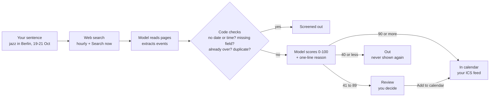


---

## 2. Product specification

**Full marks (2):**
> "A specification exists and there's a publicly accessible task tracker. The tasks define acceptance criteria and there's evidence that the agents used the tracker."

**Checklist**

| Rubric words | Where | Proof |
|---|---|---|
| A specification exists | [_docs/plan.md](../_docs/plan.md) (the PRD) | Goal, problem, 7-step workflow, expected behaviour, features, decisions with the alternatives, out of scope. |
| Which document specifies what | this row | [plan.md](../_docs/plan.md) = what and why. [search-spec.md](../_docs/search-spec.md) = search quality. [ux-spec.md](../_docs/ux-spec.md) = screens and user jobs. [openapi.yaml](../openapi.yaml) = API contract. |
| The spec is kept true | [plan.md: Changed after the MVP](../_docs/plan.md#changed-after-the-mvp-dated) | 7 dated rows. Work not shipped yet (#101) is marked "not shipped". |
| A publicly accessible task tracker | [GitHub Issues](https://github.com/alexisdacquay/sail-event/issues?q=is%3Aissue) | Public repo, no login needed. 96 issues: 85 closed, 11 open. |
| Tasks come from the spec | [plan.md: Features](../_docs/plan.md#features-the-mvp-settles-on) | Each MVP feature lists the issues that built it. Issues 1-29 are tasks 1-29 of [tasks.md](../_docs/outdated/tasks.md). |
| The tasks define acceptance criteria | [issue #11](https://github.com/alexisdacquay/sail-event/issues/11) · [template](../_docs/task-template.md) | Four sections: Goal, Acceptance criteria, Out of scope, Constraints. #11 has 15 checkable criteria. 58 issues carry all four sections. |
| Agents used it: PM | issue #11, click **edited** above the body | The oldest version is the raw task. The next one is the PM's rewrite into the four sections. |
| Agents used it: Engineer | [issue #11](https://github.com/alexisdacquay/sail-event/issues/11) comments | The engineer's comment lists its commits and the commands it ran. |
| Agents used it: QA | commands below | 69 issues carry a `## QA: PASS/FAIL` verdict. 23 failed at least once and went back. 30 PRs carry a verdict. |
| Agents used it: Orchestrator | [issue #7](https://github.com/alexisdacquay/sail-event/issues/7) last comment | 45 issues carry "closed by the orchestrator". All 85 closes are accounted for in [process.md: who closed what](../_docs/process.md#evidence-it-ran-this-way). |
| You can tell agent from human | [process.md: Who wrote a comment](../_docs/process.md#who-wrote-a-comment) | Agents post with the owner's `gh` login. The first line of each comment names the role. |

Count it yourself (numbers on 2026-10-26; they only grow):

```bash
R=alexisdacquay/sail-event
gh issue list -R $R --state all --limit 400 --json body --jq '[.[] | select(.body | test("(?m)^#+ *Goal") and test("(?m)^#+ *Acceptance criteria") and test("(?m)^#+ *Out of scope") and test("(?m)^#+ *Constraints"))] | length'   # 58 groomed
gh issue list -R $R --state all --limit 400 --json comments --jq '[.[] | select(any(.comments[]; .body | test("(?m)^#+ *QA:? *(PASS|FAIL)")))] | length'   # 69 with a QA verdict
gh issue list -R $R --state all --limit 400 --json comments --jq '[.[] | select(any(.comments[]; .body | test("(?m)^#+ *QA:? *FAIL")))] | length'          # 23 sent back
gh pr list    -R $R --state all --limit 400 --json comments --jq '[.[] | select(any(.comments[]; .body | test("(?m)^#+ *QA:? *(PASS|FAIL)")))] | length'   # 30 PRs with a verdict
gh issue list -R $R --state all --limit 400 --json comments --jq '[.[] | select(any(.comments[]; .body | test("closed by the orchestrator"; "i")))] | length'   # 45
```

**Why not the lower score** (1 point = "A spec exists, but no public task tracker")

| Risk | How we are covered |
|---|---|
| The tracker is private | The repo is public. The issues page opens without a login. |
| Tasks have no acceptance criteria | 58 issues have the four-section template. Example: #11, 15 criteria. |
| No sign that agents used the tracker | PM edit history, engineer comments, QA verdicts and orchestrator closes are on the issues. Counts with commands: [process.md](../_docs/process.md#evidence-it-ran-this-way). |
| Every comment shows `alexisdacquay` as author | Explained in [process.md](../_docs/process.md#who-wrote-a-comment): agents use the owner's `gh` login; the comment's first line names the role. That line is the project's own label, so read it as a claim; the QA steps it labels (fresh verdict per criterion, test output) are on the issue to check. |
| "Only the orchestrator closes", yet only some closes say so | All 85 closes, by kind: 45 "closed by the orchestrator", 28 its merge note, 7 by GitHub when a `Closes #N` PR merged on the owner's word, 5 other notes. Table: [process.md](../_docs/process.md#evidence-it-ran-this-way). |
| Closed issues still show unticked `[ ]` boxes | Rule in [process.md: Rules](../_docs/process.md#rules): QA ticks each criterion in its own comment. The QA comment is the record. |
| The spec contradicts the code | The out-of-scope list was corrected and a dated change log added: [plan.md](../_docs/plan.md#changed-after-the-mvp-dated). |
| Later issues have no QA comment on the issue | From issue #65 on, QA posts on the PR: [process.md: Phase 2](../_docs/process.md#phase-2-from-issue-65-worktrees-and-prs). 30 PRs carry a QA verdict. A few gaps remain: see [Known gaps](#known-gaps). |

**Extra evidence**

- Spec to task to QA, for one feature. The ICS feed (PRD feature 4) was built in [#12](https://github.com/alexisdacquay/sail-event/issues/12) and [#36](https://github.com/alexisdacquay/sail-event/issues/36), each closed after a `## QA: PASS` comment, then [#71](https://github.com/alexisdacquay/sail-event/issues/71), whose QA ran on its PR.
- Out of scope becomes follow-up issues. #11's Out of scope links #12, #13, #19, #22 and #25. The test gaps QA found on #11 were carried to [#13](https://github.com/alexisdacquay/sail-event/issues/13).
- The search spec is a living document. It carries dated owner revisions at the top: [search-spec.md](../_docs/search-spec.md).

**Picture**

One task through the tracker, issue #11:

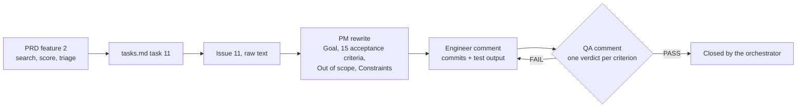

| Acceptance criteria on the issue | PM rewrite in the edit history | QA PASS, then the orchestrator closes |
|---|---|---|
| 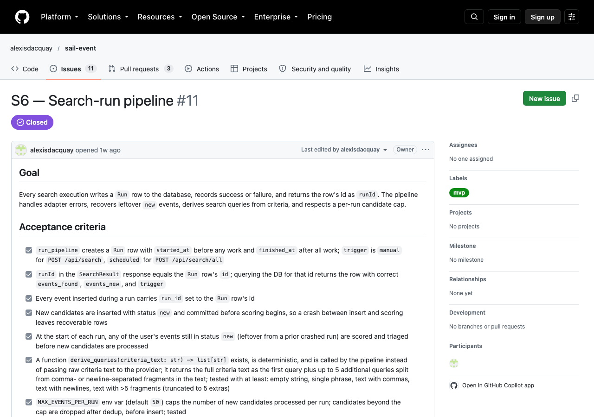 | 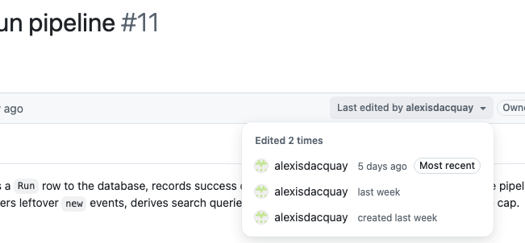 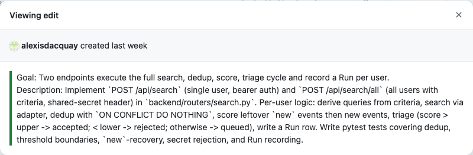 | 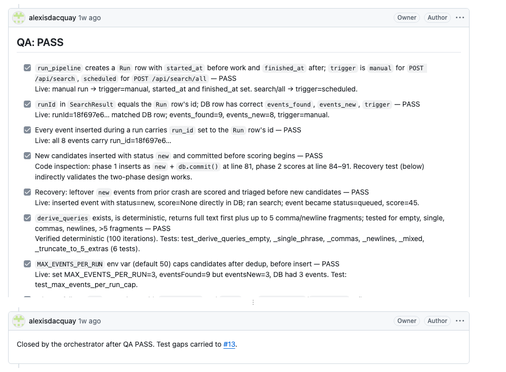 |

---

## 3. Agent team specification

**Full marks (2):**
> "The project defines the agent team and process of how they work together."

**Checklist**

| Rubric words | Where | Proof |
|---|---|---|
| Roles or agents are named | [process.md: Team](../_docs/process.md#team) | Five members: Owner (human), Orchestrator, PM, Engineer, QA (all AI). |
| Who is human, who is AI, how each starts | [process.md: Team](../_docs/process.md#team) | One table: human or AI, how it is launched, what it decides. |
| Responsibilities are clear | [process.md: Roles](../_docs/process.md#roles) | One table: **Does** / **Never does** / **Defined in**. |
| One file per role | [pm.md](../_docs/team/pm.md) · [software-engineer.md](../_docs/team/software-engineer.md) · [qa-engineer.md](../_docs/team/qa-engineer.md) | Each file has a mission, duties, what it receives and hands on, and a Definition of done. |
| A runnable agent | [.claude/agents/qa-engineer.md](../.claude/agents/qa-engineer.md) | QA only: a Claude Code subagent file. It reads its role file, then process.md. PM and Engineer have no agent file: the orchestrator starts a generic subagent with the role file as its prompt ([process.md: Team](../_docs/process.md#team), column "How it starts"). |
| The process is defined | [process.md: Lifecycle](../_docs/process.md#lifecycle) | 7 steps: pick, groom, implement, verify, FAIL goes back, PASS closes, repeat. |
| How they work together | [process.md: Handoffs](../_docs/process.md#handoffs) | Each handoff is a GitHub artifact: groomed body, engineer comment, QA verdict, orchestrator close. |
| What happens on failure | [process.md: Root-cause gate](../_docs/process.md#root-cause-gate) | FAIL goes back with the QA comment. A bug fix starts with a red test. |
| How the process changed | [process.md: Phase 2](../_docs/process.md#phase-2-from-issue-65-worktrees-and-prs) | From #65 on: own git worktree per engineer, a PR, green CI, QA on the PR, owner says merge. |
| It ran for real | [issue #7](https://github.com/alexisdacquay/sail-event/issues/7) | QA FAIL (the password was echoed in a 400 response), fix `db3499a`, QA PASS, orchestrator close. |

**What would make a role unclear, and why it is not**

This is the 1-point level: "Roles or agents are mentioned, but responsibilities are unclear."

| Would be unclear if... | Here |
|---|---|
| Two roles could close an issue | Only the orchestrator closes. |
| QA could quietly fix what it finds | QA's rule: "Never change code — not a single file" ([qa-engineer.md](../.claude/agents/qa-engineer.md)). Its tools are `Bash, Read, Grep, Glob`: no Edit or Write tool, but Bash could still write a file. So the guard is the rule plus a check: `git status --short` must print nothing, or the verdict is FAIL. |
| The engineer could move the goalposts | The engineer may comment on a wrong criterion, never edit it. |
| A merge or prod deploy could happen without a human | Both wait for the owner's word. |
| "Orchestrator" meant two different things | Fixed: it is the main Claude Code session in both [process.md](../_docs/process.md#team) and [ai-usage-report.md](ai-usage-report.md). The human is the Owner. |
| Roles exist only in prose | QA is a runnable subagent file. PM and Engineer are role files passed as the subagent's prompt, which is how they ran. The pre-commit hook enforces "no commit until tests pass" ([scripts/pre-commit](../scripts/pre-commit)). |
| On issue #7 a comment headed `## QA fix: db3499a` looks like QA wrote code | It means "fix for QA's findings". QA's own comments are verdicts only (`## QA: PASS/FAIL`); the `## QA: PASS` after it is a fresh re-check. The 2026-10-16 session transcript is not kept, so the record does not name the agent that typed the fix ([process.md: Who wrote a comment](../_docs/process.md#who-wrote-a-comment)). |
| You cannot tell an agent's comment from the human's | [process.md: Who wrote a comment](../_docs/process.md#who-wrote-a-comment) maps each comment's first line to its role. |

**Extra evidence**

- Numbers, each with its command in [process.md](../_docs/process.md#evidence-it-ran-this-way): 58 groomed issues, 69 with a QA verdict, 23 sent back on FAIL, 30 PRs with a QA verdict.
- Roles learn from defects, one commit per lesson:
  [6b77835](https://github.com/alexisdacquay/sail-event/commit/6b77835) "QA role: a dirty working tree is a FAIL",
  [13f0fd3](https://github.com/alexisdacquay/sail-event/commit/13f0fd3) "Engineer role: write only what the task needs",
  [54dca8a](https://github.com/alexisdacquay/sail-event/commit/54dca8a) "merge only on green CI",
  [c0f83e6](https://github.com/alexisdacquay/sail-event/commit/c0f83e6) root-cause gate.
  History: `git log --oneline -- _docs/team _docs/process.md .claude/agents`.
- A wider team beyond the build loop: the on-call agent ([§12](#12-on-call-agent)), three blind rubric reviewers ([rubric-review skill](../.claude/skills/rubric-review/SKILL.md), results in [work/RUBRIC-REVIEWS.md](../work/RUBRIC-REVIEWS.md)), and field-test agents ([field-test skill](../.claude/skills/field-test/SKILL.md)).
- A written waiver when QA fails something minor: [PR #85](https://github.com/alexisdacquay/sail-event/pull/85) shows two QA FAILs, a fix, then "Orchestrator: 6b waived (...)".

**Picture**

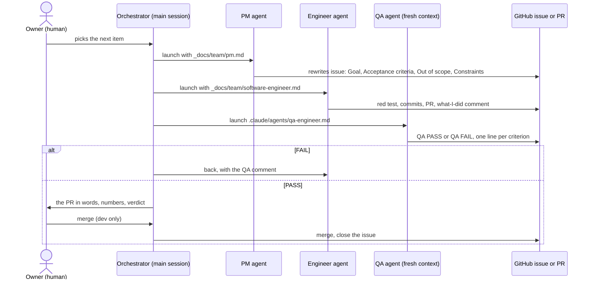

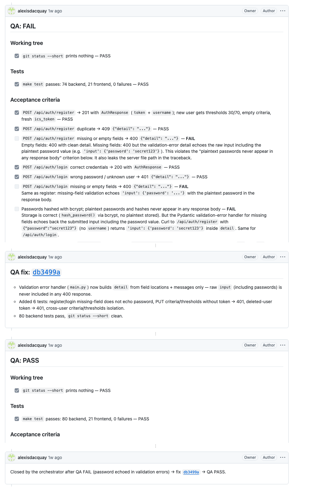

<sub>The comment headed "QA fix: db3499a" is the fix for QA's findings, not a QA verdict. QA's verdicts are the "QA: FAIL" and "QA: PASS" comments.</sub>

---

## 4. Context management

**Full marks (2):**
> "AGENTS.md exists and it also points to modular docs (process, teams, etc.)."

**Checklist**

| Rubric words | Where | Proof |
|---|---|---|
| AGENTS.md exists | [AGENTS.md](../AGENTS.md) | At the repo root. |
| Claude Code loads it | [CLAUDE.md](../CLAUDE.md) | One line: `@AGENTS.md`, Claude Code's [import syntax](https://code.claude.com/docs/en/memory). |
| It describes the project | [AGENTS.md](../AGENTS.md) lines 1-2 | "scores web-search results against a user's free-text criteria, triages by threshold, and publishes accepted events to a per-user ICS feed". |
| Points to the process doc | AGENTS.md, heading **Process and team** | Links [_docs/process.md](../_docs/process.md). |
| Points to the team docs | AGENTS.md, heading **Process and team** | Links each role file: [pm.md](../_docs/team/pm.md), [software-engineer.md](../_docs/team/software-engineer.md), [qa-engineer.md](../_docs/team/qa-engineer.md). |
| Points to other modular docs ("etc.") | AGENTS.md, headings **Product and design**, **Run, test, ship**, **Agents and tools**, **State and history** | PRD, architecture, search spec, UX spec, UI design, testing, deployment, release, API, observability, on-call, the QA agent, the skills, the state file. |
| Pointers are clickable and resolve | command below | Every pointer is a markdown link. The command lists each target and fails on a dead one. |

```bash
grep -oE '\]\([^)#]+' AGENTS.md | cut -c3- | grep -v '^http' | xargs ls -d
```

**Why not the lower score** (1 point = "An AGENTS.md (or equivalent) exists and describes the project")

| Risk | How we are covered |
|---|---|
| AGENTS.md describes the project but points nowhere | It has 5 headed groups of links (`###` headings), including "Process and team". |
| Pointers are plain text, so the reviewer cannot click | All are markdown links with full repo paths. |
| The words "process" and "team" are not there | They are heading words: **Process and team**. |
| CLAUDE.md looks empty or broken | It is the import line `@AGENTS.md`, linked to Claude Code's docs above. |
| Too many doc folders, which one counts | AGENTS.md says it in one line: `_docs/` = what to build and how the team works; `docs/` = how to run, test, ship and review. It groups every link under a heading, marks `work/` as "logs, batch results, reviews; not instructions" and `_docs/outdated/` as "history only". |
| The docs exist but agents do not use them | The QA subagent's first instruction is to read its role file, then process.md ([qa-engineer.md](../.claude/agents/qa-engineer.md)). [Issue #28](https://github.com/alexisdacquay/sail-event/issues/28) made that an acceptance criterion, and QA checked it. |
| The linked docs are stale | The architecture doc was corrected on 2026-10-26: adapter names from the code, dev-only auto-deploy ([architecture.md](../_docs/architecture.md)). |

**Extra evidence**

- Layered context: each agent loads only what it needs. Every session: AGENTS.md (about 60 lines). Per role: the role file and process.md. On demand: four skills whose frontmatter says when to load them ([.claude/skills/](../.claude/skills/)). Per incident: the on-call agent gets [responder-task.md](../incident-response/responder-task.md) plus the evidence.
- Context that learns: role files changed as lessons landed ([history](https://github.com/alexisdacquay/sail-event/commits/main/_docs/team)). AGENTS.md itself was rewritten after an examiner pass: [8239e4f](https://github.com/alexisdacquay/sail-event/commit/8239e4f).
- Rules are enforced, not only written: the pre-commit hook ([scripts/pre-commit](../scripts/pre-commit), installed by `make hooks`) gates `make test`.
- Cross-session handover: [work/STATE.md](../work/STATE.md) tells a fresh session where work stands.

**Picture**

What is loaded when:

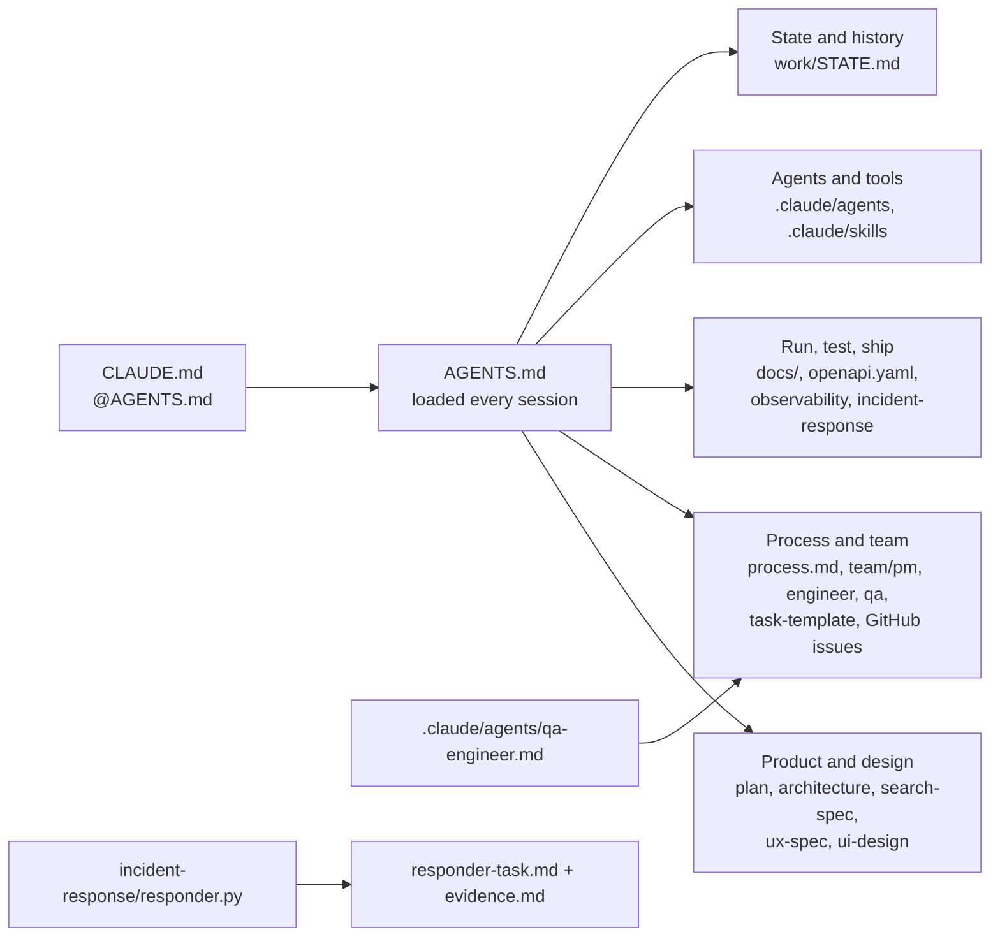

| Who | Reads |
|---|---|
| Every session | AGENTS.md |
| Each role | its role file + process.md |
| Each task | the issue + plan.md / architecture.md |
| On demand | skills, docs/, work/ |

---

## 5. Application

**Full marks (2):**
> "Full-stack application works end to end: frontend talks to backend, data persists in a database. Application runs locally with a single command."

**Checklist**

| Rubric words | Where | Proof |
|---|---|---|
| Frontend | [frontend/](../frontend/) | React 19 + TypeScript, built by Vite. |
| Backend | [backend/app/](../backend/app/) · [openapi.yaml](../openapi.yaml) | FastAPI. The contract came first; CI lints it. |
| Database | [docker-compose.yml](../docker-compose.yml) | PostgreSQL 18 with a named volume `pgdata`. Schema from Alembic migrations, run on container start ([Dockerfile line 25](../Dockerfile#L25)). |
| Frontend talks to backend | [Dockerfile line 7](../Dockerfile#L7) → [api.ts line 67][api-67] | The image build sets `VITE_API_URL`, so the UI uses real `fetch` calls ([http.ts][http-ts]). `mock.ts` serves only unit tests. |
| Data persists | [test_data_survives_restart][t-restart] · [Journey 1, reload][j1-reload] | CI restarts the app container and gets the same events back. The browser test saves a threshold, reloads, and reads 96. |
| Works end to end | [Journey 1][j1] · [test_full_journey][t-journey-int] | Playwright drives Chromium through register, criteria, search, accept and reject, against the compose stack. |
| Runs with a single command | [README: Try it](../README.md#try-it) | `docker compose up --build`. No `.env`, no migrate step, no seed step, no API keys. |

**Why not the lower score** (1 point = "Frontend, backend, and database exist but are not fully connected")

| Risk | How we are covered |
|---|---|
| A reviewer finds `mock.ts` and decides the UI is mocked | The image build sets `VITE_API_URL` ([Dockerfile line 7](../Dockerfile#L7)), so `api.ts` picks the real client. Explained in [architecture.md](../_docs/architecture.md#application-at-a-glance). |
| `make run` starts a mock frontend | Fixed: `make run` and `make run-frontend` set `VITE_API_URL` and install frontend packages on a fresh clone ([Makefile](../Makefile)). |
| `make run` uses SQLite, "is that a database?" | The single command (`docker compose up --build`) and both live sites use PostgreSQL 18. |
| Persistence is claimed, not shown | Tested in CI on every PR: [test_data_survives_restart][t-restart], green in [run 40242394581][ci-int-job]. |
| The local search returns nothing | The demo user's criteria are pre-filled with the text the recorded answers match ([main.py seed][main-seed]), and the clock is fixed (`FAKE_NOW`). |

**Extra evidence**

- The same stack is live twice, each with its own Render Postgres: [deployment.md](deployment.md#which-version-runs-where).
- The contract is tested: CI lints [openapi.yaml](../openapi.yaml), and `backend/tests/test_schema_contract.py` checks the backend against it.
- A no-browser journey with `curl`: [README](../README.md#try-it), "Same journey with curl".

**Picture**

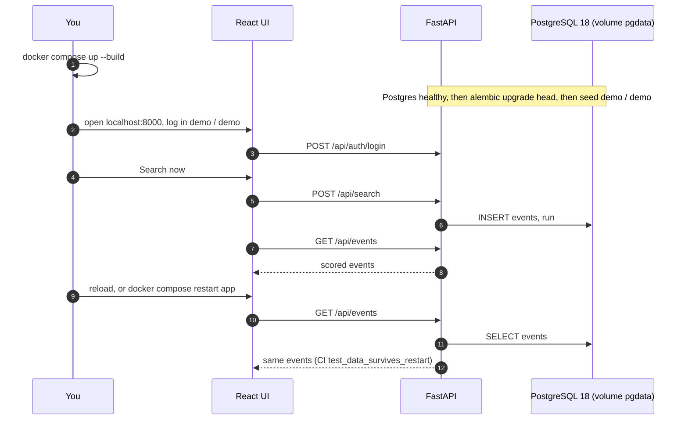

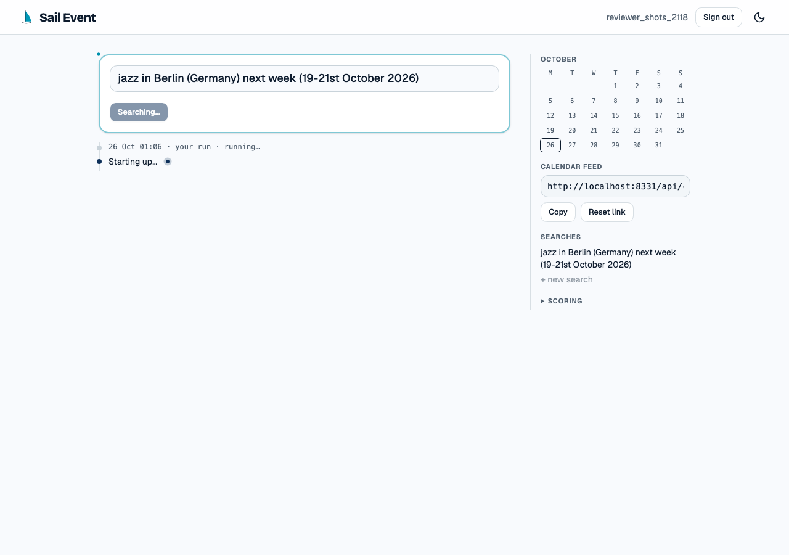

---

## 6. Testing

**Full marks (2):**
> "Both unit and integration tests exist, run with a single command, and pass."

**Checklist**

| Rubric words | Where | Proof |
|---|---|---|
| Unit tests exist | [backend/tests/](../backend/tests/) · tests beside components in [frontend/src/](../frontend/src/) · [test_responder.py](../incident-response/test_responder.py) | 481 backend (pytest), 117 frontend (Vitest), 20 responder (unittest). |
| Integration tests exist | [backend/tests/integration/test_integration.py](../backend/tests/integration/test_integration.py) | 7 tests over HTTP only, against the built container and real Postgres. They import no app code. |
| Unit vs integration, defined | [testing.md: At a glance](testing.md#at-a-glance) | Unit = one function or component, recorded fixtures, no network. Integration = the container + Postgres, HTTP only. |
| A third layer | [e2e/](../e2e/) | 12 Playwright tests in Chromium. |
| Run with a single command | [Makefile](../Makefile) `test-all` | `make test-all` runs unit, then integration, then e2e. Make stops at the first failure: one exit code. |
| They pass | [CI run 40242394581](https://github.com/alexisdacquay/sail-event/actions/runs/40242394581) | On main `8305160`: backend 481 passed, frontend 117, integration 7, Playwright 12. The 20 responder tests are not in CI: they pass in `make test` (and alone: `python3 incident-response/test_responder.py`, "Ran 20 tests ... OK" on 2026-10-26). |
| Where each layer runs in CI | [ci.yml](../.github/workflows/ci.yml) | 3 jobs. `backend` runs `uv run pytest` ([L28](../.github/workflows/ci.yml#L28)). `frontend` runs `npm test` ([L43](../.github/workflows/ci.yml#L43)). `integration` runs `make test-integration` **and** `make test-e2e` ([L70-L71](../.github/workflows/ci.yml#L70-L71)), so there is no separate e2e job. |
| They pass on every change | [ci.yml](../.github/workflows/ci.yml) | Runs on every PR and every push to main. |

**Why not the lower score** (1 point = "Only unit tests or only integration tests exist")

| Risk | How we are covered |
|---|---|
| "Three commands, not one" | `make test-all` is the one command. `make test` alone still runs unit tests without Docker. CI calls the same make targets as separate steps, so a failure shows which layer broke; it does not call `make test-all` itself. |
| "CI shows no e2e job" | e2e runs inside the job named `integration`, step `make test-e2e` ([ci.yml#L71](../.github/workflows/ci.yml#L71)). The job log prints `12 passed`. |
| "The 20 responder tests never run in CI" | True. They run in `make test` ([Makefile line 29](../Makefile#L29)). They use the standard library only and spawn no agent: `python3 incident-response/test_responder.py`. Listed in [Known gaps](#known-gaps). |
| Stale counts | Counts were refreshed from CI on 2026-10-25, with the run link: [testing.md](testing.md#at-a-glance). |
| The integration tests only mock things | They talk HTTP to the compose stack with real Postgres. One restarts the app container: [test_data_survives_restart][t-restart]. |
| No Docker on the reviewer's machine | `make test` needs no Docker. The CI run above shows integration and e2e green. |
| `make test` is silent for minutes and looks hung | The run time is written next to the command: about 5 minutes for the backend suite. |
| "4 skipped, 7 deselected" looks like hidden failures | 7 deselected = the integration tests, run by `make test-integration`. The skips need a live model, `TEST_DATABASE_URL`, or a built `frontend/dist` (see the `skipif` lines in [test_pg_smoke.py][t-pg] and [test_spa_fallback.py][t-spa]). |

**Extra evidence**

- Tests are part of the agent process. QA fails any bug fix without a regression test that fails on the parent commit ([qa-engineer.md](../_docs/team/qa-engineer.md)). Those tests live in [backend/tests/regression/](../backend/tests/regression/).
- Deterministic and key-free: recorded model answers, a fixed clock (`FAKE_NOW`), golden datasets in [backend/tests/golden/](../backend/tests/golden/). CI never calls a paid API.
- A field runner tests the live deploy in four phases: [testing.md](testing.md#field-test-runner-four-phases-against-a-deployed-service).

**Picture**

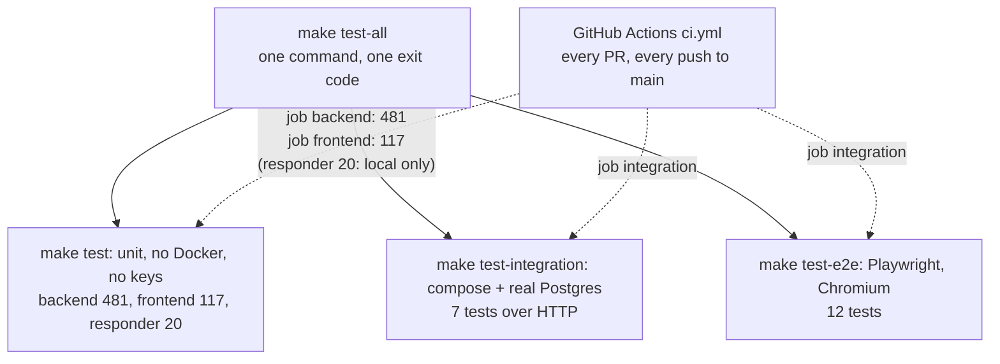

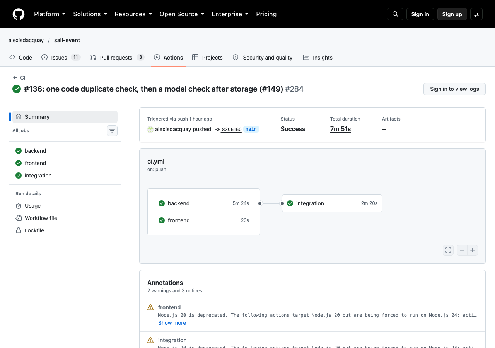

---

## 7. Containerization

**Full marks (2):**
> "The full system, including the database, runs via Docker or Docker Compose and starts with a single command."

**Checklist**

| Rubric words | Where | Proof |
|---|---|---|
| The system runs in Docker | [Dockerfile](../Dockerfile) | Two stages: Node builds the React app, Python serves the API and the built files. |
| Including the database | [docker-compose.yml](../docker-compose.yml) | Service `postgres` (`postgres:18-alpine`), named volume, `pg_isready` healthcheck. The app's `DATABASE_URL` points at it. |
| The frontend is in it too | [main.py#L117-L119][main-spa] | One image serves both. That is why compose has 2 services, not 3. |
| Docker Compose | `docker compose config --services` | Prints `postgres` and `app`. |
| Starts with a single command | [README: Try it](../README.md#try-it) | `docker compose up --build`, or `make compose-up` to run detached and wait for health. |
| No manual steps | compose file + [Dockerfile line 25](../Dockerfile#L25) | No `.env` to copy: every variable has a default. Migrations run in the container's start command. The demo user is seeded on start. No API keys. |
| Startup order is automatic | [docker-compose.yml](../docker-compose.yml) | The app `depends_on` postgres with `condition: service_healthy`. |
| Proven, not only claimed | [ci.yml line 67](../.github/workflows/ci.yml#L67) | CI runs `docker compose up --build -d --wait` on every PR, then tests the running containers. |

**Why not the lower score** (1 point = "Dockerfiles exist, but running the full system requires manual steps")

| Risk | How we are covered |
|---|---|
| A manual migrate or seed step | Both happen on container start. |
| A `.env` file to create | Every variable has a default in the compose file. |
| No `frontend` service in compose | One image serves the built frontend. Said next to the command in the README. |
| `make docker-run` uses SQLite | It is a single-container shortcut. The supported path is compose: app + Postgres. |
| The hourly scheduler is not in compose | It is an external trigger (GitHub Actions). The app works fully without it, through **Search now**. |
| Port 8000 is taken | `HOST_PORT=8010 docker compose up --build`. |

**Extra evidence**

- CI runs the same command and tests what comes up: 7 integration and 12 browser tests, then `docker compose down -v`. Log lines from the [integration job][ci-int-job] are below.
- The same Dockerfile runs live: Render builds it for dev and prod ([deployment.md](deployment.md)).
- The ops stack is containerized too, also one command: `make up-all` starts app, Postgres, OTel collector, Prometheus, Loki, Tempo and Grafana (7 containers).

**Picture**

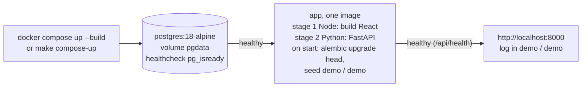

From the CI log of run 40242394581, integration job (2026-10-25, UTC):

```
23:01:20  Container sail-event-postgres-1  Started
23:01:22  Container sail-event-postgres-1  Healthy
23:01:23  Container sail-event-app-1       Started
23:01:28  Container sail-event-app-1       Healthy
23:02:25  make test-integration            7 passed
23:02:51  make test-e2e                    12 passed
```

Read it yourself: `gh run view 40242394581 -R alexisdacquay/sail-event --log --job 121317996594 | grep -E 'Healthy|passed'`.

---

## 8. Deployment

**Full marks (2):**
> "The application is deployed and reachable at a public URL, or there's a clear demo with the deployment."

**Checklist**

| Rubric words | Where | Proof |
|---|---|---|
| Deployed | [deployment.md](deployment.md) | Two Render services in Frankfurt, each with its own Postgres. |
| Reachable at a public URL | <https://sail-event.onrender.com> | `curl -s https://sail-event.onrender.com/api/health` prints `{"status":"ok","commit":"969a161..."}`. |
| You can use it, not just see a login | [deployment.md: Use it live in 4 steps](deployment.md#use-it-live-in-4-steps) | Registration is open: `curl -s https://sail-event.onrender.com/api/config` prints `{"registrationCodeRequired":false}`. |
| The deployed version is known | [deployment.md: Which version runs where](deployment.md#which-version-runs-where) | prod = release `969a161`. dev = latest main `8305160`, with demo / demo seeded. |
| It is this repo | `git log --oneline -1 969a161` | The health commit is a real commit on main. |
| Deployment steps are written down | [deployment.md](deployment.md) · [release-process.md](release-process.md) | Environment table, every variable, health path, promote and rollback commands. |

**Why not the lower score** (1 point = "Deployment steps are described, but no working deployment is shown")

| Risk | How we are covered |
|---|---|
| Login wall, the reviewer gives up | Open registration on prod. Dev has demo / demo. |
| Prod differs from main | On purpose: prod moves only when the owner promotes a sha. `/api/health` tells you which one. |
| The site sleeps | Paid instances: no sleep, no cold start. |
| A live search fails or hits a limit | Limits are written: 6 **Search now** per user per hour, a daily search budget. A search takes 1-2 minutes. |
| The docs disagree about deploys | Fixed: [architecture.md](../_docs/architecture.md) now says dev auto-deploys, prod only via `promote.yml`. |

**Extra evidence**

- Promotion is verified: the workflow waits until prod's `/api/health` reports the promoted sha ([run 39979831552](https://github.com/alexisdacquay/sail-event/actions/runs/39979831552)).
- Prod is in real use: the hourly job calls it ([hourly-search runs](https://github.com/alexisdacquay/sail-event/actions/workflows/hourly-search.yml)).
- One-command rollback: `gh workflow run promote.yml -f sha=<previous sha>` ([release-process.md](release-process.md#rollback)).

**Picture**

| Prod: open registration | Dev: sign-in with the pitch |
|---|---|
| 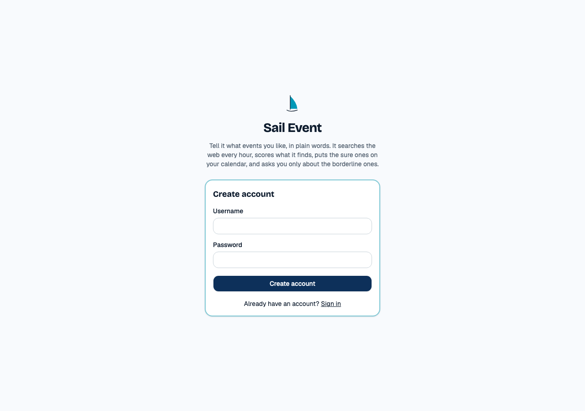 | 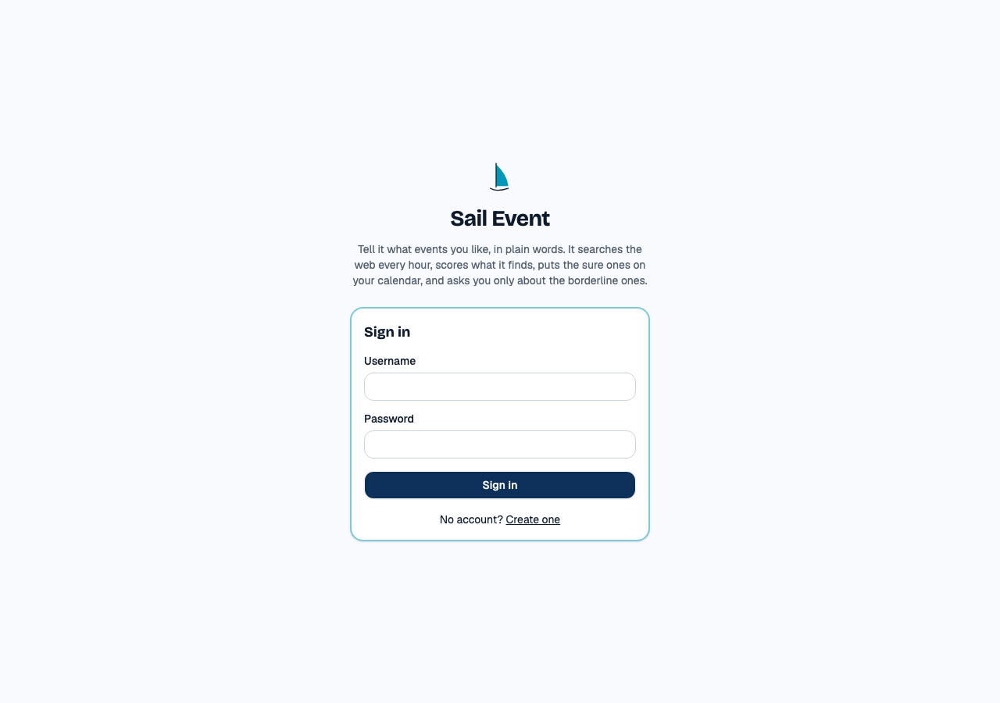 |

```
$ curl -s https://sail-event.onrender.com/api/health
{"status":"ok","commit":"969a16144b909f57359f38f8a5f8e05a0ef5b491"}
$ curl -s https://sail-event-dev.onrender.com/api/health
{"status":"ok","commit":"83051604a5acb2a9db9cafdd2963a54b2651ed68"}
```

---

## 9. CI/CD

**Full marks (3):**
> "CI runs tests, CD deploys to dev, and there's a manual deploy to production."

**Checklist**

| Rubric words | Where | Proof |
|---|---|---|
| CI on every pull request (1 pt) | [ci.yml](../.github/workflows/ci.yml) | Triggers: `pull_request` to main and `push` to main. Example: [PR #149's run](https://github.com/alexisdacquay/sail-event/pull/149/checks), three green jobs. |
| CI runs tests | [release-process.md: CI checks](release-process.md#ci-checks) | backend: pytest. frontend: Vitest, build, OpenAPI lint. integration: compose + Postgres + Playwright. |
| CD deploys to dev (2 pt) | [release-process.md: CD to dev](release-process.md#cd-to-dev-on-merge) | Render `sail-event-dev` deploys every push to main. Dev's `/api/health` reports main's head sha. |
| Manual deploy to production (3 pt) | [promote.yml](../.github/workflows/promote.yml) | Trigger: `workflow_dispatch` only, input `sha`. [15 runs](https://github.com/alexisdacquay/sail-event/actions/workflows/promote.yml), all manual. Prod has auto-deploy off. |
| The prod deploy is verified | [run 39979831552](https://github.com/alexisdacquay/sail-event/actions/runs/39979831552) | The job polls prod's `/api/health` until it reports the promoted sha. |
| Rollback | [release-process.md: Rollback](release-process.md#rollback) | The same workflow with the previous sha. |

Prove CD in 30 seconds ([deployment.md](deployment.md#prove-cd-in-30-seconds)):

```bash
curl -s https://sail-event-dev.onrender.com/api/health                       # dev commit
git ls-remote https://github.com/alexisdacquay/sail-event refs/heads/main      # same sha
curl -s https://sail-event.onrender.com/api/health                           # prod: the promoted sha
gh run list -R alexisdacquay/sail-event --workflow=promote.yml --limit 3     # manual runs
```

**Why not the lower score** (2 points = "CI runs tests and CD automatically deploys")

| Risk | How we are covered |
|---|---|
| No manual step to prod | `promote.yml` has no push trigger. Prod moves only when the owner runs it with a sha. |
| CD to dev is invisible in the repo (it is a Render setting) | Dev's `/api/health` equals main's head sha: the commands above show it. The setting is named in [deployment.md](deployment.md#prove-cd-in-30-seconds). |
| Prod is older than dev, "CD is broken" | That is the manual gate working. Prod lags dev until the owner promotes. |
| A docs line says Render auto-deploys everything | Fixed in [architecture.md](../_docs/architecture.md): dev auto-deploys, prod only via `promote.yml`. |

**Extra evidence**

- CI tests the real stack, not only units: compose with Postgres, then 7 integration and 12 browser tests.
- Ops automation lives in Actions too: the [hourly search](../.github/workflows/hourly-search.yml) calls prod and fails red on a bad health check.
- Every merge goes through a PR whose CI ran first (Phase 2 in [process.md](../_docs/process.md#phase-2-from-issue-65-worktrees-and-prs)).

**Picture**

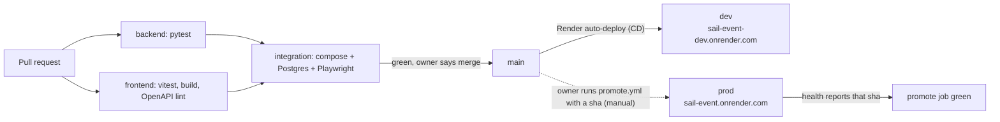

| CI on a PR | Manual promote run | Promote history |
|---|---|---|
| 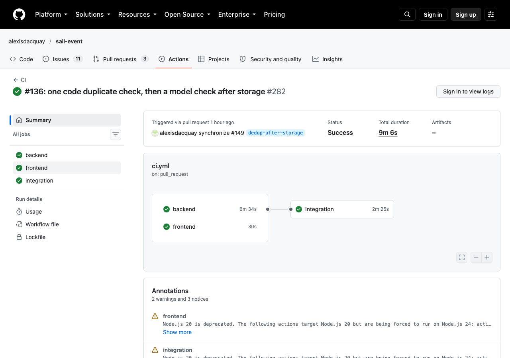 | 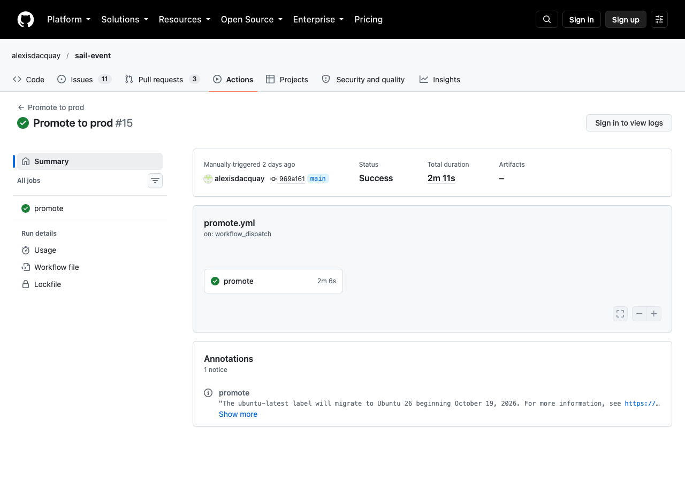 | 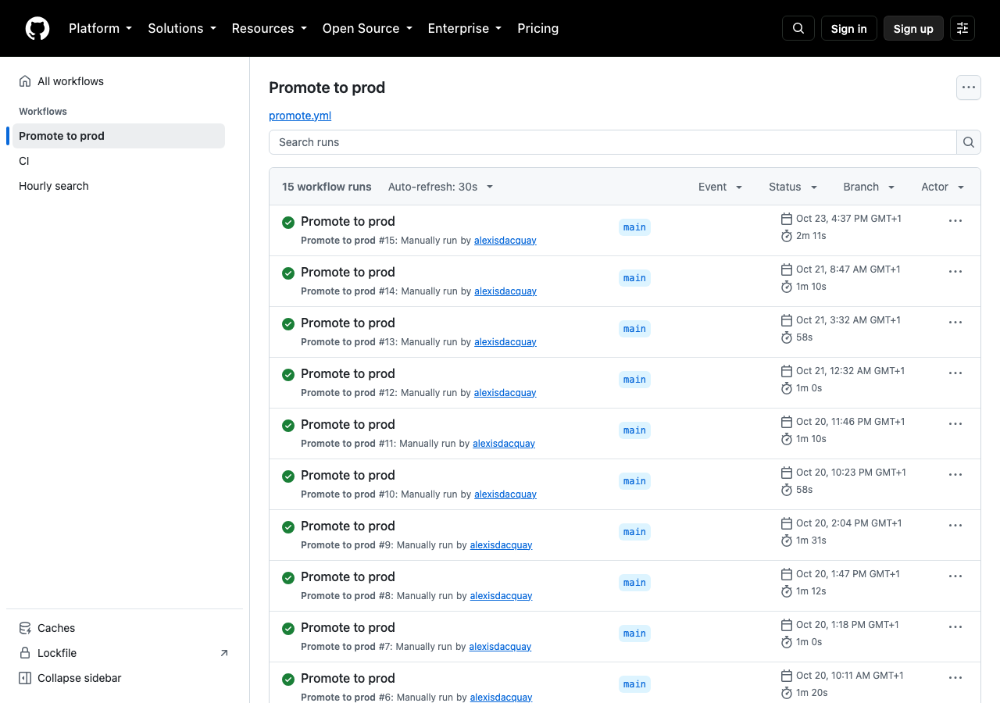 |

---

## 10. Observability

**Full marks (2):**
> "A key user journey is instrumented with metrics, traces, and structured logs that share a trace ID; no customer data or credentials are sent to telemetry; and the signals are collected, stored, and viewable in a UI."

**Where this stands, in one line:** every clause is met except one. A credential does reach telemetry: the calendar feed token sits in the raw path of HTTP spans. A strict reading gives 1 point here. The fix (replace the path with the route at the collector) is not in this release.

**Checklist**

| Rubric words | Where | Proof |
|---|---|---|
| A key user journey | [architecture.md: Request flow](../_docs/architecture.md#request-flow--one-run) | The search run: user presses **Search now**, `POST /api/search` runs the whole pipeline inside the request. |
| Metrics | [pipeline.py#L39-L76][pipe-metrics] | 9 metrics, e.g. `sail_runs_total{trigger,outcome}`, `sail_run_duration_seconds`. FastAPI adds HTTP metrics. |
| Traces | [pipeline.py#L109-L126][pipe-span] | `POST /api/search` → `search_run` → criteria, window, search, extract, detail_hop, filter, judge, triage, dedup, persist. 42 spans in the screenshot. |
| Structured logs | [main.py#L26-L37][main-json] | One JSON line per record: timestamp, level, logger, message, `trace_id`, `span_id`. Also exported to Loki. |
| Logs and traces share a trace ID | screenshots below · [observability/README.md](../observability/README.md#trace-id-correlation-proof) | The Loki line for "search run completed" has `otelTraceID 9da6b9bd...`. Tempo shows the same trace. |
| No customer data | [observability/README.md: never contains](../observability/README.md#what-telemetry-contains-and-never-contains) | Span attributes we set are ids, counts, scores, provider names. Never criteria text, usernames, passwords, JWTs, prompts. Exception: the provider's exception text (`str(exc)`) can reach logs and spans. |
| No credentials | same section, "Known exceptions" | **Not met.** No Authorization header or JWT is captured, but HTTP spans keep the raw request path, so a calendar fetch puts the feed token (`/api/calendar/<token>`) in a span. Anyone with that URL can read the feed, so it counts as a credential. The traces pipeline in [collector.yaml](../observability/collector.yaml) has no redaction step. |
| Collected | [collector.yaml](../observability/collector.yaml) | The app exports over OTLP to the collector. |
| Stored | [observability/docker-compose.yml](../observability/docker-compose.yml) | Prometheus (metrics), Loki (logs), Tempo (traces). |
| Viewable in a UI | [dashboard.json](../observability/dashboard.json) | Grafana on <http://localhost:3001>, dashboard "Sail-event — Search Run Journey", provisioned on start. |

Run it: `make up-all`, log in demo / demo, press **Search now** 2-3 times, wait 60 s, open Grafana.

**Why not the lower score** (1 point = "The app emits logs, but there are no metrics or traces, or the signals cannot be correlated to a single request")

| Risk | How we are covered |
|---|---|
| No metrics or traces | Both exist, on the same journey. Screenshots below. |
| Signals cannot be tied to one request | The log line and the trace carry the same trace id. The `search_run` span also carries `run_id`, which `POST /api/search` returns. |
| Metrics do not carry the trace id | **True.** Exemplars are off, so metrics join logs and traces only by journey and time window. Logs and traces do share the trace id. See [Known gaps](#known-gaps). |
| A credential reaches telemetry | **Yes, one.** The feed token, in HTTP span paths (row "No credentials" above). This is the 2-point clause we do not meet. Fix, not done: a collector `transform` that replaces the path with the route. |
| Telemetry is local only | The rubric asks for signals "collected, stored, and viewable in a UI", not a hosted stack. The full stack is one command: `make up-all`. |
| You need Docker to see it | The screenshots below show each signal from a real run. |

**Extra evidence**

- Signals are used, not only stored: two alerts on the same metric wake an on-call agent ([§11](#11-alerting-on-user-impact), [§12](#12-on-call-agent)).
- From a user's run to its trace: `POST /api/search` returns `runId`; search Tempo for `{ span.run_id = "<runId>" }`.
- Release-aware: resource attributes `deployment.environment` and `service.version` feed the dashboard's environment and version selectors ([telemetry.py][telemetry]).

**Picture**

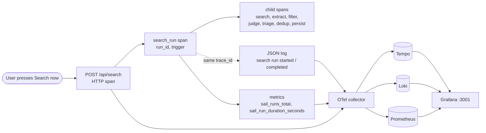

| One trace, 42 spans | The same trace id in a log line |
|---|---|
|  |  |

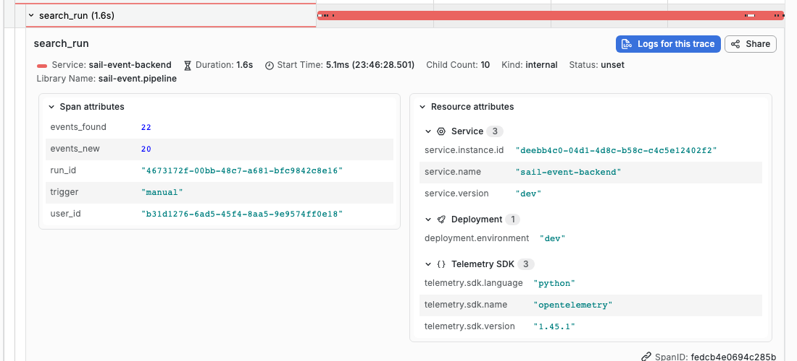

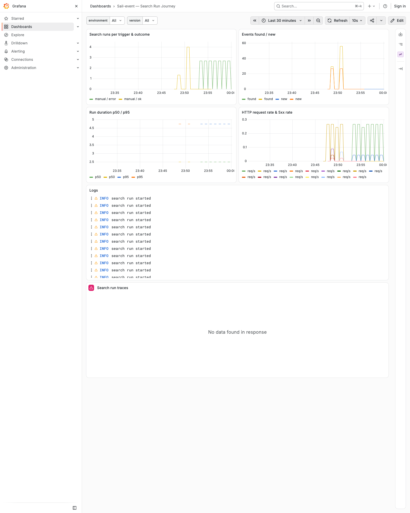

<sub>All telemetry screenshots come from the local stack (`make up-all`). No hosted Grafana is public.</sub>

---

## 11. Alerting on user impact

**Full marks (1):**
> "At least one alert exists."

**Checklist**

| Rubric words | Where | Proof |
|---|---|---|
| An alert exists | [rules.yaml#L9](../observability/grafana/provisioning/alerting/rules.yaml#L9) | `SearchRunFailures`, provisioned as code, evaluated every 60 s. |
| A second one | [rules.yaml#L66](../observability/grafana/provisioning/alerting/rules.yaml#L66) | `SearchRunsSilent`: no run at all in 2 hours. |
| On user impact, not CPU | [observability/README.md: Alerting](../observability/README.md#alerting) | Counts failed search runs: a user pressed Search and got nothing. |
| It notifies something | [policies.yaml](../observability/grafana/provisioning/alerting/policies.yaml) · [contactpoints.yaml](../observability/grafana/provisioning/alerting/contactpoints.yaml) | `severity=critical` routes to a webhook with a Bearer secret, which wakes the on-call agent. |
| It fired for real | [alert.json](../incident-response/incidents/20261021-074150-SearchRunFailures/alert.json) | Grafana's own payload: `status: firing`, `startsAt 2026-10-21T07:41:20Z`. |

| Rule | Expression, then threshold | Held for | What the user sees |
|---|---|---|---|
| SearchRunFailures | `increase(sail_runs_total{outcome="error"}[10m])` > 1 | 5 min | Search fails: no new events |
| SearchRunsSilent | `increase(sail_runs_total[2h])` < 1 | 10 min | Calendars stop getting new events |

**Why not the lower score** (0 points = "No alerts")

| Risk | How we are covered |
|---|---|
| The alert cannot be found | Linked above by line. It has its own section in [observability/README.md](../observability/README.md#alerting). |
| It is config that never fired | Two recorded firings: [2026-10-21](../incident-response/incidents/20261021-074150-SearchRunFailures/alert.json), [2026-10-17](../incident-response/incidents/20261017-052050-SearchRunFailures/alert.json). |
| It is an infra alert | Its expression counts failed user searches. |
| The runbook says TODO | Fixed: both rules link [incident-response/README.md](../incident-response/README.md). |

**Extra evidence**

- Both failure modes are covered: errors (`SearchRunFailures`) and silence (`SearchRunsSilent`, with `noDataState: OK` so a fresh stack stays quiet).
- Reproduce it: [Fire the alert locally](../observability/README.md#fire-the-alert-locally-copy-paste-block), about 7-8 minutes, Docker needed.
- A prod-side probe: the [hourly-search workflow](https://github.com/alexisdacquay/sail-event/actions/workflows/hourly-search.yml) checks `/api/health` and runs the search on prod; any failure turns the run red.

**Picture**

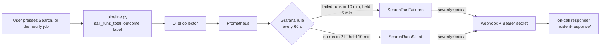

| Firing | The rule | Routing |
|---|---|---|
|  | 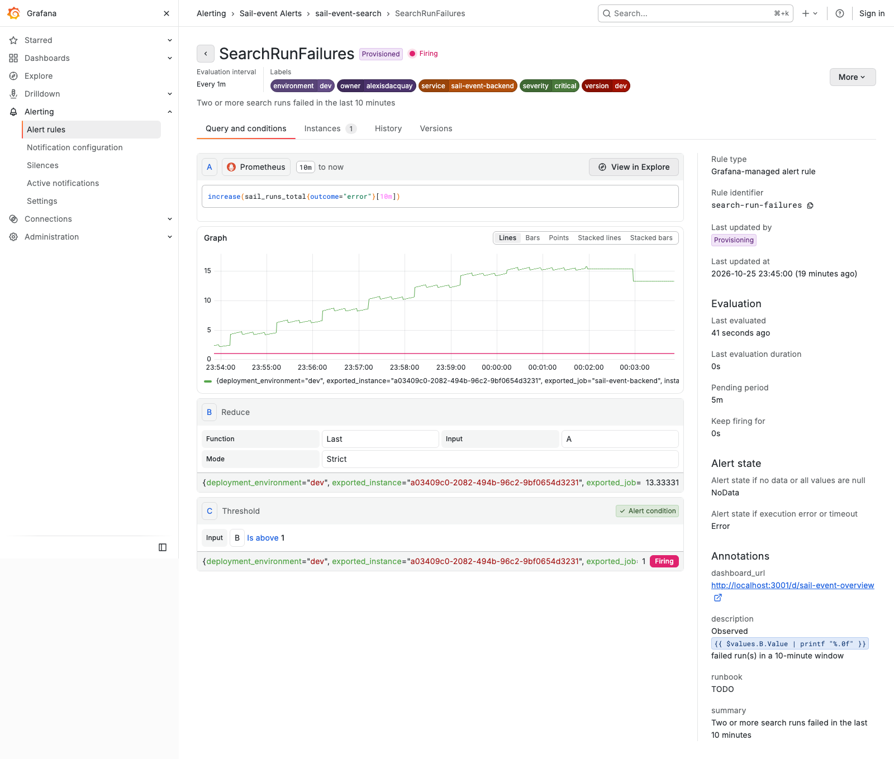 | 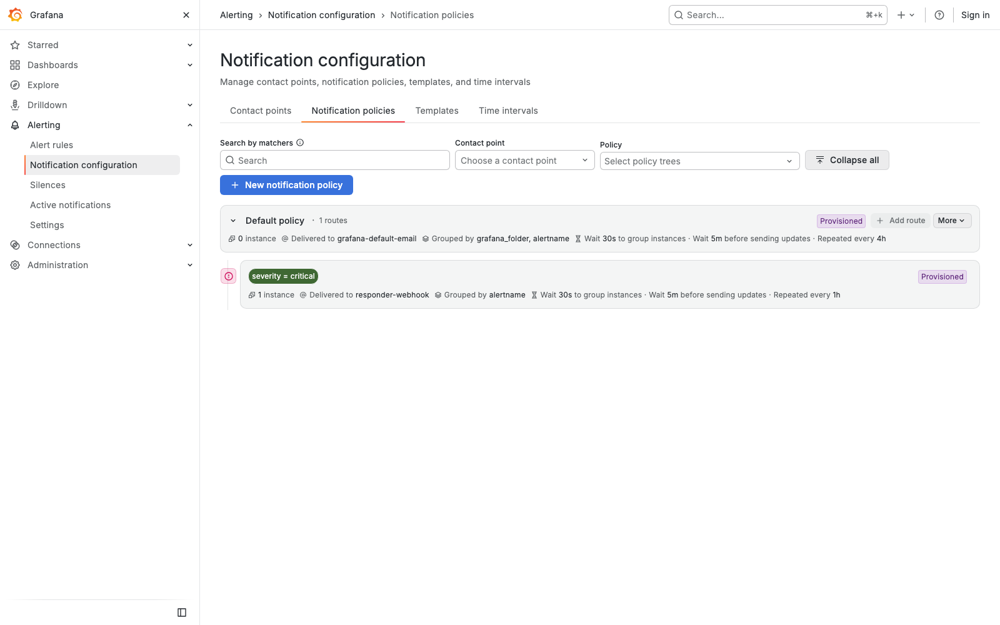 |

---

## 12. On-call agent

**Full marks (2):**
> "An agent wakes up on an alert and fixes the issue."

**Checklist**

| Rubric words | Where | Proof |
|---|---|---|
| An agent | [incident-response/README.md](../incident-response/README.md#on-call-agent-at-a-glance) · [responder.py](../incident-response/responder.py) | A webhook server that launches headless Claude Code (`claude -p`). |
| Wakes up on an alert | [contactpoints.yaml](../observability/grafana/provisioning/alerting/contactpoints.yaml) → `POST /alerts` | Grafana's webhook reaches the responder. No human in between. |
| The alert was real | [alert.json](../incident-response/incidents/20261021-074150-SearchRunFailures/alert.json) | Grafana-only fields: `ruleUID search-run-failures`, `fingerprint e97bf414370b8ee7`, `generatorURL`, `silenceURL`. |
| It investigates | [evidence.md](../incident-response/incidents/20261021-074150-SearchRunFailures/evidence.md) | 28 error runs in 10 min, app health ok, newest commit `3d9f6b8 test: inject search-provider fault`. |
| It fixes the issue | [verdict.json](../incident-response/incidents/20261021-074150-SearchRunFailures/verdict.json) · [fix.diff](../incident-response/incidents/20261021-074150-SearchRunFailures/fix.diff) | Verdict `fix`, file `backend/app/adapters/fixture.py`, commit [8d2f839](https://github.com/alexisdacquay/sail-event/commit/8d2f839): the injected `raise` removed, the original method restored. The agent's own test claim is weak (see below). |
| More than once | [incident-response/README.md: Recorded incidents](../incident-response/README.md#recorded-incidents) | 2026-10-17: scorer fault, fix [dae24e9](https://github.com/alexisdacquay/sail-event/commit/dae24e9). 2026-10-21: search-provider fault, fix `8d2f839`. |
| Safely | [autonomy-policy.yaml](../incident-response/autonomy-policy.yaml) | Own git worktree, a tool allowlist, no push, $1 budget, 300 s timeout, Bearer secret. |

**Why not the lower score** (0 points = "No on-call agent")

| Risk | How we are covered |
|---|---|
| "The fault was staged, so this is a demo" | Nobody can schedule a real outage for a reviewer. Detection is real: a real metric, a real Grafana rule, Grafana's own webhook. The agent found the culprit commit from the evidence and fixed it. The commit message made that easy: see [What this run does not prove](#what-this-run-does-not-prove). |
| "The fix stayed on a branch" | By design: the agent never pushes ([autonomy-policy.yaml](../incident-response/autonomy-policy.yaml)). A human merges or drops the branch. Here nothing needed merging: the fault commit `3d9f6b8` exists only on the branch [incident/20261021-074150-SearchRunFailures](https://github.com/alexisdacquay/sail-event/commits/incident/20261021-074150-SearchRunFailures), never on main. Check: `git merge-base --is-ancestor 3d9f6b8 origin/main` exits 1. |
| "The alert was faked with curl" | The payload carries Grafana-only fields (table above). The only `curl` to `/alerts` in [test-incident.sh](../incident-response/test-incident.sh) sends a "resolved" liveness ping, which the responder ignores. |
| "I cannot reproduce it" | Three paths: read the recorded folders; run `RESPONDER_WEBHOOK_SECRET=any-string incident-response/test-incident.sh --dry-run` (no API key); run `python3 incident-response/test_responder.py` (20 tests, stdlib only). |
| Docs contradict the record | Fixed: the 2026-10-17 run is now described as a scorer fault, as its `verdict.json` says. |
| `agent.log` starts with CLI warnings | The agent's report starts at **Root cause:**. The lines above are CLI settings warnings. |

### What this run does not prove

Said here so a skeptic does not have to dig.

| Doubt | Fact |
|---|---|
| The agent was handed the culprit | Partly true. The fault commit's message is "test: inject search-provider fault", and it is the newest line under "Recent commits" in [evidence.md](../incident-response/incidents/20261021-074150-SearchRunFailures/evidence.md). A fault with a neutral commit message was not recorded. |
| It is a drill, not an outage | True. We injected the fault on a local branch. The app, Prometheus and Grafana ran locally (`make up-all`), not on prod. |
| The agent's test claim | Weak. [agent.log](../incident-response/incidents/20261021-074150-SearchRunFailures/agent.log) says "All 84 frontend + backend tests ... pass", but the backend alone had 217 test functions at that commit. It also says it did not check a background pytest run. `verdict.json` lists `make test` as run. We did not re-run the tests on the incident branch. |
| `agent.log` opens with CLI permission warnings | True: Claude Code settings warnings that show local paths. The agent's report starts at **Root cause:**. |

What holds: a real metric, a real Grafana rule and Grafana's own webhook woke the agent with no human; it read the evidence, made the right two-line fix, and committed it in its own worktree 4 min 52 s after the alert.

**Extra evidence**

- Time from alert to fix, read from the files: 2026-10-21, alert 07:41:20, fix commit 07:46:12, so **4 min 52 s**.
- Three verdicts, not only "fix": the agent can also answer `false_positive` or `escalate` ([response.schema.json](../incident-response/response.schema.json)).
- A hardening issue closed: [#34](https://github.com/alexisdacquay/sail-event/issues/34). Capability table: [security-audit/capability-table.md](../security-audit/capability-table.md).

**Picture**

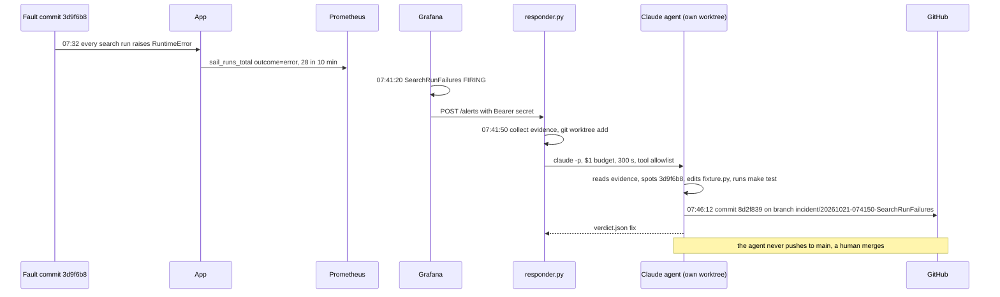

| The injected fault | The agent's fix |
|---|---|
| 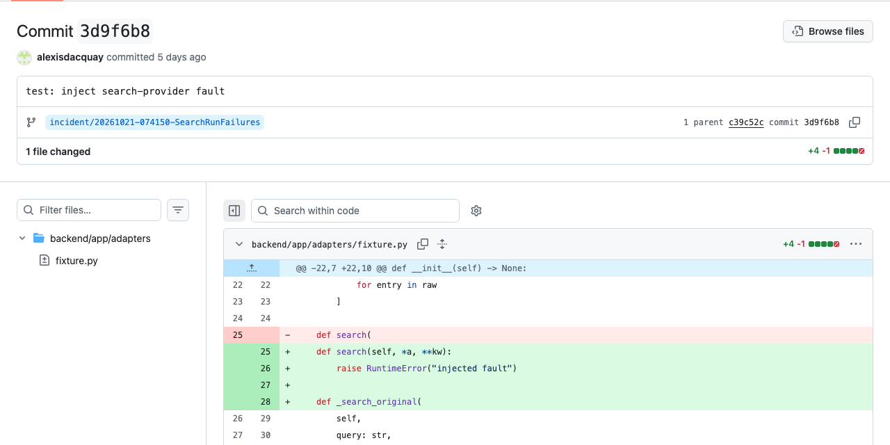 | 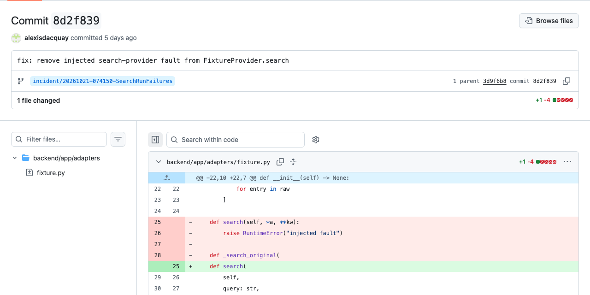 |

---

## Known gaps

Stated here so you do not have to find them.

| Gap | Criterion | Status |
|---|---|---|
| HTTP spans keep the raw path, so a calendar fetch puts the feed token (a credential) in a span. This fails the 2-point clause "no ... credentials are sent to telemetry" | 10 | Open. Fix: a collector `transform` that replaces the path with the route. Not done: the release froze first |
| Metrics do not carry the trace id (exemplars off) | 10 | Open. Logs and traces do share it |
| Some warning logs and `span.record_exception` carry the provider's exception text (`str(exc)`) | 10 | Open, stated in [observability/README.md](../observability/README.md#what-telemetry-contains-and-never-contains) |
| The collector's `filelog` receiver reads every container log on the Docker host, not only the app's | 10 | Open, same section |
| The dashboard's "Search run traces" panel errors | 10 | Open. Explore, Tempo shows the traces |
| Telemetry runs only in the local stack; no hosted Grafana to open | 10 | By choice: the rubric asks for a UI, not a hosted one. Screenshots in §10 |
| The 20 responder unit tests are not in CI | 6 | Open. They run in `make test` and pass locally |
| On-call: a drill. We injected the fault; its commit message names it; the agent's "84 tests pass" claim does not match the suite | 12 | Stated in [§12: What this run does not prove](#what-this-run-does-not-prove) |
| QA has Bash, so "QA edits no file" rests on its instruction and the clean-tree check, not on a tool block | 3 | By design; stated in §3 |
| Early fix comments (e.g. `## QA fix: db3499a` on #7) do not name the agent that typed the fix; those transcripts are not kept | 2, 3 | Stated in [process.md](../_docs/process.md#who-wrote-a-comment) |
| Issues #39, #52, #55: after one small QA FAIL item, the orchestrator added the line or re-checked the fix itself and closed, with no fresh QA pass | 2, 3 | Each closing note says so; listed in [process.md](../_docs/process.md#evidence-it-ran-this-way) |
| Issues #139 and #142 were closed with no QA verdict; PR #144 merged after three QA FAILs with no written waiver | 2, 3 | Open, listed in [process.md](../_docs/process.md#evidence-it-ran-this-way) |
| 21 issues (#94-#131) carry neither `mvp` nor `post-mvp` | 2 | Open, listed in [process.md](../_docs/process.md#labels) |
| Dev auto-deploys on merge without waiting for CI on main (each PR's CI was green before the merge) | 9 | Open. Fix: Render "After CI checks pass" |
| The dev auto-deploy setting lives in Render, not in the repo | 9 | Shown indirectly: dev's `/api/health` commit equals main's head sha ([§9](#9-cicd)) |
| Scheduled runs land every 2-6 hours, not every hour | 1 | GitHub delays scheduled runs; stated in the README |
| App screenshots come from the local stack with recorded data (Berlin jazz), not from prod | 1, 5 | Same UI as dev; live data differs |

[t-rej]: https://github.com/alexisdacquay/sail-event/blob/8305160/backend/tests/test_events.py#L150
[t-bound]: https://github.com/alexisdacquay/sail-event/blob/8305160/backend/tests/test_events.py#L111
[pipe-triage]: https://github.com/alexisdacquay/sail-event/blob/8305160/backend/app/services/pipeline.py#L739-L745
[pipe-metrics]: https://github.com/alexisdacquay/sail-event/blob/8305160/backend/app/services/pipeline.py#L39-L76
[pipe-span]: https://github.com/alexisdacquay/sail-event/blob/8305160/backend/app/services/pipeline.py#L109-L126
[main-json]: https://github.com/alexisdacquay/sail-event/blob/8305160/backend/app/main.py#L26-L37
[main-spa]: https://github.com/alexisdacquay/sail-event/blob/8305160/backend/app/main.py#L117-L119
[main-seed]: https://github.com/alexisdacquay/sail-event/blob/8305160/backend/app/main.py#L49
[telemetry]: https://github.com/alexisdacquay/sail-event/blob/8305160/backend/app/telemetry.py#L26-L67
[api-67]: https://github.com/alexisdacquay/sail-event/blob/8305160/frontend/src/services/api.ts#L67
[http-ts]: https://github.com/alexisdacquay/sail-event/blob/8305160/frontend/src/services/http.ts
[t-restart]: https://github.com/alexisdacquay/sail-event/blob/8305160/backend/tests/integration/test_integration.py#L250
[t-journey-int]: https://github.com/alexisdacquay/sail-event/blob/8305160/backend/tests/integration/test_integration.py#L37
[j1]: https://github.com/alexisdacquay/sail-event/blob/8305160/e2e/journeys.spec.ts#L31
[j1-reload]: https://github.com/alexisdacquay/sail-event/blob/8305160/e2e/journeys.spec.ts#L60-L67
[ci-int-job]: https://github.com/alexisdacquay/sail-event/actions/runs/40242394581/job/121317996594
[t-pg]: https://github.com/alexisdacquay/sail-event/blob/8305160/backend/tests/test_pg_smoke.py#L15-L18
[t-spa]: https://github.com/alexisdacquay/sail-event/blob/8305160/backend/tests/test_spa_fallback.py#L13
