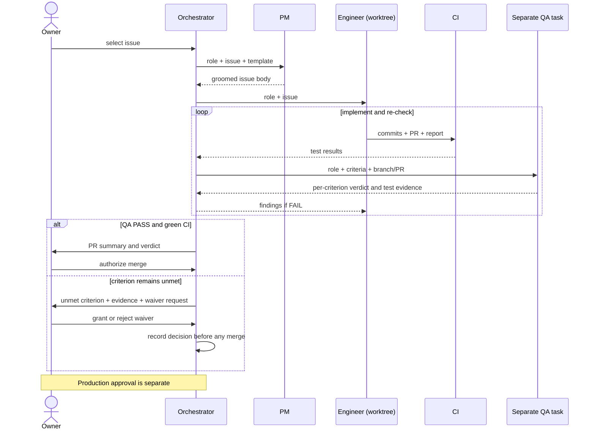
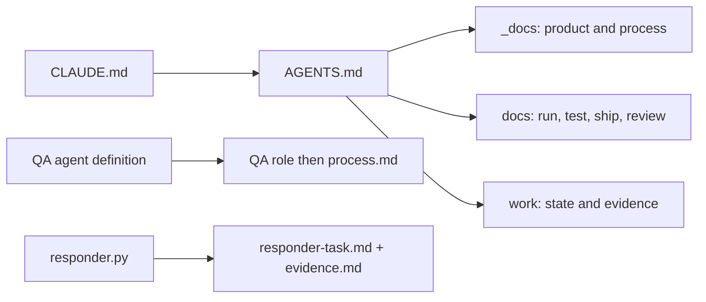
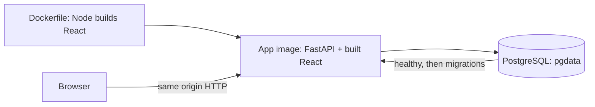
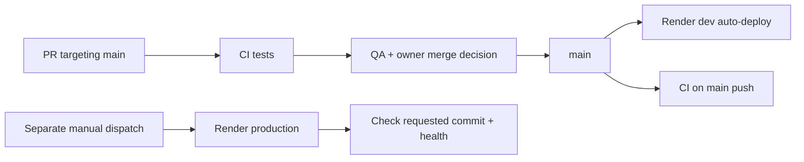
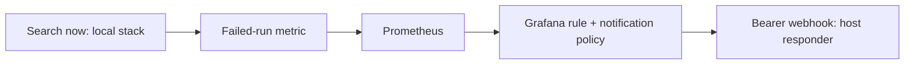
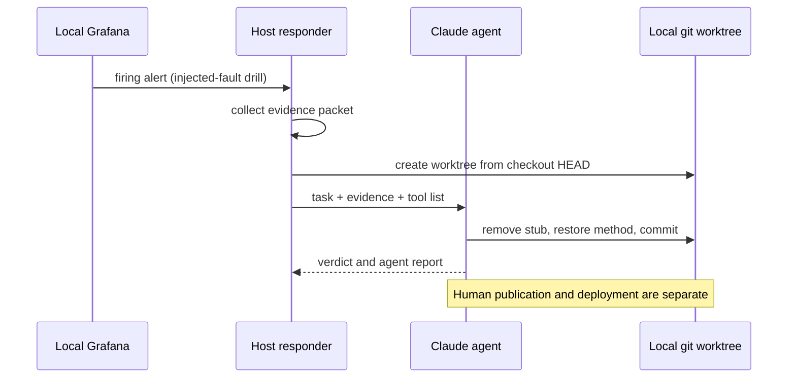

# Reviewer guide

Sail-event turns a free-text event search into scored events and a personal ICS feed. [Production](https://sail-event.onrender.com) · [Dev](https://sail-event-dev.onrender.com) · [Local setup](../README.md#try-it).

Each criterion below has the rubric's levels, a phrase-by-phrase checklist, evidence against the lower level, extras and a picture where useful. Each proof is a file, record or screenshot you can open in under a minute.

Rubric: [saved copy](../work/rubric-2026-10-16.md), compared with the [course source](https://github.com/DataTalksClub/ai-dev-tools-zoomcamp/tree/main/project) on 2026-10-26. Source links were checked at `542e58cb0fe73065a905febec7637bfa377a77c4` on 2026-10-26. Check the deployed commit with `curl -fsS https://sail-event.onrender.com/api/health`.

## Criteria map

| Criterion | Strength |
|---|---|
| [1. Problem description](#1-problem-description) | The README connects the problem, workflow and tested behavior. |
| [2. Product specification](#2-product-specification) | Public specifications lead to acceptance criteria and QA verdicts. |
| [3. Agent team specification](#3-agent-team-specification) | Separate roles pass criteria, commits and review evidence. |
| [4. Context management](#4-context-management) | AGENTS.md routes each role to modular instructions. |
| [5. Application](#5-application) | Browser journeys exercise the stack; data survives an app restart. |
| [6. Testing](#6-testing) | Unit, integration and browser suites pass; one command runs them. |
| [7. Containerization](#7-containerization) | One command starts the app and persistent PostgreSQL. |
| [8. Deployment](#8-deployment) | The public app reports health and its deployed commit. |
| [9. CI/CD](#9-cicd) | CI tests changes; dev auto-deploys; production promotion is manual. |
| [10. Observability](#10-observability) | Grafana displays metrics, logs and traces; logs link to traces by ID. |
| [11. Alerting on user impact](#11-alerting-on-user-impact) | Failed-search alerts have recorded firing drills. |
| [12. On-call agent](#12-on-call-agent) | Alert-triggered agents produce repair commits in recorded drills. |

## Check it in 5 minutes

Open the [app](https://sail-event.onrender.com). These read-only checks need curl, Git and an authenticated GitHub CLI:

```bash
# §8: availability and the deployed commit.
curl -fsS --max-time 20 https://sail-event.onrender.com/api/health
# §9: compare dev's reported commit with main's head; allow for a deploy in progress.
curl -fsS --max-time 20 https://sail-event-dev.onrender.com/api/health
git ls-remote https://github.com/alexisdacquay/sail-event refs/heads/main
# §6: find the latest CI run, then inspect its jobs with gh run view <id> -R ...
gh run list -R alexisdacquay/sail-event --workflow=ci.yml -b main -L 3
# §2–3: engineer report, QA verdicts per criterion, re-check and merge.
gh pr view 151 -R alexisdacquay/sail-event --comments
```

Browser alternatives: [CI history](https://github.com/alexisdacquay/sail-event/actions/workflows/ci.yml) · [PR #151](https://github.com/alexisdacquay/sail-event/pull/151).

With a clone, `python3 -I incident-response/test_responder.py` checks the responder without launching an agent. For a longer local review, use `docker compose up --build` (Docker), then `make test-all` (Docker, uv, Node/npm and Python). These builds and test suites are outside the five-minute check.

## 1. Problem description

**Rubric levels**

> The problem is not described. (0 points)
>
> The problem is described briefly, but it is unclear what the system does or what functionality is expected. (1 point)
>
> The README clearly describes the problem, the system functionality, and expected behavior. (2 points)

**Checklist**

| Rubric phrase | Where to look | Proof checkable in under a minute |
|---|---|---|
| README | [README](../README.md) | The entry document contains the problem, workflow and expected behavior. |
| clearly | [Problem](../README.md#problem) | The gap is repeated discovery and checking: a web search returns pages, not checked events in a calendar. |
| describes the problem | [Problem](../README.md#problem) · [user](../_docs/ux-spec.md#1-who-the-user-is) | The user wants events without repeatedly scanning sites and copying details. |
| the system functionality | [What it does](../README.md#what-it-does) · [pipeline][pipeline] | Search → extract → event-page fetch → screen → store as new → score/triage → model duplicate check → feed. |
| expected behavior | [Expected behaviour](../README.md#expected-behaviour) · [triage implementation][triage] · [pipeline test][triage-test] · [rejection test][rejection] | Saved thresholds control triage; a rejected event stays rejected after a later search. |

**Why not the lower score**

The lower level is “The problem is described briefly, but it is unclear what the system does or what functionality is expected.” The README distinguishes discovery from calendar delivery, names the result states, and links expected behaviors to tests.

Thresholds are per user. Defaults accept at **90 or more**, reject at **40 or less**, and leave the middle for review ([registration defaults][auth], [triage][triage]). A later model duplicate check can reject a high-scoring event ([dedup stage][dedup]).

**Beyond the rubric**

The [expected-behavior table](../README.md#expected-behaviour) links the product description to executable checks for triage, user isolation, feed removal and token rotation.

**Picture**


Local recorded demo, captured 26 October 2026. The demo clock is fixed at 18 October so the 19–21 October fixtures remain usable.

## 2. Product specification

**Rubric levels**

> No written specs. (0 points)
>
> A spec exists, but no public task tracker. (1 point)
>
> A specification exists and there's a publicly accessible task tracker. The tasks define acceptance criteria and there's evidence that the agents used the tracker. (2 points)

**Checklist**

| Rubric phrase | Where to look | Proof checkable in under a minute |
|---|---|---|
| A specification exists | [PRD](../_docs/plan.md) · [search spec](../_docs/search-spec.md) · [API contract](../openapi.yaml) | Product behavior, quality targets and API operations are written down. |
| publicly accessible task tracker | [GitHub Issues](https://github.com/alexisdacquay/sail-event/issues?q=is%3Aissue) | Issues and comments are readable in the public repository. |
| The tasks define acceptance criteria | [task template](../_docs/task-template.md) · [issue #11](https://github.com/alexisdacquay/sail-event/issues/11) | Among issues #1–#152, 91 name acceptance criteria; 58 use all four template sections (2026-10-26; command in [Tracker evidence](#tracker-evidence)). |
| evidence that the agents used the tracker | [#11 edit history and comments](https://github.com/alexisdacquay/sail-event/issues/11) · [PR #149 QA](https://github.com/alexisdacquay/sail-event/pull/149) | Among issues #1–#152, 69 carry a QA verdict; QA sent work back on 23 issues (2026-10-26; [command](#tracker-evidence)). Issue #11 preserves its body rewrite, implementation report and per-criterion QA PASS. |

**Why not the lower score**

“A spec exists, but no public task tracker.” The issue body, implementation report and QA verdict are public, not just an internal task list. They show use of acceptance criteria.

[Issue #11](https://github.com/alexisdacquay/sail-event/issues/11), including **edited** and the QA comment, preserves the specification-to-review handoff: the four-section groom, implementation report and per-criterion PASS. The [PRD's dated changes](../_docs/plan.md#changed-after-the-mvp-dated) track later product decisions.

**Beyond the rubric**

- The spec preceded code. `git log --reverse --diff-filter=A --format='%h %ci %s' -- _docs/plan.md AGENTS.md backend/app/main.py` shows the PRD on 2026-10-15 (`fa345ba`), context and roles on 2026-10-16 (`98f3cf7`), then the first backend scaffold (`6ccfdec`).
- [Original tasks](../_docs/outdated/tasks.md) 1–28 became issues 1–28. Task 18 was narrowed to CI; CD was split into [#29](https://github.com/alexisdacquay/sail-event/issues/29).

## 3. Agent team specification

**Rubric levels**

> No agent team described. (0 points)
>
> Roles or agents are mentioned, but responsibilities are unclear. (1 point)
>
> The project defines the agent team and process of how they work together. (2 points)

**Checklist**

The first two rows check the preceding level: role names and clear responsibilities.

| Rubric phrase | Where to look | Proof checkable in under a minute |
|---|---|---|
| Roles or agents are mentioned | [Team](../_docs/process.md#team) | Human owner; AI orchestrator, PM, engineer and QA. |
| responsibilities | [role files](../_docs/team/) · [Roles](../_docs/process.md#roles) | PM specifies; engineer implements; QA verifies; orchestrator coordinates. The walkthrough below follows each role's input and output. |
| defines the agent team | [Team](../_docs/process.md#team) · [QA agent](../.claude/agents/qa-engineer.md) | The main Claude Code session coordinates separate subagent tasks. QA also has a runnable agent definition. |
| process | [Lifecycle](../_docs/process.md#lifecycle) · [Phase 2](../_docs/process.md#phase-2-from-issue-65-worktrees-and-prs) | Groom → implement → verify → fix/recheck → owner-authorized merge. |
| how they work together | [Handoffs](../_docs/process.md#handoffs) · [PR #149](https://github.com/alexisdacquay/sail-event/pull/149) | Issue body → implementation/PR → QA verdict → owner decision. PR #149 contains a QA PASS against the duplicate-check criteria. |

**Why not the lower score**

“Roles or agents are mentioned, but responsibilities are unclear.” The roles have distinct inputs and outputs, not just names. In the documented Phase 2 cycle:

1. The owner selects work; the orchestrator starts a PM task with [pm.md](../_docs/team/pm.md), the issue and [task template](../_docs/task-template.md). PM rewrites the body; it does not implement code. [Recorded launches](../_docs/process.md#how-the-orchestrator-starts-an-agent) use background `general-purpose` tasks for PM and engineer, with the role file and read list supplied in the brief.
2. The orchestrator starts an engineer task with [software-engineer.md](../_docs/team/software-engineer.md) and the groomed issue. In Phase 2 the engineer uses its own copy of the repository on a separate branch, implements within scope and opens a PR with its report. It may question criteria in a comment, not rewrite them or close the issue.
3. CI runs on the PR. The merge rule requires green CI and a QA verdict before the owner authorizes merge.
4. The orchestrator starts a separate QA task, using [qa-engineer.md](../.claude/agents/qa-engineer.md) or the QA role brief. The QA definition says “Start fresh”: read the criteria, inspect/run the code and do not trust the implementation report. QA posts a verdict, edits no files and leaves the issue open.
5. FAIL returns the QA comment to the engineer for a fix and re-check. If a criterion remains unmet, the orchestrator sends that criterion and its evidence to the owner, who grants or rejects a waiver; the decision is recorded before merge. QA records its verdict on the PR. A PASS goes to the owner with the PR summary.
6. The owner authorizes merge in chat; the orchestrator performs it. GitHub may close an issue through `Closes #N`. A merge deploys dev. Production needs separate owner approval for a named SHA; the owner can dispatch the promote workflow or instruct the orchestrator to dispatch that approved SHA. The workflow history records each production dispatch.

[Issue #7](https://github.com/alexisdacquay/sail-event/issues/7) shows the same handoffs in Phase 1, before PRs: criteria, implementation, a QA review that sent the work back, a re-check and the close.

**Beyond the rubric**

The root-cause/regression rule entered the role files on **2026-10-25** (`c0f83e6`, part of the test-runner PR), then process.md on **2026-10-26** (`ac54483`). Verify with `git show --format='%h %cs %s' c0f83e6 -- _docs/team/software-engineer.md` and `git show --format='%h %cs %s' ac54483 -- _docs/process.md`.

**Picture**



## 4. Context management

**Rubric levels**

> No project docs. (0 points)
>
> An AGENTS.md (or equivalent) exists and describes the project. (1 point)
>
> AGENTS.md exists and it also points to modular docs (process, teams, etc.). (2 points)

**Checklist**

“describes the project” checks the preceding level as well.

| Rubric phrase | Where to look | Proof checkable in under a minute |
|---|---|---|
| AGENTS.md exists | [AGENTS.md](../AGENTS.md) | Root entry document. |
| describes the project | [AGENTS.md](../AGENTS.md) opening | Event finding, score thresholds and per-user ICS feeds are named. |
| points to modular docs | [AGENTS.md: Documents](../AGENTS.md#documents) | Links group product, process, operations and history rather than embedding them all. |
| process | [process.md](../_docs/process.md) | Lifecycle and handoffs. |
| teams | [role files](../_docs/team/) | PM, engineer and QA responsibilities. |
| etc. | [testing](testing.md) · [deployment](deployment.md) · [observability](../observability/README.md) | Operational context is linked separately. |

**Why not the lower score**

“An AGENTS.md (or equivalent) exists and describes the project.” The entry file also routes readers to modular instructions. `_docs/` is product, design and team process; `docs/` is running, testing, shipping and review. `work/` is evidence and handover, and `_docs/outdated/` is history.

**Beyond the rubric**

[CLAUDE.md](../CLAUDE.md) contains `@AGENTS.md`. The [launch/context record](../_docs/process.md#how-the-orchestrator-starts-an-agent) describes the rest of the context handoff:

1. The orchestrator briefs the task with its role, issue, read list, scope, branch/worktree and required reply. The PM gets the template/product context; the engineer gets architecture/API/code context. The runnable QA definition explicitly reads its role file, then process.md.
2. Replies return artifact links, checked heads, commands/results and unmet criteria. QA independently checks the submitted commit against the criteria.
3. Before context compression, the orchestrator records active issues, heads, worktrees, verdicts, pending decisions and the next action in [STATE](../work/STATE.md). A resumed session reads the top block and its evidence rather than restarting the backlog.
4. The on-call path is separate: [responder.py][responder] builds a prompt from the task template and fenced evidence packet, then starts the agent in its worktree.

**Picture**

Context entry points:



## 5. Application

**Rubric levels**

> No working application, or frontend, backend, or persistent storage is missing. (0 points)
>
> Frontend, backend, and database exist but are not fully connected. (1 point)
>
> Full-stack application works end to end: frontend talks to backend, data persists in a database. Application runs locally with a single command. (2 points)

**Checklist**

| Rubric phrase | Where to look | Proof checkable in under a minute |
|---|---|---|
| works end to end | [browser journey][journey] · [HTTP journey][integration] | Registration, criteria, thresholds, search, decisions and re-fetch are exercised against the app. CI evidence is in §6. |
| frontend talks to backend | [image build][dockerfile] · [client selection][client] | `VITE_API_URL=""` selects the HTTP client at the same origin, not the mock client. |
| data persists in a database | [restart test][restart] · [Compose][compose] | App restarts; the nonzero event count remains. The browser journey separately reloads a saved threshold. |
| runs locally | [Compose][compose] | App and PostgreSQL run on the local host through containers. |
| with a single command | [README setup](../README.md#try-it) · [Dockerfile][dockerfile] | `docker compose up --build` starts the database and app; startup migrates and seeds the demo. |

**Why not the lower score**

“Frontend, backend, and database exist but are not fully connected.” The browser and HTTP tests cross those boundaries; the restart test checks storage beyond the app process. Their assertions and the §6 CI log provide the proof.

**Beyond the rubric**

[The schema-contract test][contract] compares API paths, methods and operation IDs with [openapi.yaml](../openapi.yaml). [Journey 2][journeys] checks that another user cannot see the first user's events.

## 6. Testing

**Rubric levels**

> No tests, or the tests do not run. (0 points)
>
> Only unit tests or only integration tests exist. (1 point)
>
> Both unit and integration tests exist, run with a single command, and pass. (2 points)

**Checklist**

| Rubric phrase | Where to look | Proof checkable in under a minute |
|---|---|---|
| Both unit and integration tests exist | [backend tests](../backend/tests/) · [frontend tests](../frontend/src/) · [HTTP integration tests][integration] | Unit: pytest and Vitest suites. Integration: HTTP against the container and PostgreSQL, including restart. Results are below. |
| run with a single command | [Makefile][makefile] | `make test-all` invokes `test`, `test-integration` and `test-e2e`. |
| pass | [Local combined run](#combined-test-run) · [CI run 40251535674](https://github.com/alexisdacquay/sail-event/actions/runs/40251535674) | `make test-all` exited 0 locally on 2026-10-26 with the application code of `542e58c`; the command and summary are below. |

**Why not the lower score**

“Only unit tests or only integration tests exist.” Both layers run: [CI configuration][ci] uses `uv run pytest` in `backend`, `npm test` in `frontend`, then `make test-integration` and `make test-e2e` inside the job named `integration`. The combined local command runs these suites plus the responder tests.

At **542e58c**, [CI run 40251535674](https://github.com/alexisdacquay/sail-event/actions/runs/40251535674) reports **507 backend passed, 4 skipped, 7 deselected; 117 frontend; 7 integration; 12 Playwright**. Reproduce:

```bash
gh run view 40251535674 -R alexisdacquay/sail-event --log | grep -E 'passed|test_data_survives_restart'
```

<a id="combined-test-run"></a>

**Local combined run**

On 2026-10-26, with the application code of `542e58c`, this command exited **0**:

```bash
make test-all
```

```text
Backend:     507 passed, 4 skipped, 7 deselected
Frontend:    117 passed
Responder:   Ran 20 tests; OK
Integration: 7 passed, including test_data_survives_restart
Playwright:  12 passed
```

Test setup and suite details: [docs/testing.md](testing.md).

**Beyond the rubric**

The responder's **20** stdlib tests passed locally on 2026-10-26: `python3 -I incident-response/test_responder.py`. They do not launch an agent. The [schema-contract test][contract] checks API drift, and the [browser journeys][journeys] exercise user isolation.

## 7. Containerization

**Rubric levels**

> No containerization. (0 points)
>
> Dockerfiles exist, but running the full system requires manual steps. (1 point)
>
> The full system, including the database, runs via Docker or Docker Compose and starts with a single command. (2 points)

**Checklist**

| Rubric phrase | Where to look | Proof checkable in under a minute |
|---|---|---|
| The full system | [Dockerfile][dockerfile] · [SPA mount][spa] | One image builds React and serves it with FastAPI; Compose adds storage. |
| including the database | [Compose][compose] | `postgres:18-alpine`, healthcheck and named `pgdata` volume; the app connects to that service. |
| runs via Docker or Docker Compose | [Compose][compose] | `docker compose config --services` prints `postgres` and `app`. |
| starts with a single command | [Dockerfile][dockerfile] · [Compose][compose] | `docker compose up --build`; health dependency, migrations and demo seed run automatically. |

**Why not the lower score**

“Dockerfiles exist, but running the full system requires manual steps.” The default application path needs no separate database creation, migration, seed or provider-key setup. CI starts the same Compose stack before integration and browser tests ([CI][ci]).

**Beyond the rubric**

`make up-all` adds the [observability containers](../observability/docker-compose.yml) and enables OTLP in the app through [the override](../docker-compose.observability.yml). The responder itself is a host process, not one of those containers.

**Picture**



## 8. Deployment

**Rubric levels**

> Application is not deployed. (0 points)
>
> Deployment steps are described, but no working deployment is shown. (1 point)
>
> The application is deployed and reachable at a public URL, or there's a clear demo with the deployment. (2 points)

**Checklist**

| Rubric phrase | Where to look | Proof checkable in under a minute |
|---|---|---|
| deployed | [Render deployment instructions](deployment.md) · [public app](https://sail-event.onrender.com) | HTTP GET reaches the hosted application; `/api/health` returns status and the deployed commit. |
| reachable at a public URL | <https://sail-event.onrender.com/api/health> | `curl -fsS --max-time 20 https://sail-event.onrender.com/api/health` prints the deployment's own response. The hosted UI and API are publicly reachable. |

**Why not the lower score**

“Deployment steps are described, but no working deployment is shown.” The health endpoint and served UI can be inspected now, independently of the written instructions.

**Beyond the rubric**

- [Services](deployment.md#services) documents separate dev and production services/databases. [Promotion][promote] checks health and the requested commit after deployment.
- Registration requirements are discoverable with `curl -fsS --max-time 20 https://sail-event.onrender.com/api/config`; the 2026-10-26 GET returned `registrationCodeRequired: false`.

## 9. CI/CD

**Rubric levels**

> No CI/CD pipeline. (0 points)
>
> CI runs the tests automatically on every pull request. (1 point)
>
> CI runs tests and CD automatically deploys. (2 points)
>
> CI runs tests, CD deploys to dev, and there's a manual deploy to production. (3 points)

**Checklist**

| Rubric phrase | Where to look | Proof checkable in under a minute |
|---|---|---|
| CI runs tests | [CI][ci] · [run evidence](#6-testing) | PRs targeting main and pushes to main trigger unit, integration and browser checks. |
| CD deploys to dev | [deployment instructions](deployment.md) · [live dev health](https://sail-event-dev.onrender.com/api/health) | The [2026-10-17 deployment log](../work/DEPLOY-render.md#devprod-split-issue-21-started-2026-10-17) shows dev auto-deploying `10d4701`. For current version alignment, compare dev health with `git ls-remote https://github.com/alexisdacquay/sail-event refs/heads/main`. |
| manual deploy to production | [promote.yml][promote] · [run history](https://github.com/alexisdacquay/sail-event/actions/workflows/promote.yml) | Only `workflow_dispatch` triggers this workflow. An optional full SHA overrides the dispatched ref's commit. |

**Why not the lower score**

“CI runs tests and CD automatically deploys.” The extra distinction is the separate manual production workflow. Dev and production use different deployment paths. The dated deployment record shows the dev/prod split in use; the manual workflow and run history show production dispatches.

The [promotion workflow][promote] selects the input SHA or dispatched commit, validates its format, calls the Render deploy hook, then polls production for that healthy commit. The owner first checks dev and approves a named commit ([release process](release-process.md)).

**Beyond the rubric**

The workflow verifies the running commit after deployment, beyond checking health alone. Inspect deployment state without dispatching anything:

```bash
curl -fsS --max-time 20 https://sail-event-dev.onrender.com/api/health
git ls-remote https://github.com/alexisdacquay/sail-event refs/heads/main
curl -fsS --max-time 20 https://sail-event.onrender.com/api/health
gh run list -R alexisdacquay/sail-event --workflow=promote.yml -L 3
```

**Picture**



A push to main triggers CI and Render's dev deployment.

## 10. Observability

The local stack started with `make up-all` collects the search journey's metrics, logs and traces for inspection in Grafana. [Telemetry initialization][telemetry] uses the OTLP endpoint supplied by the local [override](../docker-compose.observability.yml).

**Rubric levels**

> No telemetry. (0 points)
>
> The app emits logs, but there are no metrics or traces, or the signals cannot be correlated to a single request. (1 point)
>
> A key user journey is instrumented with metrics, traces, and structured logs that share a trace ID; no customer data or credentials are sent to telemetry; and the signals are collected, stored, and viewable in a UI. (2 points)

**Checklist**

| Rubric phrase | Where to look | Proof checkable in under a minute |
|---|---|---|
| A key user journey | [search pipeline][pipeline] | `POST /api/search` encloses a `search_run` span with a run ID and stage spans. |
| metrics | [metric definitions][metrics] | Run count, duration, event counts and provider/model activity are instrumented. |
| traces | [pipeline][pipeline] · picture below | Search, extraction, event-page hop, filter, judge, triage, dedup and persist appear as spans. |
| structured logs | [JSON formatter][logging] | Timestamp, level, logger, message, trace ID and span ID form each application JSON record. |
| share a trace ID | picture below · [telemetry][telemetry] | The search completion log in Loki and its trace in Tempo display the same trace ID. |
| collected | [collector](../observability/collector.yaml) | OTLP receivers feed signal pipelines; filelog also reads container logs. |
| stored | [observability Compose](../observability/docker-compose.yml) | Prometheus, Loki and Tempo store metrics, logs and traces. |
| viewable in a UI | [dashboard](../observability/dashboard.json) · [Grafana provisioning](../observability/grafana/provisioning/) | The dashboard shows metrics/logs; use **Explore → Tempo** for traces, as demonstrated below. |

**Why not the lower score**

“The app emits logs, but there are no metrics or traces, or the signals cannot be correlated to a single request.” The pipeline emits metrics and traces as well as logs. The screenshots below follow one search from its completion log in Loki to the matching trace in Tempo.

**Inspect the signal path**

To inspect the local path, run `RESPONDER_WEBHOOK_SECRET=local-drill-secret make up-all`, exercise the recorded demo through `http://localhost:8000`, then open Grafana at `http://localhost:3001`. The app exports OTLP to the collector; Prometheus scrapes collector metrics; Loki and Tempo receive logs/traces. In Explore, use `{service_name="sail-event-backend"} |= "search run completed"` for logs, and find the same trace ID in Tempo. Allow for export delay. Starting the responder is a separate step (§12).

**Beyond the rubric**

The [dashboard](../observability/dashboard.json) adds environment/version selectors and panels for stage counts and run-duration percentiles.

**Picture**

Local fixture run, 2026-10-25. The matching trace ID is `9da6b9bd797b3bdc96b17585867e9f6f`:

| Tempo trace | Loki log |
|---|---|
|  |  |

## 11. Alerting on user impact

**Rubric levels**

> No alerts. (0 points)
>
> At least one alert exists. (1 point)

**Checklist**

| Rubric phrase | Where to look | Proof checkable in under a minute |
|---|---|---|
| At least one alert exists | [rules.yaml][rules] · [2026-10-21 drill alert](../incident-response/incidents/20261021-074150-SearchRunFailures/alert.json) | `SearchRunFailures`: failed-run increase over ten minutes > 1, held five minutes, evaluated every 60 seconds. A firing alert element is recorded. |

**Why not the lower score**

“No alerts.” The rule is provisioned in code and a drill records its firing. It measures failed searches, a user journey outcome, rather than CPU utilization.

**Beyond the rubric**

The route is also configured: `severity=critical` → [notification policy](../observability/grafana/provisioning/alerting/policies.yaml) → [Bearer-authenticated webhook](../observability/grafana/provisioning/alerting/contactpoints.yaml) → responder. The rules also link the runbook.

A second rule, `SearchRunsSilent`, checks for inactivity in each search-run metric series over two hours, held ten minutes.

**Picture**



## 12. On-call agent

**Rubric levels**

> No on-call agent. (0 points)
>
> An agent wakes up on an alert and fixes the issue. (2 points)

**Checklist**

| Rubric phrase | Where to look | Proof checkable in under a minute |
|---|---|---|
| An agent | [responder launch][responder-launch] · [task](../incident-response/responder-task.md) | The HTTP responder starts headless Claude Code with model `sonnet`; the model process is the agent. |
| wakes up on an alert | [drill script][drill] · [stored alert](../incident-response/incidents/20261021-074150-SearchRunFailures/alert.json) | The drill injects a fault and waits for Grafana's firing rule to reach the responder. §11 links the rule, notification route and stored alert. |
| fixes the issue | [verdict](../incident-response/incidents/20261021-074150-SearchRunFailures/verdict.json) · [diff](../incident-response/incidents/20261021-074150-SearchRunFailures/fix.diff) · [commit 8d2f839](https://github.com/alexisdacquay/sail-event/commit/8d2f839) | The repair commit removes the injected exception stub and restores the search method. |

**Why not the lower score**

“No on-call agent.” The drill preserves the alert, collected evidence, agent report, verdict and fix commit. It demonstrates alert-triggered code repair of an injected fault.

The implemented sequence is explicit in [responder.py][responder]:

1. Run the webhook server on the host with `RESPONDER_WEBHOOK_SECRET=local-drill-secret make responder`; use the same secret for `make up-all`. Grafana's default URL is `host.docker.internal:8001/alerts`.
2. For an authenticated firing alert, create an incident folder and save the alert element.
3. Run `collect-evidence.sh` before the agent starts: Prometheus errors, Loki query, health and recent commits form `evidence.md`.
4. Create a separate repository worktree from the responder checkout's **HEAD**. Pass [responder-task.md](../incident-response/responder-task.md) and fenced evidence to Claude Code. The task asks it to make an incident branch, investigate, test, commit and write `verdict.json`.
5. Copy the report/verdict into the incident record and remove the worktree. The tool list omits `git push`; branch publication and deployment are separate human actions.

**Recorded drills**

- The **2026-10-17** drill injected a scorer fault (`7318f2f`) and recorded fix `dae24e9` ([folder](../incident-response/incidents/20261017-052050-SearchRunFailures/)). The 2026-10-21 drill injected search-provider fault `3d9f6b8` and recorded fix `8d2f839`.
- The latter alert starts at **07:41:20 UTC**, and its fix commit is **07:46:12 UTC**: **4 min 52 s** from alert to fix commit. Check `git show -s --format='%h %cI %s' 3d9f6b8 8d2f839` against the stored alert.

**Beyond the rubric**

Runtime controls are in [the tool list][responder-tools], [launch flags][responder-launch] and [authentication][responder-auth]: separate worktree, $1 budget, 300-second timeout, Bearer check. The [response schema](../incident-response/response.schema.json) also permits `false_positive` and `escalate`.

**Picture**



## Evidence commands

### Tracker evidence

Snapshot checked on 2026-10-26, limited to issues and PRs #1–#152: **58 groomed issues**, **91 issues naming acceptance criteria**, **69 issues with QA verdicts**, **23 issues where QA sent work back**, **30 PRs with QA verdicts**, and **45 orchestrator closing notes**. The review-and-recheck cycle shows QA making its own assessment before the next handoff.

Run from a clone with `gh` authenticated:

```bash
python3 - <<'PYCOUNTS'
import json, re, subprocess
repo = 'alexisdacquay/sail-event'
def get(kind):
    fields = 'number,body,comments'
    rows = json.loads(subprocess.check_output([
        'gh', kind, 'list', '-R', repo, '--state', 'all', '--limit', '400', '--json', fields]))
    return [x for x in rows if x['number'] <= 152]
issues, prs = get('issue'), get('pr')
def groom(x):
    return all(re.search(r'^#+ *'+h, x['body'], re.M)
               for h in ['Goal', 'Acceptance criteria', 'Out of scope', 'Constraints'])
def qa(x, pattern=r'PASS|FAIL'):
    return any(re.search(r'^#+ *QA:? *('+pattern+r')', c['body'], re.M) for c in x['comments'])
print('groomed issues:', sum(map(groom, issues)))
print('issues naming acceptance criteria:',
      sum('acceptance criteria' in x['body'].lower() for x in issues))
print('issues with QA verdicts:', sum(map(qa, issues)))
print('issues sent back by QA:', sum(qa(x, 'FAIL') for x in issues))
print('PRs with QA verdicts:', sum(map(qa, prs)))
print('orchestrator closing notes:', sum(any('closed by the orchestrator' in c['body'].lower()
      for c in x['comments']) for x in issues))
PYCOUNTS
```

For individual handoffs, open [issue #11](https://github.com/alexisdacquay/sail-event/issues/11) for the groomed specification, implementation report and QA verdict; [issue #7](https://github.com/alexisdacquay/sail-event/issues/7) for work sent back and re-checked; and [PR #151](https://github.com/alexisdacquay/sail-event/pull/151) for the engineer's report, QA's per-criterion reviews and final PASS.

[auth]: https://github.com/alexisdacquay/sail-event/blob/542e58cb0fe73065a905febec7637bfa377a77c4/backend/app/routers/auth.py#L100-L101
[rejection]: https://github.com/alexisdacquay/sail-event/blob/542e58cb0fe73065a905febec7637bfa377a77c4/backend/tests/test_events.py#L150
[pipeline]: https://github.com/alexisdacquay/sail-event/blob/542e58cb0fe73065a905febec7637bfa377a77c4/backend/app/services/pipeline.py
[triage]: https://github.com/alexisdacquay/sail-event/blob/542e58cb0fe73065a905febec7637bfa377a77c4/backend/app/services/pipeline.py#L737-L750
[dedup]: https://github.com/alexisdacquay/sail-event/blob/542e58cb0fe73065a905febec7637bfa377a77c4/backend/app/services/pipeline.py#L547-L556
[journey]: https://github.com/alexisdacquay/sail-event/blob/542e58cb0fe73065a905febec7637bfa377a77c4/e2e/journeys.spec.ts#L31-L115
[journeys]: https://github.com/alexisdacquay/sail-event/blob/542e58cb0fe73065a905febec7637bfa377a77c4/e2e/journeys.spec.ts
[integration]: https://github.com/alexisdacquay/sail-event/blob/542e58cb0fe73065a905febec7637bfa377a77c4/backend/tests/integration/test_integration.py#L37-L97
[restart]: https://github.com/alexisdacquay/sail-event/blob/542e58cb0fe73065a905febec7637bfa377a77c4/backend/tests/integration/test_integration.py#L254-L301
[dockerfile]: https://github.com/alexisdacquay/sail-event/blob/542e58cb0fe73065a905febec7637bfa377a77c4/Dockerfile
[compose]: https://github.com/alexisdacquay/sail-event/blob/542e58cb0fe73065a905febec7637bfa377a77c4/docker-compose.yml
[client]: https://github.com/alexisdacquay/sail-event/blob/542e58cb0fe73065a905febec7637bfa377a77c4/frontend/src/services/api.ts#L67-L71
[contract]: https://github.com/alexisdacquay/sail-event/blob/542e58cb0fe73065a905febec7637bfa377a77c4/backend/tests/test_schema_contract.py
[makefile]: https://github.com/alexisdacquay/sail-event/blob/542e58cb0fe73065a905febec7637bfa377a77c4/Makefile#L25-L32
[ci]: https://github.com/alexisdacquay/sail-event/blob/542e58cb0fe73065a905febec7637bfa377a77c4/.github/workflows/ci.yml
[spa]: https://github.com/alexisdacquay/sail-event/blob/542e58cb0fe73065a905febec7637bfa377a77c4/backend/app/main.py#L117-L126
[promote]: https://github.com/alexisdacquay/sail-event/blob/542e58cb0fe73065a905febec7637bfa377a77c4/.github/workflows/promote.yml
[telemetry]: https://github.com/alexisdacquay/sail-event/blob/542e58cb0fe73065a905febec7637bfa377a77c4/backend/app/telemetry.py
[metrics]: https://github.com/alexisdacquay/sail-event/blob/542e58cb0fe73065a905febec7637bfa377a77c4/backend/app/services/pipeline.py#L39-L77
[logging]: https://github.com/alexisdacquay/sail-event/blob/542e58cb0fe73065a905febec7637bfa377a77c4/backend/app/main.py#L26-L37
[rules]: https://github.com/alexisdacquay/sail-event/blob/542e58cb0fe73065a905febec7637bfa377a77c4/observability/grafana/provisioning/alerting/rules.yaml
[responder]: https://github.com/alexisdacquay/sail-event/blob/542e58cb0fe73065a905febec7637bfa377a77c4/incident-response/responder.py
[responder-tools]: https://github.com/alexisdacquay/sail-event/blob/542e58cb0fe73065a905febec7637bfa377a77c4/incident-response/responder.py#L27-L33
[responder-launch]: https://github.com/alexisdacquay/sail-event/blob/542e58cb0fe73065a905febec7637bfa377a77c4/incident-response/responder.py#L151-L166
[responder-auth]: https://github.com/alexisdacquay/sail-event/blob/542e58cb0fe73065a905febec7637bfa377a77c4/incident-response/responder.py#L188-L195
[drill]: https://github.com/alexisdacquay/sail-event/blob/542e58cb0fe73065a905febec7637bfa377a77c4/incident-response/test-incident.sh

[triage-test]: https://github.com/alexisdacquay/sail-event/blob/542e58cb0fe73065a905febec7637bfa377a77c4/backend/tests/test_pipeline.py#L306-L323
