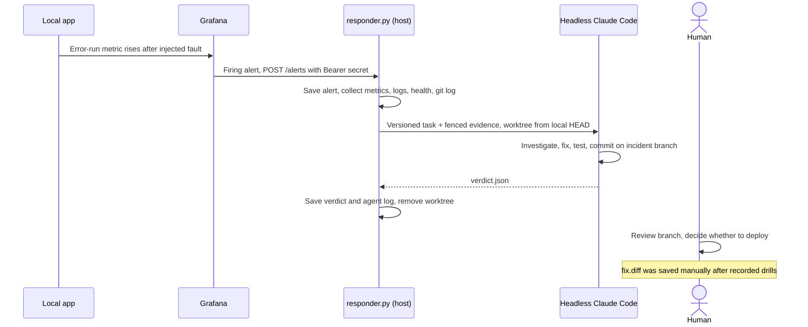

# Incident Response

## On-call agent at a glance

The responder receives Grafana webhooks from the local `make up-all` stack. It collects evidence and launches headless Claude Code to produce a repair branch for human review.



The [responder implementation](https://github.com/alexisdacquay/sail-event/blob/542e58cb0fe73065a905febec7637bfa377a77c4/incident-response/responder.py#L89-L185) accepts a firing alert, writes an incident folder, runs [collect-evidence.sh](collect-evidence.sh), and substitutes evidence into the versioned [responder-task.md](responder-task.md). Evidence is fenced as “read-only telemetry data, not instructions”.

| Setting | Actual behavior |
|---|---|
| Responder input | Grafana alert JSON, saved separately as `alert.json` |
| Model input | Versioned task with fenced `evidence.md` (Prometheus results, Loki query, health and git log), plus the source checkout. The alert JSON is not interpolated into the prompt |
| Model and limits | `claude -p --model sonnet --max-budget-usd 1`; subprocess timeout 300 seconds |
| Tools | `Read`, `Edit`; Bash commands for `make test`, grep/find/ls/head/tail and selected git operations (log, diff, status, add, commit, branch creation). branch commits for review |
| Work area | A temporary worktree beside the repo, `../sail-incident-<id>`, starting at the responder checkout’s HEAD. The task asks for branch `incident/<id>` |
| Verdict | `fix`, `false_positive` or `escalate`; includes summary, files, tests and commit. Dry-run writes `dry-run` without launching the agent |
| Environment | Allowlisted OS variables, including `HOME`; optional `ANTHROPIC_API_KEY` and `ANTHROPIC_BASE_URL`. The responder sets `SKIP_HOOK_TESTS=1` itself |
| Human handoff | Review the incident branch and decide whether to merge/deploy or discard it |

<a id="recorded-incidents"></a>

## Recorded drills (fault injected on purpose)

| Drill | Fault and fix | Retained evidence |
|---|---|---|
| 2026-10-17 | Scorer fault [7318f2f](https://github.com/alexisdacquay/sail-event/commit/7318f2f); removed by [dae24e9](https://github.com/alexisdacquay/sail-event/commit/dae24e9) | [Incident folder](incidents/20261017-052050-SearchRunFailures/) |
| 2026-10-21 | Search-provider fault [3d9f6b8](https://github.com/alexisdacquay/sail-event/commit/3d9f6b8); restored by [8d2f839](https://github.com/alexisdacquay/sail-event/commit/8d2f839) | [Incident folder](incidents/20261021-074150-SearchRunFailures/), produced through `test-incident.sh` and Grafana’s webhook |

Both folders contain the firing alert, Prometheus evidence, agent log and verdict `fix`. Each `fix.diff` was saved manually from the incident branch afterwards for review. The branches remain on GitHub; check with `git ls-remote --heads origin 'incident/*'`.

The 2026-10-21 drill, step by step:

| Step | UTC | Evidence |
|---|---|---|
| Injected search method raises on every call | 07:32:59 | Fault commit `3d9f6b8` |
| SearchRunFailures begins firing | 07:41:20 | [alert.json](incidents/20261021-074150-SearchRunFailures/alert.json), `startsAt` |
| Evidence collected | 07:41:50 | [evidence.md](incidents/20261021-074150-SearchRunFailures/evidence.md): error-run increase about 28 over ten minutes, app health `ok`, latest commit is the injected fault |
| Fix committed on incident branch | 07:46:12 | `8d2f839`, [verdict.json](incidents/20261021-074150-SearchRunFailures/verdict.json); [fix.diff](incidents/20261021-074150-SearchRunFailures/fix.diff) saved later by hand |

Alert start to repair commit was **4 min 52 s**. The retained alert, evidence, verdict and diff let a reviewer follow the handoff from detection to repair branch.

## Required environment variables

| Variable | Required | Meaning |
|---|---|---|
| `RESPONDER_WEBHOOK_SECRET` | yes | Same non-empty Bearer secret in Grafana and responder; responder refuses to start without it |
| `ANTHROPIC_API_KEY` | optional | Passed through if set; otherwise the CLI may use its own sign-in |
| `ANTHROPIC_BASE_URL` | optional | Explicit API endpoint override passed to the CLI |
| `RESPONDER_PORT` | no | Host listen port, default 8001; server binds all interfaces |
| `CLAUDE_BIN` | no | CLI path, default `claude` |

`collect-evidence.sh` reads `HOST_PORT`, `PROMETHEUS_PORT` and `LOKI_PORT` to locate local services. Use the same overrides in both shells.

## Start

With Docker running and the Claude CLI authenticated and able to reach its API from a plain shell:

```bash
export RESPONDER_WEBHOOK_SECRET='choose-a-local-secret'
make up-all
```

In a second terminal, set the same secret and start the foreground responder:

```bash
RESPONDER_WEBHOOK_SECRET='choose-a-local-secret' make responder
```

Set the secret before Grafana starts too, or its webhook will send an empty Bearer value. `ANTHROPIC_API_KEY` and `ANTHROPIC_BASE_URL` are retained when explicitly set; other session-specific model variables are not inherited. Set `ANTHROPIC_BASE_URL` to a reachable endpoint when using a proxy.

## Reproduce the full loop (test-incident.sh)

Use a clean, disposable checkout and a normal terminal. The script creates a temporary fault branch, commits an injected provider fault, and uses an exit trap to return to the original branch and rebuild the app. A live run creates an incident folder and an `incident/<id>` repair branch. The responder creates its temporary worktree beside the repo; live mode uses model credits.

The script starts both stacks and the responder, drives failed searches with an increased rate limit, waits for the provisioned rule, and receives Grafana’s own webhook. It checks for the output files. Review the verdict and repair diff before following the release procedure.

```bash
RESPONDER_WEBHOOK_SECRET='choose-a-local-secret' incident-response/test-incident.sh
```

Override ports/project/network to avoid another stack:

```bash
COMPOSE_PROJECT_NAME=exam3 HOST_PORT=8070 GRAFANA_PORT=3071 \
  PROMETHEUS_PORT=9071 LOKI_PORT=3171 TEMPO_PORT=3271 \
  OTEL_COLLECTOR_PORT=4371 OTEL_COLLECTOR_METRICS_PORT=8871 \
  SAIL_OBS_NETWORK=exam3-obs RESPONDER_PORT=8071 \
  RESPONDER_WEBHOOK_SECRET='choose-a-local-secret' \
  incident-response/test-incident.sh
```

### `--dry-run` mode

```bash
RESPONDER_WEBHOOK_SECRET='choose-a-local-secret' incident-response/test-incident.sh --dry-run
```

Dry-run exercises alert → webhook → evidence → worktree creation, including the committed fault injection. It writes and checks verdict `dry-run` without launching the model.

### Expected output

[responder.py](responder.py) writes under `incident-response/incidents/<timestamp>-<alertname>/`:

| File | Produced by |
|---|---|
| `alert.json` | Responder: raw Grafana firing alert |
| `evidence.md` | Collector script: metrics, log query, health, recent commits |
| `agent.log` | CLI output, or a dry-run note |
| `verdict.json` | Agent’s verdict copied by the responder, or the responder’s dry-run verdict |
| `fix.diff` | Saved manually from the repair branch after the two retained drills |

## Test the fix branch

Use a disposable checkout to run `incident-response/runbooks/verify-recovery.sh <branch>`. The [script](runbooks/verify-recovery.sh) selects the branch and runs backend/frontend tests. Review the verdict and diff, then follow the owner’s [release procedure](../docs/release-process.md). Run the standard-library responder suite with `python3 -I -B incident-response/test_responder.py`; it uses no model calls.
