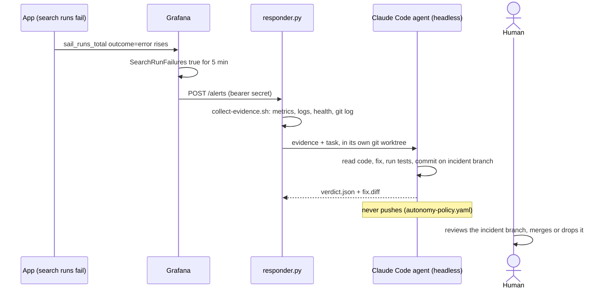

# Incident Response

Automated on-call responder: receives Grafana alert webhooks, collects
evidence, and launches a headless Claude Code agent to investigate.

## On-call agent at a glance



Run of 2026-10-21, step by step:

| Step | Time (UTC) | Evidence |
|---|---|---|
| Fault injected: `FixtureProvider.search` always raises | 07:32 | commit [3d9f6b8](https://github.com/alexisdacquay/sail-event/commit/3d9f6b8) |
| Alert rule | - | [rules.yaml#L9](../observability/grafana/provisioning/alerting/rules.yaml#L9) |
| Alert fires | 07:41:20 | [alert.json](incidents/20261021-074150-SearchRunFailures/alert.json) (`status: firing`, `startsAt`) |
| Webhook received | 07:41:50 | route `POST /alerts` in [responder.py](responder.py); folder name = arrival time |
| What the agent saw | 07:41:50 | [evidence.md](incidents/20261021-074150-SearchRunFailures/evidence.md): 28 error runs in 10 min; app health `ok`; newest commit `3d9f6b8 test: inject search-provider fault`; the Loki section came back empty |
| Verdict + fix | 07:46 | [verdict.json](incidents/20261021-074150-SearchRunFailures/verdict.json) (`fix`) · [fix.diff](incidents/20261021-074150-SearchRunFailures/fix.diff) |
| Fix commit | 07:46:12 | [8d2f839](https://github.com/alexisdacquay/sail-event/commit/8d2f839) on branch `incident/20261021-074150-SearchRunFailures` |

The agent never pushes ([autonomy-policy.yaml](autonomy-policy.yaml)).
A human reviews the incident branch and merges it, or drops it.
Recovery check for a branch: `incident-response/runbooks/verify-recovery.sh <branch>` (runs `git checkout`, so use a throwaway worktree).

Known gap: the Loki query in [collect-evidence.sh](collect-evidence.sh) filters on a `container` label that OTLP logs do not carry, so that section is empty.

## Required environment variables

| Variable | Required | Description |
|---|---|---|
| `RESPONDER_WEBHOOK_SECRET` | **yes** | Bearer token shared with Grafana; the server refuses to start without it |
| `ANTHROPIC_API_KEY` | for real runs | Passed to the agent subprocess |
| `RESPONDER_PORT` | no | Listen port (default `8001`) |
| `CLAUDE_BIN` | no | Path to the Claude CLI binary (default `claude`) |
| `SKIP_HOOK_TESTS` | no | Set to `1` in the agent env so commits in incident worktrees skip the pre-commit test gate |

## Start

```sh
export RESPONDER_WEBHOOK_SECRET=<value>
make responder
```

## Recorded incidents

**2026-10-17 (`20261017-052050-SearchRunFailures`)** -- the complete run.
Alert fired from Grafana after an injected fault in the scorer:
`FakeScorer.score` in `backend/app/adapters/fake.py`, injected by commit `7318f2f`.
The agent read the evidence, found the `raise RuntimeError`, fixed it on
branch `incident/20261017-052050-SearchRunFailures`, and committed
`dae24e9`.  All five files are present: `alert.json`, `evidence.md`,
`agent.log`, `verdict.json`, `fix.diff`.

**2026-10-21 (`20261021-074150-SearchRunFailures`)** -- the same loop on
the current code, produced by `test-incident.sh` from the owner's terminal:
Grafana's own webhook payload in `alert.json` (status `firing`, rule labels),
Prometheus/Loki evidence, the agent's own log, verdict `fix`, commit
`8d2f839` on branch `incident/20261021-074150-SearchRunFailures`, `fix.diff`.
Note for operators: the agent needs the API reachable from a plain shell;
on this machine that means the corporate VPN on (the CLI is configured to
use a corporate proxy) or `ANTHROPIC_BASE_URL=https://api.anthropic.com`
with the VPN off.

## Reproduce the full loop (test-incident.sh)

Prerequisites:

- `claude` CLI installed and signed in (`claude --version` to verify)
- Run from a normal terminal, not from inside a Claude Code session
  (the session exports `ANTHROPIC_*` and `CLAUDE_*` vars that the
  allowlist strips; the CLI must use its own OAuth store)
- No VPN that blocks `api.anthropic.com`
- If your `~/.claude/settings.json` routes the CLI through a corporate proxy
  that does not resolve on your current network (the agent log then ends
  with `ENOTFOUND`), prefix the command with
  `ANTHROPIC_BASE_URL=https://api.anthropic.com`; the responder passes that
  variable through when you set it explicitly
- Docker running

The script starts the full stack (observability + app) and the responder
itself, injects a fault into the search provider (`fixture.py`), drives
failing searches, and waits for Grafana's SearchRunFailures alert to fire.
Grafana's own webhook delivers the alert to the responder.  One terminal
is enough:

```sh
RESPONDER_WEBHOOK_SECRET=any-string incident-response/test-incident.sh
```

All ports come from env with safe defaults.  Override to avoid clashes:

```sh
COMPOSE_PROJECT_NAME=exam3 HOST_PORT=8070 GRAFANA_PORT=3071 \
  PROMETHEUS_PORT=9071 LOKI_PORT=3171 TEMPO_PORT=3271 \
  OTEL_COLLECTOR_PORT=4371 OTEL_COLLECTOR_METRICS_PORT=8871 \
  SAIL_OBS_NETWORK=exam3-obs RESPONDER_PORT=8071 \
  RESPONDER_WEBHOOK_SECRET=any-string \
  incident-response/test-incident.sh
```

### `--dry-run` mode

Add `--dry-run` to prove the alert-to-evidence chain without the
Anthropic API:

```sh
RESPONDER_WEBHOOK_SECRET=any-string incident-response/test-incident.sh --dry-run
```

Dry-run proves: alert &rarr; webhook &rarr; evidence collection &rarr;
worktree creation, and nothing more.  The verdict is `"dry-run"`, the
agent is never launched, and no fix is attempted.

### Expected output

Incidents are written to `incident-response/incidents/<timestamp>-<alertname>/`.
Each folder contains:

| File | Contents |
|------|----------|
| `alert.json` | Raw Grafana alert payload |
| `evidence.md` | Prometheus metrics, Loki error logs, app health, recent commits |
| `agent.log` | Claude CLI output (or `"dry-run: agent not launched"` in dry-run) |
| `verdict.json` | `{"verdict": "fix"|"dry-run"|...}` with summary, files, commit |
