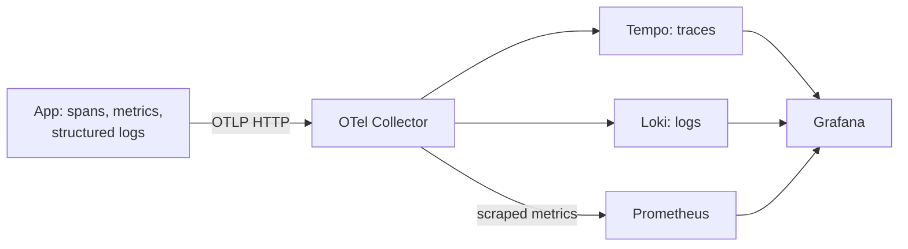

# Observability

**Local stack only (`make up-all`). The deployed app sends no telemetry to this stack; prod has no project alert or on-call responder.** The GitHub scheduled job checks health and enqueueing, not search completion. During the 2026-10-25 DeepSeek balance outage, searches failed on dev and prod without a project alert ([incident record](../work/HANDOVER-2026-10-25.md)).

## Search journey and signals

A manual search enters `POST /api/search`, then the `search_run` span. Its children cover criteria parsing, date-window resolution, search/query, extraction/page, event-page fetching (`detail_hop`), filtering, judge/event, triage, duplicate checking and persistence. Scheduled searches enter through background tasks. The [pipeline](https://github.com/alexisdacquay/sail-event/blob/542e58cb0fe73065a905febec7637bfa377a77c4/backend/app/services/pipeline.py#L101-L131) attaches `run_id`, a user UUID and trigger to the run span.



Custom instruments ([pipeline definitions](https://github.com/alexisdacquay/sail-event/blob/542e58cb0fe73065a905febec7637bfa377a77c4/backend/app/services/pipeline.py#L39-L77), [guardrail factory](https://github.com/alexisdacquay/sail-event/blob/542e58cb0fe73065a905febec7637bfa377a77c4/backend/app/adapters/factory.py#L154-L169)):

| Metric | Measures | Instrument labels |
|---|---|---|
| `sail_runs_total` | Completed pipeline calls, `ok` or `error` | `trigger`, `outcome` |
| `sail_events_found_total` | Events found across runs | none |
| `sail_events_new_total` | New events across runs | none |
| `sail_run_duration_seconds` | Run-duration histogram | none |
| `sail_stage_items_total` | Filtered or kept events | `stage`, `outcome` |
| `sail_llm_calls_total` | Model calls counted by the pipeline | `prompt`, `provider` |
| `sail_llm_tokens_total` | Input/output token totals | `direction` |
| `sail_search_calls_total` | Search-provider calls | `provider`, `outcome` |
| `sail_budget_stops_total` | Budget stops | `which` |
| `sail_guard_runs_total` | Guardrail outcomes | `guard`, `target`, `outcome` |

The collector also adds resource labels such as service, environment and version. HTTP instrumentation supplies request metrics. Metrics carry no trace ID; logs and traces can be correlated, but the rubric’s requirement that metrics, traces and logs “share a trace ID” remains a gap.

## Start and inspect

Export the same webhook secret before starting Grafana and the responder. Starting the stack does not start the responder process:

```bash
export RESPONDER_WEBHOOK_SECRET='choose-a-local-secret'
make up-all
```

`make observability-up` starts only collector, Prometheus, Loki, Tempo and Grafana. `make up-all` also starts app + Postgres with the telemetry overlay. `make observability-down` removes the observability containers and volumes; it does not stop the app stack. These are development services: Grafana has anonymous Admin access, and compose publishes its ports on the host.

Open `http://localhost:3001/d/sail-event-overview`, **Sail-event — Search Run Journey**. Its panels show runs by trigger/outcome, found/new events, duration p50/p95, HTTP request/5xx rates, logs and traces. The **Search run traces** panel has a recorded rendering error ([dashboard capture](../docs/images/review-40-grafana-dashboard.png)); use **Explore → Tempo** instead. Search for `{ name = "search_run" }`, select a trace, and inspect its `run_id` and child spans.

Host ports can be overridden: `GRAFANA_PORT` (3001), `PROMETHEUS_PORT` (9090), `LOKI_PORT` (3100), `TEMPO_PORT` (3200), `OTEL_COLLECTOR_PORT` (4318), `OTEL_COLLECTOR_METRICS_PORT` (8889). App port: `HOST_PORT` (8000).

## Alerting

[rules.yaml](grafana/provisioning/alerting/rules.yaml) evaluates each returned time series every 60 seconds; these expressions do not aggregate across users, triggers or instances.

| Rule | Condition | Pending period | No data | Interpretation |
|---|---|---|---|---|
| **SearchRunFailures** | `increase(sail_runs_total{outcome="error"}[10m]) > 1` | 5 min | `NoData` | Sustained failed search runs, so users receive no new results |
| **SearchRunsSilent** | `increase(sail_runs_total[2h]) < 1` | 10 min | `OK` | A silence demonstration. The local stack has no scheduler, so an idle existing series can trigger it; it does not monitor GitHub’s prod cron |

Both are `severity=critical` and route through [policies.yaml](grafana/provisioning/alerting/policies.yaml) to **responder-webhook** after a 30-second group wait, repeating after one hour. An idle series can therefore wake a running paid responder. The silence rule is useful as a scheduler check only if scheduled runs feed that same Prometheus; they do not here.

**No-data gap:** on 2026-10-26, a GET of the existing local stack returned an active `DatasourceNoData` alert for SearchRunFailures with `severity=critical` and receiver `responder-webhook`. That stack had older provisioning; this was not a fresh-checkout reproduction. The checked-in rule still uses `noDataState: NoData`. The responder accepts firing alerts with any valid alert name, so missing metrics can invoke it; this is not proof of failed user searches.

```bash
curl -s http://localhost:3001/api/alertmanager/grafana/api/v2/alerts | python3 -m json.tool
```

The checked-in rules include summary, description, dashboard URL and runbook URL. A [recorded drill firing](../incident-response/incidents/20261021-074150-SearchRunFailures/alert.json) followed a deliberately injected search-provider fault. [The responder runbook](../incident-response/README.md) explains the model, evidence, controls and what the drill did not prove.

The webhook defaults to `http://host.docker.internal:8001/alerts` (`RESPONDER_WEBHOOK_URL`) and uses the shared Bearer secret. Grafana’s compose service adds `host.docker.internal:host-gateway` for native Linux.

### Fire the alert locally (copy-paste block)

This drill changes the local app’s configuration to an invalid provider. It raises the manual-search limit to 1000/hour; it does not disable rate limiting. It need not launch the model agent. If a responder is already listening, firing alerts can launch it.

After exporting the secret and starting the stack above:

```bash
SEARCH_PROVIDER=unknown SEARCH_NOW_PER_HOUR=1000 \
  docker compose -f docker-compose.yml -f docker-compose.observability.yml up --build -d --wait
SAIL_OBS_BASE="http://localhost:${HOST_PORT:-8000}"
SAIL_OBS_TOKEN=$(curl -fsS -X POST "$SAIL_OBS_BASE/api/auth/login" \
  -H 'Content-Type: application/json' -d '{"username":"demo","password":"demo"}' \
  | python3 -c 'import sys,json; print(json.load(sys.stdin)["token"])')
# Maintain failing searches through the five-minute pending period.
# Inspect Alerting in Grafana in parallel; Ctrl-C stops this loop.
while true; do
  curl -s -X POST "$SAIL_OBS_BASE/api/search" -H "Authorization: Bearer $SAIL_OBS_TOKEN"
  sleep 30
done
```

Restore the provider and normal rate limit afterwards, including before the correlation check:

```bash
SEARCH_PROVIDER=fixture SEARCH_NOW_PER_HOUR=6 \
  docker compose -f docker-compose.yml -f docker-compose.observability.yml up -d --wait
```

## Trace-id correlation proof

With the local app restored to fixtures and the fixed clock, use the seeded demo account and its recorded criteria. A new fixture search is a local write; no provider key is needed.

```bash
SAIL_OBS_BASE="http://localhost:${HOST_PORT:-8000}"
SAIL_OBS_TOKEN=$(curl -fsS -X POST "$SAIL_OBS_BASE/api/auth/login" \
  -H 'Content-Type: application/json' -d '{"username":"demo","password":"demo"}' \
  | python3 -c 'import sys,json; print(json.load(sys.stdin)["token"])')
curl -fsS -X POST "$SAIL_OBS_BASE/api/search" -H "Authorization: Bearer $SAIL_OBS_TOKEN"
curl -sG "http://localhost:${LOKI_PORT:-3100}/loki/api/v1/query_range" \
  --data-urlencode 'query={service_name="sail-event-backend"} |= "search run completed"' \
  --data-urlencode 'limit=1' | python3 -m json.tool
```

Allow time for the batch exporters. In Grafana **Explore → Loki**, use that same query and expand the log’s fields. OTLP trace context is structured metadata, not a stream label; the context may appear as `trace_id` or `otelTraceID`. Copy the non-zero trace ID into **Explore → Tempo → Trace ID**, then inspect `search_run` and its children. Metrics are aggregate series and cannot follow this trace-ID lookup. The [Loki](../docs/images/review-42-loki-log-line.png) and [Tempo](../docs/images/review-41-tempo-trace.png) captures record this correlation; this documentation pass did not create another search.

<a id="what-telemetry-contains-and-never-contains"></a>

## Telemetry contents and privacy gaps

[telemetry.py](../backend/app/telemetry.py) is a no-op without `OTEL_EXPORTER_OTLP_ENDPOINT`. The local [overlay](../docker-compose.observability.yml) sets it. App logs are JSON with message, level, logger, timestamp, `trace_id` and `span_id`; the local stack also exports logs through OTLP.

| Signal | Data sent |
|---|---|
| App spans | Run ID, user UUID, trigger, provider, counts, event score, page kind, source host |
| HTTP spans | Method, route, raw path, status, client IP/port and User-Agent from FastAPI/ASGI auto-instrumentation |
| Logs | Messages, trace context, exception class, sometimes public page URLs and provider exception text |
| Metrics | Counts and durations with the labels listed above |

Application instrumentation does not deliberately attach criteria, passwords, JWTs, prompts or model answers. This is not a guarantee that telemetry contains no customer data or credentials:

- Calendar HTTP paths include the secret feed token. HTTP instrumentation also records client IP/port and User-Agent; a user UUID is a customer identifier. Route/path sanitization and removal of client attributes are not implemented.
- Some warnings and `span.record_exception` export exception text, which may contain provider content. Raw public page URLs can carry query strings.
- The collector’s `filelog` receiver reads every Docker container log available under its host mount, not only this app’s.
- Metrics have no trace ID; the dashboard trace panel errors. These remain gaps against the full observability rubric.

Inspect application attributes and logging calls:

```bash
git grep -nE 'set_attribute|start_as_current_span' -- backend/app
git grep -nE 'logger\.(debug|info|warning|error|exception)' -- backend/app
```

## `otel-collector` hostname collision

Use a separate `SAIL_OBS_NETWORK` for each stack to avoid resolving another project’s `otel-collector`: `SAIL_OBS_NETWORK=my-project-obs make up-all` creates and uses that network.

### Linux caveat

The Grafana-to-host webhook mapping is described under [Alerting](#alerting). The collector’s host Docker-log mount may be empty on Docker VMs such as OrbStack; the app’s OTLP log exporter supplies the alternative path ([telemetry.py](../backend/app/telemetry.py)).
